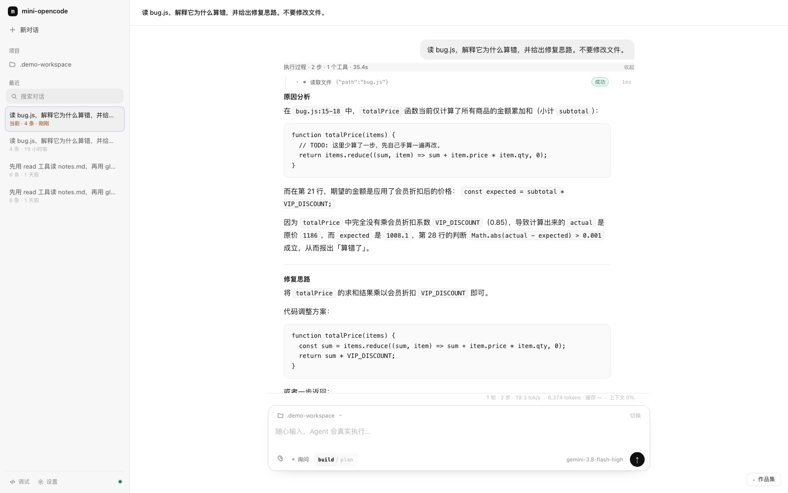
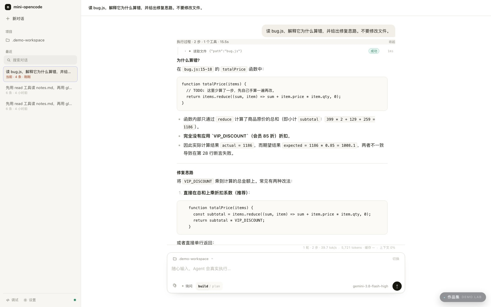

# mini-opencode

> **手搓一个 opencode，顺便把 Agent 的原理揉碎讲清楚。**
>
> 用 Node 24 原生 TypeScript 从零实现一个 AI 编码 Agent：
> 模型调用、流式输出、工具调用、Agent 循环、文件工具、bash、权限系统、
> 上下文压缩、会话持久化、终端 UI、子 Agent——全部自己写，**运行时零依赖**。

---

## Demo 合集里的真实运行版（/demos/agent-lab/）

> 本目录是本地 mini-opencode 教学项目 v0.2.0 的迁移副本：完整源码、CLI、网页面板、
> 15 章文档、完整测试套件全部保留。
>
> **它在 demo 合集里不是回放**：页面连接本机真实后端，模型真的回复、工具真的读写文件 /
> 执行命令、权限审批真的会阻塞等待你点。以前的「把录制轨迹内联成纯静态站」的做法已经删掉，
> 只保留历史录制素材供教学参考（见文末）。



### 快速入口

在 **demo 合集根目录**（`apps/agent-lab` 的上两级目录）：

```bash
npm run serve          # 起站点 5180 + 真实 Agent 后端（自动挑空闲端口）+ /api 代理
# → http://127.0.0.1:5180/demos/agent-lab/
```

只跑这个 app 本身（不经过合集站点）：

```bash
npm install            # 只装 devDependencies（TypeScript 类型），运行时零依赖
npm run web            # → http://127.0.0.1:8787
```

> 浏览器里打开面板后，右下角若出现「未连接到真实 Agent 后端」，说明后端没起；
> 按提示在根目录执行 `npm run serve` 即可（面板不会用假数据骗你）。

### 界面（中性灰白）

面板不追「AI 产品模板」的那套视觉（一排胶囊、emoji 图标、灰紫渐变、大写小标签），
而是按工具软件的标准做了一套安静的中性灰白界面：

- **侧栏**（#f7f7f7 灰白）：品牌、新对话、项目、可搜索的最近会话；底部是调试 / 设置 / 连接状态；
- **主区域**（纯白）：单栏居中对话，正文 14.5px / 行高 1.78；用户是暖灰气泡，Agent 是不带气泡的正文；
- **空会话**：一句「今天想做点什么？」+ 三条真实可跑的示例任务，点一下填进输入框；
- **输入卡片**：工作区、权限档位、build/plan、模型、停止、发送，只在需要时出现；
- **调试抽屉**：右侧滑出，装事件流 / 工具 / 会话记录和运行详情；
- 界面基本无彩色，唯一的语义色只用在权限档位（“完全访问”的琥珀色圆点）上。

外壳层是 `src/web/public/codex.css`（外观）+ `src/web/public/shell.js`（壳交互与状态镜像）。
`app.js` 里的 Agent 业务逻辑没动，所有数据仍然来自真实 `/api` 与 SSE。

### 它现在到底真在哪

```
浏览器（site/demos/agent-lab/）
   │  真实请求 /api/*（fetch + EventSource/SSE）
   ▼
合集静态服务（node scripts/serve-site.mjs）
   │  反向代理 /api/* → http://127.0.0.1:<后端端口>（SSE 流式透传）
   ▼
mini-opencode 后端（node src/main.ts web --workspace .demo-workspace）
   │
   ├── 真实模型：任何 OpenAI 兼容 /chat/completions（默认配在 .env）
   ├── 真实工具：read / write / edit / grep / glob / bash / webfetch / todo / task …
   ├── 真实权限：write、bash 等默认弹窗问你，允许后才执行
   ├── 真实会话：JSONL 落盘，可切换 / 归档 / 导出
   └── 真实工作区：所有文件/命令工具都被限制在演示沙盒内
```

具体来说：

- **模型是真的**：面板顶栏显示的模型名、流式 token、token 用量、上下文预算都来自真实 API；
- **工具是真的**：`read` 读的是磁盘文件，`edit` 改的是磁盘文件，`bash` 真的起子进程；
- **审批是真的**：服务端会 `await` 你在浏览器里点的「允许 / 拒绝」，不点就一直等；
- **会话是真的**：每回合追加写进工作区的 `.mini-opencode/sessions/*.jsonl`，刷新页面还在；
- **工作区是真的**：面板左下角可以切换目录（默认是隔离的演示沙盒，见下）；
- **流式是真的**：SSE 代理不缓冲，模型吐一个字页面就多一个字。

### 配置模型（真实 key）

复制模板并填自己的 key（`.env` 已在 `.gitignore`，不会进仓库 / 不会进 zip）：

```bash
cp .env.example .env
# 编辑 .env：
#   OPENAI_BASE_URL=https://你的网关或官方地址/v1
#   MINI_API_KEY=sk-...
#   MINI_MODEL=模型名（必须和网关是同一家，否则 400）
```

也可以启动后在面板右上角「模型配置」里改（可勾选保存到 `.env`）。
没有任何 key 时仍有两种诚实选择：

1. 面板里勾选 **mock 模式**：模型是剧本假的，但 Agent 循环 / 工具执行 / 审批 / 会话全是真的
   （适合离线看链路，UI 会明确标 `mock`）；
2. 什么都不做：面板会显示模型未配置的错误，不会伪造回答。

### 演示沙盒（Agent 只在这里干活）

合集根目录的 `npm run serve` 会用 `--workspace` 把后端指向：

```
apps/agent-lab/.demo-workspace/     # 第一次启动自动生成种子文件，gitignore
├─ README.md           # 沙盒说明 + 可以试的提示词
├─ AGENTS.md           # 给 Agent 看的沙盒规则（会进系统提示词）
├─ bug.js              # 一个会员折扣没生效的订单脚本（读 → 跑 → 改 → 再跑）
├─ notes.md            # 一份会议纪要（总结 / 提取行动项）
├─ data/expenses.csv   # 支出明细（统计 / 画图）
└─ package.json        # 只有 node bug.js / npm test 两个脚本，无依赖
```

想清空重来：删掉 `.demo-workspace/`，下次启动会自动重新生成种子文件。

推荐的第一句话（都是真实执行，不是回放）：

```
先读 bug.js，再运行 node bug.js 看看哪里错了，然后修好它并重新运行验证。
```

### 安全边界

- 后端默认只监听 `127.0.0.1`，没有登录鉴权，**不要暴露到公网**；
- 默认权限档是「询问」：写文件 / 执行命令要你在弹窗里批准（面板里可切「自动改文件 / 全自动」）；
- 工具路径被限制在当前工作区内；默认工作区是演示沙盒，刻意避开了项目源码；
- 浏览器端所有模型/工具输出都用 `textContent` 渲染，没有 `innerHTML` 拼接。

### 构建产物（dist/）

`npm run build` 现在只做一件事：把**真实前端**原样拷进 `dist/`，供合集站点在
`/demos/agent-lab/` 子路径下使用：

```
src/web/public/{index.html,style.css,codex.css,app.js,shell.js}
                                                   ──build-dist.mjs──▶  dist/
                                                                    ├─ index.html        资源路径改相对 + mode=live meta
                                                                    ├─ style.css
                                                                    ├─ codex.css         Codex 风格外观层（覆盖 style.css）
                                                                    ├─ app.js            原样复制（真实面板逻辑，一行不改）
                                                                    ├─ shell.js          外壳交互（图标栏/空状态/权限胶囊/搜索）
                                                                    └─ offline-guard.js  后端不在线时如实提示
```

`dist/` 里**没有** `fixtures-data.js`、**没有** `static-api.js`、**没有**任何假数据：
所有 `/api/*` 都真实打到本机后端。单独把这个 dist 部署到静态托管时，面板会显示
「未连接到真实 Agent 后端」并给出启动方法 —— 这是 Agent 的物理边界，不是加载失败。

### 历史素材：录制回放（不再参与构建）

仓库里还留着 `fixtures/` 与 `scripts/record-fixtures.mjs`：它们能用一个临时工作区
真实跑一遍 mock 模型，把 SSE 事件流录制下来，作为教学/调试素材。
**站点构建已经不再使用它们**（以前的 `static-api.js` / `verify-static.mjs` 已删除）。

### 验收记录

- `npm test`：**122 个用例全部通过**（Web / 工具 / 会话 / MCP / 循环）；
- 端到端（真实模型网关 + 合集站点代理）：模型先 `read bug.js` → 请求执行 `node bug.js`
  →（审批）→ `edit bug.js` 补上会员折扣 →（审批）→ 再跑 `node bug.js` 输出
  `✓ 订单金额正确` → 模型用中文总结；全程 SSE 流式实时可见；
- 页面级验收：根目录 `npm run audit` 会连真实后端跑全站，无 pageerror / console.error / 4xx；
- 真实 Agent 专项验收：先 `npm run serve`，再在另一个终端执行根目录的
  `npm run verify:agent`（会发一条只读任务，等真实模型回答，并截图）。
- 真实后端不可达时：页面显示「未连接到真实 Agent 后端」，不伪造任何数据。
- 独立 bug 审计（只读、独立端口 + 临时工作区，真实跑出来 8 条）全部修复并补了回归测试：
  默认配置保存被 `maxToolCalls=0` 卡死、`.env` 持久化写错变量名、后端重启后 SSE 永久断开、
  审批弹窗盖住「停止」、压缩失败被吞、配置安全文案矛盾、空会话堆积、导出格式静默回退；
  修复后 `npm test` 从 119 → **122** 个用例全过（详见「我们修过的真实 bug」第二张表）。

---

## 这是什么

这是一个**教学项目**。它把 [opencode](https://opencode.ai) 这类 AI 编码 Agent 拆到最小，
让你能在一个下午里读完约 6800 行 Agent 内核 + 5600 行网页前端（其中大量是中文注释），真正搞懂：

- 大模型到底是怎么"调用工具"的？（答案：它只是输出一段 JSON，执行的是你的代码）
- 为什么 Agent 需要一个 `while` 循环？
- 上下文为什么会爆、怎么压缩？
- 权限系统为什么是 Agent 能安全落地的前提？
- 子 Agent 是怎么用"上下文隔离"换效率的？

配套 **15 章正文 + 术语表**（`docs/`）+ **三个渐进式示例 + 两个 MCP 最小示例**（`examples/`）+ **122 个测试**。

## 这不是什么

- ❌ 不是生产可用的编码助手（没有 LSP、快照回滚、多 provider 目录、沙箱）
- ❌ 不是 opencode 的 fork 或精简版（是**照着它的设计思想独立实现**的教学版）
- ❌ 不是框架（没有插件系统，代码就是全部）

---

## 30 秒上手（不需要 API key）

```bash
cd mini-opencode
npm install          # 只装 devDependencies（TypeScript 类型），运行时零依赖
npm run mock         # 离线体验：用剧本式假模型跑通完整 Agent 链路
```

进去之后试试这两句话：

```
帮我创建一个 hello.txt
用 todo 拆解一下这个任务
```

你会看到 Agent 一步步调用工具：`bash ls` → `write` → `read` → 总结。
**这一切都是真的**——工具真的执行了、文件真的写出来了、会话真的落盘了，
只有"模型"是假的。

## 网页版：看见 Agent 的每一步（推荐）

```bash
npm run web          # 打开 http://127.0.0.1:8787
```

网页里能实时看到：模型流式输出、每一步的上下文 token、调用了哪个工具（参数/结果/耗时）、
权限审批（浏览器里点允许/拒绝/始终允许）、上下文压缩提示；还能切换 build/plan、
回放历史会话、把整条 trace 导出成 JSONL 或 Markdown，还能把不用的会话归档或删除。
输入区可选择**工作区目录**、切换**三级权限**、上传或直接粘贴**图片**；思考过程和工具结果可折叠，界面为浅色简洁主题。

「模型配置」里还能改 temperature、上下文预算（contextBudget）和 mock。
没 key 也能用：勾选 **mock** 即可离线演示。
接真实 DeepSeek 也简单：`.env` 填 key，或直接在网页里临时填（只存进程内存）。
详见 [第 12 章](./docs/12-Web可视化与真实模型接入.md)。



> 界面是 **Codex 桌面端风格**：最左图标栏（对话 / 最近 / 调试 / 设置）+ 可搜索的
> 「项目 · 最近」侧栏 + 居中对话流 + 底部一张输入卡片。输入卡片上方是工作区（项目），
> 下面一排是：`+ 图片`、权限胶囊（询问 / 自动改文件 / 完全访问）、build/plan、模型、停止、发送；
> 对话为空时中间是欢迎语和三个建议任务，点一下就能填进输入框。
>
> 过程默认**收起成一行**（`执行过程 · N 步 · M 个工具`），点开后才显示活动行：
> `思考 · <第一行>`、`运行命令 · <参数>`、`写入文件 · <路径>`……每行还可再点开看完整内容；
> 最终回答永远单独可见。底部统计条点开可看
> **上下文分项 / Token 用量 / 会话统计（用时、TTFT、TPS、缓存命中）**。
> 事件流 / 工具与能力 / 会话记录收进右侧 **「调试」抽屉**（图标栏的 `</>` 或「最近会话」打开）。
>
> 还有一张：[工作区选择模态框](./docs/assets/web-workspace.png)

## 接上真模型

```bash
cp .env.example .env
# 编辑 .env，填入 DEEPSEEK_API_KEY=sk-你的key
npm run chat
```

想用别的 OpenAI 兼容服务（OpenAI / 硅基流动 / 月之暗面 / 本地 Ollama）：

```bash
# 比如本地 Ollama
OPENAI_BASE_URL=http://localhost:11434/v1 MINI_MODEL=qwen2.5-coder:7b npm run chat
```

> 默认参数面向 **DeepSeek 网关环境**：`baseUrl` 默认 `https://api.deepseek.com`、`model` 默认 `deepseek-flash`。
> 如果你用的是**官方 DeepSeek API**，模型名要改成 `deepseek-v4-flash` / `deepseek-v4-pro`
> （旧的 `deepseek-chat` / `deepseek-reasoner` 官方已停止使用）；用第三方网关则把 `OPENAI_BASE_URL` 改成网关地址。
> 模型名和 baseUrl 必须属于同一家服务商，否则会 400。

## 接 MCP 工具（可选）

项目根放一个 `mcp.json`（模板见 `mcp.example.json`），Agent 启动/切换工作区时会自动连接：

```json
{
  "mcpServers": {
    "filesystem": {
      "command": "npx",
      "args": ["-y", "@modelcontextprotocol/server-filesystem", "/Users/you/notes"]
    }
  }
}
```

工具会以 `mcp__<server>__<tool>` 出现，和内置工具一起交给模型；`readOnlyHint` 的工具按只读放行，
其余仍走权限审批。也可以用 `MINI_MCP_CONFIG=<path>` 指定配置文件。原理、协议与安全边界见
[第 14 章 MCP 与工具生态](./docs/14-MCP与工具生态.md)。

---

## 命令速查

| 命令 | 作用 |
| --- | --- |
| `npm run web` | **网页可视化面板**（推荐，`http://127.0.0.1:8787`） |
| `npm run mock` | 离线终端交互模式 |
| `npm run chat` | 真模型终端交互模式 |
| `npm run run -- --yolo "列出 src 下的文件"` | 一次性执行任务后退出（失败/中断/工具被拒时退出码为 1） |
| `npm run sessions` | 列出历史会话 |
| `node src/main.ts chat --session <id>` | 恢复某个会话 |
| `npm test` | 跑 122 个测试 |
| `npm run code-map` | 生成《代码地图-函数清单》（27 个文件 / 229 个函数 + 模块依赖） |
| `npm run typecheck` | TypeScript 类型检查 |
| `npm run example:01` / `02` / `03` | 三个渐进式示例（加 `-- --mock` 可离线） |
| `node examples/05-mcp-client.mjs` | 最小 MCP 客户端 demo：自动拉起 `04-mcp-server.mjs`，走完握手/列表/调用 |

**CLI 参数**：

```
--mock            用假模型，不联网
--yolo            跳过所有权限确认（危险，学习时方便）
--plan            以只读的 plan 模式启动
--model <name>    覆盖模型名
--base-url <url>  覆盖接口根地址
--max-steps <n>   单回合最大模型步数（默认 0 = 不限；给 CI/无人值守再设）
--max-tool-calls <n> 单回合最大工具调用次数（默认 0 = 不限）
--accept-edits    自动允许改文件（write/edit），bash 仍询问
--no-repeat-guard 关闭“连续 3 次相同工具+参数”的卡死熔断
--reasoning-effort <level> 推理强度 default/low/medium/high/max（部分模型支持）
--budget <n>      上下文 token 预算（默认按模型窗口自动算：DeepSeek 224K，认不出的模型 112K）
--temperature <n> 采样温度 0~2（默认 0.2；Agent 建议 0~0.3）
--session <id>    恢复会话
--port <n>        web 模式端口（默认 8787）
--host <addr>     web 模式监听地址（默认 127.0.0.1）
```

**对话中的斜杠命令**：`/help` `/new` `/sessions` `/session <id>` `/model` `/mode` `/yolo` `/compact` `/todos` `/exit`

---

## 项目结构

```
mini-opencode/
├── src/
│   ├── main.ts              # CLI 入口、REPL、斜杠命令、信号处理
│   ├── config.ts            # .env / 环境变量 / 默认值解析
│   ├── util.ts              # token 估算、截断、.env 解析
│   ├── llm/
│   │   ├── types.ts         # ★ 数据契约：消息 / 工具 / 流事件
│   │   ├── client.ts        # ★ OpenAI 兼容客户端 + 手写 SSE 解析 + 重试
│   │   ├── factory.ts       # 按配置创建模型（mock / 真实）
│   │   └── mock.ts          # 剧本式假模型（离线可跑）
│   ├── agent/
│   │   ├── loop.ts          # ★★ Agent 主循环（全项目的心脏）
│   │   ├── context.ts       # token 估算 / 历史裁剪 / LLM 摘要压缩
│   │   ├── prompt.ts        # 系统提示词 + AGENTS.md 注入 + build/plan 模式
│   │   └── subagent.ts      # 子 Agent（上下文隔离）
│   ├── tools/
│   │   ├── types.ts         # 工具接口定义
│   │   ├── registry.ts      # 工具注册表 + JSON Schema 参数校验
│   │   ├── files.ts         # read / write / edit / glob / grep + 路径安全
│   │   ├── bash.ts          # shell 执行 + 超时 + 进程组 + 环境变量清洗
│   │   ├── todo.ts          # 待办清单（Agent 的工作记忆）
│   │   ├── task.ts          # 子 Agent 工具
│   │   └── builtin.ts       # 内置工具清单（build/plan 两套）
│   ├── permission.ts        # allow / ask / deny + 危险命令识别
│   ├── session.ts           # JSONL 会话持久化
│   ├── ui/                  # ANSI 颜色 / 流式渲染 / 键盘输入
│   └── web/                 # ★ 网页版：HTTP 服务 + SSE 事件流 + 前端
│       ├── server.ts        #   API、SSE、审批、会话导出
│       ├── bridge.ts        #   把 AgentUI 事件转成 SSE
│       └── public/          #   index.html / app.js / style.css / codex.css / shell.js（零依赖）
├── scripts/
│   ├── code-map.mjs         # 用 TS AST 自动生成函数清单（npm run code-map）
│   ├── build-dist.mjs       # 真实前端 → dist/（合集站点用，不含任何假数据）
│   ├── offline-guard.js     # 后端不在线时的诚实提示
│   └── record-fixtures.mjs  # 历史素材：录制真实 SSE 事件流（不参与构建）
├── test/                    # 122 个测试（单元 + 工具 + 循环 + 会话 + Web + MCP + 安全回归）
├── examples/                # 三个渐进式示例 + 04/05 最小 MCP server/client + mcp-hello.json
├── docs/                    # 15 章中文教程
└── AGENTS.md                # 项目规则文件（会被注入系统提示词）
```

---

## 学习路线

### 先跑，再读（推荐顺序）

1. `npm install && npm run mock` —— 先用起来，建立直觉
2. `node examples/01-hello-llm.ts --mock` —— 只用一次模型调用
3. `node examples/02-one-tool.ts --mock` —— 一次完整的工具调用往返
4. `node examples/03-mini-agent.ts --mock` —— 100 行的完整 Agent
5. 然后按下面的章节顺序读文档、读代码

### 章节目录

| 章节 | 主题 | 对应代码 |
| --- | --- | --- |
| [第 0 章 从零理解 Agent](./docs/00-从零理解Agent.md) | 心智模型：Agent = 模型 + 工具 + 循环 + 上下文 | — |
| [第 1 章 最小可跑：第一次调用 LLM](./docs/01-最小可跑-第一次调用LLM.md) | HTTP、SSE 流式、token、temperature | `src/llm/client.ts` |
| [第 2 章 消息、角色与工具调用协议](./docs/02-消息与工具调用协议.md) | tool_calls、tool_call_id、JSON Schema、参数校验 | `src/llm/types.ts`、`src/tools/registry.ts` |
| [第 3 章 Agent 循环](./docs/03-Agent循环-把循环装进程序里.md) | ReAct、终止条件、错误回喂、中断、依赖注入 | `src/agent/loop.ts` |
| [第 4 章 文件工具与路径安全](./docs/04-文件工具与路径安全.md) | read/write/edit/glob/grep、路径逃逸、符号链接 | `src/tools/files.ts` |
| [第 5 章 bash 与权限系统](./docs/05-bash与权限系统.md) | 进程组、超时、环境变量清洗、allow/ask/deny | `src/tools/bash.ts`、`src/permission.ts` |
| [第 6 章 上下文管理](./docs/06-上下文管理.md) | token 预算、裁剪、LLM 摘要压缩、prompt cache | `src/agent/context.ts` |
| [第 7 章 会话持久化与恢复](./docs/07-会话持久化与恢复.md) | JSONL、事件日志、恢复、层边界 | `src/session.ts` |
| [第 8 章 系统提示词工程](./docs/08-系统提示词工程.md) | 提示词结构、AGENTS.md、build/plan、提示注入 | `src/agent/prompt.ts` |
| [第 9 章 终端 UI 与交互](./docs/09-终端UI与交互.md) | 流式渲染、ANSI、Ctrl+C、TTY | `src/ui/`、`src/main.ts` |
| [第 10 章 进阶：子 Agent 与 MCP](./docs/10-进阶-子Agent模式与MCP.md) | 上下文隔离、task 工具、MCP、skills | `src/agent/subagent.ts`、`src/tools/task.ts` |
| [第 11 章 对照真实 opencode 源码](./docs/11-对照真实opencode源码.md) | 真实架构、我们省略了什么、怎么继续深入 | — |
| [第 12 章 网页版可视化](./docs/12-Web可视化与真实模型接入.md) | HTTP + SSE、trace 埋点、浏览器审批、接入 DeepSeek | `src/web/` |
| [第 13 章 轮数、步数与"真干活"](./docs/13-轮数步数与真实干活-对照三家Agent.md) | 对照 Claude Code / Codex / DSH，步数/工具上限/熔断/收尾 | `src/agent/loop.ts`、`src/permission.ts` |
| [第 14 章 MCP 与工具生态](./docs/14-MCP与工具生态.md) | JSON-RPC、stdio、tools/list/call、配置、安全、写一个 server | `src/mcp/`、`src/tools/mcp.ts` |
| [第 99 章 术语表与常见坑](./docs/99-术语表与常见坑.md) | 60 个术语、20 个坑 | — |
| [附录：代码地图-函数清单](./docs/代码地图-函数清单.md) | 自动生成：32 个文件 / 281 个函数 / 模块依赖 | `npm run code-map` |

### 建议节奏

每天 1 小时，约一周：

| 天 | 读 | 跑 | 动手 |
| --- | --- | --- | --- |
| Day 1 | 0、1 章 | `npm run web`（勾选 mock） | 在网页里看一次完整回合 |
| Day 2 | 2、3 章 | example 02 / 03 | 自己加一个工具 |
| Day 3 | 4、5 章 | 真模型改文件 | 故意触发权限拒绝 |
| Day 4 | 6、7 章 | `--budget 1200` 看自动压缩 | 用 `--session` 恢复 |
| Day 5 | 8、9 章 | `/mode plan` | 写自己的 AGENTS.md |
| Day 6 | 10、14 章 | 真模型试 `task` 子 Agent | 配一个真实 MCP server（filesystem/GitHub） |
| Day 7 | 11、99 章 | — | 通读源码，给自己出题 |

---

## 它到底实现了什么

| 能力 | 状态 | 看哪里 |
| --- | --- | --- |
| OpenAI 兼容的流式客户端（手写 SSE 解析） | ✅ | `src/llm/client.ts` |
| 重试 / 退避 / 中断 / 错误分类 | ✅ | `src/llm/client.ts` |
| Mock 模型（离线学习） | ✅ | `src/llm/mock.ts` |
| 工具注册表 + JSON Schema 校验 | ✅ | `src/tools/registry.ts` |
| 文件工具 read/write/edit/glob/grep | ✅ | `src/tools/files.ts` |
| 路径边界 + 符号链接逃逸防护 + 敏感文件保护 | ✅ | `src/tools/files.ts` |
| bash 工具（超时、进程组、env 清洗） | ✅ | `src/tools/bash.ts` |
| 权限系统 allow/ask/deny + 危险命令识别 | ✅ | `src/permission.ts` |
| Agent 主循环 + 错误回喂 + 步数上限 | ✅ | `src/agent/loop.ts` |
| 上下文裁剪 + LLM 摘要压缩 + 手动 `/compact` | ✅ | `src/agent/context.ts` |
| 系统提示词 + AGENTS.md + build/plan 模式 | ✅ | `src/agent/prompt.ts` |
| JSONL 会话持久化 + 恢复 | ✅ | `src/session.ts` |
| 流式终端 UI + 审批交互 + Ctrl+C | ✅ | `src/ui/`、`src/main.ts` |
| 循环治理：默认不限步数/工具数，可选上限，卡死熔断 + 优雅收尾 | ✅ | `src/agent/loop.ts` |
| `acceptEdits` 自动改文件（shell 仍审批） | ✅ | `src/permission.ts` |
| 网页可视化面板（实时步骤 / 工具 / token / 事件流） | ✅ | `src/web/` |
| 浏览器内权限审批 + build/plan/yolo 切换 | ✅ | `src/web/server.ts` |
| 会话回放 + 导出 JSONL / Markdown | ✅ | `src/web/server.ts` |
| 联网抓网页 `webfetch`（拒绝内网） | ✅ | `src/tools/webfetch.ts` |
| 文件 checkpoint / `rewind` 回退 | ✅ | `src/tools/checkpoint.ts` |
| Skills：`.mini-opencode/skills/*.md` 按需加载 | ✅ | `src/tools/skills.ts` |
| 会话归档 / 恢复 / 删除（清理历史列表） | ✅ | `src/session.ts`、`src/web/` |
| 子 Agent（task 工具） | ✅ | `src/agent/subagent.ts` |
| todo 清单 | ✅ | `src/tools/todo.ts` |
| MCP 外部工具（本地 stdio server） | ✅ | `src/mcp/`、`src/tools/mcp.ts`（第 14 章） |
| LSP / skills / 快照回滚 / 多 provider 目录 | 📚 只讲概念（第 10、11 章） | — |

---

## 为什么这样设计

**为什么零运行时依赖？**
因为依赖会把你和原理隔开。手写 SSE 解析、手写参数校验、手写 ANSI 颜色，你才知道那些库在干什么。
`devDependencies` 里只有 TypeScript 和 `@types/node`，纯粹为了编辑器提示和 `npm run typecheck`。

**为什么用 Node 24 原生 TypeScript？**
Node ≥22.6 可以直接剥掉类型执行 `.ts`，**不需要编译、不需要构建工具**。
`tsconfig.json` 里开了 `erasableSyntaxOnly`，强制我们只用"可擦除"语法（不能用 enum 等），
这样"编辑器里能跑 = 命令行里能跑"。

**为什么会话用 JSONL 而不是数据库？**
追加写、抗损坏、你可以直接用 `cat` 看 Agent 的完整思考过程。真实 opencode 用 SQLite，
那是工程规模决定的；教学上 JSONL 更透明。

**为什么权限系统这么"重"？**
因为这是 Agent 从"玩具"变成"能给别人用"的分水岭。没有权限的 Agent 等于把 shell 交给一个会幻觉的模型。

---

## 测试与类型检查

```bash
npm test          # 122 个测试：SSE、schema、上下文、工具、循环、权限、会话、MCP、安全回归
npm run typecheck # tsc --noEmit
```

测试里最值得看的是 `test/loop.test.ts`：它用 20 行"剧本 provider"在离线状态下
把 Agent 循环的所有控制流（正常、坏 JSON、坏参数、未知工具、权限拒绝、步数上限、中断）钉死。

---

## 我们修过的真实 bug（最好的学习材料）

这个项目不是"写完就完"。它经历了一轮**独立验收**（另一个人只读代码、只跑命令，专门找茬），
以及三位文档作者逐条实跑实验。下面这些 bug 都是真实存在过、被真实抓到的——现在都已修复，
并且每一条都有回归测试或文档案例：

| bug | 症状 | 根因（一句话） | 看哪章 |
| --- | --- | --- | --- |
| 历史重复插入 | 模型像"失忆"、看到两份相同对话 | 主循环和持久化层都 push 历史，所有权没划清 | 第 7 章 |
| 符号链接逃逸 | `write` 能借目录软链把文件写到工作目录外 | 只对"已存在"的目标做 realpath 检查 | 第 4 章 |
| 压缩拆散工具配对 | `/compact` 后接真实模型直接 400 | `slice(-keepRecent)` 切在 assistant/tool 中间 | 第 6 章 |
| 权限 always 绕过危险命令 | 选过一次"始终允许"后 `sudo rm -rf /` 静默放行 | 危险检测写在 always 快路径之后 | 第 5 章 |
| 中断丢 tool 结果 | Ctrl+C 后恢复会话接真实模型 400 | 中断直接 return，没补齐剩余 tool 消息 | 第 3、9 章 |
| 管道输入丢行 | 一次喂多行时，第二条斜杠命令被吞 | readline `question()` 不会缓冲无人接管的行 | 第 9 章 |
| bash 被后台进程拖住 | `sleep 3 &` 让工具卡 3 秒，还误报超时 | 用 `close` 收尾，等的是 stdio 而不是进程 | 第 5 章 |
| macOS 路径符号链接 | glob 永远匹配不到文件 | 一边 realpath、一边用原始路径算相对路径 | 第 4 章 |

**这八条比任何"最佳实践"都值钱**：它们展示了一个 Agent 从"能跑"到"可靠"之间真正要处理什么。
建议你读完对应章节后，试着自己复现一遍（文档里都有实验），再想想"如果是我，怎么在写的时候就避开"。

### 第二轮：真实 Agent 化 + Codex 风格改版时抓到的 bug

这一轮的重点是“把面板从回放改成真 Agent，再换一套 UI”。独立审计在**独立端口 + 临时工作区**
上用 mock 把浏览器会做的事重放了一遍，另外用真实模型确认了流式链路。下面 8 条都有回归测试：

| bug | 症状 | 根因（一句话） |
| --- | --- | --- |
| 默认配置保存必失败 | 什么都不改点「保存配置」→ toast 报 `maxToolCalls 需要 1~10000`，请求根本没发 | 前端把 0 当非法，但后端默认就是 `maxToolCalls=0`（=不限） |
| “保存到 .env”重启不生效 | 保存成功、重启后仍是旧 key | 写的是 `DEEPSEEK_API_KEY`，而 `config.ts` 优先读 `MINI_API_KEY` |
| 后端重启后面板永久断线 | SSE 显示“已断开”，点“重试连接”没用，只能刷新 | `EventSource` 遇到 502 会进入 `CLOSED`（规范上不再自动重连），前端没重建 |
| 审批弹窗盖住“停止” | ask 档审批时点不到停止按钮 | 全屏模态背板 z-index 高于顶栏；UI 没有中断入口 |
| 压缩失败被吞 | 点“压缩上下文”只提示“已请求压缩”，实际失败 | `/api/compact` 恒返回 `ok:true`，失败只发 notice，普通模式又隐藏 notice |
| 配置提示自相矛盾 | 一边说“key 不落盘”，一边默认勾选“保存到 .env” | 文案写死，没跟勾选状态联动 |
| 空会话堆积 | 连点「新聊天」落一堆 0 条消息的 jsonl | 每次 `POST /api/session` 都无条件 `Session.create` |
| 导出格式静默回退 | `?format=csv` 返回 200 JSONL | 只判断 `md`，其余全当 JSONL |

另外还发现并修复了一个 `compactHistory` 的崩溃：空历史时读 `messages[0].role` 直接
`Cannot read properties of undefined`，现在会给出“历史太短，不需要压缩”。

---

## 已知限制

- **不是沙箱**：`bash` 以你的用户权限运行；权限系统是"确认层"，不是隔离层。只在信任的目录用。
- **mock 只演两套剧本**（建文件、todo 拆解），它没有真智能；填 key 才能真正体验。
- **没有文件回退**：会话有历史快照，但修改过的文件没有 undo/redo（真实 opencode 有 snapshots）。
- **没有 LSP / 多 provider 目录 / 插件系统**：见第 11 章，已明确列为"故意省略"；MCP 只实现了 stdio 本地 server（第 14 章），远程 OAuth 未做。
- **网页版没有登录鉴权**：默认只监听 127.0.0.1，不要暴露到公网；它是开发/学习工具。
- **Windows**：`bash` 工具依赖 `/bin/bash`，请在 WSL / Git Bash 里跑。
- **会话文件会增长**：上下文压缩会追加 snapshot 行（逻辑覆盖，不删旧行），练习里给了"物理压缩"脚本。

---

## 常见问题

**Q：没有 API key 能学吗？**
能。`npm run mock` 用剧本式假模型跑通全链路，所有概念都能理解；只有"真智能"需要真模型。

**Q：Node 版本？**
建议 24+（本项目在 v24.22 上开发）。最低 22.6（原生 TS 支持开始的地方），再低需要换 tsx/编译。

**Q：Windows 能用吗？**
`bash` 工具依赖 `/bin/bash`，Windows 请在 WSL 或 Git Bash 里跑；其他功能跨平台。

**Q：安全吗？能直接在重要项目里跑吗？**
**不要。** 这是教学项目：bash 没有沙箱，权限系统只是"确认层"不是"隔离层"。
只在你自己信任的目录、用 `--mock` 或低风险任务练习。

**Q：为什么 mock 只演两种剧本？**
教学演示用。想看真智能，填 key。你也可以在 `src/llm/mock.ts` 里加自己的剧本（练习 1）。

**Q：temperature 在哪改？**
三处都可以：命令行 `--temperature 0.3`、`.env` 的 `MINI_TEMPERATURE=0.3`、网页右上角「模型配置」。
默认 0.2，范围 0~2；Agent 任务建议 0~0.3（要稳定），0 表示尽量确定。
注意：上下文压缩那次摘要请求固定用 0.1，不受这个配置影响。

**Q：上下文预算（contextBudget）在哪改？**
默认按模型窗口自动算（DeepSeek 224K）。三种改法：网页「模型配置」里的 **contextBudget** 输入框
（1000~2000000）、命令行 `--budget 64000`、`.env` 的 `MINI_CONTEXT_BUDGET`。

**Q：报错 400 `The supported API model names are deepseek-flash, deepseek-v4-pro, but you passed deepseek`？**
模型名不是你连的那个网关支持的。把 `model` 改成报错里列出的名字（`deepseek-flash` 或 `deepseek-v4-pro`）：
网页「模型配置」、`.env` 的 `MINI_MODEL`、或 `--model deepseek-flash` 三处任选其一。
另外注意 **baseUrl 和 model 要属于同一家服务商**（官方 DeepSeek 现在用 `deepseek-v4-flash` / `deepseek-v4-pro`；旧的 `deepseek-chat` / `deepseek-reasoner` 已停止使用）。

**Q：网页版打不开 / 端口被占用？**
默认地址 `http://127.0.0.1:8787`；被占用就 `npm run web -- --port 8788`。
网页版没有鉴权，只建议本机使用。

**Q：换了网关以后，多步工具调用报 400 `Invalid request parameter`？**
这是网关侧模型路由的兼容问题，不是本地 bug：同一个网关下有的模型（例如
`gemini-3.8-flash`）会在「工具结果 → 再请求模型」这一步拒绝 OpenAI 的 function-call
续写格式，换成支持 tool calling 的模型即可。当前演示环境用的是
`gemini-3.8-flash-high`（`.env` 的 `MINI_MODEL`），它跑多步「读文件 → 跑命令 → 回答」是正常的。
遇到类似报错，先用 curl 直接打网关确认模型是否支持 function call，再改 `MINI_MODEL`。

**Q：网页里填的 key 会保存吗？**
默认会：在「模型配置」里勾选 **“保存到 .env”**（默认勾选）时，key 会以 0600 权限写入项目根 `.env`
（已在 `.gitignore`，不会提交），重启后自动加载，不用重填；取消勾选则只存在进程内存，重启后需要重填。
弹窗底部的安全提示会跟着勾选状态变化。
> 已知一个曾经的真实 bug：早期版本这里写的是 `DEEPSEEK_API_KEY`，而 `.env` 里用的是优先级更高的
> `MINI_API_KEY`，导致“保存成功但重启后还是旧 key”。现在统一写 `MINI_API_KEY`，并补了重启验证测试。

**Q：为什么 Agent 干到一半停了？**
默认**不设步数/工具数上限**（`maxSteps=0` / `maxToolCalls=0`），对齐 Claude Code 交互模式与 Codex 的行为。
会让它停下的只有：你按了 Stop、模型自然结束、或**卡死熔断**（连续 3 次相同工具+参数；`--no-repeat-guard` 可关）。
如果你自己给 CI/无人值守设过 `--max-steps` / `--max-tool-calls`，撞到时会自动做一次"不加工具"的进度小结。详见第 13 章。

**Q：怎么让它自动改文件，不用每个文件都点允许？**
开 `acceptEdits`：命令行 `--accept-edits`，或网页顶栏「自动改文件」。
它只放行 write/edit，`bash` 仍会审批；`--yolo` 才是全放行（危险）。

**Q：怎么继续深入？**
读第 11 章。下一步建议：加一个 `webfetch` 工具 → 接 MCP → 加 `--continue` 自动恢复 →
对照真实 opencode 源码读它的 `tools/` 和 `session/`。

---

## 参考资料

- opencode 官网：<https://opencode.ai>
- opencode 工具文档（本文对照的官方依据）：<https://opencode.ai/docs/tools/>
- opencode 权限文档：<https://opencode.ai/docs/permissions/>
- opencode agents / 规则 / MCP：<https://opencode.ai/docs/agents/> · <https://opencode.ai/docs/rules/> · <https://opencode.ai/docs/mcp-servers/>
- 一篇非官方的 opencode 源码内幕分析（仅供延伸阅读，注意时效性与非官方性质）：
  <https://github.com/cdavid817/agent-interview/blob/415c377f19d1caa11f5ace2dce09ebd7eae6de5c/docs/reference/deep-dive/opencode-%E6%8A%80%E6%9C%AF%E5%86%85%E5%B9%95.md>

> 本项目仅用于学习，与 opencode 官方无关。opencode 的架构在快速演进，
> 文中关于真实实现的说法以官方仓库最新代码为准。

---

**开始吧**：`npm install && npm run web`，浏览器打开 `http://127.0.0.1:8787`，然后翻到 [第 0 章](./docs/00-从零理解Agent.md)。
