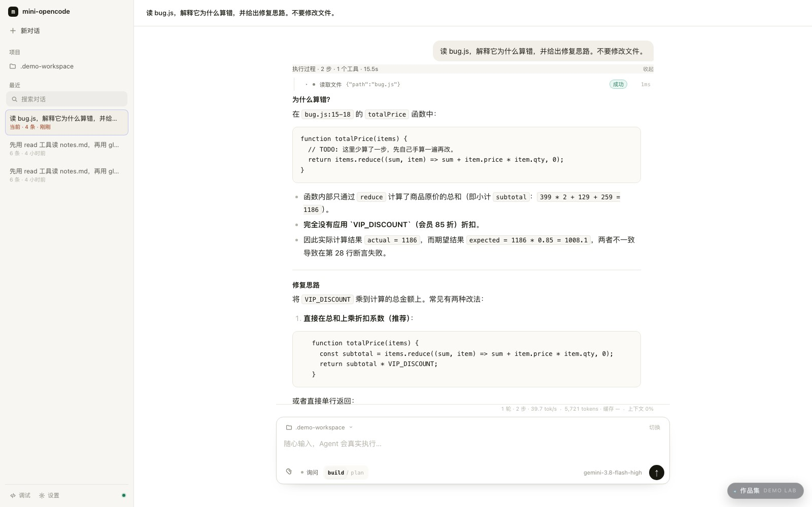

# 第 12 章 网页版可视化：看见 Agent 的每一步

> **本章目标**：给 Agent 加一个“驾驶舱”。打开网页发一句话，就能实时看到
> 模型每一步在想什么、调用了哪个工具、上下文多大、结果是什么；整条 trace 可回放、可导出。
> 读完你能：自己写一个 Agent 的 HTTP + SSE 服务，把内部状态可视化，并接上真实 DeepSeek。
>
> 预计：50 分钟。对应代码：`src/web/server.ts`、`src/web/bridge.ts`、`src/web/public/`、`src/agent/loop.ts` 的 trace 埋点。



> 截图里看到的：左侧是运行统计（上下文 token / 步数 / 用量）与会话列表；
> 中间是时间线——每一步的上下文、每次工具调用的参数与结果、权限审批记录、回合统计；
> 界面是安静的中性灰白：左侧 #f7f7f7 灰白侧栏（新对话 / 项目 / 可搜索的最近会话 / 底部调试与设置），
> 主区域纯白单栏居中对话，底部是一张输入卡片（工作区、权限档位、build/plan、模型、停止、发送）。
> 事件流 / 工具 / 会话记录收进右侧「调试」抽屉；移动端侧栏变抽屉。
> 右上「调试」打开事件流/工具/会话记录。
> 每个回合的过程默认收起成一行（`执行过程 · N 步 · M 个工具`）；点开后才显示 DSH 风格活动行（`思考 · …`、`运行命令 · …`），每行还可再展开。最终回答单独常显。
> 底部统计条（轮数/步数/速度、Token/缓存命中、上下文百分比）点开可看 DSH 风格明细；`snapshot().contextUsage` 提供系统提示词/工具定义/对话消息分项。
> 事件流 Tab 能看到每一条 SSE 的原始 JSON。

---

## 12.1 为什么 Agent 一定要能“被看见”

学 Agent 最痛苦的事：**它明明跑完了，你却不知道刚才发生了什么。**

终端里只看到几行输出，但真正决定行为的东西都在“里面”：

- 这一轮模型收到的上下文有多少 token？被裁剪过吗？
- 它为什么选了 `bash` 而不是 `read`？
- 工具参数是什么？执行花了多久？失败了吗？
- 权限系统拦过它吗？还是用户随手点了“允许”？
- 最后那 3 步是不是在绕圈子？

没有可视化，这些问题只能靠 `console.log` 猜。而一个可观测的 Agent，应该像飞机驾驶舱：

| 仪表 | 对应的 Agent 状态 |
| --- | --- |
| 当前高度/速度 | 上下文 token、步数、剩余预算 |
| 引擎参数 | 模型、温度、maxSteps、模式（build/plan） |
| 操作记录 | 每次工具调用、参数、结果、耗时 |
| 告警灯 | 权限拒绝、压缩、步数上限、错误 |
| 黑匣子 | 会话 JSONL：可回放、可导出、可复盘 |

**一个原则：Agent 的内部状态，必须能通过一个稳定的事件流暴露出来。**
有了这条，终端、网页、桌面端都只是“显示层”。

---

## 12.2 整体架构：浏览器 ↔ HTTP/SSE ↔ Agent

```
┌──────────────────────────── 浏览器 ────────────────────────────┐
│  index.html + app.js + style.css + codex.css + shell.js        │
│  （纯原生，无框架；codex.css/shell.js 只做 Codex 风格外壳）      │
│                                                                 │
│  ┌──────────────┐   POST /api/message    ┌──────────────────┐  │
│  │  输入框      │ ──────────────────────▶│  Node http 服务  │  │
│  └──────────────┘                        │  （src/web）     │  │
│  ┌──────────────┐   EventSource          │                  │  │
│  │ 时间线/事件流│ ◀──────────────────────│  事件流 SSE      │  │
│  └──────────────┘   GET /api/events      └────────┬─────────┘  │
│  ┌──────────────┐   POST /api/approval            │            │
│  │ 审批弹窗     │ ────────────────────────────────┤            │
│  └──────────────┘                                  │            │
└────────────────────────────────────────────────────┼────────────┘
                                                     ▼
                                     ┌──────────────────────────┐
                                     │  WebBridge（AgentUI）    │
                                     │  + trace 回调            │
                                     └────────────┬─────────────┘
                                                  ▼
                                     ┌──────────────────────────┐
                                     │  runAgent（第 3 章）      │
                                     │  模型 / 工具 / 权限 / 压缩 │
                                     └────────────┬─────────────┘
                                                  ▼
                                     ┌──────────────────────────┐
                                     │  Session（JSONL）         │
                                     │  每一步都落盘，可回放      │
                                     └──────────────────────────┘
```

关键点：**主循环完全不知道有网页存在**。
它只认 `AgentUI` 接口和 `trace` 回调（下一节）；Web 只是又一个“消费者”。

这种分层的好处，在第 9 章其实已经埋下伏笔：

- 终端 UI 实现 `AgentUI` → 输出 ANSI 字符
- Web 服务实现 `AgentUI` → 把事件推成 SSE
- 测试用“静默/记录 UI” → 断言事件顺序

---

## 12.3 后端：一个文件就够了

`src/web/server.ts` 用 Node 内置 `http` 起服务，**零依赖**。路由表：

| 方法 | 路径 | 作用 |
| --- | --- | --- |
| GET | `/` `/app.js` `/style.css` `/codex.css` `/shell.js` | 静态前端 |
| GET | `/api/state` | 完整状态快照（首屏/刷新/回合结束后对齐） |
| GET | `/api/meta` | 只取工具 / 功能 / 文档清单（轻量） |
| GET | `/api/config` | 当前模型配置（key 只返回掩码） |
| GET | `/api/events` | **SSE 实时事件流** |
| POST | `/api/message` | 发一条任务（可带 `images` dataURL 数组），立即返回 202 |
| GET | `/api/workspace?path=` | 浏览目录（只列目录、父目录/home/roots） |
| POST | `/api/workspace` | 切换工作区（新 cwd + 新会话，旧会话保留） |
| POST | `/api/permission` | 三级权限：`ask` / `accept-edits` / `auto` |
| POST | `/api/abort` | 中断当前回合（对应 Ctrl+C） |
| POST | `/api/approval` | 浏览器审批：`yes` / `no` / `always` |
| POST | `/api/config` | 填 API key / 换模型 / 切 mock（只存内存） |
| POST | `/api/mode` `/api/yolo` `/api/accept-edits` | 切 build/plan；旧权限接口（保留兼容） |
| GET | `/api/sessions` | 历史会话列表 |
| POST | `/api/session` | 新建或载入历史会话 |
| GET | `/api/session/<id>` | 读取历史会话（只读回放） |
| GET | `/api/session/<id>/export?format=md\|jsonl` | 导出记录 |
| POST | `/api/compact` | 手动压缩上下文 |

两个设计细节值得记住：

**① 发消息立即返回 202，不在 HTTP 请求里等 Agent 跑完。**
一个 Agent 回合可能跑几十秒；如果让 `POST /api/message` 一直挂着，
网络一断就丢失整个回合的响应。正确做法是“命令式接收 + 事件流推送”：

```ts
// 只做“同步校验 + 启动”，立刻返回
startRun(rawText: string): void {
  if (this.busy) throw new HttpError(409, "上一轮还在运行");
  const provider = this.ensureProvider();   // 没 key 会同步抛错
  this.busy = true;
  this.session.appendMessage({ role: "user", content });
  this.emit("user_message", { content });
  void this.executeRun(content, provider, signal);  // 后台跑
}
```

**② 一个回合结束，前端会重新拉一次 `/api/state`。**
实时增量渲染适合“看着爽”，但最终一致性要靠快照。
这样即使某条 SSE 丢了、页面刷新了，状态也不会错。

---

## 12.4 为什么用 SSE，而不是 WebSocket

Agent 的事件是**服务端单向推送**：模型吐字、工具开始/结束、审批请求……
浏览器只需要“听”，不需要在这个通道上“说”（说话走普通 POST）。

SSE（Server-Sent Events）正好：

- 协议就是纯文本流，`data: {json}\n\n`，实现 20 行
- 浏览器原生 `EventSource` 自带断线重连
- 经过代理/防火墙比 WebSocket 友好
- 调试方便：`curl -N http://127.0.0.1:8787/api/events` 就能看裸事件

WebSocket 是双向的，这里用不上，还得自己处理心跳和重连。

服务端核心就是“往所有订阅者写一行”：

```ts
private emit(type: string, data: Record<string, unknown> = {}): void {
  const event = { seq: ++this.seq, ts: Date.now(), type, data };
  const line = `data: ${JSON.stringify(event)}\n\n`;
  for (const listener of this.listeners) listener.write(line);
}
```

每个事件都带 `seq` 和 `ts`：前者用于前端排序/去重，后者用于算耗时。

连接建立时先发一帧 `hello`，里面是**完整状态快照**：

```ts
res.write(`data: ${JSON.stringify({ type: "hello", data: { state: this.snapshot() } })}\n\n`);
```

所以页面刷新、断线重连都不怕：拿快照重画，再接着收增量。

---

## 12.5 事件契约：Agent 的“黑匣子”

完整事件类型（前端 `app.js` 全部监听）：

| 事件 | 含义 | 关键字段 |
| --- | --- | --- |
| `hello` / `state` | 全量快照 | `state` |
| `run_state` | 运行中/空闲 | `busy` |
| `user_message` | 用户发了一条消息 | `content` / `text` / `images`（dataURL 数组） |
| `run_start` | 回合开始 | `model, mode, mock` |
| `assistant_start/delta/end` | 流式正文 | `text` |
| `thinking_delta` | 推理模型的思考过程 | `text` |
| `tool_start` / `tool_end` | 工具开始/结束 | `name, argsPreview` / `output, isError, durationMs` |
| `permission_request` | 需要用户审批 | `id, toolName, detail, danger` |
| `permission_resolved` | 审批结果 | `id, allowed, reason` |
| `trace` | 结构化步骤事件 | 见下 |
| `notice` / `info` / `error` | 提醒/错误 | `message` |
| `turn_end` | 回合结束 | `steps, usage, aborted, hitStepLimit, toolDenials, durationMs` |
| `usage` | token 统计 | `promptTokens, completionTokens, steps, durationMs` |
| `turn_complete` | 提示前端拉快照 | `sessionId` |
| `workspace` | 工作区切换 | `path` |
| `permission` | 三级权限切换 | `level` |
| `sessions` / `todos` / `config` / `mode` / `yolo` / `accept_edits` | 状态同步 | 对应值 |

### trace 事件：专门为“可视化”加的埋点

`AgentUI` 是给人看的流式渲染；**trace 是给机器看的结构化记录**，两者刻意分开
（UI 可以换，trace 字段保持稳定）。定义在 `src/agent/loop.ts`：

```ts
export type TraceEvent =
  | { type: "step_start"; step: number; historyMessages: number;
      contextTokens: number; budget: number; tools: string[] }
  | { type: "context"; removed: number; truncatedToolOutputs: number;
      tokens: number; budget: number }
  | { type: "compaction"; before: number; after: number; summary: string }
  | { type: "assistant_message"; content: string;
      toolCalls: Array<{ id: string; name: string; arguments: string }> };
```

主循环在四个位置调用它：

```ts
// 1) 每轮开始：这一轮带了多少上下文、有哪些工具可用
trace?.({ type: "step_start", step, historyMessages: promptMessages.length,
          contextTokens: fitted.tokens + systemTokens,
          budget: contextBudget, tools: registry.names });

// 2) 上下文被裁剪时
trace?.({ type: "context", removed, truncatedToolOutputs, tokens, budget });

// 3) 自动压缩时
trace?.({ type: "compaction", before, after, summary });

// 4) 模型回复完成时
trace?.({ type: "assistant_message", content, toolCalls: calls.map(...) });
```

Web 服务把它**同时**做了两件事：

```ts
const trace = (event: TraceEvent) => {
  this.session.appendEvent(event);  // 落盘：以后能回放
  this.emit("trace", event);        // 推给浏览器：现在就能看
};
```

> 💡 这就是“可观测性”的完整闭环：**埋点 → 事件流 → 落盘 → 回放**。
> 真实产品里对应的是 OpenTelemetry / LangSmith 这类 tracing 系统，
> 思想完全一样：结构化事件 + 时间线 + 可关联的上下文。

---

## 12.6 权限审批：浏览器如何“卡住”Agent

这是整个 Web 化里最有趣的部分。Agent 在服务端跑，用户却在浏览器里点按钮——
中间隔着一个 HTTP 请求，怎么让 Agent **暂停等待**？

答案：`Permissions` 的 `confirm` 是一个 **async 回调**，我们让它在 Promise 上等：

```ts
private askApproval(request: ConfirmRequest): Promise<ConfirmAnswer> {
  const id = randomUUID();
  this.emit("permission_request", { id, ...request });   // ① 推给浏览器

  return new Promise<ConfirmAnswer>((resolve) => {
    const timer = setTimeout(() => {                       // ③ 兜底超时
      this.pendingApprovals.delete(id);
      resolve("no");
    }, 10 * 60_000);

    this.pendingApprovals.set(id, { id, request, timer, resolve }); // ② 挂起
  });
}
```

浏览器收到 `permission_request` 弹窗 → 用户点“允许” → `POST /api/approval`：

```ts
private resolveApproval(id: string, decision: unknown): void {
  const pending = this.pendingApprovals.get(id);
  if (!pending) throw new HttpError(404, "这个审批已经过期或不存在");
  const answer = decision === "always" ? "always" : decision === "yes" ? "yes" : "no";
  pending.resolve(answer);   // ← Agent 主循环在这里被唤醒，继续往下跑
}
```

三个细节：

1. **超时**：用户关掉浏览器，Agent 不能永远挂着 → 10 分钟后自动拒绝
2. **`always` 的语义**：记住的是“这个工具”，**危险命令仍然每次问**（第 5 章的规则在 `Permissions` 里，Web 层不重复实现）
3. **前端必须禁用输入**：有 `pendingApprovals` 时不能发新消息，否则状态会乱
4. **Stop 要能救场**：用户点 Stop 时，服务端必须把所有挂起的审批直接 resolve 成拒绝，
   否则主循环会一直卡在 `await` 上，等到 10 分钟超时才结束
5. **切会话要清记忆**：`always` 是"本会话"级别，新建/切换会话时要调用
   `permissions.clearSessionAllowed()`，否则旧会话的放行会带到新会话里

> 🧠 这种“服务端挂起 Promise、客户端异步 resolve”的模式，
> 在 Web 里到处都是：人机审批、表单补全、支付确认……本质是**把同步逻辑变成可等待的事件**。

---

## 12.7 记录与回放：事件溯源天然适合可视化

会话文件本来就是事件日志（第 7 章）。现在它多了一类事件：`step_start`、`context`、`compaction`。

于是“回放”几乎是免费的：前端拿到 `/api/state` 里的 `events` 数组，按顺序重建时间线：

```js
// app.js 里完成回合的重建逻辑（简化）
state.events.forEach((event) => {
  if (event.type === "message" && event.message.role === "user") startTurn();
  if (event.type === "step_start") addStep(event.step, event.contextTokens);
  if (event.type === "message" && event.message.role === "assistant") addAgentText(...);
  if (event.type === "tool") addToolCard(event.name, event.arguments);
  if (event.type === "turn_end") closeTurn(event.steps, event.usage);
});
```

因为所有内容都在 JSONL 里，导出也简单：

- **JSONL**：原始事件流，适合用脚本分析（比如统计每次工具耗时、上下文增长曲线）
- **Markdown**：人读的对话记录，包含每步上下文、工具参数、执行结果

```bash
# 命令行也能看（不打开网页）
npm run sessions
curl -s "http://127.0.0.1:8787/api/session/<id>/export?format=md" | head
```

### 12.7.1 折叠的正确姿势：藏“一层”，不是藏“一堆子元素”

「执行过程」要能一句话收起。第一版是这么写的：

```css
.turn:not(.show-steps) .step-head { display: none !important; }
.turn:not(.show-steps) .tool-card { display: none !important; }
```

看起来对：表头和工具卡片都不见了。但一个 40 步的回合，收起后页面下方还拖着一大片空白。
原因是 `.step` 这个**父容器还活着**：它自带 `border-top` + `padding-top` + `margin-top`，
而 `.turn` 是 `flex column; gap: 8px`——**flex 的 gap 只算子项个数，不看子项高度**，
空子项照样吃掉 8px。40 步 ≈ 700px 纯空气，用户看到的是一屏横线。

更根本的问题不是这几像素，而是**“折叠”和“保留答案”变成了同一件事**：
回答文字塞在“最后一个 step 的 items 里”，于是只能靠
“这一步里有没有 `.msg`”这种判断去猜该不该隐藏——DOM 结构一改就全崩。

所以最后改成按**信息层级**分层，而不是按“藏哪些子元素”：

```text
.turn
├── 用户气泡
├── .turn-trace        ← 折叠状态条：执行过程 · 30 步 · 29 个工具 · 1m30s
├── .turn-process      ← 步骤 + 工具卡片，折叠时整块 display:none
├── .turn-answer       ← 最终回答，永远可见
├── .notice / 错误 / 权限审批卡   ← 永远可见（安全相关的东西不能被折叠吃掉）
└── .turn-end          ← 回合统计
```

```css
.turn:not(.show-steps) .turn-process { display: none !important; }
```

一句话：**折叠要藏的是“一层容器”，不是“容器里的一堆孩子”**。
容器藏了，里面有几万个 step、每个 step 多少 padding，都不再影响布局。

配套的两条纪律：

1. **答案要从过程里摘出来，而不是复制一份**。`renderTurn` 会先用
   `takeFinalAnswerText` 把回合里最后一段 Agent 文字从 `step.items` 里 `splice` 掉，
   再渲染成 `.turn-answer`。顺序不能反：先建过程 DOM、再删数据，
   页面上就会同时出现两段一样的文字（这个 bug 当场就踩了）。
2. **运行中展开、跑完收起**。`onTurnEnd` 里去掉 `show-steps`，
   于是长任务运行过程看得见，结束后只剩一行摘要 + 答案——和 Codex / Claude Code
   的行为一致：过程是证据，默认收起；结论是主线，永远在。

### 12.7.2 清理会话：归档与删除

历史会话越积越多时，网页提供了两种清理方式（左侧栏和「会话记录」Tab 都有入口）：

- **归档**：`POST /api/session/<id>/archive`，服务端往 JSONL 追加一条 `archive` 事件，
  `Session.list` 默认就不再返回它。文件还在，点「归档 N」按钮切到“显示归档”即可恢复或继续导出。
- **删除**：`DELETE /api/session/<id>`，直接删掉 JSONL 文件，不可撤销，前端用 `confirm()` 二次确认。
  归档项也能直接删，不用先点「恢复」——左侧栏每个历史会话项（当前会话除外）都有删除入口。

`/api/state` 的 `sessions` 数组同时包含归档项，每项多一个 `archived: boolean`，前端据此过滤；
`GET /api/sessions` 默认只返回未归档，带 `?archived=1` 才返回全部。删除当前正在使用的会话会被
服务端拒绝（409），因为内存里的 `Session` 还指着那个文件。

为什么归档也做成事件而不是挪文件？第 7 章 7.3.7 有完整解释：JSONL 是 append-only 事件流，
追加一行最贴合模型，也不会让 `load` / 导出路径失效。归档管的是“列表里看不看得到”，不是“占多少磁盘”。

### 12.7.3 模型输出是 Markdown，不能当纯文本显示

早期的气泡是这么渲染的：

```js
el("div", { className: "msg-text", text: content });   // textContent = content
```

配合 CSS 的 `white-space: pre-wrap`，换行是保住了，但用户看到的是**裸的 Markdown**：

> \*\*1. 推理开关\*\* `client.ts:152`：现在会写 `reasoning_effort` \- 顶栏加了…

不是"样式丑"，是**格式根本没被渲染**——星号、反引号、`- `、`##` 全是字面字符。

模型输出天然是 Markdown（几乎所有系统的 system prompt 都在要求它这么写），
所以对话 UI 必须渲染它。但这里有两个坑：

**坑一：不能为了渲染就 `innerHTML`。**
项目规矩是"所有模型输出用 `textContent`"，因为模型输出是**不可信输入**：
它可能被用户诱导吐出 ``。所以渲染器全程只做两件事：

```js
parent.appendChild(document.createTextNode(text));   // 普通文字，天然转义
parent.appendChild(el("strong", { text }));          // 命中语法，才建元素
```

拿不到任何一处字符串拼 HTML，`` 就只会被当字面文字显示出来。
链接还要额外做**协议白名单**（只放行 `http/https/mailto`），
否则 `[点我](javascript:alert(1))` 就成了一个可点击的 XSS。

**坑二：流式输出不能每个 token 都重渲染。**
模型一秒吐几十个增量，每次都重新解析整段文本是 O(n²)，长回答会直接卡住主线程。
折中方案是**节流渲染**：增量只累积到 `state.stream.text`，
最多每 80ms 重渲染一次（约 12fps），`assistant_end` 时再补一次终稿；
光标元素作为兄弟节点，不参与重渲染。

渲染器本身（`app.js` §5.1）只支持对话里真正会出现的语法，故意**不支持内联 HTML**
（那是唯一会重新引入 XSS 的语法），也暂不支持脚注：

| 语法 | 输出 |
| --- | --- |
| ```` ```lang ```` 围栏 | `<pre><code class="language-lang">` |
| `#` ~ `######` | `<h3>` ~ `<h6>`（降两级，不抢页面层级） |
| `- * +` / `1.` | `<ul>` / `<ol>` + `<li>`（按缩进嵌套） |
| `\| a \| b \|` + `\| --- \| --- \|` | `<table>`（横向可滚动） |
| `>` | `<blockquote>` |
| `---` | `<hr>` |
| `` `x` `` | `<code class="md-code">` |
| `**x**` / `*x*` / `~~x~~` | `<strong>` / `<em>` / `<del>`（`2 * 3 * 4` 仍按乘法显示） |
| `[文字](https://…)` | `<a target="_blank" rel="noopener noreferrer">` |

为什么不用 marked / markdown-it？三条理由：项目要求零运行时依赖（前端纯原生、无 CDN、无构建）；
第三方渲染器默认放行 HTML，等于自己开一个 XSS 面；真正需要支持的语法就那么几种。

还有一个细节值得记：`.msg-text` 原本是 `white-space: pre-wrap`（纯文本靠它保换行）。
内容变成 `<p>/<pre>/<ul>` 之后，`pre-wrap` 会把块之间的空白二次放大、行距变松，
所以渲染过的气泡要加 `.md` 类并把 `white-space` 改回 `normal`——
**换行交给块级元素负责，而不是靠空白字符**。用户气泡仍是纯文本，继续用 `pre-wrap`。

最后，这条安全规矩现在有测试守着：`test/web.test.ts` 里
「app.js 全程不拼 innerHTML」会扫源码，发现任何非注释的 `innerHTML` 就失败。
规矩写在文档里容易被忘，写成测试才拦得住。


### 12.7.4 配色：为什么"丑"通常不是审美问题，是**灰阶太多**

先说结论：界面发灰、发脏、"抽丝"，绝大多数时候不是颜色不够好看，而是
**灰阶挤在一个很窄的区间里**。上一版的调色板是这样的：

| 变量 | 值 | 用途 |
| --- | --- | --- |
| `--bg` | `#f6f7f9` | 页面底 |
| `--bg-soft` | `#eef1f5` | 顶栏 / 控件底 |
| `--panel-2` | `#f1f3f6` | 代码块 / 徽章底 |
| `--panel-3` | `#eaeef3` | 再深一档的填充 |
| `--panel-4` | `#e0e5ec` | 更深的填充 |
| `--border` | `#e3e6eb` | 分隔线 |
| `--border-strong` | `#cfd5de` | 强分隔线 |

七个灰，全落在 `#e0`~`#f6` 这 22 个色阶里，相邻两级只差 2~3 级。
`#e3e6eb` 的分隔线压在 `#eef1f5` 的底上，对比度只有 **1.1:1**——
肉眼根本分辨不出来，看到的就是一整片"不知道哪里是边"的灰。
再叠上阴影（`--shadow-sm`）和带边框的胶囊按钮，画面就糊了。

**重做时定了四条规矩：**

1. **画布用纯白，不要"灰底衬白卡片"。**
   白 + 灰两层是最容易发灰的组合：白卡片在灰底上会显得脏，灰底又不够灰。
   `--bg: #ffffff`，层次改用 1px 细线 + 留白来做。
2. **灰阶只留三档，每档之间拉开 8~10 个色阶。**
   `#ebedf2`（线）→ `#f5f6f8`（浅填充：代码块、输入框）→ `#eceff4`（稍深填充）。
   相邻两档肉眼可辨，也不用再记七个近似值。
3. **强调色只留一个：DeepSeek 品牌蓝 `#4d6bfe`。**
   状态色（绿 `#0f9f75` / 黄 `#b7791f` / 红 `#e5484d`）保留语义，
   但饱和度压到和主蓝同一个量级，避免"红绿蓝三色打架"。
4. **阴影只给真正浮起来的元素**（弹窗、抽屉）。卡片、顶栏、气泡一律平铺。

**蓝色怎么用，也有讲究。** 上一版用户气泡是"实心蓝底 + 白字"，
一块 `#4d6bfe` 占掉不少面积，在浅色界面里像贴了块补丁，眼睛会被反复吸走。
现在改成**淡蓝底 + 深色字**（`rgba(77,107,254,0.08)` 上的 `#16181d`，对比度 15.9:1），
Agent 回复则**完全不加气泡**，直接排在画布上——回复通常很长，套框会变成"卡片里的卡片"。

同理，主按钮从"渐变"改成平涂，顶栏按钮从"带边框"改成"幽灵按钮"（悬停才出底色），
分段控件的选中态从"实心蓝"改成"白底 + 蓝字"。这些都是**减少色块面积**，不是换颜色。

**对比度是硬指标，不能靠感觉。** 上一版有一处明显不达标：

| 元素 | 旧值 | 对白底 | 新值 | 对白底 |
| --- | --- | --- | --- | --- |
| 弱化文字（时间戳 / 提示 / 占位符） | `#98a2b3` | 2.6:1 ❌ | `#6f757f` | 4.6:1 ✅ |
| 次级文字（标签 / 说明） | `#667085` | 4.9:1 | `#4b515a` | 8.0:1 ✅ |
| 正文 | `#1f2329` | 15.9:1 | `#16181d` | 17.8:1 ✅ |

（AA 要求正文 ≥4.5:1。弱化文字用 10~11px 小字，2.6:1 基本等于"看不见"，
这是上一版"灰得难受"的第二来源。）

换品牌蓝时还得注意一个坑：`#4d6bfe` 对白底只有 **4.3:1**，当**填充**没问题，
但当**文字颜色**就差了 0.2。所以它在 CSS 里只做背景/描边，
真正要显示成蓝字的地方（链接、按钮文字、选中态）用同色系深一档的
`--accent-strong: #3d5bf0`（5.3:1）。肉眼几乎看不出差别，小字却清楚了。

改完之后可以用一句话自检：**截图里 70% 以上是白，实心强调色不超过 1%。**
超了，说明又有大色块混进去了。

---

## 12.8 接入真实 DeepSeek 模型

两条路，任选：

**路线 A：`.env`（推荐，key 不经过浏览器）**

```bash
cd mini-opencode
cp .env.example .env
# 编辑 .env：DEEPSEEK_API_KEY=sk-你的key
npm run web
```

**路线 B：网页里临时填**

点右上角「模型配置」→ 填 `API Key`、`Base URL`（默认 `https://api.deepseek.com`）、
`model`（默认 `deepseek-flash`；用官方 API 就填 `deepseek-v4-flash`）→ 保存。

输入区的三个新控件（对应 `snapshot()` 的 `workspace` / `permissionLevel`）：
- **工作区**：`GET /api/workspace` 浏览、`POST /api/workspace` 切换；切换后工具边界按新 cwd 生效，旧会话留在旧目录；
- **三级权限**：询问 / 自动改文件 / 全自动，分别映射 `ask` / `accept-edits` / `auto`；
- **图片**：上传或直接粘贴，前端压成 dataURL，随 `POST /api/message` 的 `images` 发送；模型收到的 content 是 `[{type:"text"},{type:"image_url"}]`。

「模型配置」里还可以改 **temperature、contextBudget（上下文预算）、maxSteps、maxToolCalls**
（后两个默认 `0` = 不限，只有给 CI/无人值守才建议设值），
改完立即生效（服务端会重建 provider），不用重启。
顶栏还有一个 **「自动改文件」** 开关（acceptEdits 模式）：打开后 write/edit 不再询问，
但 `bash` 仍会询问——适合"让它连续改代码"的场景。

规则：

- 浏览器里填的 key 默认只存在服务进程内存；「模型配置」里勾选 **保存到 .env**（默认勾选）后写入项目根 `.env`（0600、gitignored），重启自动加载，不用重填
- 重启服务后需要重新填；想长期使用就放 `.env`
- 没有 key 时可以勾选 `mock`，用假模型把整个流程走通
- 任何 OpenAI 兼容接口都能接：把 Base URL 改成 OpenAI / 硅基流动 / 本地 Ollama 即可
- **推理强度（reasoning_effort）**：顶栏就有一个下拉（默认 / 低 / 中 / 高 / 最高），
  改了立即生效，不用点开「模型配置」。命令行是 `--reasoning-effort high`，
  或 `.env` 里 `MINI_REASONING_EFFORT=high`。
  选「默认」时**不发送这个字段**——有些网关只认 low/medium/high，发字符串 `"default"` 会 400。
  只有支持它的模型/网关才会因此变慢变强；不支持的话服务端会忽略。
- **temperature（温度）**：默认 0.2，范围 0~2。网页「模型配置」里可以直接改；
  命令行用 `--temperature 0.3`，或 `.env` 里 `MINI_TEMPERATURE=0.3`。
  Agent 任务建议 0~0.3（稳定、少发散）；0 表示尽可能确定；推理模型可能忽略这个参数

> ⚠️ 常见报错：`400 Bad Request：The supported API model names are deepseek-flash, deepseek-v4-pro, but you passed deepseek.`
> 这说明你连的网关只支持列出的模型名。把 model 改成 `deepseek-flash`（快/便宜）或 `deepseek-v4-pro`（更强）即可。
> 再强调一次：**baseUrl 和 model 必须是同一家服务商的**——官方 DeepSeek API 的模型名是
> `deepseek-v4-flash` / `deepseek-v4-pro`（旧名 `deepseek-chat` / `deepseek-reasoner` 官方已停止使用），不是这两个网关名。

---

## 12.9 安全边界（务必读）

这个面板是**开发/学习工具**，不是生产服务：

1. **默认只监听 `127.0.0.1`**，没有登录鉴权。不要把 `--host 0.0.0.0` 暴露到公网。
2. **API key 默认不落盘**；勾选“保存到 .env”后会以 0600 权限写入 `.env`（已在 .gitignore），共享机器上注意文件权限。
3. **前端必须用 `textContent` 渲染模型输出**。模型可能生成 `</script>` 之类的内容，
   用 `innerHTML` 拼就是 XSS。本项目前端所有输出都走 `textContent`。
4. **权限审批是真实生效的**，但“用户随手点允许”是最大风险——危险命令会单独黄字警告。
5. **会话文件包含你的代码和对话**：`.mini-opencode/` 已在 `.gitignore` 里，别提交。

---

## 12.10 动手实验

**实验 1：看一次完整回合（离线，5 分钟）**

```bash
cd mini-opencode
npm run web          # 浏览器打开 http://127.0.0.1:8787
```

1. 先点右上角「模型配置」勾选 `mock`（如果没有 key）
2. 输入：`帮我创建一个 hello.txt`
3. 观察：步骤分隔（第 N 步 / 上下文 token）→ 工具卡片（bash/write/read）→ 审批弹窗 → 最终总结
4. 切到「事件流」Tab，看每个 SSE 事件的原始 JSON

**实验 2：审批的三种选择**

分别用“允许”“拒绝”“始终允许”跑同一个任务，对比结果：

- 拒绝：工具卡片变红，模型收到错误后会尝试别的方案
- 始终允许：之后同类工具不再问，但**危险命令仍然会问**
- 试一个危险命令：让模型执行 `rm -rf ~`（别真跑，观察审批弹窗的黄字警告后点拒绝）

**实验 3：切 plan 模式**

右上角切到 `plan`，再让它改文件。观察：
- 模型手里**没有写工具**（工具卡片数量变少）
- 它只能 read/glob/grep，最后给你一份实施计划

**实验 4：让上下文爆掉**

「模型配置」把上下文预算调小（或命令行 `--budget 1200`），连续对话几轮。
观察「上下文已自动压缩」提示和 token 进度条变化，然后切到事件流找 `compaction` 事件。

**实验 5：导出与回放**

跑完几轮后，在「会话记录」Tab 下载 Markdown 和 JSONL，打开看看。
再新建一个会话，然后载入旧会话——时间线能完整重建。
最后把几个空会话归档（或删除），观察左侧列表计数和「显示归档」开关的变化。

**实验 6：接真实模型（需要 key）**

在 `.env` 里填 key 后重启 `npm run web`，让它做一个真实小任务（比如“读一下 README，把项目结构总结成 5 条”），
对比 mock 和真模型的行为差异。

---

## 12.11 常见坑

| 坑 | 症状 | 原因 / 解决 |
| --- | --- | --- |
| 刷新页面后对话消失一半 | 只看到最近几条 | 没处理 `hello` 快照；首屏必须用 `/api/state` 重建 |
| SSE 断线后不再更新 | 状态卡住 | `EventSource` 会自动重连；但重连后要重新拉快照对齐 |
| 审批弹窗没出现，Agent 卡住 | 页面一直转圈 | 浏览器刷新/断开导致审批事件丢失；刷新后从 `pendingApprovals` 恢复弹窗 |
| 重复发消息导致两个回合 | 状态错乱 | `busy` 时禁用输入；服务端也会用 409 拒绝 |
| key 重启后失效 | 又要重填 | 内存 key 设计如此；长期使用写 `.env` |
| 端口被占用 | 启动报 `EADDRINUSE` | `--port 8788` 换一个；或先停掉旧进程 |
| 模型输出把页面搞乱 | 布局炸 / 脚本执行 | 一律 `textContent` 渲染，不要 `innerHTML` |
| 回合结束但界面没更新 | 少了最后一条工具结果 | 在 `turn_complete` 后重新 `GET /api/state` 全量重绘 |
| 事件太多页面卡 | 事件流 Tab 越来越卡 | 只渲染最近 N 条，或提供“暂停/清空” |

---

## 12.12 本章小结

- Agent 的内部状态要通过**稳定事件流**暴露；UI 只是消费者。
- 架构：浏览器（原生 JS）↔ HTTP + SSE ↔ WebApp ↔ `runAgent` ↔ JSONL。
- 命令用 POST 异步触发，结果用 SSE 推送；`turn_complete` 后拉快照对齐。
- `AgentUI` 负责人看的流式渲染，`trace` 负责机器看的结构化步骤——两者分开。
- 权限审批 = 服务端挂起 Promise + 浏览器 HTTP resolve + 超时兜底。
- 事件落盘即回放；JSONL 可分析，Markdown 可阅读；归档/删除用来治理越来越长的历史列表。
- 真实模型接入：`.env` 或网页临时填 key（仅内存）；任何 OpenAI 兼容接口都行。
- 安全底线：只监听本机、无鉴权、key 不回显、输出必须转义。

---

## 12.13 练习

1. **加一个“工具耗时排行榜”**：从 `state.events` 里统计每个 `tool` 事件的 `durationMs`，
   在侧边栏显示 Top 3。提示：`reduce` 分组求和。
2. **给事件流加过滤器**：只显示 `tool_*` 或 `trace` 事件。提示：按 `event.type` 过滤。
3. **做“回放模式”**：载入历史会话后，加一个播放按钮，按时间间隔逐条显示事件，像录像一样。
   提示：用 `setTimeout` 逐条渲染，可暂停。
4. **接 Ollama**：把 Base URL 改成 `http://localhost:11434/v1`，model 改成你本地有的模型，
   看看小模型的工具调用和 DeepSeek 差在哪。
5. **思考题**：如果要把这个面板做成“多人同时看同一个 Agent 会话”，需要改哪里？
   （提示：现在每个浏览器都能审批，冲突怎么处理？会话应该按连接隔离还是共享？）

---

👉 上一章：[第 11 章 对照真实 opencode 源码](./11-对照真实opencode源码.md)　|　下一章：[第 13 章 轮数、步数与"真干活"](./13-轮数步数与真实干活-对照三家Agent.md)
