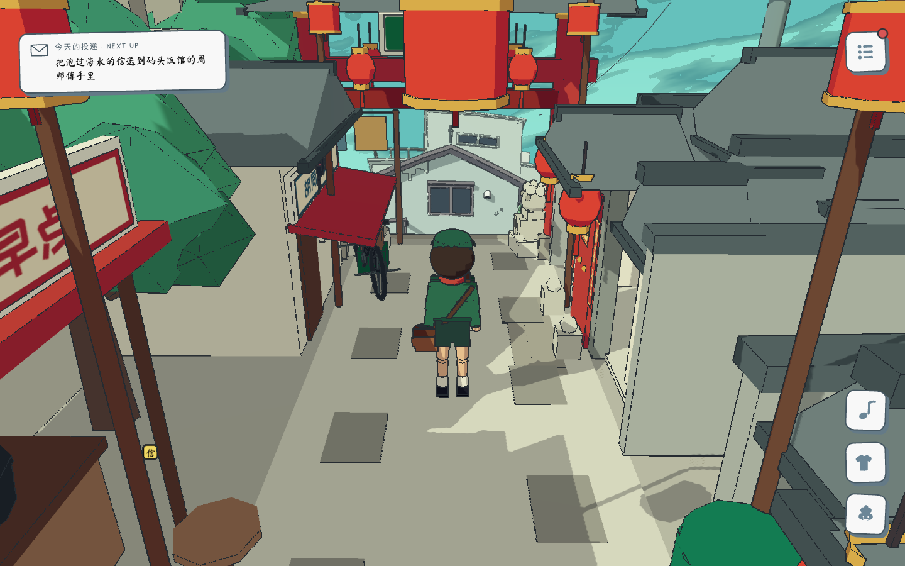

# 京城来信 · Beijing Courier

> 一颗小行星，五封没有地址的信。
>
> 这是一个以 [Messenger](https://messenger.abeto.co) 的**渲染语言**为参考、以**北京**为内容主题的
> 3D 小行星递送游戏。卡通描边 + 3D LUT 调色 + 手绘小行星的管线按参考站思路重建；
> 主角、北京街区（胡同/中轴/CBD/城墙）、投递道具、音频、剧情、UI 均为本项目**原创自建**。



## 玩什么

- 在一颗可以朝任意方向一直走回原点的小行星上，替人送五封手写信：
  **海边码头 → 村子 → 城市 → 山寺 → 瀑布**。
- 出生在**春风胡同**：牌楼、灰瓦四合院、红灯笼、邮筒、二八自行车、老槐树、
  遛鸟大爷与红领巾小学生就在身边；往北是**中轴**（鼓楼 + 天坛祈年殿），
  往东是**CBD**（中国尊 + 央视大楼 + 鸟巢），胡同台地南沿是**长城**城墙与烽火台。
- 与 NPC 说话，接信、捡信、送到正确的人手里；清单记录每一封的状态。
- 原创主角「北京邮差」：墨绿制服、邮差帽、斜挎邮包、红围巾，程序化骨骼动画。
- 换装（自己角色的帽/包/巾配色）、表情、区域环境音、手绘中文 UI、触屏摇杆。
- 单人离线可玩，本机存档保存进度与配色。

## 操作

| 操作 | 键盘 / 鼠标 | 触屏 |
| --- | --- | --- |
| 行走 | `WASD` / 方向键 | 左下摇杆 |
| 奔跑 | `Shift` | 摇杆推到底 |
| 跳跃 | `Space` | 右下跳跃键 |
| 交谈 / 捡起 / 交付 | `E` | 右下互动键 |
| 转视角 | 拖动鼠标 / 滚轮缩放 | 拖动空白处 |
| 清单 | `B` | 右侧清单按钮 |
| 换装 | `C` | 右侧换装按钮 |
| 静音 | `M` | 右侧声音按钮 |
| 表情 | `Q` | 右侧表情按钮 |
| 推进对话 | `Enter` / `Space` / `E` | 点击对话框 |

## 运行

```sh
npm install
npm run dev      # http://127.0.0.1:5190/
npm run build    # dist/ 纯静态资源，可放到任意静态子目录
npm test         # 剧情 / 对话状态机 / 球面碰撞 / 资产完整性（15 项）
npm run shots    # Playwright 验收截图（需要 dev server 已启动）
node tools/audio/verify.mjs   # 程序化音频验收（需要 dev server 已启动）
```

PWA：构建时会把入口、CSS、主包、字体、图标与主要场景资源写入预缓存；
Service Worker 需要 HTTPS 或 localhost。首次进入需要网络加载 3D 资源。

## 自建内容（v3 的重点）

参考站只保留「渲染语言 + 小行星场景基底」；下面这些是本项目**从零程序化建模/合成**的资产，
统一走 `src/render/toon.js`，自动进入同一条描边 + LUT 管线：

| 模块 | 内容 |
| --- | --- |
| `src/actor/originalCourier.js` | 原创 Q 版北京邮差：13 骨、56 mesh、程序化 idle/run/sprint/air/talk + 眨眼/口型/围巾飘动；`setOutfit({hat,bag,scarf})` |
| `src/actor/originalNpc.js` | 原创北京 NPC：遛鸟大爷（鸟笼）、广场舞大妈（折扇）、红领巾小学生（书包） |
| `src/world/beijing.js` | 17 件程序化北京资产 + 4 个片区布置：四合院、牌楼、胡同路牌、邮筒、二八车、石狮、老槐树、小卖部、早点铺、晾衣绳、鼓楼、天坛祈年殿、中国尊、央视大楼、鸟巢、798 烟囱、城墙/烽火台；canvas 中文招牌 |
| `src/world/items.js` | 5 件投递道具：信、明信片（手绘北京天际线）、便签、点心匣子、黑胶唱片 |
| `src/game/music.js` + `audio.js` | 原创 C 宫五声 Lo-fi BGM（80BPM/36s 无缝循环，53 个自写旋律音）+ 8 个区域程序化环境音 + 25 个合成音效；**0 个外部音频文件** |
| `src/ui/` | 原创手绘 DOM UI：开场、LOADING、对话、清单、换装、表情、区域标题、触屏摇杆 |
| `src/game/` | 原创中文剧情、任务状态机、5 封手写信 |
| `public/fonts/` | OFL 授权字体（Patrick Hand / Gochi Hand / Ma Shan Zheng / Zhi Mang Xing / ZCOOL KuaiLe） |

素材来源与版权的完整清单见 [ASSETS.md](ASSETS.md)。参考站素材仅用于渲染对照与技术学习，
版权归 [Abeto](https://messenger.abeto.co) 所有，请勿商用。

## 技术实现

### 渲染（按参考站思路重建）

- `src/render/pipeline.js`：自定义 MRT 管线 —— 场景渲染到 2 张 HalfFloat RT
  （颜色 + alpha 面 id；深度 / 法线 / 描边权重），全屏 pass 做屏幕空间描边，
  再应用 32³ 3D LUT 调色；**1.4× 超采样**（移动端关闭）消除描边/植被的逐帧闪烁。
- `src/render/materials.js`：移植参考站 `baseMaterial` 的地形/角色/NPC/道具分支、HSV 阴影色、
  硬边角色阴影、眼睛/嘴巴 sprite 与 `gl_FragDepth` 植被细节；用 three 标准蒙皮替代骨骼纹理。
- `src/render/toon.js`：自建资产的统一卡通材质（顶点色/贴图/flatShading + 阴影采样 + 雾），
  同样写 MRT 两张附件，所以自建模型与参考站场景风格一致。
- `src/render/environment.js`：天空（云噪声球壳）、树冠 billboard、实例化草、电缆、水面、飞鸟。
- 修复的稳定性问题：站立时不再每帧重采样碰撞网格（消除相机/角色微抖）、
  法线用「径向 + 三角面」混合并平滑、相机碰撞距离做阻尼、动画状态增加滞后阈值、
  天空云边缘改为 smoothstep。

### 场景与碰撞

- `src/assets.js` 复用参考站 `dracoworker.js` 解码自定义属性（planet 的 surfaceId/batchId、
  角色/NPC 的 skinIndex/skinWeight、植被的 centr/rand 等）；KTX2 经 Basis 转码，LUT 重建为 Data3DTexture。
- 星球碰撞使用参考站 `hitmesh_0..4`（约 18 万三角形），自建均匀 3D 网格 + DDA raycast：
  贴地、跳跃、相机避墙、指点导航。
- `src/world/collision.js` 支持 `appendGeometry/appendMeshes/clone`：
  - 玩家地面碰撞追加自建北京片区的**台地行走面**；
  - 相机碰撞额外追加**全部北京建筑网格**，跟随相机不再穿墙/穿屋顶；
  - 建筑体水平碰撞盒由 `beijing.wallColliders` 提供（见 `README-beijing.md`）。

### 音频（全原创）

- `src/game/music.js`：Karplus-Strong 古筝式拨弦 + pad + 软鼓 + 卷积混响，OfflineAudioContext
  预渲染 36s 无缝循环（C 宫五声、80BPM、12 小节、53 个自写旋律音）。
- `src/game/audio.js`：8 个区域环境音（海边/村子/城市/森林/工厂/山寺/瀑布/微风）与 25 个
  合成 cue（脚步、跳跃、纸声、任务完成、信件风铃、相机 whoosh…），含静音/音量持久化与降级。

### UI

- 纯 DOM/CSS（`src/ui/`），手绘风：黑描边纸片、蓝名牌、黄色 BEGIN、右下角蓝色播放箭头；
  自托管 OFL 字体；开场、LOADING、对话打字机、清单、换装、表情、区域标题、触屏摇杆本地实现。

## 验收

- `npm test`：15 项通过（剧情完整性、spot/pickup 映射、清单/对话状态机、球面碰撞 raycast、关键资产）。
- `npm run build`：纯静态 `dist/`，可直接部署到任意子目录；`site/demos/beijing-courier/` 已同步。
- `npm run shots`：21 张截图（见 `screenshots/`）—— 开场、胡同出生点、对话、清单、换装、
  北京四片区（胡同/中轴/CBD/城墙）、五处投递点、手机竖屏。
- `node tools/audio/verify.mjs`：真实游戏页 AudioContext 运行、BGM/环境音/cue 离线渲染均非静音。
- 截图对照：`screenshots/ui/`、`screenshots/character/`、`screenshots/hero/`、`screenshots/beijing/`。

## 已知限制

- 参考站的星球基底几何、树冠/水面噪声贴图、9 个任务 NPC 模型仍是参考站资产（见 ASSETS.md）；
  北京街区、主角、投递物、音频、UI、剧情为原创。
- 参考站完整任务链/多人同步没有复刻；水面为简化 shader。
- 建筑体只做台地行走面 + 水平碰撞盒，不能站上屋顶；牌楼/灯笼可穿行。
- 首次进入需要下载约 11MB 场景资产；BGM 在 BEGIN 前已经预渲染，通常无缝接上。
