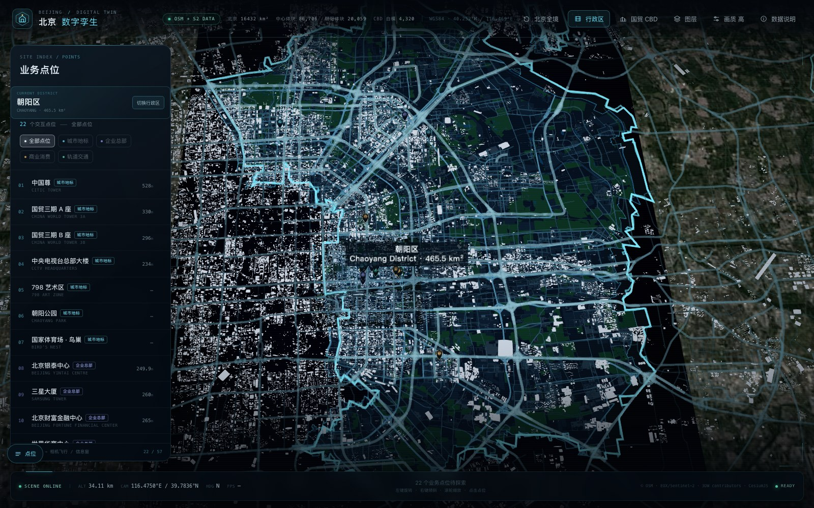
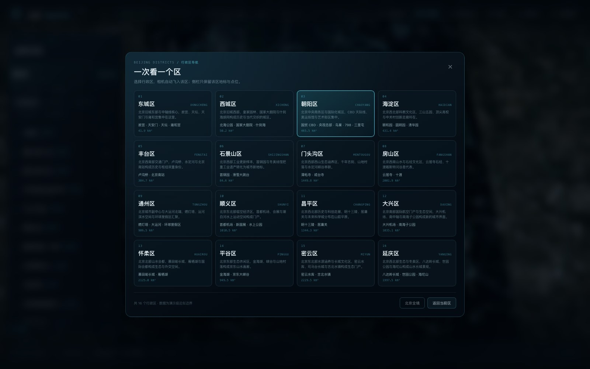
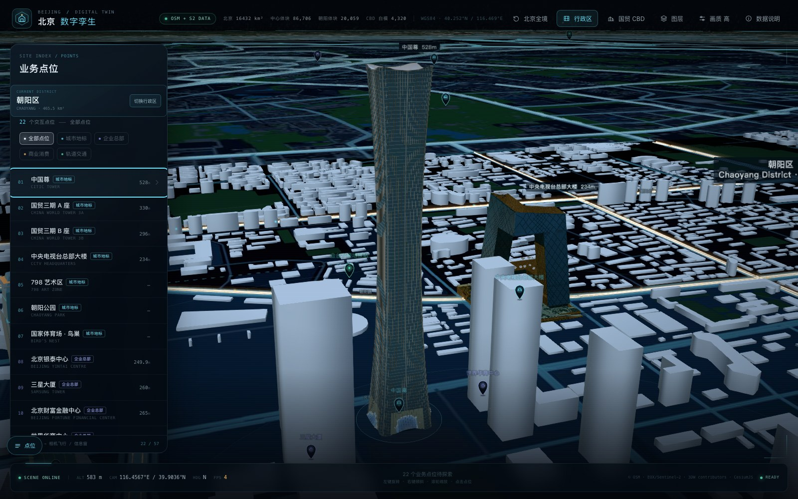
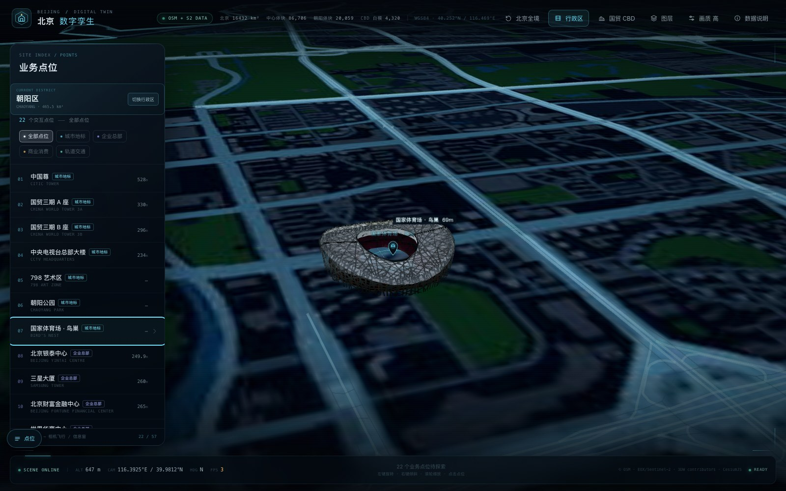

# 北京 · 数字孪生

> 用 CesiumJS + Vue 3 做「一次看一个区」的北京数字孪生：16 个行政区可切换，每个区独立相机、边界、地标与 POI；中心城区 86,706 个 GPU 实例化低模体块、国贸 CBD 精细白模、Sentinel-2 卫星底图，以及 6 个来自 3D Warehouse 的免费地标模型。
> **纯前端 · 零在线 Key · 静态可部署 · 构建产物可放在任意子路径。**



| 行政区导航 | 单区边界 / 地标 | 免费地标模型 |
| --- | --- | --- |
|  |  |  |

| 指标 | 本 Demo |
| --- | --- |
| 北京范围 | **16,432 km²**（DataV 近似边界，官方 16,410.54；含 16 区） |
| 中心城区低模体块 | **86,706 个 box 实例** / 1,040,472 三角面 / **3.3 MB**（`EXT_mesh_gpu_instancing`，OSM 中央城区 bbox） |
| 朝阳区低模体块 | **20,059 个 box 实例** / 240,708 三角面 / 0.8 MB |
| CBD 精细白模 | **4,320 栋** / 62,546 三角面 / 71,187 顶点 |
| 道路 | **18,062 条北京中心城区干路 + 7,632 条朝阳干路 + 1,398 条 CBD 道路** |
| 地标 | 6 个免费 3D Warehouse 模型（央视 / 中国尊 / 故宫 / 天坛 / 鸟巢 / 天安门）+ 2 个程序化（国贸三期 A/B） |
| 底图 | 北京 z11 卫星 + z10 周边上下文（Sentinel-2 cloudless, CC BY 4.0）+ 朝阳/CBD 暗色底图 |
| 行政区 | **16 个**，可逐区切换；每区独立边界、相机、地标与 POI |
| POI | **57 个**（覆盖 16 区；2026-11 新增各区地标） |
| 动态效果 | 主干道发光 + 112 个流光粒子 + 8 座地标环 |
| 数据依赖 | 全部本地；无 Cesium ion token、无在线瓦片、无后端 |
| 构建产物 | `dist/` 约 52 MB（8.8 MB Cesium + 5.2 MB 北京卫星底图 + 13.6 MB 北京数据 + 11.4 MB 免费模型 + 朝阳/CBD 数据） |

> ⚠️ **精度声明**：北京边界来自 DataV 展示用近似边界；中心城区体块高度由 OSM `height` / `building:levels` / 类型默认值估算；免费地标来自 3D Warehouse，受 GML 使用范围限制（**mapping/geographic application 与公开分发有额外限制，仅建议本地/内部演示**）。所有数据**不是测绘/BIM/竣工数据**，不可用于规划审批或工程量计算。详见 [数据来源与精度](#七数据来源与精度) 与 [`docs/landmark-models.md`](./docs/landmark-models.md)。

---

## 一、功能

- **一次一个区**：顶栏「行政区」打开 16 区选择器；选中后相机飞入该区，只显示该区边界、地标模型与 POI，其余区的点位/地标自动隐藏。
- **16 区地标目录**：东城 / 西城 / 朝阳 / 海淀 / 丰台 / 石景山 / 门头沟 / 房山 / 通州 / 顺义 / 昌平 / 大兴 / 怀柔 / 平谷 / 密云 / 延庆；默认朝阳区，可随时切换「北京全境」总览。
- **三层体块 LOD**：中心城区 86,706 个 OSM footprint box + 朝阳 20,059 个 + CBD 4,320 栋精细白模，全部通过 `EXT_mesh_gpu_instancing` / 3D Tiles 1.1；非免费地标区保留中心城区体块作背景；有免费地标的区在近景自动隐藏体块，只显示当前区地标与 POI。
- **免费地标模型**：央视总部、中国尊、故宫、天坛、鸟巢、天安门使用 3D Warehouse 免费 glTF；只有所属行政区内才显示。相机距离免费地标 15km 内会隐藏低模体块，保证 Forbidden City / Bird's Nest 等不穿模。作者与许可见 POI 信息窗及 [`docs/landmark-models.md`](./docs/landmark-models.md)。
- **道路与流光**：CBD 主干道 3 层霓虹合批，27,092 条北京/朝阳/CBD 道路使用 5 个 `PolylineCollection`；流光是沿主干道运行的 112 个 glow Billboard，总览自动隐藏。
- **POI 交互**：按当前行政区过滤的 Canvas 图钉 + 脉冲光环；57 个点位覆盖 16 区；点击打开屏幕锚定 InfoWindow，相机飞入/环绕。
- **操作**：左键旋转、右键倾斜、滚轮缩放；触屏保留双指缩放。
- **底图**：北京 Sentinel-2 卫星（本地） + z10 周边上下文 + 朝阳/CBD 暗色矢量底图；无在线瓦片、无 Cesium ion token。
- **HUD / 图层 / 移动端**：10 个图层开关；小屏侧栏变抽屉、信息窗变底部卡片；总览自动隐藏 POI 标签。

---

## 二、快速开始

```bash
cd apps/cbd-digital-twin
npm install

npm run dev        # http://127.0.0.1:5185/
npm run build      # → dist/（相对路径，可嵌套部署）
npm run preview    # http://127.0.0.1:5186/
npm run typecheck  # vue-tsc --noEmit
```

只重新生成地标模型（需要 `@gltf-transform/core`）：

```bash
npm run generate:models
```

北京 / 朝阳数据重跑（需要 `/tmp/Beijing.osm.gz`；详见 [docs/beijing-data.md](./docs/beijing-data.md)、[docs/district-data.md](./docs/district-data.md)）：

```bash
python3 tools/build-district-data.py --osm-gz /tmp/Beijing.osm.gz --boundary /tmp/chaoyang-boundary.geojson
python3 tools/build-beijing-data.py  --osm-gz /tmp/Beijing.osm.gz
```

在合集根目录下构建/预览：

```bash
cd ../..                       # 仓库根目录
node scripts/build-all.mjs --only cbd-digital-twin
npm run serve                  # → http://127.0.0.1:5180/demos/cbd-digital-twin/
```

> 本 Demo 不需要任何 `.env`。如果要在生产环境接入 Cesium ion 地形/影像，建议新建独立分支并自行管理 token，不要把 token 提交进 git。

---

## 三、目录结构

```text
apps/cbd-digital-twin/
├── index.html                    # Cesium BASE_URL 注入、首屏骨架
├── vite.config.ts                # base './'、自定义 Cesium 运行时资源插件
├── scripts/
│   └── generate-landmarks.mjs    # 程序化地标 → public/models/*.glb
├── public/
│   ├── data/                     # 数据管线产物（OSM，ODbL）
│   │   ├── beijing/              #   北京全域数据
│   │   │   ├── boundary.geojson  #     北京市 MultiPolygon（16,432 km²）
│   │   │   ├── districts.geojson #     16 区边界 / 中心 / 面积
│   │   │   ├── roads.geojson     #     18,062 条中心城区干路
│   │   │   ├── basemap.jpg       #     z11 卫星底图
│   │   │   ├── basemap-context.jpg #   z10 周边上下文底图
│   │   │   ├── meta.json
│   │   │   └── tiles/massing/    #     86,706 个 box 实例化 3D Tiles
│   │   ├── district/             #   朝阳区全域数据
│   │   │   ├── boundary.geojson  #     朝阳区 MultiPolygon 区界
│   │   │   ├── roads.geojson     #     7,632 条全域干路
│   │   │   ├── context.geojson   #     主要公园/水系
│   │   │   ├── basemap.jpg       #     3072px 全域暗色底图
│   │   │   ├── meta.json
│   │   │   └── tiles/district-massing/  # box 实例化 3D Tiles
│   │   ├── tiles/white-models/   #   CBD tileset.json + white-models.glb（3D Tiles 1.1）
│   │   ├── roads.geojson         #   1,398 条 CBD 可通车道路
│   │   ├── context.geojson       #   公园 / 水系 / landuse 面
│   │   ├── railways.geojson      #   地铁/铁路（可选）
│   │   ├── buildings-fallback.geojson
│   │   ├── basemap.jpg           #   2560×1772 暗色 CBD 底图
│   │   └── meta.json             #   来源 / bbox / 统计 / 高度模型 / 精度声明
│   └── models/
│       ├── cwtc-3a.glb / cwtc-3b.glb # 程序化地标
│       └── free/                 # 6 个 3D Warehouse 免费地标 + manifest
│           ├── cctv.glb / citic.glb / forbidden-city.glb
│           ├── temple-of-heaven.glb / birds-nest.glb / tiananmen.glb
│           └── manifest.json
├── src/
│   ├── App.vue                   # 页面编排 + Vue 状态 + CbdScene 生命周期
│   ├── components/               # TopBar / Sidebar / DistrictPanel / InfoWindow / LayerPanel / HUD / About / Loading
│   ├── cesium/
│   │   ├── CbdScene.ts           # Cesium 场景类：相机、图层、图元、拾取、轨道
│   │   └── utils/                # canvas 图标、GeoJSON/坐标工具
│   ├── data/
│   │   ├── districts.ts         #   16 区目录（区名/英文/面积/代表地标）
│   │   ├── poi.ts               #   57 个 POI / 地标配置 / 视角 / 图层
│   │   └── ...                  #   types / meta 适配
│   ├── styles/main.css           # 深色数字孪生视觉系统
│   └── main.ts
├── tools/                        # OSM → CBD / 全域数据的 Python 管线
│   ├── build-city-data.py        #   CBD 精细白模 / 道路 / 底图
│   ├── build-district-data.py    #   朝阳全域 boundary / 干路 / 实例化 box
│   └── build-beijing-data.py     #   北京 boundary / 卫星 / 中心城区 massing / 道路
├── docs/
│   ├── architecture.md           # 架构方案、状态机、性能与扩展点
│   ├── data-pipeline.md          # CBD 数据管线说明
│   ├── district-data.md          # 朝阳全域数据管线
│   ├── beijing-data.md           # 北京全域数据管线（边界/卫星/中心城区）
│   ├── landmark-models.md        # 免费地标模型来源、许可风险与 attribution
│   └── data-sources.md           # 【数据获取指南】模型/白模/道路/地形/许可
└── screenshots/                  # 封面与演示截图
```

---

## 四、架构设计

### 4.1 分层

```text
┌───────────────────────────────────────────────────────────────┐
│ Vue 3 UI（声明式响应式，不持有 Cesium 对象）                    │
│ TopBar / PoiSidebar / PoiInfoWindow / LayerPanel / HUD        │
│   状态：selectedPoi / anchor / layers / stats / orbitActive    │
└──────────────────────────────┬────────────────────────────────┘
                               │ 方法调用 + 回调
┌──────────────────────────────▼────────────────────────────────┐
│ CbdScene（命令式门面，单例类）                                  │
│  相机控制 / 图层开关 / 拾取 / 环绕 / 进度 / 生命周期            │
└──────────────────────────────┬────────────────────────────────┘
                               │ Cesium API
┌──────────────────────────────▼────────────────────────────────┐
│ CesiumJS 1.147（Viewer / Scene / Primitives / 3D Tiles）        │
└──────────────────────────────┬────────────────────────────────┘
                               │ fetch（本地静态文件）
┌──────────────────────────────▼────────────────────────────────┐
│ public/data/：meta / roads / context / railways / basemap      │
│ public/data/tiles/white-models/：tileset.json + GLB            │
│ public/models/：8 个地标 GLB（6 免费 + 2 程序化）              │
└───────────────────────────────────────────────────────────────┘
```

**关键取舍**：Cesium 对象（Viewer、Primitive、Billboard、Model）绝不放进 Vue 的 `reactive`，避免 Proxy 包裹导致 Cesium 内部判等/销毁异常。`App.vue` 只持有 `shallowRef<CbdScene>` 和纯数据状态；`CbdScene` 通过 `callbacks` 把进度、POI 选中、屏幕锚点、HUD 数据推回 Vue。

### 4.2 图层组装顺序（`CbdScene.loadCityLayers`）

1. 并行 fetch 全域 `district/meta.json` / `boundary.geojson` / `roads.geojson` 与 CBD 数据。
2. 底图：先画全域 `basemap.jpg`，再叠加更清晰的 CBD 底图（两层 `SingleTileImageryProvider`）。
3. 全域区界：MultiPolygon 填充 + 边界线 + 区名/面积 + 望京/798/首都机场等区域标签。
4. 道路：全域干路 2 个 `PolylineCollection`；CBD 精细道路 3 层合批；总览模式下自动切换为「全域暗色路网」避免 CBD 过曝。
5. 北京中心城区体块：`beijing/tiles/massing`，86,706 个 `EXT_mesh_gpu_instancing` box；单 root 无 LOD，`maximumScreenSpaceError=0.1` 保证首屏加载。
6. 朝阳体块：`district/tiles/district-massing`，20,059 个实例 box。
6. 流光：把 CBD 主干道折线等距采样成 `Cartesian3[]`，创建 112 个 Billboard，`preRender` 时按时间索引采样点（总览隐藏）。
7. CBD 白模：`Cesium3DTileset.fromUrl`，失败 → `GeoJsonDataSource` 拉伸兜底。
8. 地标：`Model.fromGltfAsync` + `forwardAxis: Axis.X` + `eastNorthUpToFixedFrame` 定位。
9. POI：`BillboardCollection` + `LabelCollection`，`billboard.id = poi` 供 `scene.pick` 直接取业务对象。

### 4.3 相机操作与状态机

- 鼠标：左键拖拽旋转（局部聚焦时视觉上近似平移，本质是地球旋转）、右键拖拽倾斜、滚轮缩放；触屏额外保留双指 PINCH。
- 右键菜单已 `preventDefault`，不会在倾斜结束时弹出浏览器菜单。

```text
initialView ──flyToBoundingSphere──> focusing ──complete──> idle
     ▲                                  │                     │
     │                                  │ 点击「环绕浏览」      │ 拖拽/滚轮/关闭信息窗
     └──────────── resetView ◄──────────┴──── orbit ◄──────────┘
```

- **聚焦**：`camera.flyToBoundingSphere(target, { offset: HeadingPitchRange, duration: 2.1 })`，按 POI 高度/焦点距离配置。
- **环绕**：`camera.lookAtTransform(ENU(target), new HeadingPitchRange(heading, pitch, range))`，在 `preRender` 里递增 heading；退出时 `lookAtTransform(Matrix4.IDENTITY)` 保持当前世界位姿。
- **用户接管**：canvas 的 `pointerdown` / `wheel` / `touchstart` 会立即停止环绕。
- **屏幕锚点**：InfoWindow 不放在 Cesium 的 `infoBox` 里。每帧用 `scene.cartesianToCanvasCoordinates()` 把 POI 世界坐标投影为屏幕坐标，Vue 仅更新 `left/top`；相机前后判断避免背面弹窗。

---

## 五、核心实现（节选）

> 完整实现见 [`src/cesium/CbdScene.ts`](./src/cesium/CbdScene.ts)、[`src/App.vue`](./src/App.vue)、[`src/components/PoiInfoWindow.vue`](./src/components/PoiInfoWindow.vue)。

### 5.1 场景初始化 / 隐藏 UI / 地形深度检测

```ts
this.viewer = new Cesium.Viewer(container, {
  animation: false, timeline: false,
  baseLayer: false, baseLayerPicker: false, geocoder: false,
  homeButton: false, sceneModePicker: false, navigationHelpButton: false,
  fullscreenButton: false, infoBox: false, selectionIndicator: false,
  scene3DOnly: true,
  terrainProvider: new Cesium.EllipsoidTerrainProvider(),
  creditContainer,             // 隐藏默认版权条，署名收进「数据说明」
  targetFrameRate: 60,
  msaaSamples: 1, // 关闭 4x MSAA，改用 FXAA：Retina 下曾是大头开销
});

const scene = this.viewer.scene;
scene.globe.depthTestAgainstTerrain = true;   // 防止模型/线穿入地形
scene.globe.baseColor = Cesium.Color.fromCssColorString('#071019');
scene.skyAtmosphere.show = false;
scene.light = new Cesium.DirectionalLight({ direction: lightDir, intensity: 2.4 });
```

初始视角：全域总览使用 `INITIAL_VIEW`（116.5094°E, 39.9524°N，`HeadingPitchRange(0.08, -1.05, 36000)`，移动端 52000）后立即 `lookAtTransform(Matrix4.IDENTITY)` 释放局部参考系；点击「国贸 CBD」再飞入 `CBD_VIEW`。后续飞行/拖拽都在世界坐标中完成。

### 5.2 白模 3D Tiles 与地标 glTF

```ts
// 1) OSM 白模 → 3D Tiles 1.1（glTF content）
const tileset = await Cesium.Cesium3DTileset.fromUrl(
  assetUrl('data/tiles/white-models/tileset.json'),
  { maximumScreenSpaceError: 16, dynamicScreenSpaceError: true },
);
tileset.style = new Cesium.Cesium3DTileStyle({ color: "color('#d7e7f2')" });
viewer.scene.primitives.add(tileset);

// 2) 独立 glTF 地标：ENU 定位 + 显式轴向修正
const model = await Cesium.Model.fromGltfAsync({
  url: assetUrl('models/citic-tower.glb'),
  modelMatrix: Cesium.Transforms.eastNorthUpToFixedFrame(
    Cesium.Cartesian3.fromDegrees(116.46014, 39.91157, 0),
  ),
  // glTF 约定 x=东 / y=上 / z=南；Cesium 独立 Model 默认 forwardAxis=Z，
  // 会额外绕 Y 轴转 90°，长轴建筑（如央视总部）必须显式指定 X。
  forwardAxis: Cesium.Axis.X,
  scale: 1,
});
viewer.scene.primitives.add(model);
```

3D Tiles 的 glTF content 与独立 Model 的轴约定不同：3D Tiles 默认 `modelUpAxis=Y`、`modelForwardAxis=X`，因此白模 GLB 用 `x=east / y=up / z=-north` 即可；独立 `Model` 必须写成 `forwardAxis: Cesium.Axis.X`，否则会多转 90°。这个坑详见 [`docs/architecture.md`](./docs/architecture.md)。

### 5.3 道路发光与流光

```ts
// 1,398 条道路全部用 Primitive API 合批；主干道叠三层形成霓虹光晕
const halo = new Cesium.PolylineCollection();   // 宽而淡的光晕
const glow = new Cesium.PolylineCollection();   // PolylineGlow
const core = new Cesium.PolylineCollection();   // 窄亮芯
const glowMaterial = Cesium.Material.fromType('PolylineGlow', {
  color: Cesium.Color.fromCssColorString('#ffbd6f').withAlpha(0.5),
  glowPower: 0.22,
  taperPower: 0.7,
});

halo.add({ positions, width: 17, material: Cesium.Material.fromType('Color', {
  color: Cesium.Color.fromCssColorString('#ffb35c').withAlpha(0.075),
}) });
glow.add({ positions, width: 8, material: glowMaterial });
core.add({ positions, width: 1.45, material: Cesium.Material.fromType('Color', {
  color: Cesium.Color.fromCssColorString('#ffe8c4').withAlpha(0.82),
}) });

viewer.scene.primitives.add(halo);
viewer.scene.primitives.add(glow);
viewer.scene.primitives.add(core);

// 支路同材质合批，避免逐条 Entity 产生数千 draw call
const minor = new Cesium.PolylineCollection();
minor.add({
  positions,
  width: 1.05,
  material: Cesium.Material.fromType('Color', {
    color: Cesium.Color.fromCssColorString('#153243').withAlpha(0.58),
  }),
});
viewer.scene.primitives.add(minor);

// 流光：把折线按 15m 等距采样，preRender 时按时间取索引，不每帧重建几何
const s = (particle.offset + elapsed * particle.speed) % route.length;
particle.billboard.position = route.samples[Math.floor(s / route.step)];
```

### 5.4 POI 拾取与自定义 InfoWindow

```ts
// 拾取：pick 直接拿到 billboard.id（业务 POI 对象）
handler.setInputAction(({ position }) => {
  const picked = viewer.scene.pick(position);
  const poi = this.poiFromPicked(picked);
  poi ? this.selectPoi(poi) : this.clearSelection();
}, Cesium.ScreenSpaceEventType.LEFT_CLICK);

// 投影：postRender 把世界坐标换算为屏幕坐标，Vue 只负责渲染 HTML 卡片
const anchor = worldToScreen(scene, this.selectedWorld);
this.callbacks.onAnchor?.({ x: Math.round(anchor.x), y: Math.round(anchor.y), visible: anchor.visible });
```

```vue
<!-- InfoWindow 完全由 HTML/CSS 实现，不依赖 Cesium infoBox -->
<div class="info-window" :style="{ '--poi-color': meta.color, ...placement.style }">
  <span class="info-arrow" aria-hidden="true"></span>
  <h3>{{ poi.name }}</h3>
  <div class="info-stats">
    <div v-for="stat in poi.stats" :key="stat.label">
      <span>{{ stat.label }}</span><b>{{ stat.value }}</b>
    </div>
  </div>
  <button @click="emit('toggle-orbit')">{{ orbitActive ? '停止环绕' : '环绕浏览' }}</button>
</div>
```

移动端：`left/top` 锚定策略在 `< 760px` 时切换为底部固定卡片；侧栏改为抽屉；隐藏 POI 文字标签，避免遮挡三维场景。

---

## 六、数据获取指南（摘要）

> 完整 500 行指南（含 61 个来源、Overpass QL、py3dtiles / 3d-tiles-tools 命令、许可检查表）：[`docs/data-sources.md`](./docs/data-sources.md)。
> 本项目的 OSM → 白模/全域管线：[`tools/README.md`](./tools/README.md)、[`docs/data-pipeline.md`](./docs/data-pipeline.md)、[`docs/district-data.md`](./docs/district-data.md)。

### 6.1 国贸免费模型去哪找？

**先接受一个现实：免费的高精度国贸三期 / 中国尊 / 央视官方模型基本不存在。** 官方 BIM、竣工模型不公开；Sketchfab 上可下载结果大多不是目标建筑。可用的替代路线：

| 方案 | 是否免费 | 说明 |
| --- | --- | --- |
| **程序化示意体量（本项目）** | ✅ | 按公开高度 + 平面轮廓生成 glTF，可完全离线；适合演示，不适合测绘 |
| Cesium ion · OSM Buildings | 有免费额度 🔑 | 全球 OSM 白模 3D Tiles，需 token；精度取决于 OSM |
| Cesium ion · Google Photorealistic 3D Tiles | 需 token/计费 🔑 | 摄影测量实景，受 Google 条款约束，中国大陆覆盖需自行核实 |
| Sketchfab | ✅/付费 | 筛选 CC0 / CC-BY；核对比例与位置；保留许可凭证 |
| SketchUp 3D Warehouse | ✅/需账号 | 用户模型，skp → glTF；地理配准通常要手工对齐 |
| 商业航测 / 倾斜摄影 | 💰 | 厘米级、可量测；需商务采购与测绘资质合规 |

获取流程、Sketchfab 搜索词与 Cesium 加载代码见指南第 1 节。

### 6.2 朝阳区白模怎么生成 / 获取？

**本项目路线（可完全离线）**：

```text
BBBike Beijing OSM extract（.osm.gz）
  → tools/build-city-data.py 解析 bbox 内 building / highway / landuse
  → footprint + height/levels 估算高度，耳切法三角化
  → glTF（x=east, y=up, z=-north）
  → 3D Tiles 1.1（tileset.json + glb，ENU→ECEF transform）
  → public/data/tiles/white-models/
```

```bash
# 只做结构/几何校验（无需重新下载原始数据）
python3 tools/build-city-data.py --verify-only

# 从已解析的 GeoJSON 重建
python3 tools/build-city-data.py \
  --input /tmp/cbd-data/osm-filtered.geojson \
  --out public/data

# 从头下载 BBBike 北京 extract 再解析（约 48 MB，较慢）
python3 tools/build-city-data.py --osm-gz /tmp/Beijing.osm.gz --out public/data
```

高度模型：`height`（去 `m`）→ `building:levels × 3.2 + 1.2` → 按建筑类型默认值；缺失字段会显著影响天际线，生产环境应采购带高度的数据或人工校准。其他路线（py3dtiles、3d-tiles-tools、QGIS + ion、FME、自研 b3dm）见指南第 2 节。

### 6.3 道路 GeoJSON 怎么下载？

- **Overpass API / overpass turbo**：按 `highway` 分类导出 bbox 内道路为 GeoJSON（推荐，即时）。
- **BBBike / Geofabrik**：下载城市/国家 OSM extract，再用 QGIS / osmium / 本项目管线裁剪。
- **QGIS**：QuickOSM 下载 → 过滤 `highway` → 导出 GeoJSON（WGS84）。
- **在线矢量瓦片**：MapTiler / Mapbox / 天地图 / 高德；CesiumJS 1.142+ 已提供实验性 `MVTDataProvider`（本项目未使用，保持零 key），旧方案可用第三方 MVT imagery provider 或服务端转 GeoJSON。
- 高德/腾讯底图是 **GCJ-02**，不能直接叠到 Cesium WGS84 上；天地图 CGCS2000 可近似当 WGS84。

本项目的 `public/data/roads.geojson` 来自 BBBike 北京 extract：CBD 1,398 条、朝阳 7,632 条、北京中心城区 18,062 条；北京路网由 `tools/build-beijing-data.py` 生成，剔除朝阳/CBD 已精细渲染范围避免重复。Overpass QL 示例见指南第 3 节。

### 6.4 地形 / 影像 / token

本 Demo 使用 `EllipsoidTerrainProvider` + 本地 Sentinel-2 卫星底图 + 本地白模，**不需要任何 key，也不会请求在线瓦片**。生产环境如需 World Terrain / 实景影像：
1. 申请 Cesium ion token，设置 `Cesium.Ion.defaultAccessToken`（只存服务端注入或环境变量，勿提交）；
2. 加载 `Cesium.createWorldTerrainAsync()`，同时把道路/POI 改为地面贴合（`clampToGround` / `GroundPolylinePrimitive`）；
3. 注意 CGCS2000 / GCJ-02 / WGS84 偏移与数据署名（OSM ODbL、影像供应方 ToS）。

---

## 七、数据来源与精度

| 数据 | 来源 | 许可 | 精度/说明 |
| --- | --- | --- | --- |
| 北京边界 / 16 区 | DataV.GeoAtlas（GCJ-02→WGS84） | 展示用近似边界 | 16,432 km²（官方 16,410.54，+0.13%）；非测绘成果 |
| 北京中心城区体块 | OSM（BBBike Beijing extract 2026-10-31） | ODbL 1.0 | 86,706 个 OBB box 实例；仅覆盖中央城区 bbox |
| 朝阳全域体块 | 同上 | ODbL 1.0 | 20,059 个 OBB box 实例；低模示意 |
| CBD 精细白模 | 同上 | ODbL 1.0 | 4,320 栋；高度按 OSM/估算，非实测 |
| 道路 / 绿地 / 水系 | 同上 | ODbL 1.0 | 北京中心 18,062 + 朝阳 7,632 + CBD 1,398 条 |
| 北京卫星底图 | EOX Sentinel-2 cloudless 2020 | CC BY 4.0 | z11 3072×2408 + z10 上下文 3072×2422；本地缓存 |
| 朝阳 / CBD 底图 | 由 OSM 数据离线绘制 | ODbL Produced Work | 3072/2560px JPEG；与矢量对齐 |
| 6 个免费地标 | 3D Warehouse（作者见 manifest） | 3D Warehouse GML | 央视 / 中国尊 / 故宫 / 天坛 / 鸟巢 / 天安门；**仅建议本地/内部演示** |
| 国贸三期 A/B | 本项目程序化生成 | 自制 | 仅示意体量 |
| POI 高度/层数 | 公开资料 + OSM 字段 | 演示用途 | 位置/数值可能有误差 |
| CesiumJS | Cesium GS | Apache-2.0 | 署名保留在「数据说明」面板 |

使用/分发时请保留 **© OpenStreetMap contributors (ODbL 1.0)**、**Sentinel-2 cloudless by EOX IT Services GmbH (CC BY 4.0)** 与 Cesium 署名。3D Warehouse 模型遵循 GML，**不得在未授权的 mapping/geographic application 中公开使用，也不得单独分发模型文件**；公开部署前请替换为 CC0/CC-BY 资产或取得 Trimble 书面许可，详见 [`docs/landmark-models.md`](./docs/landmark-models.md)。

---

## 八、性能设计

### 8.1 白模不是「逐栋加载真模型」，而是地图形状拉伸

很多人会把白模理解成 4,320 个独立的 3D 模型文件，实际上本项目的白模是 **OSM building footprint 直接拉伸出来的棱柱**：

```text
OSM 建筑多边形（地图上的真实脚印）
  → 耳切法三角化屋顶 / 每边生成墙面
  → 按 height/levels 估算高度（平均每栋仅 14.5 个三角形、16.5 个顶点）
  → 4,320 栋合并成 1 个 GLB（1 mesh / 1 primitive / 0 贴图 / 1 材质）
  → 3D Tiles 1.1 一次加载
```

因此当前实现已经等价于「根据地图形状拉成立方体」，只是保留了多边形街道轮廓和屋顶三角化。**独立的 8 个 glTF 只是地标模型**（6 个免费 3D Warehouse 模型 + 2 个程序化；约 13.7 万三角面），不是周边白模。

如果把每栋楼进一步简化成 12 个三角形的立方体，对 CBD 4,320 栋而言理论三角面只从 **62,546** 降到约 **51,840**（约 17%），但会丢掉 L 形、凹字形、庭院等真实脚印；渲染收益很小，不建议为整体城市肌理做这种替换。真正要优化时，优先用**顶栏画质档位 / 自适应分辨率**、按需做核心区裁剪、LOD 分块。


- **Entity vs Primitive**：地标地面环等少量对象用 Entity；道路全部走 `PolylineCollection` 合批——CBD 主干道 3 层（宽淡光晕 / glow / 亮芯），北京/朝阳干路各 1 层，避免逐段 Entity 的 draw call 爆炸。
- **3D Tiles**：CBD 4,320 栋合成 1 个 GLB；北京中心城区 86,706 栋 + 朝阳 20,059 栋各合成 1 个实例化 GLB（0.8–3.3 MB、3 个高度分档 node）。单 root 无 LOD 的 tileset 在远视距下需把 `maximumScreenSpaceError` 压到 0.1 才会请求内容，本项目已处理。
- **实例化**：中心城区与朝阳体块使用 `EXT_mesh_gpu_instancing` 的 TRANSLATION / ROTATION / SCALE，把 10.6 万栋 box 压到约 4.1 MB；不逐栋建 Entity/Model。
- **三级 LOD**：相机高度 >15 km 时使用暗色路网 + 隐藏 CBD 流光/精细道路/地标标签；近景隐藏朝阳体块、仅保留中心城区体块与地标；<5 km 提亮卫星底图。
- **POI**：57 个 Billboard + 57 个 Label；按行政区过滤，行政区视角放宽标签高度，总览/小屏隐藏。
- **流光**：只更新 Billboard 的 position，不重建 `PolylineGeometry`；等距采样避免每帧三角函数/分配。
- **渲染（2026-11 性能优化后）**：`msaaSamples: 1` + FXAA（原 **MSAA 4** 是卡顿主因）；`resolutionScale` 默认 1x 设备原生像素，并由 **auto 画质档**按实测 FPS 闭环调节（0.55–1.0，不超过原生分辨率做无意义超采样）；关闭阴影/大气/雾；固定方向光。
- **交互节流**：`MOUSE_MOVE` 的 `scene.pick` 节流到 ~15Hz；POI 标记只在「选中 / 悬停」状态变化时才更新，避免移动鼠标时反复重建 Billboard/Label 纹理。
- **画质档位**：顶栏「画质」可在 **自动 / 高 / 中 / 低** 间切换（快捷键 `Q`），选择记录在 localStorage。自动档：连续 2 次采样 < 55 CSS fps 就降 7% 渲染分辨率，连续 4 次 ≥ 59 fps 再缓慢升 3%，并带 1s 冷却与热身期，避免相机飞行时来回抖动。

### 性能实测（Apple M1 Max · ANGLE Metal · headless Chromium）

| 配置 | 渲染像素 / 帧 | FPS |
| --- | --- | --- |
| 优化前（MSAA 4 + `resolutionScale` 1.5，1728×1117 @2x） | 5184×3351 ≈ 17.4M | **22** |
| 优化后（MSAA 1 + 自动 100%，同尺寸） | 3456×2234 ≈ 7.7M | **60** |
| 外接大屏 2560×1440 @2x（自动 100%） | 5120×2880 ≈ 14.7M | **60**（拖拽 57） |

> 不同机器/浏览器会有差异；如果仍偏卡，把顶栏「画质」切到「中」或「低」，或保留「自动」让它自行降分辨率。
- **可扩展点**：真实城市级数据建议把道路/地块也切 3D Tiles 或使用矢量瓦片，POI 走按需加载 + 聚合，白模使用 Draco/Meshopt 压缩。

构建产物中 Cesium 运行时资源约 **8.8 MB**（Workers / Assets / ThirdParty / Widgets），北京卫星底图约 **5.2 MB**，北京数据约 **13.6 MB**（含 3.3 MB massing、4.4 MB 道路、2.5 MB 市域底图 + 2.5 MB context），免费地标约 **11.4 MB**，JS gzip 约 **1.4 MB**。

---

## 九、生产化升级清单

- [ ] 用有授权的 BIM / 倾斜摄影 / Cesium ion 自建 3D Tiles 替换 `public/data/tiles/white-models/`（保持 transform 或改用 `tileset.transform`）；
- [ ] 用官方/授权高精度 glb 替换 `public/models/free/*.glb`（或取得 3D Warehouse GML 的书面许可），并同步 `docs/landmark-models.md`；
- [ ] 用有授权的倾斜摄影 / 3D Tiles 替换 `public/data/beijing/tiles/massing/`；
- [ ] 接入 World Terrain + 在线影像，并把道路/POI 改为贴地；
- [ ] 替换 POI 为真实业务接口数据（企业、客流、招商、告警），增加聚合/搜索；
- [ ] 静态资源上 CDN，开启 Brotli；3D Tiles 与底图分域缓存；
- [ ] 生产构建开启 CSP / token 域名白名单；不要把 ion token 写进前端 bundle。

## 十、已知限制

1. **不是测绘成果**：北京边界为 DataV 展示用近似边界；白模/地标/POI 为演示级数据，存在位置、高度、形态误差。
2. **无真实地形**：使用椭球面；真实地形下模型会需要贴地/开挖处理。
3. **底图分辨率有限**：北京全境使用 Sentinel-2 z11（约 60 m/px）+ z10 上下文（约 120 m/px）；朝阳/CBD 有离线暗色底图，近景外围会偏模糊。
4. **免费地标是第三方模型**：3D Warehouse 模型为示意/爱好者资产，非官方 BIM；国贸三期 A/B 为程序化体量。
5. **3D Warehouse 许可限制**：GML 对 mapping/geographic application 与公开分发有额外限制；本 Demo 仅建议本地/内部演示，公开部署需替换为 CC0/CC-BY 或取得 Trimble 书面许可。
6. **POI 数据为静态演示**：时间、客流、企业信息未接入实时接口；各区只有由公开资料整理的代表性地标，不是完整景点库。
7. **体块/白模加载**：单 root tileset 在远视距必须用低 `maximumScreenSpaceError` 才会请求 content；本项目已压到 0.1，保证行政区视角也显示白模/体块。
8. **中心城区体块只覆盖 OSM 中央城区 bbox**（39.68–40.18°N / 116.08–116.77°E）；延庆、密云、怀柔、平谷等外围仅有卫星底图与边界。体块为 OBB box 近似，高度多为估算。

---

## 文档索引

- [数据获取指南（500 行，含 61 个来源）](./docs/data-sources.md)
- [北京全域数据管线](./docs/beijing-data.md)
- [朝阳全域数据管线](./docs/district-data.md)
- [免费地标模型与许可](./docs/landmark-models.md)
- [CBD 数据管线说明](./docs/data-pipeline.md)
- [架构方案与状态机](./docs/architecture.md)
- [OSM 管线工具用法](./tools/README.md)

## License

代码：可与本仓库其他 Demo 相同的演示用途使用。数据：OSM ODbL 1.0；Sentinel-2 cloudless by EOX IT Services GmbH（CC BY 4.0）；DataV.GeoAtlas（展示用近似边界）；CesiumJS Apache-2.0。国贸三期 A/B 程序化模型为自制示意资产。3D Warehouse 模型版权归原作者，遵循 GML，**公开部署前请取得 Trimble 书面许可或替换为 CC 授权资产**。
