# 潮线 TIDELINE · 3D 动态水淹模拟分析系统

> **用一根滑块把海平面推上山，看一座滨海城市怎样被淹。**
> CesiumJS 1.147 + Vue 3 + Vite 的纯前端 WebGIS Demo：地形、地表贴图、城市 3D Tiles（**10 个 b3dm / 1067 栋**）全部**程序化生成本地加载**，水面是 ShaderToy「Seascape」(TDM, Ms2SD1) 移植到 Cesium 的**屏幕空间后处理**，滑块驱动水位、实时输出淹没统计。

**纯前端 · 零后端 · 无 Cesium ion Token · 无运行期网络请求 · 静态可部署到任意子路径。**

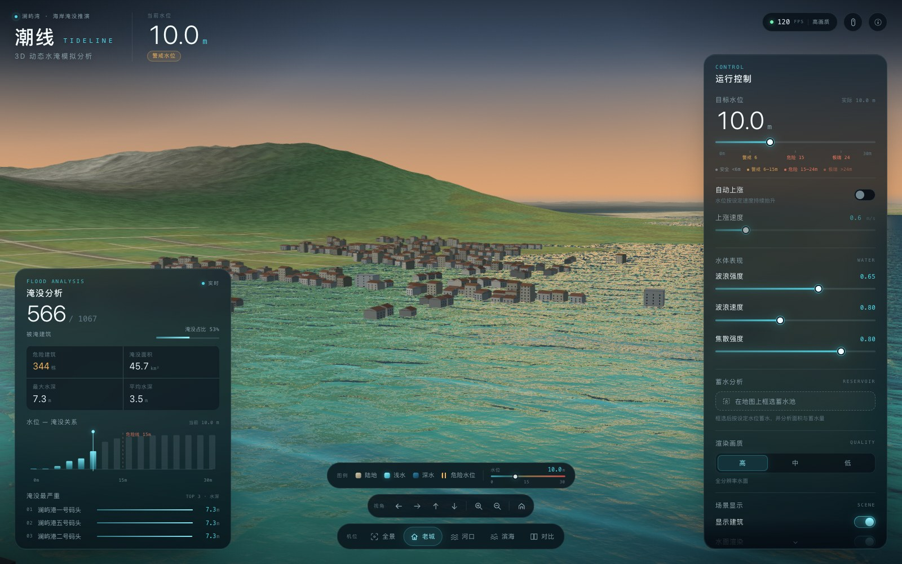

| 全景 · 水位 2.5 m | 全景 · 水位 15 m | 老城 · 水位 15 m |
| --- | --- | --- |
| 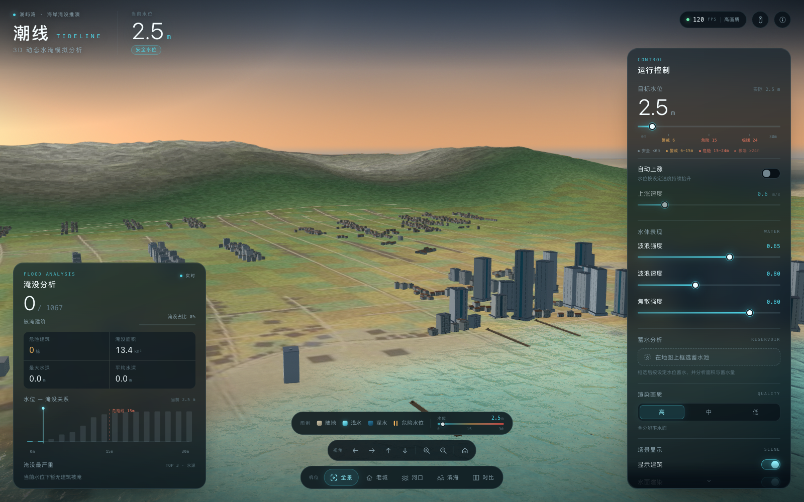 | 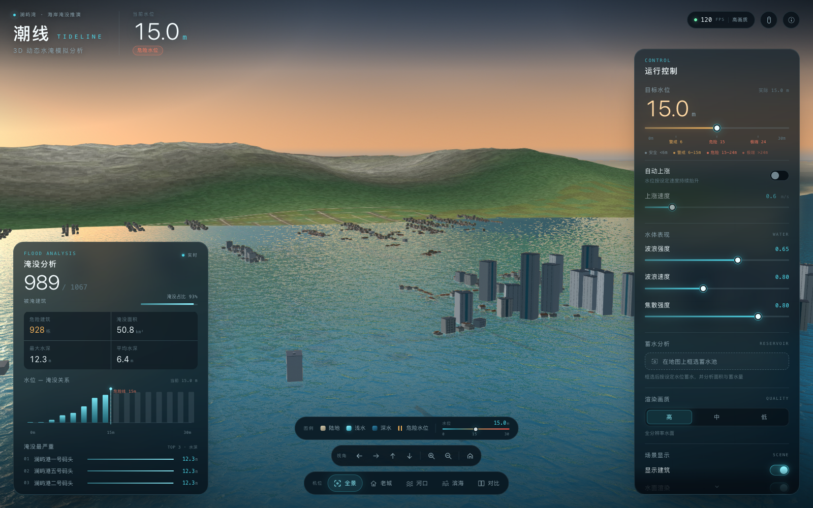 | 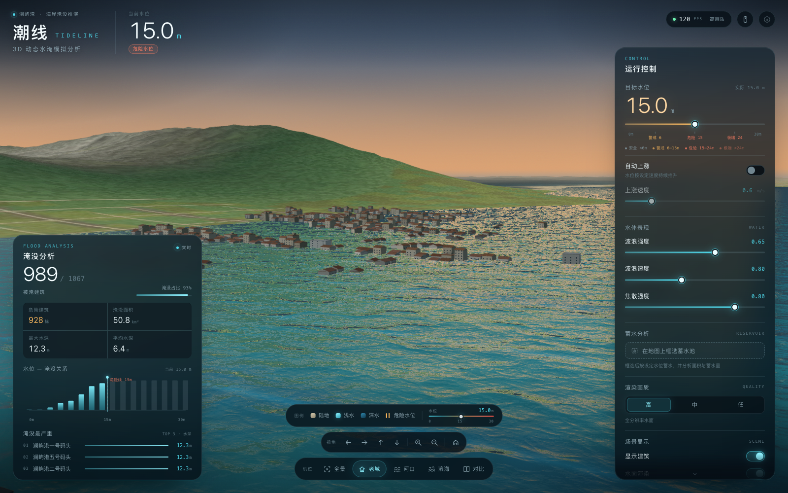 |

| 老城 · 水位 2.5 m | 移动端 | 窄屏（900 px） |
| --- | --- | --- |
| 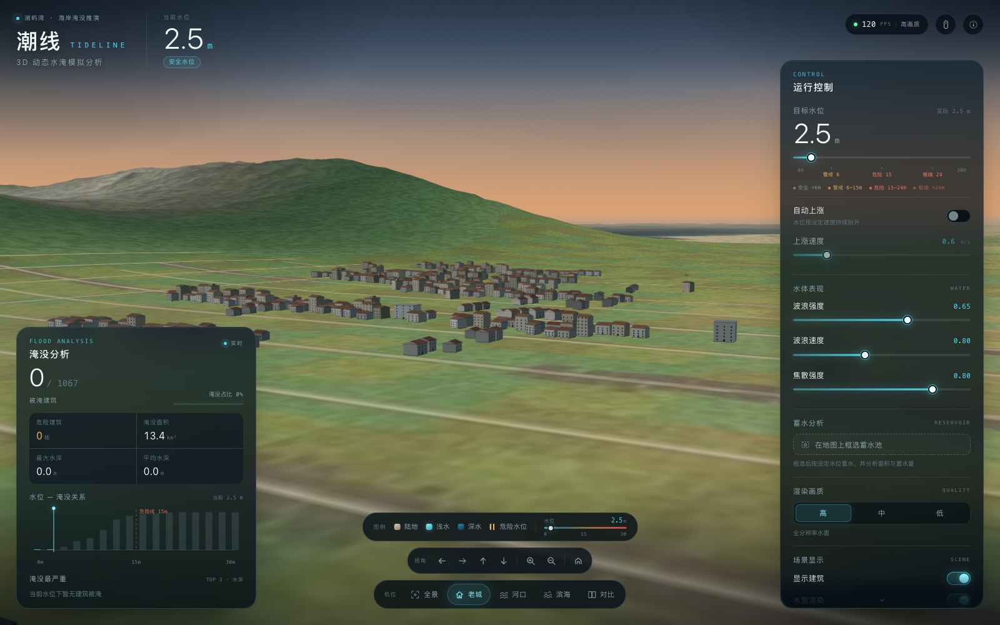 | 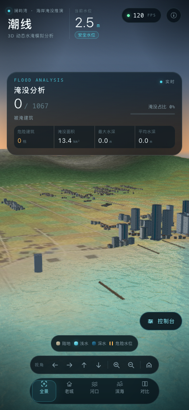 | 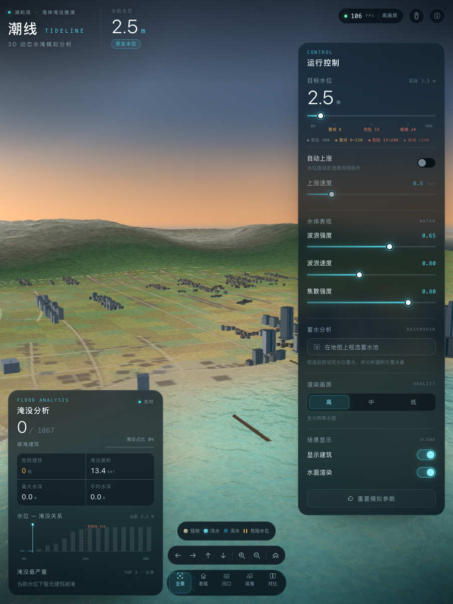 |

| 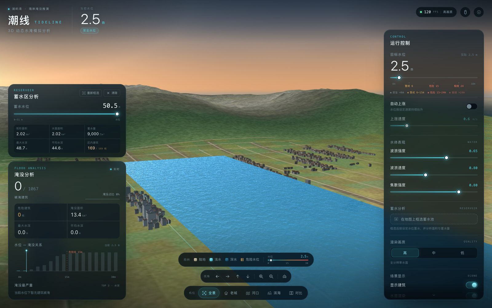 |  |  |
| --- | --- | --- |
| 山间框选蓄水区：水位 50.5 m，矩形 2.02 km² / 水面 2.02 km² / 蓄水量 9,000 万 m³、区内 169/169 栋被淹 | 放大后的建筑体量（老城 3–4F 坡顶） | 滨海新区高层与码头 |

> 首页封面：`screenshots/cover.jpg`。分镜为 headless Chromium（1600×1000，WebGL2 / ANGLE Metal）实拍，文件名为固定契约（`final-overview-2_5.png` / `final-overview-15.png` / `final-village-2_5.png` / `final-village-15.png` / `final-zone.png` / `final-ui-mobile.png` / `final-ui-narrow-900.png`），内容会随水面/UI 收尾迭代更新；开发期中间截图保留在 [`screenshots/wip/`](./screenshots/wip/)。

---

| 指标 | 本 Demo（实测） |
| --- | --- |
| 地区 / 范围 | 虚构的闽东海岸「澜屿湾」，14 km × 12 km（局部 ENU 米，原点 `120.05°E, 26.98°N`） |
| 地形 | **程序化高程纯函数**实时生成，`CustomHeightmapTerrainProvider`，每瓦片 64×64 采样，最大层级 18 |
| 最大 LOD 精度 | level 18 瓦片约 **68 m × 76 m**，采样间距 **1.1~1.2 m** |
| 城市 | **澜屿市 · 1067 栋**（建成区约 3.9 × 3.4 km）：老城 233 + 西城 320 + 北城 200 + 滨海新区 263 + 滨海 CBD 46 + 滨水公共带 5；`kind` → 民居 621 / 商住 319 / 公寓 66 / 塔楼 40 / 公共 6 / 地标 9 / 码头 6；`type`（schema）→ house 621 / shop 425 / public 15 / pier 6 |
| 建筑体量 | 民居 3–4F、高 10.6–13.9 m（坡顶）；商住 4–7F、14.1–27.7 m；公寓 10–18F、30.9–59.1 m；**CBD 塔楼 40 栋 20–40F、71.5–146.7 m**；**地标 9 栋 18–52F、62.2–188.2 m**（其中 6 栋 ≥150 m）；公共 6 栋 4–18F；码头 6 座；最高 **188.2 m** |
| 3D Tiles | **10 个 b3dm**（old-west 119 / old-east 114 / west-north 196 / west-south 124 / north 200 / harbor-west 127 / harbor-mid 71 / harbor-east 65 / cbd-north 41 / cbd-south 10 栋），合计 **11,726,628 B（11.18 MiB）**；多 tile `tileset.json`（root 空节点 + 10 children，`refine: ADD`），batch table 8 个字段 |
| 几何 | **247,906 顶点 / 123,134 三角面**（预算 13 万面、余量 6,866；民居/商铺只做前后立面窗），逐顶点色 + PBR 材质 |
| 道路 | **48 条 / 75,171 m**：主路 9–12 m（滨海大道/西/北/南环路 12 m、港城大道 11 m、澜屿街等 10 m、CBD 金融街 9 m）、巷 4.2–6 m；中心线进 `roads.json`，烘进地表贴图 |
| 水面 | `Cesium.PostProcessStage` 屏幕空间水面，三档画质 `textureScale = 1.0 / 0.75 / 0.5` |
| 地面高程 | 城市 **1.70–23.99 m**；建筑 `minGround` **2.65–23.36 m**（非栈桥最低 2.72 m；西城 8.96–23.36、北城 9.61–18.86、老城 6.47–12.33、滨海 2.65–6.78）；最高建筑 **188.2 m** |
| 淹没统计 | **1067 栋**逐栋判定 + **168×144** 高程网格（约 83 m 一格）面积统计，5.5 Hz 更新 |
| 蓄水区分析 | 地形上左键拖拽框选矩形 → `RectangleGeometry` + `Primitive` + Seascape Material 水面；**64×64** 地形采样 → 矩形面积/水面面积/最大水深/平均水深/蓄水量/区内建筑；验收用例 `draw/clear reservoir zone` 通过 |
| 构建产物 | `dist/` 约 **30 MB**（`du -sh`；精确 25,631,979 B = 24.44 MiB / 363 文件）：assets 5.04 MiB（主 chunk 4.85 MiB / gzip 1.34 MiB）+ Cesium 运行时 6.72 MiB + 生成数据 12.69 MiB |
| 首屏初始化 | 生产构建实测 **≈2.57 s**（地表贴图生成约 1.82 s，占 71%；`?timing` 可看各阶段） |
| 帧率（headless） | 1600×1000（Apple M1 Max / ANGLE Metal / 当前生产构建）：overview 视角 high **120**（环境上限）/ medium 120 / low 120 fps，**sea 海面视角 63 fps**；draw call 164/97/77（详见 [§6.1](#61-先看实测三档画质到底差多少)） |
| 依赖 | `cesium@1.147.0`、`vue@3.5`、`vite@6`；无 UI 框架、无图标库、无 Cesium ion |

> ⚠️ **精度声明（先读这一段再看效果图）**
> 1. 这**不是水文/洪水演进模型**。水位是一个全局标量（海拔，米），淹没判定是「地形/建筑地基高程 < 水位」的**静态几何比较**，没有流场、流速、演进时间、堤坝溃决、潮汐/波浪爬高，也没有考虑建筑对水体的阻挡。
> 2. 水面是**屏幕空间近似**：深度重建 + 射线与球面求交 + 解析着色，不是流体模拟；折射/反射/焦散都是屏幕空间或解析近似。
> 3. 地形、城市（澜屿市）、道路都是**程序化虚构**（固定随机种子可复现），不代表任何真实地点，不能用于规划、审批或工程量计算。
> 4. 淹没面积以 83 m 网格离散统计，小尺度地形（河道、田埂）会被抹平；建筑判定用占地四角 + 中心的**最低地基** `minGround`，对坡地建筑偏保守（更容易判为被淹）。

---

## 目录

- [一、快速开始](#一快速开始)
- [二、项目架构](#二项目架构)
- [三、场景初始化与地形 / 3D Tiles 加载](#三场景初始化与地形--3d-tiles-加载)
- [四、ShaderToy Ms2SD1（Seascape）→ Cesium 完整转换](#四shadertoy-ms2sd1seascape-cesium-完整转换)
- [五、动态水位控制与淹没分析](#五动态水位控制与淹没分析)
- [六、性能优化](#六性能优化)
- [七、数据准备指南（换成真实数据）](#七数据准备指南换成真实数据)
- [八、运行、构建与自测](#八运行构建与自测)
- [九、已知限制、后续路线与致谢](#九已知限制后续路线与致谢)

补充文档：

- [`docs/architecture.md`](./docs/architecture.md) —— 架构细节：坐标系约定、模块数据契约、初始化时序、逐帧循环
- [`docs/flood-analysis.md`](./docs/flood-analysis.md) —— 淹没分析的数学、误差来源与真实数据升级路径
- [`docs/shader-port.md`](./docs/shader-port.md) —— 水面 Shader 移植笔记（shader-dev 维护：原始代码对照、函数映射、踩坑）
- [`docs/research/notes.md`](./docs/research/notes.md) —— ShaderToy Ms2SD1 原始资料调研（源码获取、结构分析、现成移植参考）
- [`docs/INTERFACES.md`](./docs/INTERFACES.md) —— 团队接口契约（本文件是最终事实，接口以代码为准）

---

## 一、快速开始

### 1.1 环境

- Node.js ≥ 18（开发用 24），npm ≥ 9
- 任意支持 WebGL2 的桌面浏览器（Chrome / Edge / Safari 17+）；移动端可打开，但水面后处理较吃 GPU
- **不需要** Cesium ion token，**不需要**联网（首次 `npm install` 除外）

### 1.2 本地运行

```bash
cd apps/flood-sim
npm install            # postinstall 会把 Cesium 的 Workers/Assets/Widgets 复制到 public/cesium
npm run dev            # → http://127.0.0.1:5182
```

`npm run dev` 之前会自动执行 `predev`：`node scripts/generate-village-tiles.mjs` 重新生成
`public/generated/village/{tileset.json, city-*.b3dm ×10, buildings.json, roads.json}`（确定性：**10 个 b3dm 与 tileset 字节级一致**，两个 JSON 只有 `generatedAt` 时间戳不同；种子 `20261104`）。

```bash
npm run build          # → dist/（base './'，可嵌套部署到 /demos/flood-sim/）
npm run preview        # → http://127.0.0.1:4182
node scripts/generate-village-tiles.mjs --seed=20261104   # 只重生成城市数据
```

合集根目录（构建并拼装站点）：

```bash
cd ../..                      # 仓库根
node scripts/build-all.mjs --only flood-sim   # 构建 + 拷进 site/demos/flood-sim/
npm run serve                 # → http://127.0.0.1:5180/
```

### 1.3 操作方式（鼠标 / 键盘 / 界面按钮）

场景是一个可自由飞行的 3D 视角，除了底部「机位」预设和右侧控制台，还支持以下操作：

相机操作直接使用 **Cesium 原生控制器 + 事件映射**（更接近主流 3D 软件；配置见 §3.1）：

| 操作 | 效果 |
| --- | --- |
| **左键拖拽** | **旋转**（3D 下环绕地球旋转；贴近地面/局部时范围小，观感类似平移） |
| **右键拖拽** | **倾斜视角**（Cesium `tilt3D`） |
| **滚轮** | **缩放**（拉近 / 拉远） |
| **← / →** | 左右旋转（每次 12°，Shift 加速） |
| **↑ / ↓** | 上仰 / 下俯（每次 8°） |
| **+ / −**（或 `=`/`_`） | 放大 / 缩小 |
| **R** | 重置当前机位 |
| **1 ~ 5** | 依次切换到 全景 / 老城 / 河口 / 滨海 / 对比 机位 |
| **Esc** | 关闭操作提示 / 信息弹窗 |

界面右下角「视角」按钮组（`ViewPad.vue`）提供同样的 7 个按钮：左转 / 右转 / 上仰 / 下俯 / 放大 / 缩小 / 重置，移动端不依赖键盘也能调整视角；右上角「操作提示」按钮和 `InfoModal` 里的「重新显示操作提示」都可以重播首次进入时的提示条（提示里也包含蓄水区玩法）。

**蓄水区（山间水库）操作**：

1. 右侧控制台「蓄水分析」区点 **「在地图上框选蓄水池」**（写 `store.zoneMode = true`，按钮变「取消框选」并闪烁）；
2. 在地形上**按住左键拖拽**出矩形（框选期间相机输入临时关闭，光标变十字）；松手后按框内高程给默认蓄水水位，水面 + 贴地矩形边线出现；
3. 左侧「蓄水区分析」卡（`ZonePanel.vue`）拖 **蓄水水位** 滑块（范围由框内地形自动计算）实时重算；
4. 「重新框选 / 清除」；框选模式中按 **Esc** 或再点按钮取消；操作提示里也有一句「点『框选蓄水池』后在地形上拖拽，可模拟山间水库」。

UI 上的视角按钮不直接碰 Cesium，而是通过 `store.viewCommand` 单向下发指令，由 `floodApp` 消费：

```js
store.viewCommand = { type: 'orbit', dh: -12, dp: 0 }; // 旋转（度）
store.viewCommand = { type: 'zoom', dir: 1 };          // 1 放大 / -1 缩小
store.viewCommand = { type: 'reset' };                 // 回到当前机位
```

### 1.4 调试参数（URL Query）

`createFloodApp()` 会读 `location.search`，这些开关在排查问题、截图对比时非常有用：

| 参数 | 作用 |
| --- | --- |
| `?timing` | 在 console 打印各初始化阶段耗时（`[flood-sim timing] manifest/buildings/imagery/analyzer/water/globeTiles/ready`） |
| `?noWater` | 不创建水面后处理（只留地形/建筑，用于对照） |
| `?noTiles` | 跳过 3D Tiles，直接走 Entity 兜底建筑 |
| `?noSky` | 不添加自定义天空后处理 |
| `?skyDebug` | 天空后处理输出仰角可视化（红=地平线以上，绿=以下） |
| `?noImagery` | 不生成地表贴图 / 不挂 Globe Material（纯高程色） |
| `?flatTerrain` | 换成 `EllipsoidTerrainProvider`（平地，排查地形问题） |
| `?redGlobe` | Globe Material 换成纯红调试材质（验证 material 是否生效） |
| `?preview` | 仅开发期：不启动 Cesium，直接看 UI 占位场景（评审 UI / 低配机器演示） |

水面 Shader 还内置了 `u_debug` 可视化通道（`WaterRenderer#setDebugMode(n)`，n=0 为最终画面）：
1=窗口深度、2=水面距离、3=场景高度、4=水/陆地/天空分类、5=波浪法线、6=场景距离、
7=原始/解码深度、8=场景距离 vs 水面距离、9=场景点 ENU 高度、10=frustum near/far、
11~20=深度纹理各种打包值、21=水线 coverage、90+ = 深度纹理专项调试。
`docs/shader-port.md` 里有每个通道对应的排查场景。

---

## 二、项目架构

### 2.1 一句话架构

> **一份纯函数地形 → 三个消费者（Cesium 地形 Provider / 地表贴图 / 淹没统计）+ 一份确定性城市布局 → 两个产物（10 个 b3dm 的 3D Tiles / 1067 栋建筑清单）+ 一个屏幕空间水面后处理 + 一个 Vue 玻璃拟态控制台**，全部由 `floodApp.js` 总装、由 `store.js` 单向下发状态。

### 2.2 目录结构

```text
apps/flood-sim/
├── index.html                     # 入口：内联设置 window.CESIUM_BASE_URL（必须先于 Cesium 模块执行）
├── package.json                   # dev/build/preview + predev/prebuild 生成城市数据
├── vite.config.js                 # base:'./'，target es2020，Cesium 资源走 public/
├── public/
│   ├── cesium/                    # postinstall 从 node_modules/cesium/Build/Cesium 复制（gitignore）
│   └── generated/village/         # 生成脚本产物（gitignore，但脚本提交）
│       ├── tileset.json           # 3D Tiles 1.0：root 空节点 + 10 children（refine ADD）
│       ├── city-old-west.b3dm     # 老城西部 119 栋（含渡口栈桥）
│       ├── city-old-east.b3dm     # 老城东部 114 栋
│       ├── city-west-north.b3dm   # 西城北部 196 栋
│       ├── city-west-south.b3dm   # 西城南部 124 栋
│       ├── city-north.b3dm        # 北城 200 栋
│       ├── city-harbor-west.b3dm  # 新区西部 127 栋（含码头）
│       ├── city-harbor-mid.b3dm   # 新区中部 71 栋
│       ├── city-harbor-east.b3dm  # 新区东部 65 栋
│       ├── city-cbd-north.b3dm    # CBD 北 41 栋（含地标塔楼）
│       ├── city-cbd-south.b3dm    # CBD 南 10 栋
│       ├── buildings.json         # 1067 栋清单（含 kind/district + town 六分区段）
│       └── roads.json             # 48 条道路中心线（场景局部米 + 根中心局部米两套坐标）
├── scripts/
│   ├── generate-village-tiles.mjs # 城市 → 10 × GLB → b3dm → 多 tile tileset/JSON（含自检）
│   ├── copy-cesium-assets.mjs     # postinstall：复制 Cesium 运行时静态资源
│   ├── preview-terrain.mjs        # 离线渲染地形预览图（不依赖 Cesium，调地形手感用）
│   ├── shot-scene.mjs             # Playwright 截图脚本（开发期批量出图）
│   ├── verify-prod.mjs            # 生产构建 20 项自动验收（场景/水面/画质/相机交互/蓄水区/点选/统计）
│   └── final-shots.mjs            # 一次性重拍封面 + 5 张交付截图（生产构建）
├── src/
│   ├── main.js                    # createApp(App).mount('#app')
│   ├── App.vue                    # 全屏布局 + 场景启动/降级 + 移动端抽屉手势
│   ├── styles.css                 # 设计系统（CSS 变量）+ 全部组件样式
│   ├── store.js                   # Vue reactive 全局状态 + CAMERA_PRESETS + WATER_MARKS
│   ├── geo/
│   │   ├── terrainModel.js        # ★ 地形真值：高程纯函数、经纬度↔局部米、河流、淹没面积
│   │   └── villageLayout.js       # ★ 城市布局：老城/西城/北城/滨海/ CBD/滨水，确定性生成 1067 栋 + 48 条道路
│   ├── cesium/
│   │   ├── floodApp.js            # ★ 场景总装 + 每帧循环 + UI↔场景联动（唯一桥）
│   │   ├── terrainProvider.js     # CustomHeightmapTerrainProvider（64×64，MAX_LEVEL 18）
│   │   ├── groundTexture.js       # Canvas 生成 2048px 程序化「卫星影像」
│   │   ├── groundMaterial.js      # Globe Material（ENU 局部 UV 采样地表贴图）
│   │   ├── skyStage.js            # 自定义黄昏天空 PostProcessStage
│   │   └── dev-entry.js           # 本地调试入口（不参与构建）
│   ├── water/
│   │   ├── WaterRenderer.js       # ★ 水面渲染器：PostProcessStage 生命周期 / uniforms / 降级
│   │   ├── waterPostProcess.glsl.js # ★ Seascape 移植的 fragment shader + 画质宏
│   │   └── waterMaterial.js       # Material fabric 版水面：兼容方案 + **蓄水区矩形水面复用**
│   ├── analysis/
│   │   └── floodAnalysis.js       # ★ 淹没统计：建筑判定 / 高程网格面积 / 直方图
│   └── components/
│       ├── TopBar.vue             # 标题 + 当前水位读数 + 风险等级
│       ├── ControlPanel.vue       # 水位滑块 / 自动上涨 / 波浪 / 画质 / 开关 / 重置
│       ├── StatsPanel.vue         # 被淹建筑、面积、最大水深、直方图、Top3
│       ├── CameraDock.vue         # 5 个机位预设（全景/老城/河口/滨海/对比）
│       ├── ViewPad.vue            # 视角微调按钮组（orbit/zoom/reset，走 store.viewCommand）
│       ├── ZonePanel.vue          # 蓄水区分析卡（水位滑块 + 面积/水面/蓄水量/区内建筑 + 重选/清除）
│       ├── InteractionHint.vue    # 首次进入的操作提示浮层（鼠标/键盘）
│       ├── LegendBar.vue          # 图例 + 水位刻度尺
│       ├── BuildingCard.vue       # 点选建筑详情（名称/类型/层数/地基/淹没深度）
│       ├── InfoModal.vue          # 项目说明 / 技术栈 / 操作提示 / 署名
│       ├── LoadingOverlay.vue     # 加载遮罩（进度 + 文案 + 淡出）
│       └── FpsBadge.vue           # FPS + 当前画质
├── docs/                          # 交付文档（本 README + 架构/分析/移植笔记/调研）
└── screenshots/wip/               # 开发期实机截图（最终图由 Lead 统一替换）
```

### 2.3 模块职责表

| 模块 | 职责 | 关键导出 / 对外契约 | 依赖 |
| --- | --- | --- | --- |
| `geo/terrainModel.js` | 世界真值：地形高程、河流、海岸线、坐标转换、面积统计 | `heightAtLocal/heightAtLonLat`、`lonLatToLocal/localToLonLat`、`SCENE/WATER/VILLAGE`、`RIVER_PATH/COASTLINE`、`sampleHeights` | 无（纯 JS，Node 可用） |
| `geo/villageLayout.js` | 确定性城市布局（老城/西城/北城/滨海新区/CBD/滨水公共带：建筑/道路/广场），高程全部取自 `heightAtLocal` | `generateVillageLayout({seed})`、`TOWN`、`mulberry32`、`VILLAGE_CENTER`、`FOUNDATION_DEPTH` | `terrainModel.js` |
| `cesium/terrainProvider.js` | 把高程函数包成 Cesium 地形 Provider | `createTerrainProvider()` | Cesium、`terrainModel` |
| `cesium/groundTexture.js` | Canvas 逐像素画 14×12 km 地表贴图（高程色带 + 山体阴影 + 河道 + 48 条道路 + 1067 栋屋顶俯视） | `createGroundImagery({onProgress})` → `{ textureUrl, canvas }` | `terrainModel`、`village/*.json` |
| `cesium/groundMaterial.js` | 自定义 Globe Material：ENU 局部 UV 采样贴图；场景外镜像平铺 + 大气透视（消除矩形贴图岛） | `createGroundMaterial(url)`、`createSceneFrame()` | Cesium、`terrainModel` |
| `cesium/skyStage.js` | 自定义黄昏天空（深度==1 的像素画渐变 + 太阳辉光） | `createSkyStage({debug})` | Cesium |
| `cesium/floodApp.js` | 总装：Viewer、瓦片、地表、3D Tiles、水面、**蓄水区（§6.6）**、分析、相机、每帧循环、事件 | `createFloodApp({container, store})` → 控制器 | 以上全部 + `water` + `analysis` + `store` |
| `water/WaterRenderer.js` | 水面后处理生命周期、每帧 camera uniforms、UI 参数同步、Material 降级 | `class WaterRenderer`：`setWaterLevel/setQuality/setWaveOptions/setEnabled/update/setMaterialMode/destroy` | Cesium、`waterPostProcess`、`waterMaterial` |
| `water/waterPostProcess.glsl.js` | Seascape 移植 fragment shader + 画质档宏 + 共用 Seascape 函数 | `createWaterFragmentShader(quality)`、`WATER_QUALITY`、`SEASCAPE_COMMON_GLSL` | 无 |
| `water/waterMaterial.js` | Material fabric 水面：① 后处理降级对照；② **蓄水区矩形水面**（`RectangleGeometry` + `MaterialAppearance`，波场按矩形尺寸缩放） | `createWaterMaterial({stScale})`、`WATER_MATERIAL_GLSL` | Cesium、`waterPostProcess`（共用函数） |
| `analysis/floodAnalysis.js` | 读建筑清单、预采样高程网格、逐水位统计 | `loadBuildingManifest()`、`buildAnalyzer(buildings)` → `{compute, histogram, ...}` | `terrainModel` |
| `store.js` | 全局状态（reactive）+ UI 文案常量 | `store`、`CAMERA_PRESETS`、`WATER_MARKS`、`resetFloodState()` | Vue |
| `components/*.vue` | 纯展示 + 写交互字段；不 import Cesium | — | `store` |
| `components/ZonePanel.vue` | 蓄水区分析卡：只读 `store.zone`、写 `zoneLevel`、用 `zoneCommand` 下发重选/清除 | — | `store` |
| `scripts/generate-village-tiles.mjs` | 城市数据 → 10 × GLB → b3dm → 多 tile tileset/JSON，末尾自检 | CLI（`--seed` / `--out`） | Cesium（仅用矩阵数学）、`villageLayout`、`terrainModel` |

> 职责边界的一条硬规则：**UI 不 import Cesium，Cesium 代码不写 Vue 组件**。两侧只通过 `store.js` 与 `createFloodApp` 返回的控制器通信（见 [`docs/INTERFACES.md`](./docs/INTERFACES.md) §2/§3）。

### 2.4 数据流

**构建期（Node，`predev`/`prebuild` 自动跑）**

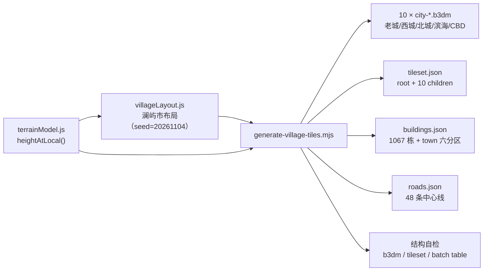

**运行期初始化（`createFloodApp` 内部顺序）**

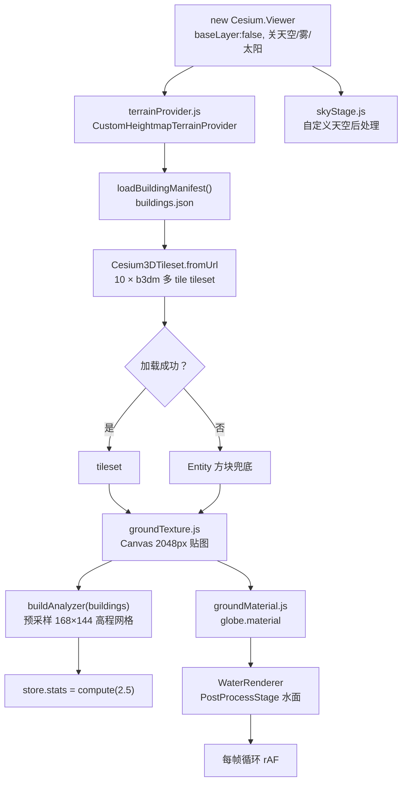

**运行期每帧**

> 蓄水区是独立支路：`store.zoneMode` → `floodApp §6.6` 框选（临时关闭相机输入）→ 写 `store.zone`；`zoneLevel` / `zoneCommand` 各自 watch 重算或清理，不参与下面的每帧循环。

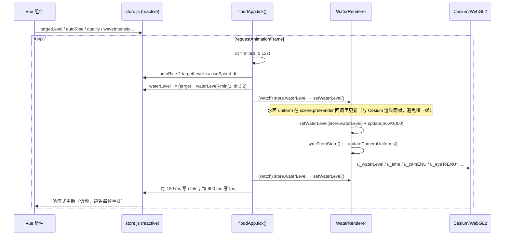

### 2.5 状态所有权（谁写谁读）

`src/store.js` 是唯一的共享状态。**规则：UI 只写交互字段，渲染循环写运行字段**，两侧都不越界：

| 字段 | 写者 | 读者 | 说明 |
| --- | --- | --- | --- |
| `targetLevel` | UI（滑块 / 自动上涨循环 / 占位模拟） | 渲染循环 | 目标水位（m，海拔），0–30 |
| `waterLevel` | 渲染循环（指数平滑） | UI 全部水位显示、水面 | 实际水位；UI 只读 |
| `autoRise` / `riseSpeed` | UI | 渲染循环 | 自动上涨开关与速度（0.1–3 m/s） |
| `waveIntensity` / `waveSpeed` / `caustics` | UI | `WaterRenderer.setWaveOptions` | 映射到 Seascape 的 SEA_* uniform |
| `quality` | UI | `applyQuality()` + `WaterRenderer.setQuality` | high / medium / low，联动 resolutionScale 与地形 LOD |
| `waterEnabled` / `showBuildings` | UI | 水面 stage / tileset + 兜底 Entity | 纯显隐，不重建 |
| `cameraPreset` | UI（CameraDock）/ 控制器 `flyTo` | `flyTo` watcher | 5 个机位，`flyTo` 2.2 s；键盘 1~5 也写这里 |
| `viewCommand` | UI（ViewPad）/ 外部调试 | `floodApp` watch → `orbitCamera / zoomCamera / resetCamera` | 单向下发的视角指令：`{type:"orbit",dh,dp}` / `{type:"zoom",dir}` / `{type:"reset"}`；每次写新对象 |
| `fps` | 渲染循环（900 ms 一次） | FpsBadge | 取整数 |
| `stats` | 渲染循环（180 ms 一次） | StatsPanel / BuildingCard | 分析结果对象 |
| `loading` | 渲染循环（初始化各阶段） | LoadingOverlay | `{visible, progress, label}` |
| `selectedBuilding` | Cesium pick 事件 | BuildingCard | 点空白清空 |
| `showInfo` | UI（InfoModal 开关） | InfoModal | — |
| `zoneMode` | UI（ControlPanel 按钮）/ floodApp（框选完成、Esc 自动关） | floodApp watch → 进入/退出框选 | 框选模式；进入时临时关闭相机输入 |
| `zone` | **渲染层写**（框选完成 / 水位变化时更新 stats） | ZonePanel（只读）、App（是否显示卡片） | `null` 或 `{minX,maxX,minY,maxY,level,stats}` |
| `zoneLevel` | UI（ZonePanel 滑块）/ 渲染层（框选后给默认值） | floodApp watch → 重算 stats + 移动水面 | 蓄水区水位（ENU 米，海拔） |
| `zoneLevelRange` | 渲染层（框选后按框内地形算） | ZonePanel 滑块范围 | `[min,max]`，默认 `[0,100]` |
| `zoneCommand` | UI（ZonePanel 重选/清除） | floodApp watch → clear / reselect / cancel | 每次写新对象 `{type,seq}` |

约定来源：[`docs/INTERFACES.md`](./docs/INTERFACES.md) §2；实现见 [`src/store.js`](./src/store.js)、[`src/cesium/floodApp.js`](./src/cesium/floodApp.js) §7–§8。

### 2.6 坐标系与单位（改代码前必看）

| 概念 | 定义 | 代码 |
| --- | --- | --- |
| 场景局部坐标 | 米，x=东、y=北，原点 `SCENE.lon0/lat0`；范围 `HALF_W=7000`、`HALF_H=6000` | `terrainModel.js` `lonLatToLocal/localToLonLat` |
| 经纬度换算 | 平面近似：`M_PER_DEG_LON = 99287`、`M_PER_DEG_LAT = 110803`（WGS84 在 27°N 的实际值；14 km 尺度误差可忽略） | 同上 |
| 海拔 | `heightAtLocal()` 返回海拔（米，椭球高近似），海平面 = 0，海床最深处约 −22 m，山最高约 720 m | 同上 |
| 水位 | 海拔标量（米），`WATER.min=0 / max=30 / initial=2.5` | 同上 |
| 城市局部坐标 | 相对**3D Tiles 根中心**（沿用 `VILLAGE.centerX=-450, centerY=700`）的 ENU 米（`x=东, y=北`），用于 3D Tiles 根变换与 `buildings.json` 的 `localX/localY`；建筑中心分布 x[-1326, 2545]、y[-2239, 1155]（场景局部 x[-1776, 2095] y[-1539, 1855]，约 3.9×3.4 km） | `villageLayout.js` `VILLAGE_CENTER` |
| 3D Tiles 内容坐标 | 相对根中心（城市中心）的 ENU 米，z=**绝对海拔**；`root.transform` = 城市中心的 `eastNorthUpToFixedFrame`；整体 ENU 包围盒 **x[-1336.8, 2625.0] y[-2246.8, 1169.2] z[-0.1, 196.4]**，世界包围球中心 `120.051955, 26.981455` 高 98.2 m、半径 2617 m | `generate-village-tiles.mjs` `buildTileset` |
| 蓄水区坐标 | 框选矩形存**场景 ENU 米**（`minX/maxX/minY/maxY`）；水面是**恒定椭球高平面**（`zoneLevel`，沿场景中心 ENU up 平移）；矩形经纬度由 `localToLonLat` 反算 | `floodApp.js` §6.6 |
| glTF 坐标 | glTF 2.0 默认 **Y-up**，写入 GLB 前做 `(X东, Y北, Z上) → (x=X, y=Z, z=−Y)`，法线同理；`tileset.asset.gltfUpAxis = "Y"` | `buildGlb()`「ENU → glTF」 |
| 水面波场坐标 | 1 波场单位 = `u_waveUnit`（默认 **10 m**）；ENU 的 `(x, y)` 映射到波场 `(x, z)`，波场 y 轴为竖直 | `waterPostProcess.glsl.js` §5 |
| 天空/太阳 | `czm_sunDirectionWC`（ECEF 单位向量）每帧经 ENU 基向量点积转成 ENU 方向 | `sunDirENU()` |

> 所有坐标系之间的唯一"真值"都是 `terrainModel.js`。**新增任何数据（DEM、真实 3D Tiles、道路）时，先确认它落在哪套坐标里，再决定挂到哪一层。**

### 2.7 场景常量

```js
// src/geo/terrainModel.js（节选，数值为准）
export const SCENE = { name: '澜屿湾', lon0: 120.05, lat0: 26.98, widthMeters: 14000, heightMeters: 12000 };
export const WATER = { min: 0, max: 30, initial: 2.5, safe: 6, warn: 15, danger: 24, histogramStep: 2 };
export const VILLAGE = { centerX: -450, centerY: 700, radiusMeters: 900, name: '澜屿村' /* + centerLon/centerLat 反算 */ };
export const ELEVATION = { min: -22, max: 720, seaLevel: 0 };

// src/geo/villageLayout.js —— 城市元数据（本轮升级）
export const LAYOUT_SEED = 20261104;
export const LAYOUT_VERSION = 2;
export const TOWN = {
  name: '澜屿市',
  districts: [
    { id: 'old',        name: '澜屿老城',   center: { x: -450, y: 700 } },
    { id: 'west',       name: '西城片区',   center: { x: -700, y: -950 } },
    { id: 'north',      name: '北城片区',   center: { x: 150, y: 700 } },
    { id: 'harbor',     name: '澜屿港新区', center: { x: 1300, y: 500 }, plannedCenter: { x: 1700, y: 450 } },
    { id: 'cbd',        name: '滨海 CBD',   center: { x: 2150, y: -50 } },
    { id: 'waterfront', name: '滨水公共带', center: { x: 1800, y: -1500 } },
  ],
};
```

地形构成（都在 `baseHeight()` 里叠加）：

1. 东侧**波浪形海岸线** `coastX(y)` → 海床（−3.2 m 起，向外 2.4 km 内降到约 −20 m）；
2. **冲积平原**：海岸约 1.4 m，向西 9 km 缓升到约 23 m，叠两层 fbm 噪声；
3. **西侧山脉**：7 座高斯山峰（最高 560 m 参数 + 软上限 760 m）+ ridged 分形噪声，`inland` 掩膜保证不侵入城市平原；
4. **河谷**：从 (−5900, 2350) 出发，沿基础地形**最陡下降方向 + 朝海偏置 + 动量**自动寻路 110 步入海，再切割河道（河床单调下降、宽度 34→184 m）；
5. **远景丘陵**（本轮改动）：半径 > 9 km 之外只抬起 **60–240 m 的低矮远丘**（`farMask` 在 9–24 km 渐入、60–110 km 淡出），让地平线自然消失在雾霭里，**不再有巨大的程序化"远山环"**——避免缩小地图时看到一块平板状远山。

> 河流不是手写折线，而是"**在同一个高程函数上做梯度下降**"得到——所以河道一定贴合山谷，且与地形永远一致。

---

## 三、场景初始化与地形 / 3D Tiles 加载

> 对应源码：[`src/cesium/floodApp.js`](./src/cesium/floodApp.js)（Viewer 与总装）、[`src/cesium/terrainProvider.js`](./src/cesium/terrainProvider.js)、[`src/cesium/groundTexture.js`](./src/cesium/groundTexture.js)、[`src/cesium/groundMaterial.js`](./src/cesium/groundMaterial.js)、[`src/cesium/skyStage.js`](./src/cesium/skyStage.js)、[`scripts/generate-village-tiles.mjs`](./scripts/generate-village-tiles.mjs)。

### 3.1 Viewer 配置逐项说明

`createFloodApp()` 里创建 Viewer 时几乎关掉了所有默认 UI 与默认环境效果。这不是"图省事"，每一条都有具体原因：

```js
const viewer = new Cesium.Viewer(container, {
  baseLayer: false,                                  // 不用任何影像图层（地表由 Globe Material 画）
  terrainProvider: createTerrainProvider(),          // 程序化地形（见 3.3）
  baseLayerPicker: false, geocoder: false, homeButton: false,
  sceneModePicker: false, navigationHelpButton: false,
  animation: false, timeline: false, fullscreenButton: false,
  infoBox: false, selectionIndicator: false,
  shouldAnimate: false,
  shadows: false,
  creditContainer: credits, creditViewport: credits, // 自定义署名容器（保留许可证信息）
  contextOptions: {
    webgl: { alpha: false, antialias: true, powerPreference: 'high-performance' },
  },
});
```

| 配置 | 取值 | 为什么这么设 |
| --- | --- | --- |
| `baseLayer: false` | 关闭默认影像底图 | 1) 无影像图层就没有 `IonImageryProvider`/Bing 的默认请求，**零 token、零网络**；2) 地表颜色完全由 `globe.material` 决定（见 3.4），不会被底图盖住；3) 少一层纹理采样，启动更快 |
| `terrainProvider` | `CustomHeightmapTerrainProvider` | 地形来自本地高程函数，不需要 DEM 文件或 ion（见 3.3） |
| 默认控件全关 | `baseLayerPicker/geocoder/homeButton/sceneModePicker/navigationHelpButton/animation/timeline/fullscreenButton/infoBox/selectionIndicator` | 自己画 UI；Cesium 的浅色控件、时间轴、信息框与深色玻璃拟态冲突，且它们的 DOM/CSS 会带来额外布局与内存开销 |
| `shouldAnimate: false` | 冻结时钟 | 场景是**固定黄金时刻**（`GOLDEN_HOUR = '2026-11-03T08:40:00Z'`，对应北京时间 16:40 的低角度侧光）：太阳方向固定 → 水面高光、天空渐变、地表 hillshade 三者永远对得上；也避免每帧推进 Cesium 的时间系统 |
| `shadows: false` | 关闭阴影贴图 | 3D Tiles 仍设 `tileset.shadows = RECEIVE_ONLY`（接收不投射）；不开阴影 pass 省一次全场景深度渲染，headless/集显更稳。黄昏低角度阴影其实主要靠地表烘焙的 hillshade 表达 |
| `contextOptions.webgl.alpha: false` | 画布不透明 | 页面背景不透，省掉 alpha 混合与合成；避免 WebGL 画布与 CSS 背景之间的色差 |
| `antialias: true` | 浏览器 MSAA | 保留地形/建筑边缘质量；后处理链里另有 `scene.postProcessStages.fxaa.enabled = true` 兜底（后处理会重采样，MSAA 只在几何 pass 有效） |
| `powerPreference: 'high-performance'` | 优先独显/高性能 GPU | 双显卡笔记本上避免落到集显 |
| `creditContainer/creditViewport` | 指向自建 `div.flood-credits` | **许可证要求署名可见**（Seascape 是 CC BY-NC-SA 3.0），自定义容器能控制位置/字号，又不会被 Cesium 默认样式顶到左下角遮挡图例 |
| 相机事件映射 | `rotateEventTypes=[LEFT_DRAG]`、`tiltEventTypes=[RIGHT_DRAG]`、`zoomEventTypes=[WHEEL]`、`lookEventTypes=[]` | 用户指定的三键操作：左键旋转、右键倾斜、滚轮缩放；关闭 Shift+左键自由观察，减少误操作 |
| 相机边界 | `minimumZoomDistance=60`、`maximumZoomDistance=3600`；`preRender` 里再夹一次高度 60–3600 m、pitch −77°~+5.7° | Cesium 原生 tilt 绕“视线落点”旋转，低空右拖容易把相机抬高很远；每帧兜底夹一次保证画面始终在场景附近、不把视角抬到整屏天空 |

Viewer 之后还有一批 `scene` / `globe` 设置：

```js
scene.highDynamicRange = false;                         // HDR 关闭：自定义天空/水面都是 LDR 调色，避免二次色调映射跑偏
scene.globe.baseColor = Cesium.Color.fromCssColorString('#0a1b22');  // material 失效时的兜底色
globe.enableLighting = false;                           // 光照由地表材质 + 烘焙 hillshade 表达，避免与自定义 material 叠加
globe.depthTestAgainstTerrain = true;                   // ★ 水面后处理能读到地形深度的前提（见 4.7）
globe.maximumScreenSpaceError = 2;                      // 地形 LOD 阈值（high 档；medium=3 / low=4）
globe.tileCacheSize = 240;                              // 瓦片缓存，减少来回切换时的重算
scene.backgroundColor = new Cesium.Color(0.72, 0.56, 0.43, 1.0); // 暖色兜底（抗锯齿/后处理边界）
scene.postProcessStages.fxaa.enabled = true;            // 后处理链抗锯齿
// 相机事件映射（Cesium 原生控制器）
const controller = scene.screenSpaceCameraController;
controller.rotateEventTypes = [Cesium.CameraEventType.LEFT_DRAG];  // 左键：旋转
controller.tiltEventTypes = [Cesium.CameraEventType.RIGHT_DRAG];   // 右键：倾斜
controller.zoomEventTypes = [Cesium.CameraEventType.WHEEL];        // 滚轮：缩放
controller.lookEventTypes = [];                                    // 关闭 Shift+左键自由观察
controller.minimumZoomDistance = 60;
controller.maximumZoomDistance = 3600;
// 每帧兜底：夹高度/pitch（见 6.5 clampCameraLimits）
```

### 3.2 自定义天空：为什么关掉 atmosphere / skyBox / fog

```js
scene.skyAtmosphere.show = false;
scene.skyBox.show = false;
scene.sun.show = false;
scene.moon.show = false;
scene.fog.enabled = false;
if (!debugFlags.has('noSky')) {
  scene.postProcessStages.add(createSkyStage({ debug: debugFlags.has('skyDebug') }));
}
```

关掉 Cesium 默认天空的理由（按重要性排序）：

1. **观感必须完全可控**：本项目的基调是"金色黄昏 + 低角度侧光 + 海天雾霭"，Cesium 的 `SkyAtmosphere` 是物理散射模型，参数（Rayleigh/Mie 系数、亮度）难精确调到某个固定色板；而水面 shader 的反射/雾霭需要和天空**逐个颜色对齐**（见 4.9），自定义天空才能做到"水天接缝不可见"。
2. **headless 环境不可靠**：在 headless Chromium（ANGLE Metal）下 Cesium 的 `SkyAtmosphere` 曾出现整片纯黑，导致自动截图/审计不可用；自定义后处理只依赖深度纹理，行为稳定。
3. **省一次大气散射 pass**：`SkyAtmosphere` 是全屏 ray-march 散射积分；我们的天空是解析渐变 + 太阳辉光，成本低一个量级。
4. `fog` 与 `groundMaterial` 里的"大气透视"重复：雾霭统一在材质/水面 shader 里按**距离**做，和天空地平线色同源，避免两套雾叠加出灰边。

**实现（`skyStage.js`）**：天空像素的定义是"**场景里没有几何体**"，在 Cesium 里就是深度等于 clear 值 1.0 的像素。这里有个关键点——**必须直接读深度纹理的原始值**：

```glsl
vec4 sceneColor = texture(colorTexture, v_textureCoordinates);
// 直接读深度缓冲原始值：天空像素是 clear 值 1.0，几何体在 log-depth 下都 < 1.0。
// 不能用 czm_readDepth 反算后的窗口深度做阈值（log depth 在近景也会接近 1）。
float rawDepth = texture(depthTexture, v_textureCoordinates).r;

if (rawDepth < 0.9999999) {          // 有几何体：原样输出
    out_FragColor = sceneColor;
    return;
}
// 无几何体：用逆投影 + 逆视图重建世界方向射线
vec2 ndc = v_textureCoordinates * 2.0 - 1.0;
vec4 farClip = czm_inverseProjection * vec4(ndc, 1.0, 1.0);
vec3 rayEye = normalize(farClip.xyz / farClip.w);
vec3 rayWC  = normalize(mat3(czm_inverseView) * rayEye);
vec3 camWC  = (czm_inverseView * vec4(0.0, 0.0, 0.0, 1.0)).xyz;
float elevation = dot(rayWC, normalize(camWC));   // sin(仰角)
```

然后按仰角插值三段色（地平线暖色 → 中段 → 天顶）、叠加低频云带（用方位角 + 仰角做噪声）、太阳辉光（`pow(mu, 8/48/512)` 三层）与日盘（`smoothstep(0.99955, 0.99985, mu)`）。

| uniform | 值 | 含义 |
| --- | --- | --- |
| `u_zenith` | `(0.078, 0.129, 0.216)` | 天顶色 `#16243a` |
| `u_mid` | `(0.29, 0.373, 0.478)` | 中段天蓝 `#4a5f7c` |
| `u_horizon` | `(0.86, 0.635, 0.451)` | 地平线暖色 `#d8a273` |
| `u_ground` | `(0.62, 0.596, 0.565)` | 地平线以下雾霭（一般被地形挡） |
| `u_sunColor` | `(1.0, 0.847, 0.659)` | 太阳色 `#ffd9a8` |
| `u_cloudColor` | `(0.93, 0.78, 0.63)` | 低空云带的暖色 |
| `u_sunIntensity` | `1.0` | 太阳辉光强度 |
| `u_debug` | `0 / 1` | 调试：输出仰角红/绿通道 |

太阳方向用 Cesium 自动 uniform `czm_sunDirectionWC`（随 `clock.currentTime` 与场景光照更新），所以"固定黄金时刻"就是"固定太阳方向"。水面 shader 的 `getSkyColor()` 用**同一套色板与同一组幂次**重写了天空（`#16243a/#4a5f7c/#d8a273/#ffd9a8/#a9a49c`），保证反射天空 = 真实天空。

> 截图对照：[`screenshots/wip/sky-default-viewer.png`](./screenshots/wip/sky-default-viewer.png)（Cesium 默认黑色大气）、[`screenshots/wip/sky-base.png`](./screenshots/wip/sky-base.png)（自定义天空）、[`screenshots/wip/sky-lookup.png`](./screenshots/wip/sky-lookup.png)（抬头看云带与日盘）。

### 3.3 程序化地形 Provider

**目标**：在没有 DEM 文件、没有 ion token、不允许运行期网络请求的前提下，让 Cesium 有一个"任意 LOD 都自洽"的地形。

**做法**：`CustomHeightmapTerrainProvider` 允许按瓦片坐标回调生成高度图。我们把回调实现成"对高程函数采样"，于是 LOD 变成天然属性：Cesium 要哪一级，就现场算哪一级。

```js
const TILE_SAMPLES = 64;   // 每瓦片 64×64 = 4096 个采样点
const MAX_LEVEL = 18;      // 最大细分层级

const tilingScheme = new Cesium.GeographicTilingScheme();

function tileSamples(x, y, level) {
  const { west, east, south, north } = tilingScheme.tileXYToRectangle(x, y, level);

  // 场景包围盒外（留 0.35° ≈ 35 km 余量）的瓦片：返回共享的"平海面"数组，不做计算
  if (outOfScene(west, east, south, north)) return flat;

  const buffer = new Float32Array(TILE_SAMPLES * TILE_SAMPLES);
  const dLon = (east - west) / (TILE_SAMPLES - 1);
  const dLat = (south - north) / (TILE_SAMPLES - 1);   // 注意是负的：row 0 = 最北
  let k = 0;
  for (let row = 0; row < TILE_SAMPLES; row++) {
    const lat = north + dLat * row;                     // 北 → 南
    for (let col = 0; col < TILE_SAMPLES; col++) {
      buffer[k++] = heightAtLonLat(west + dLon * col, lat);  // 西 → 东
    }
  }
  return buffer;
}

export function createTerrainProvider() {
  return new Cesium.CustomHeightmapTerrainProvider({
    width: TILE_SAMPLES,
    height: TILE_SAMPLES,
    tilingScheme,
    credit: '澜屿湾 · 程序化地形（本地实时生成）',
    callback: (x, y, level) => (level > MAX_LEVEL ? undefined : tileSamples(x, y, level)),
  });
}
```

几个容易踩的点：

| 点 | 说明 |
| --- | --- |
| **行序** | `HeightmapTerrainData` 要求行优先、**第一行在最北**、每行自西向东；`dLat = (south - north)/(n-1)` 是负数，所以循环里 `lat = north + dLat * row` 恰好从北往南。写反了地形会南北镜像 |
| **返回 `undefined`** | `level > MAX_LEVEL` 时返回 `undefined`，Cesium 会停止细分并使用父瓦片——这是"最大 LOD"的正确写法（不是返回空数组） |
| **共享 `flat` 数组** | 场景外瓦片返回同一个 `Float32Array` 实例。Cesium 在回调返回后会同步消费并复制，回调之间不会并发写同一块内存；但**绝不能**在别处修改它 |
| **`tilingScheme` 必须复用** | `tileXYToRectangle` 与 Provider 必须用同一个 tiling scheme 实例/配置，否则瓦片边界对不上 |
| **采样点数选择** | 64×64 在 level 18 时采样间距约 1.1–1.2 m，近景足够；32×32 会让山脊出现台阶，128×128 单瓦片计算量 ×4（4096→16384 次高程函数调用），收益不明显 |

**LOD 实际尺寸**（`GeographicTilingScheme` 根瓦片 180°，level 18 是 2^18 细分）：

| 层级 | 瓦片经纬跨度 | 东西宽 | 南北高 | 采样间距（64×64） | 用途 |
| --- | --- | --- | --- | --- | --- |
| L12 | 0.04395° | 4,363 m | 4,869 m | 69.3 m / 77.3 m | 全景/远景山体 |
| L15 | 0.005493° | 545 m | 609 m | 8.7 m / 9.7 m | 中景 |
| L18 | 0.000687° | **68 m** | **76 m** | **1.08 m / 1.21 m** | 近景（城市/河道） |

> 这组数字是实测（`Cesium.GeographicTilingScheme().tileXYToRectangle()` + 本场景纬度换算），不是估算。

**性能上的两个小设计**（`terrainModel.js`）：

1. **河流距离场加速**：精确计算"到河流折线的最短距离"要遍历 100+ 段，而高程函数又被调用数十万次。这里预计算一张 **260 m 网格**的粗距离场（`DIST_GRID`），双线性插值；距离 > 1.8 km 时直接走 `baseHeight()` 快速路径（因为河谷削弱与河道切割都已饱和为 0），只有近河区域才走精确 `riverInfo()`。
2. **地形函数本身无状态**：`heightAtLocal` 只依赖输入坐标，不缓存任何中间结果（除了一次性的河流路径/距离场初始化），所以可以在 Worker、Node、浏览器里任意调用——生成脚本、地表贴图、淹没统计才能共用同一份真值。

**换真实 DEM**（详见 [§7](#七数据准备指南换成真实数据)）：

```js
// 方案 A：Cesium ion World Terrain（需 token，联网）
return await Cesium.createWorldTerrainAsync({ requestVertexNormals: true, requestWaterMask: false });

// 方案 B：本地 quantized-mesh 目录（离线，推荐生产用）
return await Cesium.CesiumTerrainProvider.fromUrl('./terrain/');

// 方案 C：仍用 CustomHeightmapTerrainProvider，但把 heightAtLonLat 换成 DEM 双线性采样
//         （保持"程序化 LOD"的架构，只是数据源变了）
```

### 3.4 地表着色：为什么放弃 ImageryLayer，改用 Globe Material

最初的方案很直觉：Canvas 生成一张 14 km × 12 km 的"卫星影像"，用 `SingleTileImageryProvider` 铺到地球上。**问题出在场景边界**：

- Imagery 图层的本质是"一个矩形范围 → 一张贴图"。矩形**外**的地形瓦片依然存在（地球是无限延伸的），Cesium 只能把纹理坐标 clamp 到边缘像素 → 边界外出现**明显的拉伸条纹**（"边缘涂抹"），在俯瞰视角下一眼就能看出来。
- 而本场景的地形在 14×12 km 之外还继续延伸到更远的丘陵/地面、乃至整个地球；`SingleTileImageryProvider` 无法表达"范围外走另一套配色"。

**解法**：不用 ImageryLayer，改用 **Globe Material**（`Cesium.Material` + `fabric.source`）。在片元着色器里自己把世界坐标转成场景 ENU 局部米，判断是否落在场景矩形内：

- **矩形内**：采样地表贴图（`u_groundTex`），叠加 1~12 m 的高频程序化噪声补细节；
- **矩形外**：**镜像平铺同一张地表贴图**（`mirrorUV = abs(fract(uv * 0.5) * 2 - 1)`，无接缝、延续田野/林地观感）+ 高处转岩石/林地色 + 大气透视——既消除"边缘涂抹"，也避免用户缩小地图时看到一个矩形"贴图岛"；
- 场景内外用同一套雾霭色做大气透视（距离 4.2–24 km / 5–30 km 渐入），缩放时看不到矩形边界。

```glsl
// groundMaterial.js 核心：世界坐标 → ENU 局部米 → UV
czm_material czm_getMaterial(czm_materialInput materialInput) {
    czm_material material = czm_getDefaultMaterial(materialInput);
    vec3 positionWC = (czm_inverseView * vec4(-materialInput.positionToEyeEC, 1.0)).xyz;
    vec3 rel = positionWC - u_centerWC;
    float x = dot(rel, u_eastWC);      // 东向米
    float y = dot(rel, u_northWC);     // 北向米

    float u = (x + u_halfSize.x) / (2.0 * u_halfSize.x);
    float v = (u_halfSize.y - y) / (2.0 * u_halfSize.y);
    float h = materialInput.height;
    float dist = length(materialInput.positionToEyeEC);

    bool outside = (u < 0.0 || u > 1.0 || v < 0.0 || v > 1.0);
    if (outside) {
        // 场景外：镜像平铺同一张贴图 + 高处岩/林色 + 大气透视
        vec2 mirrorUV = abs(fract(vec2(u, v) * 0.5) * 2.0 - 1.0);
        color = texture(u_groundTex, mirrorUV).rgb * (0.86 + pat * 0.28);
        color = mix(color, rock, smoothstep(30.0, 260.0, h) * 0.85);
        float hazeOut = smoothstep(4200.0, 24000.0, dist) * 0.72;
        color = mix(color, hazeCol, hazeOut);
    } else {
        color = texture(u_groundTex, vec2(u, v)).rgb;
        float micro  = gNoise(vec2(x, y) * 0.55) - 0.5;   // 1~2 m 颗粒
        float meadow = gNoise(vec2(x, y) * 0.12) - 0.5;   // 8~12 m 斑块
        color *= 1.0 + (micro * 0.16 + meadow * 0.12) * smoothstep(4.0, 0.5, h);
        float haze = smoothstep(5000.0, 30000.0, dist) * 0.72;  // 大气透视
        color = mix(color, hazeCol, haze);
    }
    material.diffuse = color;
    material.alpha = 1.0;
    return material;
}
```

> 注意 `materialInput.positionToEyeEC` 是"片元 → 相机"的 eye 空间向量，所以用 `czm_inverseView * vec4(-positionToEyeEC, 1.0)` 才是片元的世界坐标。这个符号很容易写反、写成相机位置——写反时地表会整体偏 2 倍相机距离。

**地表贴图生成（`groundTexture.js`）**

| 项 | 值 / 做法 |
| --- | --- |
| 贴图尺寸 | 2048 × 1755（按 14:12 比例），JPEG q=0.92 的 blob URL |
| 高程网格 | 640 × 549（约 21.9 m/格），只用于**山体阴影**与坡度，颜色用逐像素 `heightAtLocal` 精确值 |
| 高程色带 | 13 个色标（深水 `#0d222c` → 浅海 `#1e3e48` → 滩涂 `#8e846a` → 农田 `#becf96`…），线性插值 |
| 细节着色 | 农田按 110 m 网格三色（绿/金/褐）+ 9 m 微粒噪声；山地按 24/34 m 噪声；高处叠植被斑块 |
| 山体阴影 | 由高程梯度算法线，光方向 `(-0.86, -0.18, 0.48)`（西偏南、高度角约 28°），与黄昏侧光一致 |
| 河流 | 按 `RIVER_PATH` 分三层描边（220 m 滩地 / 70 m 河岸 / 26 m 河心），水面由 shader 负责 |
| 道路 | 读 `roads.json` 的 **48 条**道路，每条画"深色路基 + 浅色路面"两笔 |
| 建筑基底 | 读 `buildings.json` 的 **1067 栋**，按 `rotation` 旋转方块画屋顶俯视色（正射视角更自然），老城中心/广场加径向渐变 |
| 单像素成本 | 约 2048×1755 ≈ 359 万像素 × (精确高程 + 色带 + 细节 + 阴影)；生产构建 `?timing` 实测该阶段累计 **1820 ms**（贴图生成约 1.8 s，占首屏 2.57 s 的七成） |
| 贴图分辨率 | 14 km / 2048px ≈ **6.8 m/px**；近景靠 shader 程序化噪声补足，不依赖更大贴图 |

> `groundTexture.js` 的文件头注释还写着"与 Cesium 的 SingleTileImageryProvider 配合"——那是放弃 ImageryLayer 之前的旧注释，**最终代码只把 `textureUrl` 交给 `groundMaterial.js`**，没有创建任何 ImageryProvider。

**Globe Material 的 uniforms**（构造时一次性设置）：

| uniform | 值 | 说明 |
| --- | --- | --- |
| `u_groundTex` | blob URL | Cesium Material 自动加载为纹理 |
| `u_centerWC` | 场景中心 ECEF | 由 `createSceneFrame()` 构造 |
| `u_eastWC` / `u_northWC` | ENU 基向量（ECEF 方向） | 世界坐标点积得到局部米 |
| `u_halfSize` | `(7000, 6000)` | 场景半宽/半高（米） |
| `u_heightMax` | `700.0` | 预留（色带归一化用） |
| `u_hazeColor` | `(0.68, 0.62, 0.55)` | 远景雾霭色，与天空 `u_ground` 同族 |

> 收益总结：**1 个 Material 替代掉"影像图层 + 每次视锥变化的瓦片请求"**；边界外不再是涂抹，而是镜像平铺的延续地表 + 大气透视；同时地表贴图只生成一次、不参与网络/瓦片调度。代价是 shader 里多几次噪声运算（对全屏地形像素而言可忽略）。

截图对照：[`screenshots/wip/terrain-compare.png`](./screenshots/wip/terrain-compare.png)、[`screenshots/wip/terrain-overview.png`](./screenshots/wip/terrain-overview.png)、[`screenshots/wip/terrain-river.png`](./screenshots/wip/terrain-river.png)。

### 3.5 城市 3D Tiles：从确定性布局到 10 个 b3dm

城市（**澜屿市**，1067 栋，建成区约 3.9 × 3.4 km）是全部"业务数据"的载体：**它既是 3D Tiles 几何，又是淹没分析的输入，还是地表贴图上的一层屋顶俯视色**。三份数据必须严格一致，所以采用"一次布局 → 多路导出"：

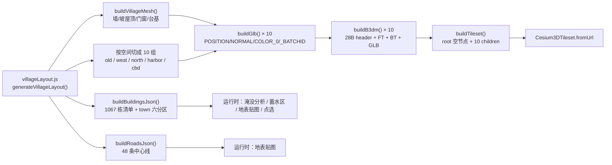

#### 3.5.1 布局规则（`villageLayout.js`，`LAYOUT_VERSION = 2`）

**六组团结构**（`buildings.json` 的 `town.districts`，坐标为场景局部米）：

| 组团（district） | 中心 | 栋数 | 内容 |
| --- | --- | --- | --- |
| 澜屿老城（`old`） | `(-450, 700)`（= 3D Tiles 根中心） | **233** | 保留老城街巷肌理（澜屿街/溪岸路/城北街/后巷/石阶巷/井边巷/打铁巷/城隍巷/南门街），3–4 层坡顶民居 + 沿街商住 + 文化礼堂/防汛调度站 + 渡口栈桥 |
| 西城片区（`west`） | `(-700, -950)` | **320** | 山脚坡地新城：沿等高线错落的 3–4 层民居 + 沿街商住（minGround 9.5–23.4 m，是"高处先淹"的对照区） |
| 北城片区（`north`） | `(150, 700)` | **200** | 河谷北岸的居住区（minGround 9.7–19.1 m） |
| 澜屿港新区（`harbor`） | `(1300, 500)`（规划中心 1700, 450） | **263** | 滨海高层带：10–18 层公寓 66 栋、沿街商住 110 栋、3 栋老地标、4 座码头 |
| 滨海 CBD（`cbd`） | `(2150, -50)` | **46** | **40 栋 20–40 层塔楼（71.5–146.7 m）+ 6 栋 150–188 m 地标**，构成天际线（cbd 不计入老城/新城住宅） |
| 滨水公共带（`waterfront`） | `(1800, -1500)` | **5** | 滨海大道旁的公共建筑 + 栈桥（4 public + 1 pier） |

| 规则 | 参数 | 原因 |
| --- | --- | --- |
| 确定性随机 | `mulberry32(seed=20261104)` | 同一 seed 重复生成：**10 个 b3dm 与 tileset 字节一致**（sha256 见 3.5.5），两个 JSON 仅 `generatedAt` 不同；便于对数据、对截图 |
| 沿街成组 | 主街两侧"街区 → 空地"节奏，`skipProb` 0.46~0.75 | 避免均匀网格感，形成真实城市的沿街肌理 |
| 高程真值 | `heightAtLocal()` 取中心 + 四角 | 与地形、统计**同源** |
| 避让河道 | 到河心线 < 180 m 不建 | 河道在洪水期是主通道，河滩地基不稳 |
| 避让海面 | 地面 < 2.2 m 不建（新区更严，约 2.62 m） | 海域/潮间带；新区要求初始水位 2.5 m 不淹脚 |
| 避让陡坡 | 占地高差 / 短边 > 0.24 不建 | 坡地建筑会悬空或埋太深 |
| 基础下埋 | `FOUNDATION_DEPTH = 2.0` m | 坡地上把台基埋到最低点以下，视觉上不悬空 |
| 建筑间距 | OBB（有向包围盒）SAT 相交检测 + 1.0 m 间隙 | 保证滴水/檐沟空间，也避免淹没统计互相重叠 |
| 体量分层 | 老城/西城 3–4F；商住 4–7F；公寓 10–18F；CBD 塔楼 20–40F；地标 18–52F | 山脚老城 → 滨海高层 → CBD 天际线的城市剖面 |

**生成结果（实测，`buildings.json`）**：**1067 栋**；`kind` → 民居 **621** / 商住 **319** / 公寓 **66** / 塔楼 **40** / 公共 **6** / 地标 **9** / 码头 **6**；`type` 计数：house 621 / shop 425（商住 319 + 公寓 66 + 塔楼 40）/ public 15（公共 6 + 地标 9）/ pier 6；占地合计 **329,242 m²**；地面高程 **1.70–23.99 m**、`minGround` **2.65–23.36 m**（非栈桥最低 2.72 m）。

| kind | 数量 | 层数 | 高度 | `minGround` 中位数 / 范围 | 占地（m²） | 说明 |
| --- | --- | --- | --- | --- | --- | --- |
| `house` 民居 | 621 | 3–4 | 10.6–13.9 m | 10.06 m / 2.89–23.36 m | 133–320 | 坡屋顶暖陶瓦；老城/西城/北城为主 |
| `shop` 商住 | 319 | 4–7 | 14.1–27.7 m | 9.78 m / 2.81–20.39 m | 144–396 | 沿街商铺/商住混合 |
| `apartment` 公寓/酒店 | 66 | 10–18 | 30.9–59.1 m | 4.73 m / 2.75–6.67 m | 432–1037 | 滨海新区高层 |
| `tower` CBD 塔楼 | 40 | 20–40 | **71.5–146.7 m** | 3.48 m / 2.84–4.36 m | 837–1545 | 滨水 CBD 主天际线 |
| `public` 公共建筑 | 6 | 4–18 | 18.9–63.9 m | 3.13 m / 2.72–8.66 m | 374–3220 | 文化礼堂/防汛调度站 + 滨水公共建筑 |
| `landmark` 地标 | 9 | 18–52 | **62.2–188.2 m**（6 栋 ≥150 m） | 3.17 m / 2.72–4.30 m | 884–1428 | 澜屿金融中心（F52 / 188.2 m）等 |
| `pier` 码头/栈桥 | 6 | 1 | 2.6 m | 2.70 m / 2.65–9.57 m | 252–1980 | 渡口栈桥 + 5 座码头 |

分区 × kind 分布（`buildings.json` 实测）：

| 分区 | 栋数 | kind 构成 |
| --- | --- | --- |
| 老城 `old` | 233 | house 186 / shop 44 / public 2 / pier 1 |
| 西城 `west` | 320 | house 215 / shop 105 |
| 北城 `north` | 200 | house 140 / shop 60 |
| 滨海新区 `harbor` | 263 | apartment 66 / shop 110 / house 80 / landmark 3 / pier 4 |
| 滨海 CBD `cbd` | 46 | tower 40 / landmark 6 |
| 滨水公共带 `waterfront` | 5 | public 4 / pier 1 |

#### 3.5.2 10 个 b3dm：按空间切 tile

1067 栋按**空间位置**切成 10 个 tile（每 tile 一个 b3dm，利于视锥剔除；单个都 < 2.6 MiB）：

| tile（文件） | 覆盖 | 栋数 | 文件体积（字节 / KiB） | 三角面 | 顶点 | `BATCH_LENGTH` |
| --- | --- | --- | --- | --- | --- | --- |
| `city-old-west` | 老城 x < −700（含渡口栈桥） | 119 | 867,696 / 847.4 | 9,032 | 18,292 | 119 |
| `city-old-east` | 老城 x ≥ −700 | 114 | 811,632 / 792.6 | 8,442 | 17,106 | 114 |
| `city-west-north` | 西城 y ≥ −1000 | 196 | 1,412,848 / 1379.7 | 14,722 | 29,798 | 196 |
| `city-west-south` | 西城 y < −1000 | 124 | 925,432 / 903.7 | 9,642 | 19,514 | 124 |
| `city-north` | 北城 | 200 | 1,473,816 / 1439.3 | 15,362 | 31,090 | 200 |
| `city-harbor-west` | 新区 x < 800（含码头） | 127 | 2,631,328 / 2569.7 | 27,860 | 55,790 | 127 |
| `city-harbor-mid` | 新区 800 ≤ x < 1300 | 71 | 724,940 / 707.9 | 7,608 | 15,308 | 71 |
| `city-harbor-east` | 新区 x ≥ 1300 | 65 | 795,228 / 776.6 | 8,368 | 16,810 | 65 |
| `city-cbd-north` | CBD + 滨水 y ≥ 500（含地标） | 41 | 1,779,176 / 1737.5 | 18,882 | 37,764 | 41 |
| `city-cbd-south` | CBD + 滨水 y < 500 | 10 | 304,532 / 297.4 | 3,216 | 6,434 | 10 |
| **合计** | | **1067** | **11,726,628（11.18 MiB）** | **123,134** | **247,906** | — |

几何与格式：

- 每栋建筑 = **墙体盒 + 坡屋顶（gable）/ 平屋顶（女儿墙）+ 门窗细节 + 台基**；为压住 13 万面预算，**民居/商铺只在前后立面做窗**（侧立面省略），塔楼/地标做完整立面；顶点色（`COLOR_0`，线性空间）墙/屋顶/台基不同色；PBR `metallicFactor 0.05 / roughnessFactor 0.85`；
- 每个 b3dm = 28 字节 header + feature table（`{"BATCH_LENGTH": 该 tile 栋数}`，8 字节对齐、空格 `0x20` 补齐）+ batch table（JSON，8 字节对齐）+ 内嵌 GLB；
- GLB：单个 primitive，`POSITION/NORMAL/COLOR_0/_BATCHID`（`_BATCHID` 为 f32，**每个 tile 内部从 0 起**）+ `Uint16` 索引（单 tile 顶点数都 < 65,535）；bufferView 4 字节对齐；
- batch table 8 个数组：`id`、`name`、`type`、`kind`、`height`、`floors`、`minGround`、`area`，长度 = `BATCH_LENGTH`，与 `_BATCHID` 一一对应（**全局 id 写在属性里**，跨 tile 仍可唯一定位）；
- 几何预算：**130,000 三角面**（当前 123,134，余量 6,866）；单 b3dm 预算 2.8 MB（当前最大 2,631,328 B = 2.51 MiB）；b3dm 总量预算 15 MB（当前 11.18 MiB）。

#### 3.5.3 tileset.json：root 空节点 + 10 children

```json
{
  "asset": { "version": "1.0", "tilesetVersion": "lan-yu-harbor-v2-seed20261104", "gltfUpAxis": "Y" },
  "geometricError": 4096,
  "root": {
    "transform": [ /* 根中心（城市中心）eastNorthUpToFixedFrame 的 4×4 列主序矩阵 */ ],
    "boundingVolume": {
      "box": [644.08, -538.75, 98.20,  1982.92, 0, 0,  0, 1710.00, 0,  0, 0, 100.25]
    },
    "geometricError": 4096,
    "refine": "ADD",
    "children": [
      { "name": "city-old-west", "boundingVolume": { "box": [ /* 局部 ENU */ ] }, "geometricError": 0, "content": { "uri": "city-old-west.b3dm" } },
      { "name": "city-old-east", "…": "…" },
      { "name": "city-west-north", "…": "…" },
      { "name": "city-west-south", "…": "…" },
      { "name": "city-north", "…": "…" },
      { "name": "city-harbor-west", "…": "…" },
      { "name": "city-harbor-mid", "…": "…" },
      { "name": "city-harbor-east", "…": "…" },
      { "name": "city-cbd-north", "…": "…" },
      { "name": "city-cbd-south", "…": "…" }
    ]
  }
}
```

- `root.transform`：`Transforms.eastNorthUpToFixedFrame(villageCenter)`，**列主序** 16 个数；
- `root` 是**空节点**（没有 `content`），`geometricError: 4096` 保证任意观察距离都会细化到 children；10 个 child 的 `geometricError: 0`（叶子）；
- `boundingVolume.box` 全部是**相对 root.transform 的 ENU 米**（root 盒按整体包围 + 2 m padding，child 盒按各自几何 + 0.5 m padding）；
- 整体 ENU 包围盒 **x[-1336.8, 2625.0] y[-2246.8, 1169.2] z[-0.1, 196.4]**（z 是海拔：海平面附近到地标塔顶 196.4 m）；建筑中心场景局部 x[-1776, 2095] y[-1539, 1855]（建成区约 3.9×3.4 km）；
- 世界包围球：中心 `120.051955, 26.981455`、高 **98.2 m**、半径 **2617 m**；
- `refine: "ADD"`：子 tile 与父级共存（父级无 content，实际就是 10 个叶子的并集）。

**glTF Y-up ↔ 3D Tiles Z-up 仍然是本项目最容易错的地方**：

- glTF 2.0 默认 **Y 轴向上**；3D Tiles 内容坐标系 **Z 轴向上**；
- Cesium 加载 b3dm 内嵌 GLB 时按 `asset.gltfUpAxis`（`"Y"`）做 Y-up → Z-up：`(x, y, z)_glTF → (x, −z, y)_3D Tiles`；
- 写入 GLB 前**反向**换算：ENU 的 `(X东, Y北, Z上)` → glTF `(x = X, y = Z, z = −Y)`，法线同理：

```js
// ENU → glTF（buildGlb）
const gx = x;          // 东
const gy = z;          // 上 → glTF 的 +Y
const gz = -y;         // 北 → glTF 的 −Z
// 法线同理：(nx, ny, nz) → (nx, nz, -ny)
```

写错任何一项：建筑**躺倒**、**南北镜像**、或整体**偏离根中心**。验证方法：`dev/tiles-test.html`（临时页面，不参与构建）里放已知尺寸立方体 + tileset，在真实 Cesium 里看朝向；生成脚本里也有"Y-up→Z-up 反变换包围盒一致"的自检。对照截图：[`screenshots/wip/tiles-village.png`](./screenshots/wip/tiles-village.png)、[`screenshots/wip/tiles-top.png`](./screenshots/wip/tiles-top.png)、[`screenshots/wip/tiles-pier.png`](./screenshots/wip/tiles-pier.png)。

#### 3.5.4 运行时加载、点选与降级

```js
tileset = await Cesium.Cesium3DTileset.fromUrl(assetURL('generated/village/tileset.json'), {
  maximumScreenSpaceError: 4,
  dynamicScreenSpaceError: true,     // 屏幕空间误差随距离动态放宽
  cullRequestsWhileMoving: true,     // 相机移动时暂缓请求新瓦片
  preloadWhenHidden: false,
});
tileset.shadows = Cesium.ShadowMode.RECEIVE_ONLY;
scene.primitives.add(tileset);
// 最多等 5 s 初始瓦片；超时也继续（遮罩不卡死）
await new Promise((resolve) => {
  let settled = false;
  const done = () => { if (!settled) { settled = true; clearTimeout(timer); resolve(); } };
  const timer = setTimeout(done, 5000);
  tileset.initialTilesLoaded.addEventListener(done);
});
```

- **点选**：`ScreenSpaceEventHandler` 监听 `LEFT_CLICK` → `scene.pick()` → 命中 `Cesium3DTileFeature` 时读 batch table 属性（`name/id/type/height/floors/minGround`），匹配 `buildings.json` 后写 `store.selectedBuilding`（含 `depth = waterLevel − minGround`、`flooded = depth > 0.15`）；
- **降级**：3D Tiles 加载失败（文件缺失/解析错误/`?noTiles`）时，用 `viewer.entities.add({ box })` 按 `buildings.json` 摆 1067 个方块（边长 `sqrt(max(24, footprintArea))`，高度 `height`），保证 demo 不空；`store.showBuildings` 同时控制 tileset 与兜底 Entity；
- **`buildings.json` schema**：`type` + `kind` + `district` + 原有字段；文件顶层 `town` 段（名称、风格、六个分区的 `centerLocal` 与 `count`）；`localX/localY` 相对根中心（城市中心）的 ENU 米，`minGround` 是占地四角 + 中心的最低地基海拔（淹没/蓄水区判定都用它）。

截图：[`screenshots/wip/tiles-village-top.png`](./screenshots/wip/tiles-village-top.png)（俯视看街道肌理）、[`screenshots/wip/tiles-street.png`](./screenshots/wip/tiles-street.png)（街面视角）、[`screenshots/wip/ui-desktop-building.png`](./screenshots/wip/ui-desktop-building.png)（点选建筑详情卡）。

#### 3.5.5 生成器自检与确定性

`generate-village-tiles.mjs` 末尾的 `validateArtifacts()` 会逐项自检（失败直接非零退出）：每个 b3dm 的 header/JSON/`BATCH_LENGTH`/8 字节对齐/GLB/`_BATCHID`；tileset 的 root.transform、children 数量、每个 child 包围盒是否包住几何；`buildings.json` 的 schema、`groundHeight === heightAtLocal()`、经纬度一致、层数-高度区间；root.transform 往返精度（经纬度 ≤ 5.8e-6°、高度 ≤ 0.001 m）；GLB Y-up→Z-up 反变换包围盒一致、batch table 数值逐栋一致；建筑互不重叠与数量 621+319+66+40+6+9+6 = 1067（tower 单列）。

实测生成耗时 **565 ms**，产物合计约 **12.69 MiB**（10 个 b3dm 11.18 MiB + 三个 JSON 1.51 MiB）。同 seed 重跑的 sha256 前 8 位：

| 产物 | sha256（前 8 位） |
| --- | --- |
| `city-old-west.b3dm` | `1698da94` |
| `city-old-east.b3dm` | `d6eaeb0b` |
| `city-west-north.b3dm` | `d3eee28b` |
| `city-west-south.b3dm` | `a40ee771` |
| `city-north.b3dm` | `45dc0408` |
| `city-harbor-west.b3dm` | `1540c3cf` |
| `city-harbor-mid.b3dm` | `1d938ba6` |
| `city-harbor-east.b3dm` | `dec6640e` |
| `city-cbd-north.b3dm` | `7e3f9d3c` |
| `city-cbd-south.b3dm` | `2899de91` |
| `tileset.json` | `6e4294e7` |

### 3.6 从程序化数据切到真实数据（改造点速查）

| 改造点 | 文件 | 做法 |
| --- | --- | --- |
| 地形数据源 | `src/cesium/terrainProvider.js` | 换成 `CesiumTerrainProvider.fromUrl()` / `createWorldTerrainAsync()`，其余代码不动 |
| 场景范围与中心 | `src/geo/terrainModel.js` 的 `SCENE` | `lon0/lat0/widthMeters/heightMeters` 必须是真实 DEM 的中心与范围；`M_PER_DEG_*` 按纬度重算 |
| 高程函数 | `src/geo/terrainModel.js` | 真实项目里删掉程序化 `baseHeight()`，改为 DEM 采样（供统计/贴图用）；`VILLAGE`/`TOWN` 常量也按真实范围改 |
| 建筑数据 | `public/generated/village/buildings.json` | 换成真实建筑清单（schema 不变；`kind`/`district`/`town` 可留空或映射），`minGround` 必须由 DEM 计算 |
| 3D Tiles | `public/generated/village/tileset.json`（+ 10 个 b3dm） | 换成真实 tileset（b3dm/1.1/倾斜摄影均可），`floodApp.js` 的 URL 与 `maximumScreenSpaceError` 按数据量调；多 tile 结构不需要改代码 |
| 地表贴图 | `src/cesium/groundTexture.js` | 可以删掉，改用真实影像图层（此时要处理 ImageryLayer 边界，或换 `Cesium.ImageryLayer` + 多级影像） |
| 水面范围 | `WaterRenderer` 构造参数 | 屏幕空间水面本身与范围无关（全屏求交），只需保证 `centerLon/centerLat` 与水位基准面正确 |
| 分析 | `src/analysis/floodAnalysis.js` | 真实地形下面积统计网格要加密/换来源（见 [§7.6](#76-分析精度的升级路径摘要)） |


---

## 四、ShaderToy Ms2SD1（Seascape）→ Cesium 完整转换

> 本章是本项目的技术核心。对应源码：
> [`src/water/waterPostProcess.glsl.js`](./src/water/waterPostProcess.glsl.js)（后处理版 fragment shader，约 740 行，含 Seascape 共用函数；水面在 v3 提亮后仍在收尾，细节以源码为准）、
> [`src/water/WaterRenderer.js`](./src/water/WaterRenderer.js)（Cesium 侧的生命周期/uniforms）、
> [`src/water/waterMaterial.js`](./src/water/waterMaterial.js)（Material fabric 兼容方案）。
> 更细的逐函数对照与调试记录见 [`docs/shader-port.md`](./docs/shader-port.md)（shader-dev 维护），原始资料调研见 [`docs/research/notes.md`](./docs/research/notes.md)。

### 4.1 原始 Shader：Seascape (TDM, Ms2SD1)

| 项 | 值 |
| --- | --- |
| 名称 / 作者 | **Seascape** / Alexander Alekseev aka **TDM**（不是 Dave Hoskins，早期资料猜错过） |
| 年份 / 链接 | 2014 / <https://www.shadertoy.com/view/Ms2SD1> |
| 许可证 | **CC BY-NC-SA 3.0 Unported**（署名 + **非商业** + 相同方式共享） |
| 结构 | 单 Image pass，**无纹理、无 iChannel**，100% 程序化；约 180 行有效 GLSL |
| uniforms | 只有 `iResolution`、`iTime`、`iMouse` |
| 源码获取 | ShaderToy 直连被 Cloudflare 403；最终从 **ISF.video 的公开 JSON API** 拿到机械转换版，再无损还原为 ShaderToy 形式（`docs/research/raw/isf-frag.glsl`、`docs/research/ms2sd1-source.glsl`）；已用 headless Chromium 编译 + 渲出 `docs/research/raw/ms2sd1-render.png` 验证 |

原始函数结构：

| 函数 | 作用 | 关键点 |
| --- | --- | --- |
| `fromEuler(ang)` | 欧拉角 → 旋转矩阵 | 给一条"飞行相机"做俯仰/翻滚/偏航 |
| `hash(p)` | `fract(sin(dot(p,(127.1,311.7)))*43758.5453)` | 经典正弦哈希 |
| `noise(p)` | 值噪声（双线性 + smoothstep） | 输出重映射到 **[-1,1]** |
| `diffuse(n,l,p)` | 包裹式 Lambert `pow(dot(n,l)*0.4+0.6, p)` | 给海水次表面感 |
| `specular(n,l,e,s)` | 基于 `reflect` 的 Phong + 能量归一 `(s+8)/(π·8)` | 太阳闪斑 |
| `getSkyColor(e)` | **解析**天空渐变（无 cubemap） | `r=(1-e.y)²`、`g=1-e.y`、`b=0.6+(1-e.y)·0.4` |
| `sea_octave(uv, choppy)` | **波形基元**（本项目的灵魂） | 见下 |
| `map(p)` | 低精度高度场 `p.y - h`，3 个 octave | 用于 raymarch |
| `map_detailed(p)` | 高精度高度场，5 个 octave | **只用于法线** |
| `getNormal(p, eps)` | `map_detailed` 前向差分，`n.y = eps` | 梯度当法线，不用 cross |
| `getSeaColor(p,n,l,eye,dist)` | Fresnel 混合天空反射 + 水色 + 次表面 + 高光 | 见下 |
| `heightMapTracing(ori,dir,p)` | **假位法（regula falsi）**高度场求交，8 步 | 不是 sphere tracing |
| `mainImage` | 构造相机射线 → 求交 → 着色 → 解析天空混合 | 相机是固定的"向前飞"轨迹 |

波形基元（**这 5 行决定了整片海的观感**）：

```glsl
float sea_octave(vec2 uv, float choppy) {
    uv += noise(uv);                 // 域扭曲：打散正弦的规则性
    vec2 wv  = 1.0 - abs(sin(uv));   // abs(sin) → 尖峭的浪峰
    vec2 swv = abs(cos(uv));         // 相位错开的另一组
    wv = mix(wv, swv, wv);           // 自混合：非周期、更"碎"的波形
    return pow(1.0 - pow(wv.x * wv.y, 0.65), choppy);
}

float map(vec3 p) {                  // 低精度高度场（3 octave）
    float freq = SEA_FREQ, amp = SEA_HEIGHT, choppy = SEA_CHOPPY;
    float t = SEA_TIME;
    vec2 uv = p.xz; uv.x *= 0.75;
    float d, h = 0.0;
    for (int i = 0; i < ITER_GEOMETRY; i++) {
        d  = sea_octave((uv + t) * freq, choppy);   // 两组反向滚动
        d += sea_octave((uv - t) * freq, choppy);
        h += d * amp;
        uv *= octave_m;  freq *= 1.9;  amp *= 0.22;
        choppy = mix(choppy, 1.0, 0.2);
    }
    return p.y - h;
}
```

求交是**假位法**而非球面追踪：在 `[0,1000]` 之间用 `tmix = mix(tm, tx, hm/(hm-hx))` 迭代 8 次，靠高度场有界来保证稳定；`getNormal` 用 `dist² × EPSILON_NRM` 作为差分步长（距离自适应，**这是远处不闪烁的关键**）。

原始着色（`getSeaColor`）：

```glsl
float fresnel  = pow(1.0 - max(dot(n, -eye), 0.0), 3.0) * 0.65;
vec3 reflected = getSkyColor(reflect(eye, n));                       // 解析天空反射
vec3 refracted = SEA_BASE + diffuse(n,l,80.0) * SEA_WATER_COLOR * 0.12;
vec3 color     = mix(refracted, reflected, fresnel);
float atten    = max(1.0 - dot(dist,dist) * 0.001, 0.0);
color += SEA_WATER_COLOR * (p.y - SEA_HEIGHT) * 0.18 * atten;        // 浪尖次表面
color += vec3(specular(n, l, eye, 60.0));                            // 太阳闪斑
```

> 注意：**原版没有焦散，也没有泡沫**。看起来像"焦散"的闪光其实是 `specular(...,60)` 的太阳闪斑 + 浪尖次表面项。本项目的焦散与岸边泡沫是**额外扩展**（见 4.9）。

### 4.2 为什么不能把 raymarch 直接搬进 Cesium

把 `mainImage` 原样改成 `Cesium.PostProcessStage` 的 fragment shader，能编译、能出画面，但**和场景对不上**。原因有六条：

| # | 原因 | 具体表现 |
| --- | --- | --- |
| 1 | **原版自带一台固定相机** | `ori = vec3(0,3.5,time*5)`、`dir = normalize(vec3(uv,-2))`，相机位置/朝向写在 shader 里。Cesium 的相机由 `viewer.camera` 控制，两者不共享，raymarch 出的海面不会跟着视角转 |
| 2 | **缺少地理锚点** | Seascape 的海洋是"无限平面高度场"，没有经纬度/ECEF/ENU 概念。直接搬进来只能铺满屏幕，无法与地形、城市 3D Tiles 共享一个世界 |
| 3 | **水位是动态标量** | 本项目水位 0–30 m 实时可变。raymarch 依赖"高度场在海平面 y=0 附近"，改成 `y=waterLevel` 需要每帧重建高度场常数（并且浪高之外还要叠加水位），与"只改 uniform"的目标冲突 |
| 4 | **没有场景深度参与** | raymarch 只知道自己打到的海面，不知道地形/建筑在哪，**无法判断"这座山挡住了这片海"**——水面会画到山后面 |
| 5 | **性能模型不适合全屏** | 原版每像素 8 次 × 3-octave 求交 + 3 次 × 5-octave 法线。1600×1000 ≈ 160 万像素全屏都付这个成本，中低端 GPU 直接掉到个位数帧率；而屏幕空间方案**只有水面像素付全价**，陆地/天空早退 |
| 6 | **Cesium 的渲染机制无法复用** | 对数深度、`depthTestAgainstTerrain`、多视锥剔除、pick、FXAA 都建立在"场景几何 + 深度缓冲"上；raymarch 结果不在深度缓冲里，这些机制全部失效 |

**结论**：Seascape 值得移植的是"**怎么算波浪**"（`sea_octave`/`map_detailed`/`getNormal`/`getSeaColor`/`getSkyColor` 这套解析着色），而不是"**怎么找到海面**"（raymarch）。求交交给 Cesium 的深度缓冲，着色复用 Seascape——这就是本项目的**屏幕空间水面**。

### 4.3 方案总览：深度重建 → 射线求交 → Seascape 着色 → 合成

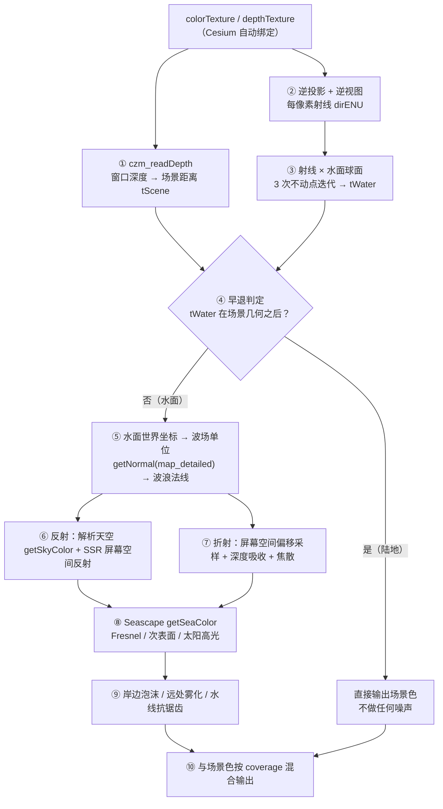

与原始实现的逐项对照：

| 环节 | Seascape 原版 | 本项目屏幕空间版 |
| --- | --- | --- |
| 相机 | shader 内写死 `ori/dir/ang` | `u_camENU` + `u_eyeToENU0/1/2` + `u_tanHalfFov`，由 `viewer.camera` 每帧算出（见 4.4） |
| 海面求交 | 假位法 raymarch 高度场 | 深度重建场景距离 + **射线 × 球面（带曲率修正）** 解析求交，3 次不动点迭代 |
| 法线 | `getNormal(p, dist²·EPSILON_NRM)` | 同一函数，`eps` 由"像素足迹 / 波场单位"换算（`u_pixelFootprint`），远处自动变宽 |
| 天空 | `getSkyColor(e)` 三行解析渐变 | 同一函数，但色板/分段与 `skyStage.js` 的**真实天空严格对齐** |
| 反射 | 只采样解析天空 | 解析天空 + **SSR**（屏幕空间反射，采样 `colorTexture` 并做遮挡测试） |
| 折射/水色 | 常量 `SEA_BASE + diffuse·SEA_WATER_COLOR·0.12` | 屏幕空间折射偏移采样 + **Beer-Lambert 深度吸收** + 深/浅水散射色 + 焦散 |
| 泡沫 | 无 | 岸边泡沫（水深 + 浪高 + 双层滚动噪声） |
| 雾 | 无（靠天空混合） | 远处按水面距离混向天空地平线色，水天一色 |
| 抗锯齿 | 无 | 水线 `coverage = smoothstep(...)` 与场景色混合，带宽随像素足迹缩放 |
| 性能 | 全屏每像素 raymarch | **非水面像素零噪声开销**；画质档降 `ITER_FRAGMENT`、关 SSR/焦散、降 `textureScale` |

> 一句话概括取舍：**"求交"用光栅化的深度缓冲换掉 raymarch，"着色"原样保留 Seascape 的解析模型**。这也是它能跑进 Cesium 同时还能保持 60+ fps 的原因。

### 4.4 uniform 映射表（ShaderToy → Cesium）

| ShaderToy | 本项目 | 来源 / 写法 | 说明 |
| --- | --- | --- | --- |
| `iTime` | `u_time` | `performance.now()/1000` → `water.update(now/1000)` | 秒。原版 `SEA_TIME = iTime * SEA_SPEED` 改成函数 `seaTime() = u_time * u_waveSpeed`（见 4.6 第一条坑） |
| `iResolution` | `u_texel` / `czm_viewport.zw` / `u_pixelFootprint` | 每帧 JS 写 `u_texel = 1/(drawingBuffer × textureScale)` | 正常着色路径**不需要 iResolution**：抗锯齿与 eps 用像素足迹 |
| `iMouse` | —（不用） | 相机代替鼠标 | 原版鼠标只用来 scrub 动画，本项目的动画由 `u_time` + UI 控制 |
| 相机位置 | `u_camENU` | `camera.positionWC - centerECEF` 点乘 ENU 基 | ENU 米 |
| 相机朝向 | `u_eyeToENU0/1/2` | `camera.inverseViewMatrix` 第 0/1/2 列 → 点乘 ENU 基 | eye 空间三轴在 ENU 中的方向 |
| 投影（FOV） | `u_tanHalfFov` | `projectionMatrix[0]`、`[5]` → `1/m[0]`、`1/m[5]` | 列主序：`m[0]=P00, m[5]=P11` |
| 射线方向 | 由 `ndc` + `u_tanHalfFov` + `u_eyeToENU*` 重建 | 见下方代码 | 与原版 `dir = normalize(vec3(uv,-2))` 等价 |
| `SEA_HEIGHT` | `u_waveHeight` | UI `waveIntensity` → `0.040 + 0.115·i` | 波场单位；×`u_waveUnit(10m)` ≈ 0.4~1.55 m 实际浪高（v3 提亮时略加大，水面特征更明显） |
| `SEA_CHOPPY` | `u_choppy` | UI → `3.2 + 1.6·i` | 尖峰程度 |
| `SEA_SPEED` | `u_waveSpeed` | UI `waveSpeed` → `0.30 + 0.85·s` | 波形滚动速度 |
| `SEA_FREQ` | `u_seaFreq` | UI → `0.52 - 0.16·i`（浪越大波长越长） | 基础频率 |
| `SEA_BASE` | `u_deepColor` `(0.028,0.105,0.175)` | 常量 | 深水基色 |
| `SEA_WATER_COLOR` | `u_scatterColor` `(0.075,0.25,0.30)` + `u_shallowColor` `(0.05,0.235,0.29)` | 常量 | 次表面/散射色 |
| `light = normalize(vec3(0,1,0.8))` | `sunDirENU()` | `czm_sunDirectionWC` 点乘 ENU 基 | 高光与真实太阳方向对齐 |
| `EPSILON_NRM = 0.1/iResolution.x` | `epsUnits = clamp(tWater·u_pixelFootprint/u_waveUnit, 0.05, 0.7)` | 每帧算 | 距离自适应差分步长（上下限是抗闪烁的调参点） |
| `fragCoord / iResolution` | `v_textureCoordinates` | Cesium 自动 | 全屏 [0,1] UV |
| `RENDERSIZE` | `textureSize(depthTexture, 0)`（调试用） | 需要时读 | 只在 debug 分支用 |
| — | `u_waterLevel` | UI → store → `setWaterLevel()` | **本项目扩展**：水面海拔 |
| — | `u_waveUnit` | 常量 10.0 | 1 波场单位 = 10 m |
| — | `u_earthRadius` | 常量 6,371,000 | 球面曲率修正 |
| — | `u_absorb` `(0.18,0.055,0.034)` | 常量（1/米） | Beer-Lambert：红光最先被吸收 |
| — | `u_ssr` / `u_refraction` / `u_foam` / `u_caustics` | UI / 画质档 | 效果强度 |
| — | `u_normalScale` / `u_specScale` | 常量（默认 1.0） | 法线强度 / 高光强度缩放；0 用于 A/B 排查（`0` = 近镜面平面 / 无高光） |
| — | `u_motion` | 每帧 JS 估算（0..1） | 相机运动强度（位置速度 + 角速度，attack 快 / release 慢，静止 ~0.3 s 回 0）：缩放/飞行时抑制 SSR、锐利高光和法线高频，减少 shimmer（见 4.7/4.9） |
| — | `u_debug` | `setDebugMode(n)` | 0=最终画面，1~21/90+ = 可视化通道 |

Cesium 侧的相机 → uniform 代码（`WaterRenderer._updateCameraUniforms()`，每帧一次）：

```js
// 相机 ENU 位置
Cesium.Cartesian3.subtract(camera.positionWC, this._centerECEF, scratchDelta);
const camENU = enuDot(scratchDelta, basis, u.u_camENU);
u.u_camENU = camENU;

// eye 空间三轴在 ENU 中的方向：inverseViewMatrix 的第 0/1/2 列
const iv = camera.inverseViewMatrix;
Cesium.Cartesian3.fromElements(iv[0], iv[1], iv[2], scratchCol);   // eye +X
u.u_eyeToENU0 = enuDot(scratchCol, basis, u.u_eyeToENU0);
Cesium.Cartesian3.fromElements(iv[4], iv[5], iv[6], scratchCol);   // eye +Y
u.u_eyeToENU1 = enuDot(scratchCol, basis, u.u_eyeToENU1);
Cesium.Cartesian3.fromElements(iv[8], iv[9], iv[10], scratchCol);  // eye +Z
u.u_eyeToENU2 = enuDot(scratchCol, basis, u.u_eyeToENU2);

// 投影矩阵 → tan(fov/2)（列主序：m[0]=P00, m[5]=P11）
const proj = camera.frustum.projectionMatrix;
u.u_tanHalfFov.x = Math.abs(1 / proj[0]);
u.u_tanHalfFov.y = Math.abs(1 / proj[5]);

// 像素足迹：1 米远处一个 stage 像素覆盖的世界尺寸（米/米）
const scale = WATER_QUALITY[this._quality].textureScale;
const w = scene.drawingBufferWidth, h = scene.drawingBufferHeight;
u.u_texel.x = 1 / (w * scale);
u.u_texel.y = 1 / (h * scale);
u.u_pixelFootprint = (2 * Math.abs(u.u_tanHalfFov.y)) / (h * scale);
u.u_time = this._time;
```

shader 内重建射线（对应原版 `dir = normalize(vec3(uv, -2))`）：

```glsl
vec2 ndc = uv * 2.0 - 1.0;
vec3 eyeDir  = vec3(ndc.x * u_tanHalfFov.x, ndc.y * u_tanHalfFov.y, -1.0);
vec3 eyeDirN = normalize(eyeDir);
// 从 eye 方向转到 ENU 方向（u_eyeToENU* 是 eye 轴在 ENU 中的方向）
vec3 dirENU  = normalize(u_eyeToENU0 * eyeDirN.x +
                         u_eyeToENU1 * eyeDirN.y +
                         u_eyeToENU2 * eyeDirN.z);
```

### 4.5 求交、尺度与坐标换算

**① 深度 → 场景距离**（`sceneDistanceAt`）：

```glsl
float sceneDistanceAt(vec2 uv, out float winDepth) {
    winDepth = czm_readDepth(depthTexture, uv);         // LOG_DEPTH 下自动反编码 → 窗口深度 [0,1]
    if (winDepth > 0.999999) return 1.0e9;              // 天空 / 无几何
    float near = czm_currentFrustum.x;
    float far  = czm_currentFrustum.y;
    float zNdc = winDepth * 2.0 - 1.0;
    float eyeDepth = (2.0 * near * far) / (far + near - zNdc * (far - near));  // 透视反投影
    vec2 ndc = uv * 2.0 - 1.0;
    vec3 eyeDir = vec3(ndc.x * u_tanHalfFov.x, ndc.y * u_tanHalfFov.y, -1.0);
    return eyeDepth * length(eyeDir);                   // eyeDepth 是 −z，乘射线长度得到沿视线距离
}
```

**② 射线 × 水面（球面近似）**：水位不是无限平面——地球是球面，15 km 外的海面会因为曲率"沉下去"，这正是海天线的来源。ENU 局部坐标下，海拔 `level` 的水面近似为抛物面 `z = level − (x²+y²)/(2R)`，用 3 次不动点迭代修正：

```glsl
float waterSurfaceDistance(vec3 ori, vec3 dir, float level) {
    if (abs(dir.z) < 1e-6) return -1.0;
    float t = (level - ori.z) / dir.z;                   // 先用平面求交
    if (t <= 0.0) return -1.0;
    for (int i = 0; i < 3; i++) {
        vec3 p = ori + dir * t;
        float sag = dot(p.xy, p.xy) / (2.0 * u_earthRadius);   // 曲率下沉量
        float targetZ = level - sag;
        t = (targetZ - ori.z) / dir.z;
        if (t <= 0.0) return -1.0;
        if (t > 1.5e6) return -1.0;                       // 掠射角：球面掉得比视线快，永远不相交
    }
    return t;
}
```

**③ 早退与水线抗锯齿**：先判断"水面在场景几何之后"（陆地）还是之前（水），并留一个随距离缩放的带宽 `aa` 做 coverage 混合：

```glsl
float aa   = clamp(tWater * u_pixelFootprint * 1.5, 0.02, 6.0);  // 米
float gap  = tScene - tWater;                                    // >0：水面在前 → 水像素
if (gap < -aa) { out_FragColor = vec4(sceneColor, 1.0); return; } // 陆地：零噪声开销
float coverage = smoothstep(0.0, 1.0, (gap + aa) / (2.0 * aa));   // 水线 0..1
```

**④ 世界 → 波场单位**：Seascape 的 `map/map_detailed` 期望 `p.xz` 是"米级"的波场坐标，且 `p.y - h` 表示"离水面多高"。本项目 1 单位 = 10 m，所以：

```glsl
vec3  pUnits   = vec3(waterENU.x, 0.0, waterENU.y) / u_waveUnit;        // ENU(x,y) → 波场(x,z)
float epsUnits = clamp(tWater * u_pixelFootprint / u_waveUnit, 0.05, 0.7); // 距离自适应差分步长
vec3  nSea     = getNormal(pUnits, epsUnits);                            // nSea.y = up
vec3  nENU     = vec3(nSea.x, nSea.z, nSea.y);                           // 换回 ENU 轴向
float flatFade = smoothstep(600.0, 6000.0, tWater);                       // 远处压平，抗闪烁
nENU = normalize(mix(nENU, vec3(0.0, 0.0, 1.0), flatFade * 0.90));
nENU = normalize(vec3(nENU.x * u_normalScale, nENU.y * u_normalScale, nENU.z)); // 法线强度（A/B 用）
nENU = normalize(mix(nENU, vec3(0.0, 0.0, 1.0), clamp(u_motion, 0.0, 1.0) * 0.45)); // 运动时进一步压平
```

> **为什么不是 1 单位 = 1 米**：Seascape 的 `SEA_FREQ≈0.16`、`SEA_HEIGHT≈0.6` 是按它自己的相机尺度调的；如果直接把米当波场单位，14 km 场景的波浪频率会低到看不见。用 `u_waveUnit=10` 做一次缩放，既保留原版参数语义（0.04~0.155 的波高、0.36~0.52 的频率），又能得到 0.4~1.55 m 的实际浪高。

**⑤ 太阳方向（ENU）**：自动 uniform `czm_sunDirectionWC` 是 ECEF 单位向量，点乘 ENU 基即可：

```glsl
vec3 sunDirENU() {
    vec3 s = czm_sunDirectionWC;
    vec3 d = vec3(dot(s, u_eastWC), dot(s, u_northWC), dot(s, u_upWC));
    float l = length(d);
    return l > 1e-5 ? d / l : normalize(vec3(0.25, 0.55, 0.15));
}
```

### 4.6 WebGL2 / GLSL ES 3.00 的坑

Cesium 1.100+ 用 WebGL2（GLSL ES 3.00）。ShaderToy 默认是 WebGL1（GLSL ES 1.00），把原版代码搬过来时会遇到一串只有 ES 3.00 才报的错。以下都是本项目真实踩到的：

| # | 坑 | 现象 | 解法 |
| --- | --- | --- | --- |
| 1 | **全局初始化引用 uniform** | 原版有 `float EPSILON_NRM = 0.1 / iResolution.x;` 和 `float SEA_TIME = iTime * SEA_SPEED;`。ES 3.00 要求**全局变量初始化必须是常量表达式**，编译直接失败：`'=' : global variable initializers must be constant expressions`（WebGL1 只给 warning，所以 ShaderToy 上没事） | 全部移进函数：`float seaTime() { return u_time * u_waveSpeed; }`，`EPSILON` 改成每帧算的 `u_pixelFootprint`/`epsUnits`。**这是搬运 Seascape 的第一号坑**，调研阶段已用 headless 编译实验验证过 |
| 2 | **`patch` 等新增保留字** | ES 3.00 保留字增加了 `patch`、`sample`、`subroutine`、`filter`、`resource`、`common`、`partition`、`active` 等；在 WebGL1 里能当变量名的 `patch`，到 ES 3.00 直接编译失败 | 变量命名时避开；本项目用的是 `nENU/pUnits/coverage` 这类名字 |
| 3 | **`in/out` 与 `out_FragColor`** | ES 3.00 没有 `gl_FragColor`/`varying`/`attribute`；post-process 的 shader 必须自己声明 `in vec2 v_textureCoordinates;`，输出写 `out_FragColor`（Cesium 会注入 `out vec4 out_FragColor`） | 按 Cesium 的 post-process 约定写；`v_textureCoordinates` **不会自动声明** |
| 4 | **循环上界必须是常量** | `for (int i = 0; i < ITER_FRAGMENT; i++)`，`ITER_FRAGMENT` 不能是 uniform | 画质档用 **`#define` 宏**注入，换档时重新生成 shader 字符串（`createWaterFragmentShader(quality)`）并重建 stage |
| 5 | **没有隐式 int→float 转换** | `pow(x, 2)`、`mix(a, b, 0)` 这类写法在 ES 1.00 可能被容忍，ES 3.00 报类型错误 | 统一写 `2.0 / 0.0`；`float(n + 1)` 显式转换（焦散函数里就有） |
| 6 | **`texture2D` → `texture`；`textureSize` 需要 lod** | 旧函数名不存在 | `texture(depthTexture, uv)`、`textureSize(depthTexture, 0)` |
| 7 | **精度声明** | ES 3.00 片元着色器没有默认 float 精度 | Cesium 的 `ShaderSource` 会注入 `precision` 与一堆 `#define`；**只有自己拼 `RawShaderMaterial` 才需要手写**。本项目走 Cesium 的 PostProcessStage，不用管 |
| 8 | **`czm_readDepth` vs 原始 depth** | Cesium 默认开对数深度，post-process 会自动注入 `LOG_DEPTH` 宏。`depthTexture.r` 是**对数深度**（近处也接近 1），而 `czm_readDepth()` 会按 `LOG_DEPTH` 反编码成 **窗口深度 [0,1]**；两者不能混用 | 需要窗口深度/反投影时用 `czm_readDepth`；**判断"天空"必须用原始值 `texture(depthTexture, uv).r == 1.0`**（`skyStage.js` 就是这么做的，见 3.2） |
| 9 | **`depthTestAgainstTerrain` 默认 false** | Cesium 在 globe pass 之后会 **clearGlobeDepth**（清空深度缓冲），post-process 拿到的 `depthTexture` 里只剩非地形物体；水面会整屏判成"水" | `globe.depthTestAgainstTerrain = true`（`WaterRenderer` 构造函数里也强制设了一次，见 4.7） |
| 10 | **`PostProcessStage.textureScale` 只读** | 创建后不能改，画质档想变 `textureScale` 只能**重建 stage** | `setQuality()` 里 `_destroyStage() → _createStage()`；水位/波浪**绝不重建**（只改 uniform） |
| 11 | **uniforms 被拷贝** | `new PostProcessStage({uniforms})` 创建时会把值拷进内部 `_actualUniforms`；之后改那个普通对象**不会上传 GPU** | 每帧从 `stage.uniforms`（getter/setter 代理）取一次再写：`_refreshUniforms()` |
| 12 | **`remove()` 内部会 destroy** | Cesium 1.147 的 `PostProcessStageCollection.remove()` 内部调用 `stage.destroy()`；再手动 destroy 会抛 `DeveloperError: This object was destroyed` | `_destroyStage()` 里只 `remove()`，不二次 destroy，并用 try/catch 兜底 |
| 13 | **Material fabric 与 post-process 是两套 API** | fabric 里没有 `colorTexture/depthTexture`，入口是 `czm_material czm_getMaterial(czm_materialInput materialInput)`；`materialInput.positionToEyeEC` 是"片元→相机"的 eye 向量 | 兼容方案见 4.8；世界坐标要用 `czm_inverseView * vec4(-positionToEyeEC, 1.0)` |
| 14 | **`Material` 的 `translucent` 位置** | Cesium 1.147 里 `translucent` 是 **Material 构造参数**，不是 fabric 字段；塞进 fabric 会被忽略 | `new Cesium.Material({ fabric: {...}, translucent: true })` |
| 15 | **`#define` 顺序** | 画质宏必须在函数定义之前；`SEASCAPE_COMMON_GLSL` 里的函数又依赖 `u_time` 等 uniform 声明 | shader 模板按「attribution → defines → Cesium 自动绑定声明 → 自定义 uniform → 工具函数 → SEASCAPE_COMMON_GLSL → main」的顺序拼接 |

### 4.7 PostProcessStage 的工程细节（JS 侧生命周期）

`WaterRenderer` 里最不直观的是**"uniforms 代理 + stage 重建"**这两件事，处理不好就是"参数调了没反应 / 内存泄漏 / destroy 报错"：

```js
// ① 创建：把 _baseUniforms 交给 stage；此时改普通对象还生效（值尚未被拷贝）
this._stage = new Cesium.PostProcessStage({
  name: `flood-water-${quality}-${seq}`,
  fragmentShader: createWaterFragmentShader(quality),
  uniforms: this._baseUniforms,
  textureScale: WATER_QUALITY[quality].textureScale,      // 只读，换档必须重建
  sampleMode: Cesium.PostProcessStageSampleMode.LINEAR,
});
this._scene.postProcessStages.add(this._stage);

// ② 每帧：stage.uniforms 是 getter/setter 代理，必须通过它写才会真正上传
_refreshUniforms() {
  this._uniforms = this._stage ? this._stage.uniforms : this._baseUniforms;
}

// ③ 换档：先销毁旧 stage（remove 内部已 destroy），再按新宏重建
_destroyStage() {
  const stage = this._stage;
  this._stage = null;
  this._refreshUniforms();                 // 退回 _baseUniforms，避免写已销毁的代理
  try { this._scene.postProcessStages.remove(stage); } catch (e) { /* 外部已移除 */ }
}

// ④ 每帧入口：先同步 store（水位/波浪/画质/开关），再更新相机 uniforms
update(timeSeconds) {
  if (this._destroyed) return;
  this._refreshUniforms();
  if (Number.isFinite(timeSeconds)) this._time = timeSeconds;
  this._syncFromStore();
  if (!this._enabled) return;
  this._updateCameraUniforms();
}
```

另外两个设计点：

1. **`_syncFromStore()` 让水面自己跟随 UI**：即使 `floodApp` 忘了接线，水面也会读 `store.waterLevel / waveIntensity / waveSpeed / caustics / quality / waterEnabled` 并做幂等更新（同档位不重建 stage）。`floodApp` 里的 `watch` 又主动调 `setWaterLevel`，两条路径都是幂等的，不会互相打架。
2. **每帧相机运动量 `u_motion`**：`WaterRenderer._updateMotionUniform()` 用相机位置速度 + 角速度估算 0..1 的运动强度（attack 快、release 慢，静止约 0.3 s 回 0），shader 用它做三件事：反射/SSR 改用低通法线、SSR 权重 ×(1−0.75·u_motion)、锐利高光 ×(1−0.6·u_motion)。它解决的是"缩放/飞行时水面一直闪烁"（uniform 更新时机 + 高频法线），实现细节见 `docs/shader-port.md` §8.11。
3. **Material 兼容模式的水面高度**：Material 版没有 uniform 可以"改高度"，只能移动 primitive 的 `modelMatrix`（沿场景中心 up 平移 `waterLevel` 米），这也是它比后处理版"廉价感"的来源之一：

```js
_waterModelMatrix() {
  const offset = Cesium.Cartesian3.multiplyByScalar(this._basis.up, this._waterLevel, new Cesium.Cartesian3());
  return Cesium.Matrix4.fromTranslation(offset);
}
```

### 4.8 Material fabric 等价实现（兼容方案 + 蓄水区水面）

Material 版（`waterMaterial.js`）没有场景深度，只能做"**解析天空反射 + 视角近似的浅/深水色 + 高光**"。它现在有两个用途：

- **降级 / 对照**：没有后处理权限、或想在 3D Tiles/任意 primitive 上复用同一套 Seascape 波浪算法时；
- **蓄水区水面**（`floodApp.js` §6.6）：屏幕空间后处理是**全局**的，无法只覆盖一个矩形，所以蓄水区用 `RectangleGeometry` + `MaterialAppearance` + 这个材质（v3 提亮后 emission 主导，远看是明确的湖面）。

**① 法线：不能用 `tangentToEyeMatrix`（v3 修复的坑）**

`Cesium.MaterialAppearance` 默认 **BASIC 材质支持**不提供 `materialInput.tangentToEyeMatrix`（是未初始化的零矩阵）。早期 shader 直接乘它 → 法线变 NaN → `ndv = 0` → `fresnel = 1` → 反射到地平线以下的雾霭色 → 蓄水区整片渲染成灰白色"板子"。正解是用 `st` 波场法线 + ENU 基向量组合成世界法线，再乘 `czm_viewRotation` 交给 Cesium 光照：

```glsl
vec2 p = materialInput.st * u_stScale;
vec3 nSea = getNormal(vec3(p.x, 0.0, p.y), 0.02);              // (东, 上, 北)
vec3 nENU = normalize(vec3(nSea.x * 1.85, nSea.y, nSea.z * 1.85)); // 横向放大，远看有波纹
vec3 nWC  = normalize(u_eastWC * nENU.x + u_northWC * nENU.z + u_upWC * nENU.y);
material.normal = normalize(czm_viewRotation * nWC);            // 只做方向旋转
```

**② v3 提亮后的着色公式（emission 主导 + 4 个调参 uniform）**

```glsl
float fresnel = 0.03 + 0.97 * pow(1.0 - ndv, 5.0);   // 反射权重
vec3 waterBody = mix(u_deepColor, u_shallowColor, shallowMix * 0.65);
waterBody = mix(waterBody, u_deepColor * 1.45, 0.28);            // 青绿 → 海蓝

material.diffuse  = (waterBody * (0.95 + 0.55 * sss)
                    + skyAmbient * u_scatterColor * 0.65) * u_diffMul;
material.emission = (skyColor * (0.10 + 0.90 * fresnel) * 1.15
                    + u_sunColor * 0.02) * u_emisMul;
material.specular = 0.90 * u_specMul;
material.shininess = 90.0;
material.alpha    = clamp(u_alphaBase + 0.40 * fresnel, u_alphaBase, 0.98);
```

默认调参：`u_diffMul = 1.8`、`u_emisMul = 1.0`、`u_alphaBase = 0.85`、`u_specMul = 1.0`（全部是 runtime uniform，改它们不需要重建材质）。实测 2.5 km 视距的蓄水区湖面像素约 **RGB(71,116,120)**，与灰白山体（约 RGB(150,150,140)）区分明显，一眼能认出是湖面。

**③ 调试通道**：运行时改 `u_debug`（不重建材质）可逐个分量排查——1/2/3 = diffuse 的 R/G/B，4 = 水体色，5 = `nENU`，6 = fresnel，7 = emission 的 R，8 = 纯白 diffuse，9 = skyColor，10 = 反射方向 `reflENU`，11 = 世界法线 `nWC`，12 = fresnel（emission 通道）。

两种方案对照：

| 维度 | PostProcessStage（主方案） | Material fabric（兼容 / 蓄水区） |
| --- | --- | --- |
| 场景深度 | ✅ 可用 → 遮挡、折射、吸收、焦散、泡沫 | ❌ 无 |
| 覆盖范围 | 全屏（按像素求交） | 一个矩形 primitive（`RectangleGeometry` + `MaterialAppearance`） |
| 水位变化 | 只改 `u_waterLevel` uniform（最廉价） | 改 `u_waterLevel` + 移动 `modelMatrix` |
| 波浪坐标 | ENU 世界米 → 波场单位（与世界对齐） | 矩形 `st(0..1)` × `u_stScale`（随矩形拉伸） |
| 与 Cesium 光照 | 自己算（Seascape 解析模型） | 走 `czm_material` 光照通道（`czm_viewRotation` 转 eye 法线） |
| 提亮方式 | 自亮 `deepColor·0.38 + scatter·0.10` + 天光 ×1.10 + 暖色偏移 | emission 主导 + `u_diffMul/u_emisMul/u_alphaBase/u_specMul` 调参 |
| 适用场景 | 本项目默认；需要"真水面感"时 | 降级、演示；**蓄水区水面** |

> **为什么不用 CustomShader**：`Cesium.CustomShader`（`fragmentMain(FragmentInput, inout czm_modelMaterial)`）是 Model/primitive 的现代材质接口，但它同样**拿不到场景深度与颜色缓冲**，做不出折射/吸收/焦散；而且本项目的水面根本不需要几何体。所以最终选择 `PostProcessStage` 为主、Material fabric 为辅，`CustomShader` 只作为"换宿主"的备选思路在本文档记录。

### 4.9 视觉扩展：折射 / 吸收 / 焦散 / 泡沫 / 雾霭 / 抗锯齿

这些是在 Seascape 之上**为本项目加的**（原版没有），每一项都有一个"物理直觉 + 屏幕空间近似"的取舍。
> 水面在交付前做过 **v3 提亮**（水面均值从近黑蓝 RGB(41,67,79) 提到清晰青蓝 RGB(71,120,131)，记录与 A/B 截图见 `docs/shader-port.md` §8.12）；下表中的数值以**当前源码**为准。

| 效果 | 做法 | 代码位置 | 取舍 |
| --- | --- | --- | --- |
| 屏幕空间折射 | 用波浪法线 `nENU.xy` 扰动采样 UV：`nENU.xy · (7 + 22/(1+depthBelow·0.55)) · u_texel`，上限 18 像素；浅水偏移更大 | `main()` §7 | 只是 2D 偏移，不是真折射；掠射角会露馅，靠 clamp 遮挡 |
| 深度吸收（Beer-Lambert） | `transmittance = exp(-u_absorb · opticalPath)`，`u_absorb=(0.18,0.055,0.034)` 1/米，红光衰减最快；`opticalPath = clamp(depthBelow·2.0+1.0, 0, 160)`（用**垂直水深**而不是视线长度，浅滩掠视也能透出地面） | §7 | 单次指数衰减，没有多次散射；深水靠 `scatter = 1-exp(-depthBelow·0.20)` 混向深水色（v3 提亮后吸收系数下调，深水不再发黑） |
| 水体自亮 / 天光补光 | `refracted += u_deepColor·0.38 + u_scatterColor·0.10`；`color += skyAmbient · u_scatterColor · 1.10`（`skyAmbient = mix(天顶天空色, 掠射天空色, 0.45)`） | §7 | 不依赖天空反射/太阳直射，黄昏逆光也保持"海蓝"；这是 v3 提亮的核心 |
| 暖色偏移 | `mix(color, color·(1.08,0.985,0.89) + (0.010,0.007,0.003), 0.65)` | §7 | 冷青蓝水体 + 6~8% 暖色，保留黄昏感，不把水面调成"白天蓝" |
| 焦散 | 自研 `causticWeb()`：用 Seascape 自己的 `sea_octave` 叠两层不同尺度/流向的域扭曲求"网状亮纹"（无平铺结构）；掩码 `exp(-depthBelow·0.26) · (1-smoothstep(6,32,pathLen)) · (1-smoothstep(60,220,tWater))`，再用低频噪声 `patchy` 打散 | §7 | 只在**浅水 + 近距离（< 220 m）**出现：远处像素足迹远大于焦散特征尺寸，任何规则图案都会退化成摩尔纹（这正是早期 Dave Hoskins 版本被替换的原因，署名仍保留在文件头） |
| 菲涅尔 | `fresnel = 0.08 + 0.92·pow(1−ndv, 5)`，掠射再向 1.0 混 50%（`smoothstep(0.70,0.97,·)·0.50`）；基底反射从 0.025 提到 0.08，俯视也带天空色 | §8 | 是"一眼看出是水"的关键之一；反射权重提高后远处水面更多是天空色而不是深水色 |
| 太阳高光 | `specular(...,120.0)·5.5` + `specular(...,28.0)·0.50` 两层；`specFade = exp(-tDist·0.00085)` 按距离衰减；`specMotion = 1−0.6·u_motion` 抑制运动时的闪烁 | §8 | 高光强度由 `u_specScale` 控制；v3 把主高光从 220^6 压到 120^5.5（更宽、更亮但不过曝），这是"太阳波光"的主要来源 |
| 岸边泡沫 | `shoreFade = 1-smoothstep(0.03,0.55,depthBelow)`（水深 < 0.55 m）+ `surfEdge`（水线附近）+ 两层低频噪声 + 门限 `smoothstep(0.40,0.78,n01)`；权重 `0.35/1.0`，距离 400→1400 m 淡出，上限 0.92；泡沫色 `(0.96,0.98,0.98)` | §8 | 早期泡沫铺满整片浅滩，远处欠采样出现"雷达波纹"摩尔纹；现在收窄到水线窄带并随距离关闭。纯噪声，不是气泡模拟 |
| 天空反射 | 解析 `getSkyColor(reflect(dir,nRefl))` + **SSR**：反射射线用**低通法线**（向 up 收拢 45%，运动时再加 40%·u_motion），投回屏幕采样 `colorTexture`，深度做遮挡测试、边缘 fade，`ssrWeight` 再乘 `(1−0.75·u_motion)` | §6 | SSR 只做单次屏幕空间步进，反射到屏幕外的物体（如相机背后的山）只能退回解析天空；低通法线是缩放不闪的关键 |
| 远处雾化 | `smoothstep(9000, 40000, tWater) · 0.72` 混向固定雾霭色 `(0.723, 0.670, 0.617)` | §9 | 与 Globe Material 的远景雾霭同族，保证海天线无硬边；v3 把雾的起点/强度调低，远处水面不再发灰 |
| 水线抗锯齿 | `coverage = smoothstep(0,1,(gap+aa)/(2aa))`，`aa` 随 `tWater·pixelFootprint` 缩放 | §4 | 几何边缘的解析 AA，比 MSAA 便宜；极细水线仍可能有 1px 抖动 |

### 4.10 调参：画质档与波浪参数

**画质档（`WATER_QUALITY`，`waterPostProcess.glsl.js`）**

| 档位 | `textureScale` | `ITER_FRAGMENT` | SSR | 焦散 | 泡沫 | 适用 |
| --- | --- | --- | --- | --- | --- | --- |
| `high` | 1.0 | 5 | ✅ | ✅ | ✅ | 桌面独显/Apple Silicon |
| `medium` | 0.75 | 3 | ✅ | ✅ | ✅ | 集显 / 高分屏 |
| `low` | 0.5 | 2 | ❌ | ❌ | ✅ | 移动端 / 弱 GPU / 需要极限帧率 |

`textureScale` 是后处理内部渲染分辨率比例（0.5 = 半分辨率再上采样），`ITER_FRAGMENT` 是法线用的 octave 数（原版 5）。**换档会重建 stage**（`textureScale` 只读），但**换水位/波浪不会**。

**波浪参数映射（`mapWaveParams`，`WaterRenderer.js`）**

| UI 字段 | 范围 | 映射到 | 实际含义 |
| --- | --- | --- | --- |
| `waveIntensity` | 0..1 | `u_waveHeight = 0.040 + 0.115·i`；`u_seaFreq = 0.52 − 0.16·i`；`u_choppy = 3.2 + 1.6·i` | 浪越大 → 波高↑、波长↑、尖峰↑；实际浪高约 0.4~1.55 m（×10 m 波场单位；v3 提亮时略加大） |
| `waveSpeed` | 0..2 | `u_waveSpeed = 0.30 + 0.85·s` | 波形滚动速度（原版 `SEA_SPEED = 0.8`） |
| `caustics` | 0..1 | `u_caustics` | 焦散强度（还受画质宏 `WATER_CAUSTICS` 控制） |

> 这些系数是**为本项目场景手调的**，不是原版数值：原版 `SEA_HEIGHT=0.6`、`SEA_FREQ=0.16` 是配合它自己的相机尺度；本项目把波场缩放到 10 m/单位后，要得到"总高不到 1 m 的近岸小浪"（而不是远洋巨浪），必须重标定。

### 4.11 与 `docs/shader-port.md` / 调研笔记的关系

- [`docs/shader-port.md`](./docs/shader-port.md)：shader-dev 的移植笔记，包含**逐函数原始代码对照、uniform 全量映射、调试通道说明、踩坑记录**——本章是"方案级"说明，那份是"实现级"细节，两者互补。
- [`docs/research/notes.md`](./docs/research/notes.md)：ShaderToy 源码获取的完整过程（Cloudflare 403 → ISF.video API）、ISF→ShaderToy 还原差异、WebGL1 vs WebGL2 编译实验、现成移植（Cesium/Godot/HLSL/Three.js）的优缺点分析。**如果你要移植别的 ShaderToy shader，这份笔记里的取源码方法可以复用。**
- [`docs/research/raw/`](./docs/research/raw/)：原始素材（`isf-frag.glsl`、`ms2sd1-source.glsl`、Cesium 移植参考 `cesium-fabric-material.glsl`、Godot 版、渲染验证图）。

署名（**发布时必须保留**）：

> "Seascape" by Alexander Alekseev (TDM), 2014 — CC BY-NC-SA 3.0 — <https://www.shadertoy.com/view/Ms2SD1>
> Caustic function by Dave Hoskins — CC BY-NC-SA 3.0 — <https://www.shadertoy.com/view/MdlXz8>

本项目把这两段署名写进了三处：shader 源码头部（`SEASCAPE_ATTRIBUTION`，会进构建产物）、Cesium 的 credit 条、以及 InfoModal 的项目说明里。


---

## 五、动态水位控制与淹没分析

> 对应源码：[`src/store.js`](./src/store.js)（状态契约）、[`src/cesium/floodApp.js`](./src/cesium/floodApp.js) §7–§9（平滑与每帧循环）、[`src/water/WaterRenderer.js`](./src/water/WaterRenderer.js)（`setWaterLevel`）、[`src/analysis/floodAnalysis.js`](./src/analysis/floodAnalysis.js)（统计）、[`src/components/ControlPanel.vue`](./src/components/ControlPanel.vue) / [`StatsPanel.vue`](./src/components/StatsPanel.vue)（UI）。
> 分析与误差的完整推导见 [`docs/flood-analysis.md`](./docs/flood-analysis.md)。

### 5.1 状态机：一根滑块，三个消费方

水位不是"UI 状态"，而是一条**单向数据流**：UI 只写目标值，渲染循环负责把它变成实际值，渲染与分析各自消费实际值。

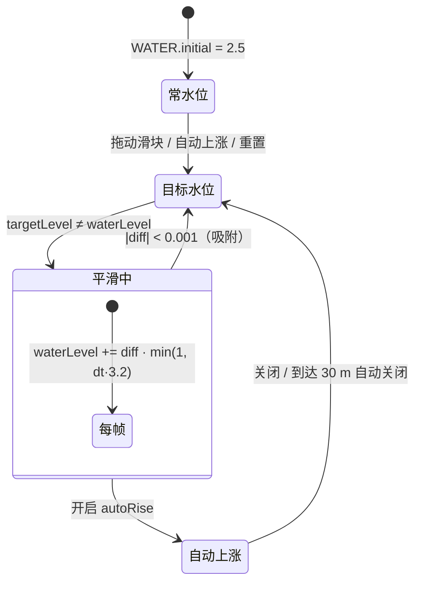

| 变量 | 类型 | 含义 | 谁写 |
| --- | --- | --- | --- |
| `store.targetLevel` | 数字（0–30） | 目标水位（m，海拔） | UI / 自动上涨 / 占位模拟 |
| `store.waterLevel` | 数字（0–30） | 实际水位（m），渲染与分析都用它 | `floodApp.tick()` |
| `store.autoRise` | 布尔 | 自动上涨 | UI |
| `store.riseSpeed` | 数字（0.1–3.0） | 上涨速度 m/s | UI |
| `store.waterEnabled` | 布尔 | 水面显隐 | UI |

> 约定来自 [`docs/INTERFACES.md`](./docs/INTERFACES.md) §2：**UI 不直接操作 Cesium**，Cesium 也不直接写 UI 组件。这保证了"拖动滑块只改一个数字，其余全部由渲染层推导"。

### 5.2 滑块 → `targetLevel`

`ControlPanel` 里的水位滑块是主交互：范围 **0–30 m**，步长 **0.1**，`input` 事件直接写 `store.targetLevel`（`aria-label="目标水位（米）"`）。同时显示：

- **目标值**（跟随手指/滑块，大号数字）；
- **实际值**（`store.waterLevel`，平滑跟随，小字）；
- 阈值刻度 **6 m 警戒 / 15 m 危险 / 24 m 极端**（`ZONE_MARKS`，颜色按 `safe/warn/danger` 变化）；
- 风险分区文案（安全 <6、警戒 6–15、危险 15–24、极端 ≥24），与 `TopBar` 的 pill 一致。

复位按钮调用 `resetFloodState()`（`store.js`）：`targetLevel=2.5 / autoRise=false / waveIntensity=0.65 / waveSpeed=0.8 / caustics=0.8 / quality='high'`，`ControlPanel` 再额外把 `showBuildings / waterEnabled` 置回 `true`。

### 5.3 每帧平滑：指数趋近 + dt 钳制

`floodApp.tick()` 里的核心 6 行：

```js
const dt = Math.min((now - lastTime) / 1000, 0.12);   // ★ 钳制 dt：切后台/断点回来不会瞬移
lastTime = now;

// 自动上涨
if (store.autoRise) {
  const next = Math.min(WATER.max, store.targetLevel + store.riseSpeed * dt);
  store.targetLevel = next;
  if (next >= WATER.max) store.autoRise = false;       // 到顶自动关，避免“空转”
}

// 指数平滑（一阶低通）
const diff = store.targetLevel - store.waterLevel;
if (Math.abs(diff) > 0.001) {
  const step = diff * Math.min(1, dt * 3.2);
  store.waterLevel = Math.abs(diff) < 0.01 ? store.targetLevel : store.waterLevel + step;
} else if (store.waterLevel !== store.targetLevel) {
  store.waterLevel = store.targetLevel;
}
```

设计考虑：

| 点 | 说明 |
| --- | --- |
| **为什么不用 CSS transition / 线性插值** | 水位要驱动 shader uniform 与统计分析，必须是一个连续数值；CSS transition 只能动数字显示，不能动 3D |
| **指数趋近而不是匀速** | `step = diff · k` 让"大差距快、小差距慢"，视觉上像水在漫上来而不是机械匀速；时间常数 `1/3.2 ≈ 0.31 s`，约 **0.94 s 收敛到 95%** |
| **dt 钳制到 0.12 s** | 切标签页/断点/截图时 `requestAnimationFrame` 会停，回来时 `dt` 可能是几秒；不钳制会"水位瞬移"，也会让自动上涨跳过中间状态 |
| **吸附阈值 0.001** | 避免无限接近但永远差一点，导致每帧都在写 store / 上传 uniform |
| **自动上涨与滑块共用 targetLevel** | 用户随时拖滑块都能"接管"；到 30 m 自动关闭开关（`autoRise = false`） |

### 5.4 自动上涨

- UI：开关 + 速度滑块（`0.1–3.0 m/s`，步长 0.1，`aria-label="自动上涨速度（米每秒）"`）；
- 逻辑：在 `tick()` 里 `targetLevel += riseSpeed · dt`，上限 `WATER.max=30`，到顶自动关；
- 因为 `waterLevel` 是 `targetLevel` 的平滑跟随，自动上涨时**两层平滑叠加**（速度积分 + 一阶低通），视觉上是"加速上涨 → 匀速"的自然过渡；
- 实测：`riseSpeed=0.6 m/s` 时，从 2.5 m 涨到 30 m 约 **46 s**。

### 5.5 为什么 `setWaterLevel` 必须廉价

水位每帧都在变（自动上涨时连续 46 s），如果每帧重建水面几何/shader，帧率会直接崩。本项目的做法是**只改一个 uniform**：

```js
// WaterRenderer.setWaterLevel —— 只写 uniform，不碰几何、不重建 stage
setWaterLevel(meters) {
  if (!Number.isFinite(meters)) return;
  this._refreshUniforms();           // 取当前 stage 的 uniforms 代理（每帧可能需要重新取）
  this._waterLevel = meters;
  this._uniforms.u_waterLevel = meters;   // ★ 唯一真正做的事
  if (this._waterPrimitive) {             // 仅 Material 降级模式需要移动模型矩阵
    this._waterPrimitive.modelMatrix = this._waterModelMatrix();
  }
  if (this._material) this._material.uniforms.u_waterLevel = meters;
}
```

- **PostProcessStage 主方案**：水位只影响 `u_waterLevel` 这个 float。水面像素的求交每帧都在 shader 里重新算，所以水位变化是"免费"的（没有几何、没有 CPU 顶点更新、没有 draw call 变化）。
- **更新时机**：水面 uniform 不在独立 rAF 里更新，而是挂在 `scene.preRender` 回调里（`water.setWaterLevel(store.waterLevel); water.update(performance.now()/1000)`）——保证 uniform 与 Cesium 本帧渲染用的是同一份相机矩阵，否则缩放/飞行时水面会"错一像素地闪"。
- **Material 降级方案**：没有"随水位长高的水"，只能整体平移一个矩形 primitive 的 `modelMatrix`（球面曲率近似）。
- **对照**：换画质档才需要重建 stage（`textureScale` 只读），所以 `setQuality()` 里才有 `_destroyStage()/_createStage()`，而 `setWaterLevel` 里完全没有。

> 这也是本 Demo 能做到"滑到哪淹到哪、实时统计"的根本原因：**水位 = 一个 uniform + 一次纯 CPU 统计**，而不是一次场景重建。
>
> 蓄水区（§5.8）沿用同一原则：`zoneLevel` 变化只改 `zonePrimitive.modelMatrix`（沿 ENU up 平移）+ 材质 `u_waterLevel`，外加一次 **64×64 地形重采样**（4,096 次 `heightAtLocal`，<1 ms 量级）；只有「重新框选 / 清除」才会销毁并重建 primitive。

### 5.6 相机预设与视角操作

5 个机位（`floodApp.js` 的 `PRESETS` + `store.js` 的 `CAMERA_PRESETS`），全部用**局部 ENU 米**定义，再由两个点自动求 heading/pitch（避免手写角度与 Cesium 约定对不上）：

| 预设（UI 标签） | 相机局部坐标 `(x, y, h)` | 看向 `(x, y, h)` | 用途 |
| --- | --- | --- | --- |
| `overview` 全景 | `(3000, -800, 450)` | `(500, 400, 60)` | **从东南海面望向城市**：前景海面/码头 + 滨海新区 + CBD 天际线 + 老城/山体背景同框 |
| `village` 老城 | `(VILLAGE.centerX+520, VILLAGE.centerY−880, 130)` = `(70, -180, 130)` | `(VILLAGE.centerX−120, VILLAGE.centerY+160, 8)` = `(-570, 860, 8)` | 老城街区平视，贴近看建筑进水 |
| `river` 河口 | `(1450, -1500, 170)` | `(150, -620, 1)` | 河道入海口与渡口栈桥 |
| `sea` 滨海 | `(3400, 300, 260)` | `(1900, 500, 100)` | 海上回看 **CBD 天际线** + 码头 + 海面 |
| `compare` 对比 | `(4000, -3000, 1800)` | `(0, 500, 80)` | 高空俯瞰全城（老城/西城/北城/新区/CBD/海岸线） |

朝向求解（`solveOrientation`）：

```js
const dx = target.x - cam.x;        // 东
const dy = target.y - cam.y;        // 北
const dz = target.h - cam.h;        // 上
const horiz = Math.hypot(dx, dy);
return {
  heading: Math.atan2(dx, dy),      // Cesium：heading 0 = 北，顺时针为正
  pitch:   Math.atan2(dz, horiz),   // 仰角；负值 = 俯视
  roll: 0,
};
```

点击底部「机位」Dock 写 `store.cameraPreset`，`floodApp` 的 `watch` 收到后 `viewer.camera.flyTo({destination, orientation, duration: 2.2, easingFunction: QUADRATIC_IN_OUT})`；初始视角也用同一套函数 `setView()`。键盘 `1~5` 与 `CAMERA_PRESETS` 顺序一一对应。

**自由视角：Cesium 原生控制器 + 三键映射**

相机自由控制使用 Cesium 自带的 `ScreenSpaceCameraController`，只把事件类型改成用户要的三件套（不再自己写 pointer 相机）：

```js
const controller = scene.screenSpaceCameraController;
controller.rotateEventTypes = [Cesium.CameraEventType.LEFT_DRAG]; // 左键：旋转
controller.tiltEventTypes   = [Cesium.CameraEventType.RIGHT_DRAG]; // 右键：倾斜
controller.zoomEventTypes   = [Cesium.CameraEventType.WHEEL];       // 滚轮：缩放
controller.lookEventTypes   = [];  // 关闭 Shift+左键自由观察
controller.minimumZoomDistance = 60;
controller.maximumZoomDistance = 3600;
```

行为说明：

- **左键拖拽 = 旋转**：Cesium 3D 的旋转是环绕地球的旋转，贴近地面/局部时旋转半径小，观感类似平移（这也是 Cesium 的标准行为）。
- **右键拖拽 = 倾斜**：`tilt3D` 绕视线落点旋转；低空右拖容易把相机抬高得很远，所以 `scene.preRender` 里有一个 `clampCameraLimits` 兜底：高度夹在 **60–3600 m**、pitch 夹在 **−77.3°~+5.7°**，保证画面始终在场景附近、不会把视角抬到整屏天空。
- **滚轮 = 缩放**：`zoomEventTypes=[WHEEL]`，距离 60–3600 m。
- **键盘 / ViewPad**：`←→↑↓` 旋转（12°/8°，Shift ×2）、`+/−` 缩放、`R` 重置、`1~5` 切机位；ViewPad 通过 `store.viewCommand` 下发 `orbit/zoom/reset`，由 `floodApp` 转成 `camera.setView`/`zoomIn|zoomOut`/`flyTo`。
- 右键菜单已屏蔽，画布有 `grab/grabbing` 光标反馈；点选建筑仍走独立的 `LEFT_CLICK`。

> 相机相关代码集中在 `floodApp.js` §3.1 配置 + §6.5 辅助函数（`orbitCamera/zoomCamera/resetCamera`、键盘、`clampCameraLimits`）；`dispose()` 会注销键盘、pointer 光标与 `preRender` 回调。

### 5.7 淹没分析：建筑逐栋 + 高程网格面积

`buildAnalyzer(buildings)` 在场景初始化时调用一次（实测 Node 下 **~12 ms**：24,192 次高程采样 + 16 档直方图 × 1067 栋；浏览器里包含在加载遮罩内），之后 `compute(level)` 每次只有 **~0.22 ms**（实测 0.218 ms / Node，浏览器 `~0.05–0.2 ms`），所以 5.5 Hz 更新毫无压力。

**① 建筑判定**（逐栋，O(n)）

```js
for (const b of buildings) {
  const depth = level - b.minGround;   // 淹没深度 = 水位 − 地基最低点海拔
  if (depth > 0.15) {                  // 被淹阈值（15 cm，避免“刚好擦到”算被淹）
    floodedBuildings += 1;
    sumDepth += depth;
    maxDepth = Math.max(maxDepth, depth);
    if (depth > 2) dangerBuildings += 1;   // 危险：深度 > 2 m
    flooded.push({ id, name, type, depth, height, minGround });
  }
}
flooded.sort((a, b) => b.depth - a.depth);
```

- 用 `minGround`（占地**四角 + 中心**的最低地基海拔）而不是 `groundHeight`（中心点）：坡地上只要有一角落水，就算被淹，**偏保守**；
- 不判断建筑自身是否阻挡水体、不判断门窗高度、不做 3D 体块求交；
- `floodedList` 按深度降序，UI 只展示前 3（`StatsPanel` 的 Top3）。

**② 淹没面积**（高程网格，`168 × 144`）

```js
const NX = 168;
const NY = Math.round((NX * SCENE.heightMeters) / SCENE.widthMeters);  // 144
const dx = SCENE.widthMeters / (NX - 1);   // 83.83 m
const dy = SCENE.heightMeters / (NY - 1);  // 83.92 m
const cellArea = dx * dy;                  // ≈ 7,036 m²

// 启动时预采样一次（24,192 次 heightAtLocal），之后每帧只做比较
heightAtLocal(x, y) → heights[]

// 统计：只算“原本是陆地（h ≥ 0）且现在在水下（h < level）”的格子
if (h >= 0 && h < level) area += cellArea;
```

- **不含海面/河床**（`h < 0` 的格子不计入）：所以水位 2.5 m 时"被淹面积 13.41 km²"指的是**原本露出的滩涂、河道两岸、低洼农田**被淹，而不是整片海；
- 陆地总面积 `landAreaM2 = 116.49 km²`，网格覆盖总面积 `sceneAreaM2 = 170.19 km²`（168×144×cellArea 略大于 14×12=168 km²，是网格单元按 dx·dy 计的正常偏差）；
- 比值 `inundatedRatio = 被淹陆地 / 陆地总面积`。

**③ 直方图**：启动时对 16 个水位档（0, 2, 4, …, 30 m）各算一次 `{level, flooded, danger, area}`，UI 直接读，不在渲染循环里重算。`StatsPanel` 用**内联 SVG**（328×94）画柱状图：当前水位左侧的柱子高亮为"已经发生"，右侧灰显；再叠一条当前水位竖线。

**④ 实测数据表**（`buildings=1067`，`minGround ∈ [2.65, 23.36]`，判定阈值 **`depth > 0.15`** / 危险 `> 2 m`）：

| 水位 | 被淹建筑 | 危险建筑 | 被淹陆地面积 | 占陆地 | 最大水深 | 平均水深 |
| --- | --- | --- | --- | --- | --- | --- |
| 0 m | 0 / 1067 | 0 | 0 km² | 0% | 0 m | 0 m |
| 2.5 m（初始） | 0 / 1067 | 0 | 13.41 km² | 11.5% | 0 m | 0 m |
| **6 m（滨海带整片进水）** | **256 / 1067** | 103 | 31.88 km² | 27.4% | 3.35 m | 1.79 m |
| 7 m（老城开始进水） | 319 / 1067 | 201 | 35.84 km² | 30.8% | 4.35 m | 2.38 m |
| **8 m（老城成片进水）** | **338 / 1067** | 269 | 39.21 km² | 33.7% | 5.35 m | 3.23 m |
| 9 m | 401 / 1067 | 321 | 42.52 km² | 36.5% | 6.35 m | 3.66 m |
| 10 m | 566 / 1067 | 344 | 45.73 km² | 39.3% | 7.35 m | 3.47 m |
| 12 m | 861 / 1067 | 603 | 49.24 km² | 42.3% | 9.35 m | 4.07 m |
| 15 m | 989 / 1067 | 928 | 50.83 km² | 43.6% | 12.35 m | 6.41 m |
| 24 m | 1067 / 1067 | 1065 | 53.39 km² | 45.8% | 21.35 m | 14.77 m |
| 30 m（上限） | 1067 / 1067 | 1067 | 54.62 km² | 46.9% | 27.35 m | 20.77 m |

> **口径说明**：正文统一用项目/UI 的 `depth > 0.15 m` 判定；若按 `depth > 0` 的"占位面积"口径，同样水位为 **6 m → 269 / 10 m → 603 / 15 m → 992**（本表不采用，避免与 `floodAnalysis.js`/UI 数字不一致）。
>
> 淹没顺序：6 m 时 **滨海新区 205 / 263 栋 + CBD 46 / 46 栋 + 滨水带 5 / 5 栋** 进水（滨水带最低，2.65–3.48 m）；7 m 老城开始进水（5 栋，老城最低地基 6.47 m）；8 m 老城 24 栋；12 m 老城 227 栋、西城 224 栋、北城 96 栋；15 m 989 栋（92.7%）；24 m 全城 1067 栋被淹、最大水深 21.35 m。

**⑤ 分类型 / 分区的 `minGround`**（决定"谁先被淹"）：

| 分类 | 栋数 | `minGround` 中位数 | 范围 |
| --- | --- | --- | --- |
| `house` 民居 | 621 | 10.06 m | 2.89–23.36 m |
| `shop` 商住 | 319 | 9.78 m | 2.81–20.39 m |
| `apartment` 公寓/酒店 | 66 | 4.73 m | 2.75–6.67 m |
| `tower` CBD 塔楼 | 40 | 3.48 m | 2.84–4.36 m |
| `landmark` 地标 | 9 | 3.17 m | 2.72–4.30 m |
| `public` 公共建筑 | 6 | 3.13 m | 2.72–8.66 m |
| `pier` 码头/栈桥 | 6 | 2.70 m | 2.65–9.57 m |
| **老城**（district old） | 233 | 9.13 m | 6.47–12.33 m |
| **西城**（district west） | 320 | 10.62 m | 8.96–23.36 m |
| **北城**（district north） | 200 | 12.05 m | 9.61–18.86 m |
| **滨海新区**（district harbor） | 263 | 4.83 m | 2.65–6.78 m |
| **滨海 CBD**（district cbd） | 46 | 3.52 m | 2.72–4.36 m |
| **滨水公共带**（district waterfront） | 5 | 2.73 m | 2.65–3.48 m |

> 这组数字解释了淹没顺序：**码头/滨水/CBD/公寓（2.6~6.8 m）→ 老城（9.1 m）→ 西城（10.6 m）→ 北城（12.1 m）**。西城/北城是山坡上的新城，`minGround` 最高到 23.36 m，是"高处后淹"的对照组。

**⑥ 关于 UI 的 6 / 15 / 24 m 刻度**：这组阈值来自场景设计（[`docs/INTERFACES.md`](./docs/INTERFACES.md) §1 的 `WATER.safe/warn/danger`），是"通用风险叙事刻度"；而澜屿市的实际地基是 **2.65–23.36 m**，所以：

- **6 m**：滨海新区/CBD/滨水带 256 栋进水（占全城 24.0%），老城/西城/北城安全；
- **7 m**：老城开始进水（5 栋，全城 319 栋被淹，占 29.9%）；
- **8 m**：老城 24 栋、全城 338 栋被淹（占 31.7%）；
- **12 m**：861 栋被淹（80.7%），西城/北城大面积进水；
- **15 m**：989 栋被淹（92.7%），最大水深 12.35 m（"危险"刻度在这里对应"绝大部分城市沉没"）；
- **24 / 30 m**：全城 1067 栋被淹（最大水深 21.35 / 27.35 m），主要体现为水深与海面大范围抬升。

> 刻度是场景相关的：如果换成"城市建在 40–80 m 台地"的地形，6/15/24 才会有真正的分级意义。

### 5.8 蓄水区：框选山间水库 + 区域分析

全局水位滑块回答"海平面涨到 X 米会淹哪里"；**蓄水区**回答另一个问题——"**如果在这片山谷里筑坝蓄水到 Y 米，会淹多少、蓄多少水、影响几栋建筑**"。它是与全局淹没**完全独立**的一套假设分析：不影响 `store.stats`，也不进入直方图。

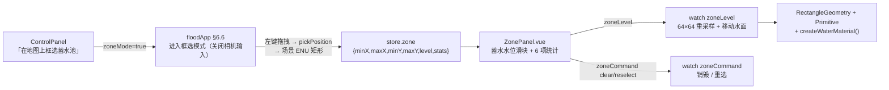

**① 交互流程**

1. 右侧控制台「蓄水分析」区点 **「在地图上框选蓄水池」** → `store.zoneMode = true`（按钮文案变「取消框选」并闪烁提示）；
2. `floodApp` 监听 `zoneMode`：进入时**临时关闭相机输入**（`screenSpaceCameraController.enableInputs = false`）、光标改 `crosshair`，并注册 `pointerdown/pointermove/pointerup/keydown`；
3. 在地形上**按住左键拖拽**：每次指针事件用 `scene.pickPosition()`（不支持时退回 `camera.pickEllipsoid`）拾取地面点，转成**场景 ENU 米**；拖拽过程画一条 `clampToGround` 的琥珀色草稿边线（`#ffd166`）；
4. 松手：矩形边长 < 30 m 视为误触丢弃；否则用 24×24 粗采样求框内地形 `minH/maxH`，给默认水位 `level = minH + clamp((maxH−minH)·0.35, 5, 80)`，并把 `zoneLevelRange` 设为 `[floor(minH−1), ceil(maxH+40)]`；随后建水面 + 贴地围栏线，`zoneMode` 自动置回 `false`；
5. 左侧出现「蓄水区分析」卡（`ZonePanel.vue`）：蓄水水位滑块（`store.zoneLevelRange`）+ 统计 + 「重新框选 / 清除」；框选模式中按 **Esc** 取消；
6. 操作提示（`InteractionHint.vue`）里也有一行：「点『框选蓄水池』后在地形上拖拽，可模拟山间水库」。

**② 水面渲染（`floodApp.js` §6.6）**

蓄水区水面**复用 Material 版 Seascape 水面**，不是屏幕空间后处理（后处理是全局的，不可能只覆盖一个矩形）：

```js
const rectangle = Cesium.Rectangle.fromDegrees(west, south, east, north);
const geometry = new Cesium.RectangleGeometry({
  rectangle,
  height: 0,                                     // 相对模型的基准高度
  vertexFormat: Cesium.MaterialAppearance.VERTEX_FORMAT,
});
zoneMaterial = createWaterMaterial({
  stScale: new Cesium.Cartesian2(
    Math.max(60, widthM / 7),                    // 波场按矩形尺寸缩放（约 1 单位≈7 m）
    Math.max(60, heightM / 7),
  ),
});
zonePrimitive = scene.primitives.add(new Cesium.Primitive({
  geometryInstances: new Cesium.GeometryInstance({ geometry }),
  appearance: new Cesium.MaterialAppearance({ material: zoneMaterial, translucent: true, closed: false, faceForward: true }),
  asynchronous: false,
}));
zonePrimitive.modelMatrix = Cesium.Matrix4.fromTranslation(
  Cesium.Cartesian3.multiplyByScalar(zoneFrame.up, zone.level, new Cesium.Cartesian3()), // 抬到蓄水水位
);
```

| 细节 | 做法 | 效果 |
| --- | --- | --- |
| 水面形状 | 14 km 场景的局部 **`RectangleGeometry`**（`height: 0`）+ `Primitive` | 矩形覆盖框选范围，不依赖地形几何 |
| 水面高度 | `modelMatrix` 沿场景中心 ENU `up` 平移 `zoneLevel` 米 | **恒定椭球高平面**（不是起伏水面） |
| 岸线/岛屿 | 水面与地形做**深度测试**（`globe.depthTestAgainstTerrain = true`） | 地形高于水面的部分自然露出 → 岸线、岛、半淹山谷 |
| 水色/波浪 | `createWaterMaterial()`（Seascape Material 版）+ 其 v3 提亮默认色（深水 `(0.030,0.110,0.180)`、浅水 `(0.10,0.34,0.38)`、`u_diffMul=1.8` 等）；`floodApp` 只覆盖波浪/泡沫参数，不再覆盖水色 | 波场随矩形尺寸缩放；`u_time` 由 `scene.preRender` 每帧更新；实测湖面约 RGB(71,116,120) |
| 矩形边线 | 4 个角点 `Cesium.Cartesian3.fromDegrees` + `clampToGround: true` 的 `PolylineGlowMaterialProperty`（`#6ef0ff`） | 贴地画框，起伏地形上也看得见 |
| 水位变化 | `zoneLevel` watch → 只改 `primitive.modelMatrix` 与材质 `u_waterLevel`（+ 重算 stats） | **零重建**，拖滑块是实时的 |

> 局限（有意为之）：Material 版没有场景深度 → **没有折射/吸收/焦散/岸边泡沫**；水面是水平面 → 不模拟坝体、入库流量、蒸发/渗漏；矩形是 ENU 轴对齐的 → 不能画任意多边形。这些都在 §5.9 与 `docs/flood-analysis.md` 里如实写。

**③ 区域分析（64×64 地形采样）**

```js
const N = 64;
const cellArea = (w * h) / (N * N);              // 矩形均分网格
for (j…) for (i…) {
  const h = heightAtLocal(x, y);
  if (h < level) {
    waterCells += 1;
    volume += (level - h) * cellArea;            // m³
    depthSum += (level - h);
    maxDepth = max(maxDepth, level - h);
  }
}
return {
  areaKm2: (w * h) / 1e6,                        // 矩形面积
  waterAreaKm2: (waterCells * cellArea) / 1e6,   // 实际水面面积（地形低于水位的格子）
  maxDepth, meanDepth: depthSum / waterCells,
  volumeWanM3: volume / 1e4,                     // 万 m³
  buildingsTotal, buildingsFlooded,             // 中心点落在矩形内的建筑，minGround 判定
  terrainMin, terrainMax,
};
```

- 复杂度：64×64 = **4,096 次 `heightAtLocal`**，只在"框选完成"和"拖动蓄水水位"时重算（拖动时用同一函数，实测单次 < 1 ms 量级）；
- **建筑判定**：`bx = VILLAGE.centerX + localX`、`by = VILLAGE.centerY + localY`，中心点落在矩形内即计入 `buildingsTotal`；`zoneLevel − minGround > 0.15` 计入 `buildingsFlooded`（与全局淹没同一阈值）；
- **蓄水量**：`Σ(水深 × 格面积)`，单位换算成**万 m³**；`areaKm2` 是矩形面积，`waterAreaKm2` 是真正被水覆盖的面积（两者之差 = 框内露出水面的山体/高地）。

**④ 实测（生产验收脚本 `draw reservoir zone`）**

| 指标 | 本轮最终构建实测（具体值取决于拖拽位置/视角） |
| --- | --- |
| 矩形面积 `areaKm2` | **0.20 km²** |
| 实际水面 `waterAreaKm2` | **0.17 km²** |
| 默认蓄水水位 | 8.7 m（由框内地形粗采样自动给出） |
| 清除后 | `store.zone === null`，水面 primitive / 边线全部移除 |

**⑤ 与全局淹没的分工**

| | 全局水位（§5.2–§5.7） | 蓄水区（本节） |
| --- | --- | --- |
| 水位含义 | 全场景海平面（0–30 m） | 框选矩形内的库区水位（按框内地形自动定范围） |
| 渲染 | 全屏 `PostProcessStage`（折射/焦散/SSR/泡沫） | `RectangleGeometry` + Material 版水面（无折射/焦散） |
| 统计 | 1067 栋 + 168×144 网格 + 直方图 | 框内 64×64 网格 + 框内建筑 |
| 交互 | 滑块 / 自动上涨 | 框选 + 蓄水水位滑块 |
| 是否影响 `store.stats` | 是 | **否**（独立假设分析） |

### 5.9 精度与局限（必须如实说明）

| 局限 | 影响 | 改进方向 |
| --- | --- | --- |
| **静态几何比较，不是洪水演进** | 没有流速、流量、到达时间、溃坝/漫堤过程；水位抬到哪就"瞬间"淹到哪 | 接入 HEC-RAS / LISFLOOD-FP 的离线演进结果，按时间读栅格（见 §7.6） |
| **`minGround` 判定偏保守** | 坡地建筑只要一角落水就判被淹；实际可能只是院墙进水 | 用建筑台基/室内地坪高程、或逐面片求交 |
| **面积网格 83.8 m** | 河道、田埂、道路等窄地物被抹平；薄长条区域的相对误差可能很大 | 提高网格密度（成本 O(n²)）或换成 DEM 原始分辨率栅格 |
| **不含海面/河床** | "被淹面积"只统计陆地，和"水面总面积"不是一个口径 | 需要时输出两套口径 |
| **水面是平的（球面近似）** | 浪高（0.3–1.3 m）不计入淹没；风暴增水/波浪爬高没有建模 | 风场 + 增水模型，或直接把水位当作"含增水的等效水位" |
| **建筑不阻挡水体** | 建筑"泡在水里"，不会形成阻水/绕流；统计认为水可以穿过建筑 | 3D 体块求交 + 流场耦合（成本高） |
| **忽略地球重力场细节** | 海拔用椭球高近似（未接大地水准面），真实场景需 DEM 高程基准 | 用 DEM 自带高程基准（EGM96/大地高转换） |
| **数据是程序化虚构** | 不能用于任何真实决策 | 换真实 DEM + 真实建筑清单（§7） |

> 一句话：**它回答的是"给定一个水位，哪些建筑/多少陆地在水下"，不是"洪水什么时候到、冲得多快"。** 前者可以做成交互 demo 并实时统计，后者必须上水文模型。

### 5.10 UI 联动一览

| UI | 数据来源 | 刷新频率 |
| --- | --- | --- |
| `TopBar` 当前水位 + 风险等级 | `store.waterLevel` | 每帧（Vue 响应式，但只是文本） |
| `ControlPanel` 目标/实际水位、滑块、开关 | `store.targetLevel` / `waterLevel` | 每帧 |
| `StatsPanel` 四项指标 + 直方图 + Top3 | `store.stats`（渲染循环写） | **5.5 Hz**（180 ms） |
| `BuildingCard` 建筑详情 | `store.selectedBuilding`（pick 时写） | 点击时 |
| `LegendBar` 刻度尺 | `store.waterLevel` | 每帧 |
| `FpsBadge` | `store.fps` | 1.1 Hz（900 ms） |
| `CameraDock` | `store.cameraPreset`（写） | 点击时 / 键盘 1~5 |
| `ViewPad` | `store.viewCommand`（写） | 点击时（orbit/zoom/reset） |
| `InteractionHint` | 首次进入自动显示，可关闭 | 一次性 + 手动重播 |
| `ZonePanel` 蓄水区卡 | `store.zone` / `zoneLevel` / `zoneLevelRange` | 拖动蓄水水位时实时；框选后出现 |
| `ControlPanel` 蓄水分析区 | `store.zoneMode`（写） | 点击时 |
| `LoadingOverlay` | `store.loading` | 初始化各阶段 |

> 低频写 UI 是刻意的：`stats` 里带 16 项直方图 + Top3 列表，每帧写会触发 Vue 的深层响应式 diff 和 DOM 重排；180 ms 一次（约 5.5 Hz）视觉上仍然"实时"，但把 Vue 更新成本压到 1/10 以下。


---

## 六、性能优化

> 本章只写**本项目真实做过、能指到代码行**的优化，不写通用空话。所有数字都标注测量环境；拿不准的地方明确写"范围"。

### 6.1 先看实测：三档画质到底差多少

**测量环境**：Apple M1 Max / macOS / **headless Chromium**（Playwright 1.59.1）+ **ANGLE Metal** 真实 GPU / **生产构建**（`npm run build`，静态服务）/ 视口 1600×1000 / `requestAnimationFrame` 计数 4 s（先让设置生效约 2.6 s，避开画质切换的编译抖动）。本轮采样时机器有中等负载（load avg ≈6.1）。

> ⚠️ **headless 的 rAF 不受 vsync 限制**（本环境上限约 120 次/秒），所以「120 fps」= **顶到环境上限**，不代表 GPU 只用了 1/120 的算力；overview 视角三档都顶到上限时，要比较开销差异看 **draw call 数**和**压力分辨率**下的帧率。
>
> ⚠️ **并发负载会污染 headless 抽帧**：同一构建在机器空闲时可到上限，并发跑多个 headless 任务时会掉到 40–60 fps。**跨时间点/跨机器的绝对 FPS 不要直接比较**，请以同一次运行内的相对关系为准。

**1600×1000（生产构建，水位 15 m，水面开启）**

| 画质档 | FPS 实测（load≈6.1） | Draw commands | 画布渲染分辨率（`resolutionScale`） | 水面 stage 内部分辨率（再 × `textureScale`） |
| --- | --- | --- | --- | --- |
| high（地形视角 overview） | **120**（rAF 上限） | **164** | 1600×1000（1.0） | 1600×1000（×1.0） |
| high（海面视角 sea，水面占比大） | **63** | **167** | 1600×1000（1.0） | 1600×1000（×1.0） |
| medium | **120** | **97** | 1376×860（0.86） | 1032×645（×0.75） |
| low | **119.7** | **77** | 1152×720（0.72） | 576×360（×0.5） |

> 三档的差异要看 draw call：**164 → 97 → 77**，水面后处理内部分辨率降到 1600×1000 的 36%（0.5 × 0.72）。overview 是天空+地形的低压力视角（三档都顶到 rAF 上限，说明 1600×1000 下余量充足）；**sea 海面视角 63 fps** 才是真实压力所在——水面像素的 Seascape 着色（法线/SSR/折射/焦散）是主要成本。

**2560×1600 压力测试**（早期构建数据：high 17.4 / medium 63.9 / low 112.8 fps、draw call 313/174/113；本轮城市更大、未重测，趋势不变：`textureScale` + `resolutionScale` 叠加后 low 档在 4 MP 下仍可流畅）。

> 与最初版本（101 栋、单 b3dm）对比：draw call 从 127 增到 **164**（1600×1000 high），这是城市密度（1067 栋、123,134 三角面）与 3D Tiles tile 数（10 个）增加的自然结果；但场景升级没有改变水面/后处理管线，`textureScale`、早退、uniform-only 等优化全部保留。
> 交叉参考：`docs/shader-port.md` §7 记录的水面专项实测为 **high 92–120 / medium 79–106 / low 96–120**（水面模块作者机器、overview 视角，早期构建）。

### 6.2 优化 ①：非水面像素"深度先判 + 早退"（收益最大）

水面后处理是**全屏**跑的：1600×1000 有 160 万像素，但真实画面里水面通常只占 20%~60%（全景/滨海视角水面多、老城视角水面少）。如果每个像素都算一遍 `getNormal`（3 次 `map_detailed`，每次 5 个 octave × 2 次 `sea_octave`），陆地像素就白烧了。

做法是在 `main()` 最前面用**深度重建 + 一次水面求交**做判定，陆地直接返回场景色，**不进入任何噪声/反射/折射计算**：

```glsl
// waterPostProcess.glsl.js · main() 的第 1~4 步（完整代码见 §4.5）
float winDepth;
float tScene = sceneDistanceAt(uv, winDepth);       // ① 深度 → 场景距离（一次 texture + 少量 ALU）
bool  hasScene = tScene < 1.0e8;

// ② 相机在水下 / 视线朝上：不可能打到水面，直接返回
if (u_camENU.z <= u_waterLevel + 0.05 || dirENU.z >= -1e-4) {
    out_FragColor = vec4(sceneColor, 1.0);
    return;
}

// ③ 射线 × 水面（平面 + 球面曲率，3 次不动点迭代）
float tWater = waterSurfaceDistance(u_camENU, dirENU, u_waterLevel);
if (tWater <= 0.0) { out_FragColor = vec4(sceneColor, 1.0); return; }

// ④ 早退：水面在场景几何之后 → 陆地像素，零噪声开销
float aa  = clamp(tWater * u_pixelFootprint * 1.5, 0.02, 6.0);
float gap = tScene - tWater;
if (gap < -aa) { out_FragColor = vec4(sceneColor, 1.0); return; }
float coverage = smoothstep(0.0, 1.0, (gap + aa) / (2.0 * aa));  // 水线附近才做混合
```

配套的两个"不花钱"的小设计：

- **水线抗锯齿不用 MSAA**：`coverage` 在 `gap ∈ [-aa, +aa]` 的窄带里插值，带宽 `aa` 随 `tWater × 像素足迹` 缩放（近处 ~2 cm、远处 ~6 m），比几何边缘的 MSAA 便宜，且能盖住粗水线。
- **天空后处理也早退**：`skyStage.js` 只处理"深度 == 1.0"的像素，有几何的像素原样输出，所以天空 stage 对地形/建筑/水面几乎零成本。

> 这项优化没有"精确收益数字"（取决于视角里水面占比），但逻辑上把**非水面像素的着色成本压到接近 0**：海面占比大的视角（`sea`/`overview`）帧率明显低于纯地形视角（§6.1 的 high 档 110–120 → 60–100），说明水面像素承担了相当大一部分 GPU 时间；早退保证的是"陆地像素不再额外付这份成本"。

### 6.3 优化 ②：后处理 `textureScale` 画质档（换档重建 stage，而不是改只读属性）

`WATER_QUALITY`（`waterPostProcess.glsl.js`）把画质拆成**纹理缩放 + 编译期宏**两层：

| 档位 | `textureScale` | `ITER_FRAGMENT` | SSR | 焦散 | 泡沫 |
| --- | --- | --- | --- | --- | --- |
| high | 1.0 | 5 | ✅ | ✅ | ✅ |
| medium | 0.75 | 3 | ✅ | ✅ | ✅ |
| low | 0.5 | 2 | ❌ | ❌ | ✅ |

三个旋钮各有分工：

1. **`textureScale`**：后处理内部以更低分辨率渲染再上采样（`sampleMode = LINEAR`）。0.75/0.5 分别把水面着色像素数降到 56% / 25%，是**线性收益**的大头；
2. **`ITER_FRAGMENT` 宏**：法线用 `map_detailed` 的 octave 数，5→3→2，直接减少噪声计算；
3. **SSR / 焦散宏**（`WATER_SSR` / `WATER_CAUSTICS`）：low 档整段 `#if` 掉，连分支都不进。

**注意 `textureScale` 是只读的**，所以换档必须重建 stage（shader 字符串也按宏重新生成）：

```js
// WaterRenderer.setQuality —— 换档 = 销毁旧 stage + 按新宏重建；
// 水位/波浪绝不走这里（见 6.4）
setQuality(quality) {
  const next = WATER_QUALITY[quality] ? quality : 'high';
  if (next === this._quality && this._stage) return;   // 幂等：watch + 每帧 sync 可能重复调用
  this._refreshUniforms();
  this._quality = next;
  if (this._materialMode === 'postprocess') {
    this._destroyStage();
    if (!this._destroyed) {
      this._createStage();          // ← 重新生成 shader + new PostProcessStage
      this._applyWaveUniforms();
      this._stage.enabled = this._enabled;
    }
  }
}
```

重建发生在**用户点画质按钮时**（一次几毫秒，含 shader 编译），不在每帧。

### 6.4 优化 ③：水位/波浪只改 uniform，不重建几何或后处理

这是本 Demo 交互"滑到哪淹到哪"的基础。`setWaterLevel` 全程只写一个 float：

```js
setWaterLevel(meters) {
  if (!Number.isFinite(meters)) return;
  this._refreshUniforms();               // 取当前 stage 的 uniforms 代理
  this._waterLevel = meters;
  this._uniforms.u_waterLevel = meters;  // ★ 唯一真正做的事（主方案）
  if (this._waterPrimitive) this._waterPrimitive.modelMatrix = this._waterModelMatrix(); // 仅 Material 降级
  if (this._material) this._material.uniforms.u_waterLevel = meters;
}
```

对 shader 来说，水位只是求交公式里的一个常量 `level`，改 uniform 是"零成本"的；而重建 stage 要重新编译/链接 GPU program，代价是毫秒级——**如果水位每帧触发重建，帧率会直接崩**。

配套的坑（`docs/shader-port.md` §8.1 记录过）：`new Cesium.PostProcessStage({ uniforms })` 会在第一次 update 时**把值拷贝**到内部 `_actualUniforms`，之后直接改你传进去的普通对象**不会上传 GPU**。所以每帧要 `_refreshUniforms()` 取一次 `stage.uniforms` 代理再写。诊断时曾出现"uniform 全是默认值、整屏按 0 水位渲染"，根因就是这条。

### 6.5 优化 ④：`resolutionScale` 与画质联动（同时降低后处理输入分辨率）

`viewer.resolutionScale` 降低整个 Cesium 画布的渲染分辨率（CSS 尺寸不变），后处理链的输入纹理也随之变小。`floodApp.js` 的 `applyQuality()` 把**三件事**绑在一个 `store.quality` 上：

```js
const applyQuality = (quality) => {
  if (quality === 'low') {
    viewer.resolutionScale = 0.72;             // 画布渲染分辨率 72%
    globe.maximumScreenSpaceError = 4;         // 地形 LOD 放宽（更少瓦片/更少 draw call）
    water?.setQuality('low');                  // 后处理 textureScale 0.5 + 宏降级 + 关 SSR/焦散
  } else if (quality === 'medium') {
    viewer.resolutionScale = 0.86;
    globe.maximumScreenSpaceError = 3;
    water?.setQuality('medium');
  } else {
    viewer.resolutionScale = 1.0;
    globe.maximumScreenSpaceError = 2;
    water?.setQuality('high');
  }
};
```

实测 draw call 的减少非常直接：**164（high）→ 97（medium）→ 77（low）**（1600×1000，overview 视角；海面视角 high 为 167），因为 `maximumScreenSpaceError` 变宽后地形瓦片数下降；`resolutionScale` 把画布从 1600×1000 降到 1376×860 / 1152×720，水面后处理再乘 `textureScale`。两者叠加，就是 6.1 里 4 MP 压力测试 high 17 → medium 64 → low 113 fps 的趋势。

### 6.6 优化 ⑤：地形 Provider 的采样数 / 最大层级 / 远场裁剪

| 参数 | 取值 | 为什么 |
| --- | --- | --- |
| `TILE_SAMPLES` | **64**（64×64 = 4096 采样/瓦片） | level 18 采样间距 1.1~1.2 m，近景足够；翻倍到 128 会让每瓦片高程调用 ×4（4096→16384），而视觉收益主要来自 LOD 而不是采样密度 |
| `MAX_LEVEL` | **18** | level 18 瓦片 68×76 m；再细分对 14 km 场景没有意义，回调返回 `undefined` 让 Cesium 用父瓦片，避免无限细分 |
| 场景外瓦片 | 返回共享的 `flat`（海平面 0） | 14×12 km 之外无需程序化细节；只对"场景包围盒 + 0.35° ≈ 35 km 余量"内的瓦片做 4096 次高程计算 |
| 河流距离场 | 260 m 粗网格 + 双线性，>1.8 km 走快速路径 | 精确"到河流折线距离"要遍历 100+ 段；地形函数被调几十万次，这项把近河之外的调用成本降到常数级 |
| `globe.tileCacheSize` | 240 | 减少相机来回移动时的瓦片重复计算 |
| `globe.maximumScreenSpaceError` | 2 / 3 / 4（随画质） | 地形 LOD 阈值，和画质档联动（见 6.5） |

> 取舍结论：**用"更粗的采样 + 更早停止细分 + 远场直接平海面"换取"任意 LOD 可现算、无 DEM 文件、无网络"**。代价是近景山脊细节有限（程序化噪声补足），远景靠低矮远丘 + 大气透视掩盖。

### 6.7 优化 ⑥：单个 Globe Material 替代 imagery 图层（顺带解决边界拉伸）

- **不用 ImageryLayer**：没有瓦片请求、没有 `ImageryProvider` 调度、没有边界 clamp 拉伸（README §3.4 详述）；
- **一张 2048×1755 贴图 + 一个 shader 材质**：地表颜色、山体阴影、河流、道路、建筑基底全部在 Canvas 里画一次，之后只有 1 次纹理采样 + 几次噪声；
- **场景外程序化**：矩形外的地形用高程色带 + 噪声 + 大气透视，不采样贴图，也不会有"贴图边缘拉伸"；
- **零运行期网络**：贴图是 Canvas → JPEG blob URL，不经过任何请求（`URL.createObjectURL`），`dispose` 时 `revokeObjectURL` 释放。

收益：**少了整层影像瓦片的调度与显存**，同时把"边界处理"从"Cesium 的 clamp 行为"变成"shader 里可控的 fade"。

### 6.8 优化 ⑦：低频写 UI（5.5 Hz 统计 / 1.1 Hz FPS）

Vue 的 `reactive` 是**深层**代理：`store.stats` 里有 16 项直方图 + Top3 列表，如果每帧写，会触发整棵依赖树的 diff 与 DOM 重排，白白吃掉主线程。所以：

```js
if (now - lastStatsTime > 180) {      // ≈5.5 Hz
  lastStatsTime = now;
  store.stats = analyzer.compute(store.waterLevel);   // 纯 CPU，0.13 ms
}
// FPS：900 ms 窗口取平均后写入
if (now - fpsLast > 900) {
  store.fps = Math.round(fpsCount / Math.max(1e-3, fpsAcc));
  fpsAcc = 0; fpsCount = 0; fpsLast = now;
}
```

- `analyzer.compute()` 本身很便宜（实测 **~0.13 ms/次**，headless 浏览器），真正贵的是"写 store → Vue diff → DOM 重排"，所以限频的是**写**，不是算；
- 水面 `water.update()` 仍然**每帧**调用（相机在动，uniform 必须每帧更新）——两者独立，别把水面也塞进 180 ms 分支。

### 6.9 其他"关掉就是赚到"的开关

| 开关 | 位置 | 省掉什么 |
| --- | --- | --- |
| `scene.highDynamicRange = false` | `floodApp.js` | HDR 渲染目标 + 色调映射 pass；自定义天空/水面都是 LDR 调色 |
| `scene.shadows = false` | Viewer 配置 | 阴影贴图 pass（全场景深度渲染） |
| `scene.skyAtmosphere/skyBox/sun/moon/fog` 全关 | `floodApp.js` | 大气散射 ray-march、skybox 采样、雾 pass |
| `shouldAnimate: false` + 固定时钟 | `floodApp.js` | 每帧推进 Cesium 时间系统、太阳位置重算 |
| `tileset.preloadWhenHidden: false` + `cullRequestsWhileMoving: true` | 3D Tiles 加载 | 不可见瓦片预取、移动中的请求 |
| 复用临时对象（`scratchCam/scratchDelta/scratchCol`） | `WaterRenderer.js` | 每帧 `new Cartesian3` 的 GC 压力 |
| 每帧只上传标量/小向量（无纹理、无矩阵） | `WaterRenderer._updateCameraUniforms` | 大块 uniform 上传开销 |
| `dispose()` 里注销 watch/事件、`revokeObjectURL`、`viewer.destroy()` | `floodApp.js` | HMR/路由切换时的内存泄漏 |

### 6.10 怎么测（可复现）

**① 浏览器 console（最快）**

```js
// 当前 FPS（渲染循环 900ms 更新一次，取整）
__floodStore.fps;

// 当前帧 draw command 数（≈ draw call 量级，随瓦片/画质变化）
__floodApp.viewer.scene.frameState.commandList.length;

// Cesium 自带的 FPS 角标（开发时打开）
__floodApp.viewer.scene.debugShowFramesPerSecond = true;

// 当前画质 → 分辨率/后处理缩放
__floodStore.quality; __floodApp.viewer.resolutionScale;
```

**② Playwright 采样 rAF（用于对比不同画质/视角）**

```js
// 核心思路：改 store → 等设置生效 → 数 4 秒 rAF 帧数 → 换算 fps
await page.evaluate(async () => {
  const s = window.__floodStore;
  s.quality = 'low'; s.targetLevel = 15;
  await new Promise((r) => setTimeout(r, 2500));       // 等平滑 + stage 重建
  const t0 = performance.now(); let frames = 0;
  await new Promise((resolve) => {
    function loop() {
      frames += 1;
      if (performance.now() - t0 > 4000) resolve(); else requestAnimationFrame(loop);
    }
    requestAnimationFrame(loop);
  });
  return frames / ((performance.now() - t0) / 1000);
});
```

**③ 初始化耗时**：`?timing` 会打印 `manifest/buildings/imagery/analyzer/water/globeTiles/ready` 各阶段耗时；`?noImagery / ?noTiles / ?noWater` 可以逐层关掉定位瓶颈。

**④ 构建体积**：

```bash
npm run build
ls -la dist/assets/
gzip -9c dist/assets/floodApp-*.js | wc -c     # gzip 后体积
du -sh dist                                    # 注意 du 是块大小，精确字节用 find+stat
```

**⑤ 生产验收**：`node scripts/verify-prod.mjs`（先 `npm run build`，再用静态服务起 `dist/`）——**20 项**自动检查（含左键拖拽旋转、右键拖拽倾斜、滚轮缩放、键盘、viewCommand 等 6 项交互回归 + 2 项蓄水区），其中包含"画质三档来回切换不报错"的回归项（`PostProcessStage.remove()` 二次 destroy 的 `DeveloperError` 曾在这里被抓到）。

### 6.11 构建体积（生产构建实测）

`du -sh dist` 为 **30 MB**（du 按块大小计）；精确字节 **25,631,979 B = 24.44 MiB，363 个文件**。明细：

| 文件 | 原始体积 | gzip | 说明 |
| --- | --- | --- | --- |
| `floodApp-*.js` | **5,082,304 B（4.85 MiB）** | **1,399,813 B（1.34 MiB）** | 主 chunk，含 CesiumJS engine + 城市/蓄水区/交互代码（Vite 把 `cesium` 打进这个 chunk） |
| `WaterRenderer-*.js` | 8,854 B（8.6 KiB） | 2,982 B（2.9 KiB） | 水面动态 import 的薄壳；`waterPostProcess` / `waterMaterial` 被主 chunk 静态共享后，这个 chunk 很小 |
| `index-*.js` | 118,033 B（115 KiB） | 43,482 B（42.5 KiB） | Vue 运行时 + 应用入口 + UI 组件（含 ZonePanel） |
| CSS 合计 | 71,633 B（23,365 + 48,268） | 14,642 B | 设计系统 + 组件样式（蓄水区卡样式在内） |
| Cesium 运行时资源 | **7,043,298 B（6.72 MiB，343 个文件）** | 不适用（Workers/Assets/Widgets 原样拷贝） | 来自 `node_modules/cesium/Build/Cesium`，postinstall 复制到 `public/cesium` |
| 生成数据（`generated/`） | **13,306,041 B（12.69 MiB，13 个文件）** | 不适用（b3dm 已压缩） | `tileset.json` 5,871 B + 10 个 `city-*.b3dm` 合计 11,726,628 B（11.18 MiB）+ `buildings.json` 431,747 B + `roads.json` 1,141,795 B |
| **`dist/` 合计** | **25,631,979 B（24.44 MiB，363 文件；du 30 MB）** | — | 静态部署即可运行，无外部依赖 |

> 体积上的变化：本轮 **生成数据（12.69 MiB）第一次超过主 chunk（4.85 MiB）**，成为 dist 的最大头——1067 栋、10 个 b3dm 的城市数据本身就是 11.18 MiB（b3dm 是二进制压缩格式，gzip 基本不再收益）。主 chunk 依旧是 CesiumJS engine + 业务代码（Cesium engine 压缩前 ~4 MB 是常态）。可以做但本项目没做的优化：`build.rollupOptions.output.manualChunks` 把 `cesium` 拆成独立 vendor chunk（缓存友好）、b3dm 做 Draco/meshopt（会牺牲"任意静态托管"的零依赖）；对 demo 而言首屏加载一次 1.34 MB gzip 可接受，就没拆。

### 6.12 没做/不值得做的优化（如实记录）

| 想法 | 为什么没做 |
| --- | --- |
| 把地形采样放进 Web Worker | `CustomHeightmapTerrainProvider` 的回调本身要在主线程返回数据；4096 次纯 JS 高程调用在 ms 级，Worker 的 postMessage 开销反而更高 |
| 预生成 quantized-mesh DEM | 程序化地形的卖点就是"无数据文件"；接真实 DEM 时才需要（见 §七） |
| 每帧更新统计 | 写 store + Vue diff 的成本远高于 `compute()`（0.13 ms），限频到 5.5 Hz 后视觉依然实时 |
| 给 3D Tiles 开阴影 | 黄昏低角度阴影在 1067 栋、最高 188.2 m 的城市上收益有限，阴影 pass 成本更高 |
| 蓄水区用后处理水面 | 屏幕空间后处理是**全局**的，无法只覆盖一个矩形；蓄水区必须用几何 + Material 版水面（代价是没有折射/焦散） |
| 用 `InstancedMesh` 之类自己合批 | 3D Tiles 已经按 batch 组织；地形/建筑都是 Cesium 内部合批，没必要造轮子 |


---

## 七、数据准备指南（换成真实数据）

> 本章写给"想把这个 demo 用到真实地点"的人。demo 本身用程序化数据，但**真实数据的接入点是清晰的**：地形 Provider、地表贴图、3D Tiles、建筑清单、分析网格各自独立，可以逐项替换。
> 分析的精度升级路径另见 [`docs/flood-analysis.md`](./docs/flood-analysis.md) §10。

### 7.1 真实 DEM 数据源选型

| 数据源 | 分辨率 | 覆盖 | 获取方式 | 许可 / 费用 | 适用 |
| --- | --- | --- | --- | --- | --- |
| **Cesium World Terrain**（ion asset 1） | 混合（多数区域 ~30 m，部分地区更高） | 全球 | Cesium ion 账号 → `Cesium.createWorldTerrainAsync()` | ion 免费额度；商用看 ion 条款；**需 token + 联网** | 最快验证 / 演示 |
| **AWS Terrain Tiles**（Mapzen / Tilezen terrarium） | ~30 m（z10–12 可用） | 全球 | AWS Open Data S3（`elevation-tiles-prod`），**无需 key** | 开放数据；按 tilezen/joerd 文档署名 | 离线自切片 |
| **Copernicus DEM GLO-30** | 30 m | 全球（含极地） | AWS Open Data（`copernicus-dem-30m`，COG GeoTIFF），无需 key | © ESA / Copernicus，免费，需署名 | **离线首选**（质量好、易获取） |
| **ALOS World 3D AW3D30** | 30 m | 全球 | JAXA 注册下载 | 研究/非商业免费；商用需授权 | 备选 |
| **SRTM 1 arc-second** | 30 m | 60°N–56°S | NASA/USGS 公开 | 公有领域 | 低纬地区快速测试 |
| **USGS 3DEP** | 1–10 m | 仅美国 | USGS 下载 | 公有领域 | 美国境内高精度 |
| **本地实测 DEM**（无人机 / 激光雷达） | cm–m | 项目范围 | 自采 | 自有 | 真实项目 |

选型建议：

- 只想"看起来像真地方" → Cesium World Terrain（3 行代码，但要 token + 联网）；
- 要**离线交付** → Copernicus GLO-30 COG 裁场景范围 → 切 quantized-mesh（7.2 路线 A）；
- 要**城市尺度高精度** → 本地实测 DEM（0.5–2 m）；此时 64×64 heightmap 采样密度反而是瓶颈，应走 quantized-mesh + 更高 LOD。

### 7.2 本地 DEM → Cesium 地形（三条路线）

#### 路线 A：切 quantized-mesh 瓦片（离线生产推荐）

工具链任选：

| 工具 | 命令示例 | 说明 |
| --- | --- | --- |
| **cesium-terrain-builder（ctb）** | `ctb-tile -f Mesh -C -N -o ./terrain dem.tif` | C++ + GDAL，老牌稳定；输出 `layer.json` + `.terrain`；可 Docker 跑 |
| **tin-terrain**（Mapbox） | `tin-terrain dem2tms --dem dem.tif --output-dir ./terrain --max-zoom 16` | 单二进制，生成 TMS 结构 |
| **CesiumLab / 商业工具** | 图形界面 | 不写代码的交付场景 |

产物目录（示意）：

```text
public/terrain/
├── layer.json          # 地形元数据（层级 / 范围 / 格式）
└── 0/0/0.terrain       # quantized-mesh（是否 gzip 取决于工具）
```

运行时切换（`src/cesium/terrainProvider.js`）：

```js
export async function createTerrainProvider() {
  return Cesium.CesiumTerrainProvider.fromUrl(new URL('terrain/', document.baseURI).href, {
    requestVertexNormals: true,   // 让 Cesium 算光照法线
    requestWaterMask: false,      // 本项目不用 Cesium 海水遮罩
  });
}
```

> 注意：`floodApp.js` 里 `terrainProvider: createTerrainProvider()` 是**同步取值**。改异步后要把 Viewer 创建改成 `const terrain = await createTerrainProvider()` 再传进去——这是唯一需要调整的调用点（`terrainProvider.js` 文件头注释也写了）。

#### 路线 B：保留 heightmap provider，换成 DEM 双线性采样

不装切片工具时，可以把 DEM 预采样成网格，只换 `heightAtLonLat()` 的实现：

```bash
# 1) 重投影到 WGS84 经纬度，并裁到场景范围
gdalwarp -t_srs EPSG:4326 -te 119.95 26.90 120.15 27.06 dem_utm.tif dem_wgs84.tif
# 2) 降采样到需要的网格（示例 2048×1755，和地表贴图同比例）
gdal_translate -outsize 2048 1755 dem_wgs84.tif dem_crop.tif
# 3) 可选：转 COG / 转 Float32 二进制 + meta.json，前端只读二进制
```

```js
// terrainProvider.js：保留 CustomHeightmapTerrainProvider 骨架，只替换采样函数
function demHeight(lon, lat) {
  const u = (lon - meta.west) / (meta.east - meta.west);
  const v = (meta.north - lat) / (meta.north - meta.south);
  // 双线性采样 + 边界 clamp；nodata 用 0 或邻域插值兜底
  ...
}
// callback 内部：buffer[k++] = demHeight(west + dLon * col, lat);
```

| | 路线 A（quantized-mesh） | 路线 B（heightmap + DEM） |
| --- | --- | --- |
| 切片工具 | 需要（ctb / tin-terrain） | 不需要 |
| 运行时依赖 | Cesium 原生 Provider | 自写采样（或 `geotiff.js` 解析） |
| 任意 LOD | ✅ 按需加载瓦片 | ✅ 可任意 LOD，但**受 DEM 原始分辨率限制** |
| 内存 / 体积 | 按需加载 | 整个网格常驻（2048×1755 Float32 ≈ 14 MB） |
| 适合 | 生产、大范围、高精度 | demo、小范围、快速接数据 |

#### 路线 C：Cesium ion World Terrain（最快，但联网 + token）

```bash
# .env.local（不要提交到 git；Vite 只会暴露 VITE_ 前缀的变量）
VITE_CESIUM_ION_TOKEN=eyJhbGciOiJIUzI1NiIs...
```

```js
// 入口或 floodApp.js 初始化处
Cesium.Ion.defaultAccessToken = import.meta.env.VITE_CESIUM_ION_TOKEN;

const terrain = await Cesium.createWorldTerrainAsync({
  requestVertexNormals: true,
  requestWaterMask: false,
});
```

> ⚠️ 本项目验收标准是「**无运行期网络请求**」。切到 ion 会破坏这一点：需要同步调整验收脚本的预期、处理 token 泄露风险（只放环境变量 / 本机代理，不进 git），并接受离线不可用。

**接真实地形后必须一起改的 5 处**（否则数据对不上）：

1. `terrainModel.js` 的 `SCENE.lon0/lat0/widthMeters/heightMeters`（真实范围；`M_PER_DEG_*` 按新纬度重算）；
2. `groundTexture.js` 的贴图范围/尺寸、`groundMaterial.js` 的 `u_halfSize`；
3. `floodAnalysis.js` 的高程网格（`NX/NY` 与 `SCENE` 联动）；
4. 相机预设 `PRESETS`（局部 ENU 米是按旧范围手调的）；
5. `WaterRenderer` 的 `centerLon/centerLat` 与水位基准面（椭球高 vs 正高要统一）。

### 7.3 真实 3D Tiles 数据源

| 数据源 | 内容 | 获取方式 | 许可 / 限制 | 备注 |
| --- | --- | --- | --- | --- |
| **Cesium ion OSM Buildings**（asset id **96188**） | 全球 OSM 建筑白模 3D Tiles | ion 里 add to assets → `Cesium3DTileset.fromAssetId(96188)` | OSM **ODbL**（署名 + 衍生数据库同许可）+ ion 条款 | 最省事；白模无纹理，与本 demo 的程序化城市风格最接近 |
| **Google Photorealistic 3D Tiles**（ion asset id **2275207**） | 全球倾斜摄影实景三维 | ion + Google Map Tiles API key，计费 | Google Maps Platform 条款（**缓存/离线/再分发受限**） | 效果最好，但不适合离线 demo；商用需评估 |
| **OSM → 3D Tiles 自建** | 建筑白模/带纹理 | `3d-tiles-tools`、`osm2cesium`、`py3dtiles`、`citygml-to-3dtiles` | OSM ODbL | 可控可离线；工作量在数据清洗（高度/层数/屋顶） |
| **倾斜摄影 osgb → 3dtiles** | 实景三维 | ContextCapture / DJI Terra 导出 osgb → CesiumLab / `obj2tiles` / `py3dtiles` 转 3D Tiles | 取决于航拍数据版权 | 数据量大（GB 级），注意 LOD 与显存 |
| **自有 b3dm** | 任意 | 参考本项目的 `scripts/generate-village-tiles.mjs`（b3dm 1.0 + batch table） | 自有 | 需要 batch table 属性时最直接 |

切换 3D Tiles 的代码（改 URL 或 assetId + 参数）：

```js
// 本地 tileset（与本项目一致：1 个 root + 10 个 b3dm children）
tileset = await Cesium.Cesium3DTileset.fromUrl(assetURL('generated/village/tileset.json'), {
  maximumScreenSpaceError: 4,
  dynamicScreenSpaceError: true,
  cullRequestsWhileMoving: true,
  preloadWhenHidden: false,
});

// Cesium ion（需要 token）
tileset = await Cesium.Cesium3DTileset.fromAssetId(96188);

// 真实数据通常还要按数据量调 LOD / 缓存
tileset.maximumScreenSpaceError = 8;
tileset.cacheBytes = 512 * 1024 * 1024;
```

> **点选属性的兜底**：`floodApp.js` 用 `picked.getProperty('name'/'id')` + `buildings.find(...)` 匹配清单；真实 3D Tiles 不一定有同名属性，代码里已兜底（读不到就只用 tileset 属性 / 不弹详情卡）。但**淹没分析必须有一份独立于 tileset 的建筑清单**（`buildings.json` 或等价物），不能依赖 batch table。

### 7.4 从程序化切真实数据的改造清单

| 步骤 | 文件 | 做什么 | 验收 |
| --- | --- | --- | --- |
| 1 | `src/geo/terrainModel.js` | 改 `SCENE`（中心/范围）、`M_PER_DEG_*`；若不再需要程序化地形，删掉 `baseHeight()`，把 `heightAtLocal` 换成 DEM 采样 | 已知点高程与 DEM 吻合 |
| 2 | `src/cesium/terrainProvider.js` | 按 7.2 切 Provider（A/B/C） | 起伏正确、无 console error、无 404 |
| 3 | `src/cesium/groundTexture.js` / `groundMaterial.js` | 贴图范围/色带随新地形调整；或直接改用真实影像图层（注意 README §3.4 的边界 clamp 问题） | 地表无边缘拉伸 |
| 4 | `public/generated/village/buildings.json` | 用真实建筑清单替换（schema 不变；`kind`/`district`/`town` 可留空或映射），`minGround` 必须由 DEM 计算 | 数量/字段齐全 |
| 5 | `public/generated/village/tileset.json`（+ 10 个 b3dm）+ `floodApp.js` | 换真实 tileset 与加载参数（多 tile 结构代码不用改） | 建筑落在地形上、可点选 |
| 6 | `src/analysis/floodAnalysis.js` | 网格密度提高到与 DEM 匹配（如 512×439 ≈ 27 m） | 与 DEM 直接统计的结果误差 < 1% |
| 7 | `src/cesium/floodApp.js` | 相机预设按新范围重算；`WaterRenderer` 的 `centerLon/centerLat` 与水位基准 | 5 个机位都合理 |
| 8 | `scripts/verify-prod.mjs` / 合集验收 | 网络请求审计（真实数据可能联网）、截图与指标标定 | 与合集约定一致 |

**从 GeoJSON footprint 生成 `buildings.json` 的伪代码**（真实项目最常见的一步）：

```js
// 输入：真实建筑 footprint（GeoJSON Polygon，WGS84）+ DEM 采样函数 demHeight(lon, lat)
for (const feature of geojson.features) {
  const ring = feature.geometry.coordinates[0];              // [[lon, lat], ...]
  const heights = ring.map(([lon, lat]) => demHeight(lon, lat));
  const minGround = Math.min(...heights);                    // 占地最低点（淹没判定用）
  const groundHeight = demHeight(centroid.lon, centroid.lat);
  const height = feature.properties.height ?? (feature.properties.levels ?? 1) * 3.3;
  buildings.push({
    id: String(feature.id ?? index),
    name: feature.properties.name ?? `建筑 ${index}`,
    type: 'house',                                           // 或按 OSM building=* 映射
    lon: centroid.lon, lat: centroid.lat,
    localX: (centroid.lon - center.lon) * M_PER_DEG_LON,
    localY: (centroid.lat - center.lat) * M_PER_DEG_LAT,
    groundHeight, height,
    floors: Math.max(1, Math.round(height / 3.3)),
    footprintArea: polygonAreaM2(ring),
    rotation: 0,                                             // 或用最小外接矩形求主方向
    minGround,
  });
}
```

> 如果直接用真实 3D Tiles（倾斜摄影 / OSM Buildings），就不需要自己生成 b3dm；`buildings.json` 退化为**分析用的属性清单**。若自己生成 b3dm（像本项目的 4 个空间 tile），注意 footprint 的 `rotation` 必须与 GLB 朝向一致（坐标映射见 README §3.5.3）。

### 7.5 许可证与署名（发布前必读）

| 资产 | 许可证 | 义务 | 本项目做法 |
| --- | --- | --- | --- |
| **Seascape**（TDM, ShaderToy Ms2SD1） | **CC BY-NC-SA 3.0** | 署名 + **禁止商业使用** + 衍生作品同许可 | shader 源码头部 `SEASCAPE_ATTRIBUTION`、Cesium credit 条、InfoModal 三处署名；**整个 demo 因此不能直接商用** |
| **Dave Hoskins「Caustic」**（早期焦散参考，当前已自研替换） | CC BY-NC-SA 3.0（按 ShaderToy 页面/文件头声明） | 参考致谢（文件头保留） | `waterPostProcess.glsl.js` 文件头 + README §4.9/§4.11 |
| **CesiumJS** | Apache-2.0 | 保留版权与许可声明 | 构建产物自带；页面有 Cesium credit |
| **Cesium ion 内容**（World Terrain / OSM Buildings） | ion 服务条款 + 数据源许可（OSM ODbL） | 按 ion 条款；OSM 数据需署名 "© OpenStreetMap contributors" | 本 demo 未使用；接入时在 credit / 关于页署名 |
| **OpenStreetMap 数据** | **ODbL 1.0** | 署名 + 衍生数据库同许可（share-alike） | 未使用；接入时标注 |
| **Copernicus DEM** | © ESA / Copernicus，免费开放 | 署名 | 未使用；接入时标注 |
| **AWS Terrain Tiles / Tilezen** | 开放数据（源数据多为公有领域） | 按 tilezen/joerd 文档署名 | 未使用 |
| **ALOS AW3D30** | JAXA，研究/非商业免费 | 注册 + 署名；商用需授权 | 未使用 |
| **Google Photorealistic 3D Tiles** | Google Maps Platform 条款 | 计费、缓存/再分发限制 | 未使用；不建议用于离线 demo |
| **本项目程序化地形/城市/贴图** | 无第三方版权（自生成） | 无 | 可自由复用 |

> 商用前必做两件事：① 替换/重写 Seascape 与 caustic 的**代码表达**（数学方法不受版权保护，具体实现受保护），或向 TDM / Dave Hoskins 取得授权；② 逐项核对 DEM / 3D Tiles 数据源的商用条款。

### 7.6 分析精度的升级路径（摘要）

1. **DEM 栅格洪水**：直接用真实 DEM 分辨率做掩膜，面积误差从 83.8 m 网格降到 DEM 像元；
2. **建筑-水体多边形求交**：按 footprint 采样淹没掩膜，得到"被淹面积占比"；用一层地坪高程替代 `minGround`；
3. **3D Tiles 要素级**：离线预计算每个要素的地基高度写入清单（在线逐帧遍历不可行）；
4. **水文模型耦合**：HEC-RAS 2D / LISFLOOD-FP 离线演进 → 每步淹没栅格 → 前端时间轴播放；
5. **水量守恒**：从"给定水位"升级为"给定来水过程"，用 DEM 做洼地蓄水演算。

细节与误差公式见 [`docs/flood-analysis.md`](./docs/flood-analysis.md) §8/§10。


---

## 八、运行、构建与自测

### 8.1 命令

```bash
cd apps/flood-sim

npm install          # postinstall：复制 Cesium Workers/Assets/Widgets → public/cesium
npm run dev          # predev 自动生成城市（10 b3dm）→ vite dev @ http://127.0.0.1:5182
npm run build        # prebuild 自动生成城市（tileset sha 6e4294e7…）→ vite build → dist/
npm run preview      # vite preview @ http://127.0.0.1:4182

# 只重新生成城市数据（确定性，同 seed 结果一致）
node scripts/generate-village-tiles.mjs
node scripts/generate-village-tiles.mjs --seed=20261104 --out=public/generated/village
```

合集根目录：

```bash
cd ../..                                # 仓库根
node scripts/build-all.mjs --only flood-sim    # 构建 + 拷进 site/demos/flood-sim/
npm run serve                           # → http://127.0.0.1:5180/
node scripts/audit-site.mjs --shots     # 全站验收（404 / console error / 返回入口）
```

### 8.2 生产验收（20 项自动检查）

`scripts/verify-prod.mjs` 在**真实 WebGL** 下跑生产构建，逐项打勾（20 项，含 6 项相机交互 + 2 项蓄水区回归）：

```bash
npm run build
python3 -m http.server 5190 -d dist &      # 或任意静态服务
node scripts/verify-prod.mjs               # VERIFY_URL 可覆盖默认 http://127.0.0.1:5190/
```

| # | 检查项 | 说明 |
| --- | --- | --- |
| 1 | `scene ready` | `window.__floodReady === true` |
| 2 | `no boot errors` | 启动阶段无 console.error / pageerror / HTTP ≥400 |
| 3 | `viewer + canvas` | Viewer 存在、画布 ≥ 1600 宽 |
| 4 | `buildings loaded (>=90)` | **1067 栋**清单加载成功（阈值 90 容忍生成差异） |
| 5 | `water level animation → 15m` | 设 `targetLevel=15` 后 3.5 s，`waterLevel > 14.5`（平滑动画工作） |
| 6 | `flood stats update` | 被淹建筑数与面积随水位上升而增加（0→989、13.4→50.8 km²） |
| 7 | `quality toggle no error` | high→medium→low→high 来回切换不报错（`PostProcessStage.remove()` 二次 destroy 回归项） |
| 8 | `fps still updating` | 切换后 FPS 仍在写 store |
| 9 | `left-drag rotate` | 左键拖拽后视点移动/朝向变化（Cesium 原生 `rotateEventTypes=[LEFT_DRAG]`） |
| 10 | `right-drag tilt` | 右键拖拽后 `camera.pitch` 明显变化（原生 tilt，实测 Δ−19.6°） |
| 11 | `wheel zoom` | 滚轮后相机高度变化（实测 2660 → 716 m） |
| 12 | `keyboard orbit` | `←/→` 按键后 heading 继续变化（键盘监听生效） |
| 13 | `store.viewCommand zoom` | 写 `{type:'zoom'}` 后相机高度下降（ViewPad 通路） |
| 14 | `store.viewCommand reset` | 写 `{type:'reset'}` 后回到预设高度（复位通路） |
| 15 | **`draw reservoir zone`** | `zoneMode=true` + 拖拽框选后 `zone.stats.areaKm2>0 && waterAreaKm2>0`（本轮实测 area 0.20 km² / water 0.17 km²；具体值随拖拽位置/视角变化） |
| 16 | **`clear reservoir zone`** | 写 `zoneCommand={type:'clear'}` 后 `store.zone === null`（水面/边线清理干净） |
| 17 | `camera preset flyTo` | 5 个预设飞完后相机高度/经纬度合理（实测 compare 预设 h=1800） |
| 18 | `building pick → selectedBuilding` | 点击 3D Tiles 建筑写入 `store.selectedBuilding`（含淹没深度） |
| 19 | `building card rendered` | `BuildingCard` DOM 出现 |
| 20 | `no runtime errors at end` | 全流程无 console.error |

> 该脚本还会在 `screenshots/verify-prod.png` 落一张带 UI 的验收截图，失败时以非零退出码结束。本项目最后一次实测 **20/20 通过**（生产构建、1600×1000 headless）。

### 8.3 手工自测清单（发布前）

- [ ] `npm install && npm run dev` 一次成功，无 404、无 console.error；
- [ ] 首屏加载遮罩正常：文案随阶段变化、进度推进、完成后淡出；
- [ ] 5 个机位（全景/老城/河口/滨海/对比）都能飞到位，地形/海面/城市构图合理；
- [ ] 蓄水区：点「在地图上框选蓄水池」→ 拖拽矩形 → 出现水面 + 贴地边线 + 左侧分析卡；拖蓄水水位实时变化（面积/水面/蓄水量/最大水深/区内建筑）；「重新框选 / 清除 / Esc」都正常；框选期间相机不会跟着拖拽转；
- [ ] 水位滑块 0→30 m：水面连续上涨、无跳变、无 z-fighting；水线贴合地形；
- [ ] 开启自动上涨（0.1 / 0.6 / 3 m/s 各试一次），到 30 m 自动停止；
- [ ] 波浪强度/速度/焦散三档调节实时生效（不重建 stage、不卡顿）；
- [ ] 画质三档来回切换：分辨率/帧率变化、无报错、水面不闪黑；
- [ ] 打开/关闭水面、建筑开关即时生效；
- [ ] 左键拖拽旋转、右键拖拽倾斜、滚轮缩放、键盘 ←→↑↓ / +− / R / 1~5、ViewPad 的 orbit/zoom/reset 都生效；相机高度限制 60–3600 m、pitch −77°~+5.7°；
- [ ] 点击建筑弹出详情卡（名称/类型/层高/地基/淹没深度），点空白关闭；
- [ ] 淹没统计四项指标 + 直方图 + Top3 随水位实时变化（5.5 Hz）；
- [ ] 移动端（<900 px）：面板变底部抽屉、可下拉关闭、不遮挡关键信息；
- [ ] `?noWater / ?noTiles / ?noSky / ?noImagery / ?flatTerrain` 逐个验证降级路径不白屏；
- [ ] `node scripts/verify-prod.mjs` **20/20** 通过。

### 8.4 初始化时序实测（生产构建）

同一台机器（M1 Max / headless Chromium）、`?timing` 输出（1600×1000）：

| 阶段 | 累计耗时 | 说明 |
| --- | --- | --- |
| `manifest` | **82 ms** | fetch `buildings.json`（421.6 KB / 1067 栋）并解析 |
| `buildings` | **211 ms** | `Cesium3DTileset.fromUrl` + 等 `initialTilesLoaded`（10 个本地 b3dm） |
| `imagery` | **1820 ms** | Canvas 生成 2048×1755 地表贴图（逐像素高程/色带/阴影/48 条道路/1067 栋基底）——**最重的一步** |
| `analyzer` | **1831 ms** | `buildAnalyzer`（24,192 次高程采样 + 16 档直方图 × 1067 栋） |
| `water` | **1871 ms** | shader 字符串生成 + `PostProcessStage` 创建 |
| `globeTiles` | **2552 ms** | `waitForGlobe()` 等地形瓦片（约 0.5 s） |
| `ready` | **2569 ms** | 首帧就绪，遮罩开始淡出 |

> 结论：**首屏 ≈ 2.57 s**，其中地表贴图生成约 1.82 s（占 71%）。优化方向很明确——把贴图生成挪进 Worker / 离线预生成 PNG，或先出低分辨率贴图再异步替换（本项目为了"零数据文件"保留了运行时生成）。
> 注：机器有并发负载时同一构建的 `buildings` 会明显变慢、`globeTiles` 可涨到 9 s+——首屏数字对负载敏感，比较时请注明环境。

### 8.5 构建与体积

见 [§6.11](#611-构建体积生产构建实测)。要点：`dist/` 约 **30 MB**（`du -sh`；精确 25,631,979 B = 24.44 MiB / 363 文件），其中 Cesium 运行时 6.72 MiB（343 文件）、主 chunk 4.85 MiB（gzip 1.34 MiB）、**生成数据 12.69 MiB**（10 个 b3dm 合计 11.18 MiB + 3 个 JSON）。静态托管即可运行，无需任何服务端。

---

## 九、已知限制、后续路线与致谢

### 9.1 已知限制（如实记录）

| 类别 | 限制 | 影响 / 说明 |
| --- | --- | --- |
| **水面** | 屏幕空间近似，不是流体模拟 | 折射/反射/焦散/泡沫都是屏幕空间解析近似；掠射角、屏幕外反射、地平线附近会有近似误差 |
| **水面** | 水面是"海拔 = 水位"的球面近似 | 浪高（0.3–1.3 m）只影响着色，不影响淹没判定；无风增水、波浪爬高、潮汐 |
| **水面** | 水面与 3D Tiles 的遮挡关系依赖深度缓冲 | 半透明/透明物体不写深度时可能出现排序问题（本项目建筑不透明，未触发） |
| **淹没分析** | 静态几何比较，无水文演进 | 没有流速、流量、到达时间、溃坝/漫堤过程（README §5.9、docs/flood-analysis.md §8） |
| **淹没分析** | 建筑用 `minGround` 一票判定 | 坡地建筑偏保守；不判断门窗高度、不判断建筑阻水 |
| **淹没分析** | 83.8 m 网格 | 窄河道/田埂/海堤被抹平，薄区域相对误差可能较大 |
| **城市规模** | 1067 栋 / 123,134 三角面，已用掉 13 万面预算的 94.7%（余 6,866） | 继续加密（如 1200+ 栋）需要提高预算/合并 b3dm/再降细节；本轮民居/商铺已只做前后立面窗。b3dm 总量 11.18 MiB，再大要考虑 Draco/meshopt 或流式分块 |
| **蓄水区** | 水面是**恒定椭球高平面**，非真实库容曲线 | 不模拟坝体、入库流量、蒸发/渗漏；矩形水面与地形相交处靠深度测试形成岸线，浪高不计入蓄水量 |
| **蓄水区** | Material 版水面（无场景深度） | 没有折射/吸收/焦散/岸边泡沫；蓄水量/面积为 64×64 采样估算，不是精确库容测量 |
| **蓄水区** | 只能框选 ENU 轴对齐矩形、单区 | 不能画任意多边形/多区叠加；建筑判定用建筑中心点是否落框内（不按 footprint 相交） |
| **地形** | 程序化虚构地形 | 不代表真实地点，不能用于规划/审批/工程量；换真实 DEM 见 §七 |
| **地形** | 64×64 采样 + MAX_LEVEL 18 | 近景山脊细节有限；超大场景（>50 km）需要提高采样/层级或换 quantized-mesh |
| **相机** | 缩放 60–3600 m、pitch 限 −71.6°~+8° | 看不到"地球尺度"的全景，也不能把视角抬到天空；这是为"不露出程序化地形边界 / 天空后处理稳定"做的取舍 |
| **数据** | 城市/道路/贴图均为构建期生成 | `public/generated/` 在 `.gitignore` 内，克隆后必须跑一次 `npm install`（postinstall）或 `npm run dev`（predev）；同 seed 产物字节稳定 |
| **授权** | Seascape 系 CC BY-NC-SA 3.0 | **非商业**；商用需替换实现或取得授权（§7.5） |
| **环境** | 需要 WebGL2 | 老设备/禁用 GPU 的浏览器无法运行；`?preview` 可降级看 UI |

### 9.2 后续路线（按收益排序）

1. **真实数据接入**：Copernicus DEM（离线）或 Cesium World Terrain（在线）+ 真实建筑清单（§七）；这是"从 demo 到可用工具"的最大一步。
2. **水文模型耦合**：HEC-RAS 2D / LISFLOOD-FP 离线演进结果 → 时间轴播放 + 分时统计；保留"水位滑块"作为设计水位模式。
3. **淹没分析升级**：DEM 栅格掩膜 + 建筑 footprint 求交 + 一层地坪高程；面积误差可降到 DEM 分辨率级。
4. **3D Tiles 体素/要素级淹没**：对建筑体块做水-体求交（离线预计算），得到"淹没到几层"的真实语义。
5. **水面质量**：SSR 多步采样 / 时域降噪（TAA）+ 更细的泡沫与岸边交互；移动端用更激进的 LOD。
6. **蓄水区做真**：用坝址/垭口线 + DEM 填洼演算"蓄水位 → 库容"曲线（而不是矩形水平面），支持任意多边形库区、坝高与泄洪，并把库区与下游淹没联动。
7. **工程化**：`manualChunks` 拆分 Cesium vendor chunk（缓存友好）、贴图生成进 Worker、CI 里跑 `verify-prod.mjs`。

### 9.3 文件与文档索引

| 文件 | 内容 |
| --- | --- |
| [`README.md`](./README.md) | 本文件（总览 + 5 大部分） |
| [`docs/architecture.md`](./docs/architecture.md) | 架构细节：依赖图、初始化时序、状态所有权、坐标约定、数据契约、生命周期、降级矩阵、调试入口 |
| [`docs/flood-analysis.md`](./docs/flood-analysis.md) | 淹没分析：算法、网格与误差、直方图、输出契约、阈值语义、复杂度、真实数据升级、自测方法 |
| [`docs/shader-port.md`](./docs/shader-port.md) | 水面 Shader 移植笔记（shader-dev）：原始代码对照、uniform 映射、扩展效果、踩坑、验收清单 |
| [`docs/research/notes.md`](./docs/research/notes.md) | ShaderToy Ms2SD1 调研：源码获取过程、结构分析、WebGL1/2 编译实验、现成移植对比 |
| [`docs/research/ms2sd1-source.glsl`](./docs/research/ms2sd1-source.glsl) | 还原后的 ShaderToy 原始 GLSL |
| [`docs/INTERFACES.md`](./docs/INTERFACES.md) | 团队接口契约（模块/database schema/`WaterRenderer` 契约） |
| [`scripts/generate-village-tiles.mjs`](./scripts/generate-village-tiles.mjs) | 城市 → 10 × GLB → b3dm → 多 tile tileset/JSON 生成器（含结构自检） |
| [`scripts/verify-prod.mjs`](./scripts/verify-prod.mjs) | 生产构建 **20 项**自动验收（场景/水面/画质/相机交互/蓄水区/点选/统计） |
| [`scripts/preview-terrain.mjs`](./scripts/preview-terrain.mjs) | 离线地形预览图（不依赖 Cesium，调地形手感用） |
| `screenshots/final-*.png` | 最终展示图（文件名固定契约；内容会随水面/UI 收尾迭代更新） |
| `screenshots/wip/` | 开发期中间截图（调试图、对照图、历史版本） |

### 9.4 致谢与参考

**算法与数据**

- **"Seascape"** by Alexander Alekseev (TDM), 2014 — <https://www.shadertoy.com/view/Ms2SD1> — CC BY-NC-SA 3.0。本项目的水面波浪/法线/反射/水色算法来自它，在此基础上做了屏幕空间适配与扩展。
- **"Caustic"** by Dave Hoskins — <https://www.shadertoy.com/view/MdlXz8> — CC BY-NC-SA 3.0。焦散函数。
- **CesiumJS** — <https://cesium.com/platform/cesiumjs/> — Apache-2.0。地形/3D Tiles/后处理/相机全部基于它。
- **Vue 3** — <https://vuejs.org/> — MIT。UI 状态与组件。
- **Vite** — <https://vite.dev/> — MIT。构建与 dev server。

**资料与研究**

- ShaderToy 源码获取方法（Cloudflare 403 → ISF.video API）见 [`docs/research/notes.md`](./docs/research/notes.md) §1，可复用于其他 ShaderToy shader 的移植；
- 现成 Cesium 移植参考：`red-fire-code/cesium-water-polygon`（Material fabric 版 Seascape）、`creikey/tdm-godot-ocean`（Godot 顶点位移版）、`Alex0vSky/HelloWinHlslSeascapeTdm`（HLSL 版）；
- 地形/3D Tiles 数据源参考见 §7.1 / §7.3 的官方文档与开放数据页面。

**工具**

- Playwright（headless 截图 / 帧率采样 / 生产验收）、`python3 -m http.server`（静态预览）、`gzip`（体积测量）。

> 如果这个 demo 帮到了你：水面部分请保留 Seascape（以及文件头里 Dave Hoskins 焦散参考）的署名——CC BY-NC-SA 3.0 要求，其余代码可自由参考。**商用请先解决 shader 授权**（§7.5）。
