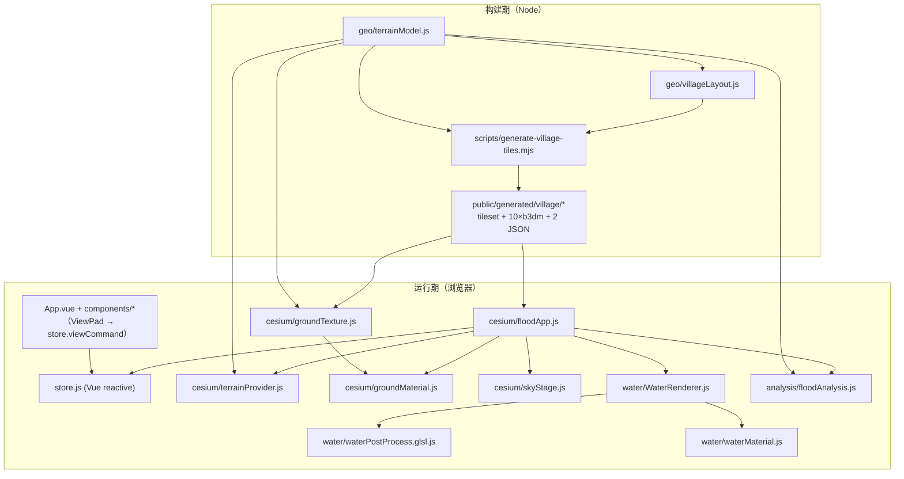

# 架构说明 · 潮线 TIDELINE

> 本文是 [`README.md`](../README.md) 的补充：把模块契约、初始化时序、状态所有权、坐标约定、生命周期与降级路径展开成"改代码前必须知道"的细节。
> 源码为准；接口约定见 [`INTERFACES.md`](./INTERFACES.md)。

## 1. 设计原则

| 原则 | 落地方式 | 收益 |
| --- | --- | --- |
| **单一数据源（Single Source of Truth）** | 地形只有一份：`src/geo/terrainModel.js` 的 `heightAtLocal()`。Cesium 地形 Provider、地表贴图、淹没统计、3D Tiles 落位全部调它 | 改地形后三处自动一致，不会出现"建筑悬空/统计对不上" |
| **纯函数、无框架依赖** | `terrainModel.js` / `villageLayout.js` / `floodAnalysis.js` 不 import Cesium，也不依赖 DOM（除 `loadGeneratedJSON` 用 `document.baseURI`） | 浏览器、Node、Worker 都能跑；生成脚本与运行时共用同一份逻辑 |
| **UI 与 Cesium 隔离** | UI 组件只 import `store.js`；Cesium 代码不写 Vue。桥只有 `createFloodApp({container, store})` 与 `store` | UI 可独立预览（`?preview`）、渲染可独立截图（`dev-entry.js`） |
| **构建期生成、运行期零网络** | 城市布局、10 个 b3dm（1067 栋）、建筑清单、道路在 `predev/prebuild` 生成；运行期只 fetch 本地 `public/generated/` | 静态可部署、无 token、无后端 |
| **失败降级、不白屏** | 3D Tiles 失败 → Entity 方块；材质失败 → 保留地形；水面失败 → 场景照常；整个 Cesium 失败 → `App.vue` 占位场景 + 全部 UI | demo 任何一层出问题都还能演示 |
| **状态单向流动** | UI 只写交互字段，渲染循环写运行字段（详见 §4） | 避免双向绑定导致的"谁改了水位"问题 |

## 2. 模块依赖图



依赖方向是单向的：`terrainModel` ← 所有消费者；`store` ↔ UI/`floodApp`；`floodApp` → 其余 Cesium 模块。**没有循环依赖**。

## 3. 初始化时序

`createFloodApp()` 是 `async`，内部严格串行（每一步都会推进 loading 进度）：

| # | 阶段 | 做什么 | loading | 失败时 |
| --- | --- | --- | --- | --- |
| 1 | 设置 `CESIUM_BASE_URL` | 若未设置，指向 `document.baseURI + cesium/` | — | 资源 404（检查 public/cesium） |
| 2 | 创建 Viewer | `baseLayer:false` + 程序化地形 + 关默认 UI/天空/雾/太阳 | — | 抛错 → `App.vue` 占位场景 |
| 3 | 天空 | `postProcessStages.add(createSkyStage())` | — | `?noSky` 可关 |
| 4 | 3D Tiles | `loadBuildingManifest()`（1067 栋）→ `Cesium3DTileset.fromUrl()`（root + 10 个 b3dm）→ 等 `initialTilesLoaded` 最多 5 s | 0.02 → 0.10 | Entity 方块兜底 |
| 5 | 地表 | `createGroundImagery()`（Canvas 2048px）→ `globe.material` | 0.15 → 0.75 | 无材质（地形只剩 `globe.baseColor`） |
| 6 | 分析 | `buildAnalyzer(buildings)` → `store.stats = compute(waterLevel)` | — | 统计为空（UI 用兜底数据） |
| 7 | 水面 | `new WaterRenderer(viewer, {...})` | — | 无水面（地形/建筑照常） |
| 8 | 交互 | `LEFT_CLICK` pick 建筑 + Cesium 原生相机（左键旋转/右键倾斜/滚轮缩放）+ 键盘/ViewPad（`store.viewCommand` watch） | — | 视角交互失效，预设仍可用 |
| 8.5 | 蓄水区 | `floodApp §6.6` 初始化：`zoneFrame`（ENU 基）、`zoneRenderTick`（preRender 更新材质时间）、`zoneMode/zoneLevel/zoneCommand` 三个 watch | — | 材质不可用 → 退回半透明纯色 |
| 9 | 每帧循环 | `requestAnimationFrame(tick)` 启动；水面 uniform 由 `scene.preRender` 回调节奏驱动 | — | — |
| 10 | 收尾 | `waitForGlobe()`（≤6 s）→ 等两帧 → 450 ms 后隐藏遮罩 | 0.85 → 1.0 | 超时也继续 |

> `?timing` 会在 console 输出每阶段耗时（`manifest/buildings/imagery/analyzer/water/globeTiles/ready`），排查"加载慢在哪一步"直接用它。
> 生产构建（1600×1000、M1 Max headless）实测累计：**manifest 82 / buildings 211 / imagery 1820 / analyzer 1831 / water 1871 / globeTiles 2552 / ready 2569 ms**——地表贴图生成（约 1.82 s）占首屏 71%。

**顺序上的两个硬约束**：

1. **天空 stage 必须先于水面 stage 添加**：后处理按 `add()` 顺序执行，水面 shader 的 `colorTexture` 里要包含天空，SSR 才能反射到真实天空（见 `docs/shader-port.md` §8.9）。
2. **`globe.depthTestAgainstTerrain = true` 必须在水面渲染前生效**：否则 Cesium 在 globe pass 之后清空深度，水面拿不到地形深度。`floodApp` 与 `WaterRenderer` 构造里都设了一次（幂等）。

## 4. 状态所有权

`store.js` 是唯一共享状态。**读写规则是硬约定**，新增字段时先决定归属：

### 4.1 UI → 渲染（只写这些）

| 字段 | 类型 / 范围 | 消费方 | 语义 |
| --- | --- | --- | --- |
| `targetLevel` | number 0–30 | `tick()` 平滑 | 目标水位（m，海拔） |
| `autoRise` | boolean | `tick()` | 自动上涨开关 |
| `riseSpeed` | number 0.1–3.0 | `tick()` | 上涨速度 m/s |
| `waveIntensity` | number 0–1 | `mapWaveParams` → uniforms | 波浪强度 |
| `waveSpeed` | number 0–2 | 同上 | 波浪速度 |
| `caustics` | number 0–1 | uniforms | 焦散强度 |
| `quality` | `'high'\|'medium'\|'low'` | `applyQuality()`、`WaterRenderer.setQuality` | 画质档（联动 resolutionScale / 地形 LOD / 后处理宏） |
| `waterEnabled` | boolean | `WaterRenderer.setEnabled` | 水面显隐 |
| `showBuildings` | boolean | `tileset.show` / 兜底 Entity.show | 建筑显隐 |
| `cameraPreset` | string（5 个 key） | `watch` → `flyTo` | 机位预设（全景/老城/河口/滨海/对比）；键盘 1~5 也写这里 |
| `viewCommand` | `{type:"orbit",dh,dp}` / `{type:"zoom",dir}` / `{type:"reset"}` | `watch` → `orbitCamera / zoomCamera / resetCamera` | ViewPad 等 UI 下发的视角指令（单向下发，每次新对象） |
| `zoneMode` | boolean | `watch` → `enterZoneMode/exitZoneMode` | 蓄水区框选模式（进入时关闭相机输入） |
| `zoneLevel` | number | `watch` → 重算 stats + 移动水面 | 蓄水区水位（ENU 米，海拔） |
| `zoneCommand` | `{type:"clear"\|"reselect"\|"cancel", seq}` | `watch` → `onZoneCommand` | UI 下发蓄水区操作（每次新对象） |
| `showInfo` | boolean | InfoModal | 说明弹窗 |

### 4.2 渲染 → UI（只写这些）

| 字段 | 写入时机 | 消费方 |
| --- | --- | --- |
| `waterLevel` | 每帧（平滑 `targetLevel`） | 顶栏/图例/滑块实际值/水面 |
| `fps` | 每 900 ms | FpsBadge |
| `stats` | 每 180 ms | StatsPanel / BuildingCard |
| `loading` | 初始化各阶段 | LoadingOverlay |
| `selectedBuilding` | `LEFT_CLICK` pick 时 | BuildingCard |
| `zone` | 框选完成 / `zoneLevel` 变化 | ZonePanel（只读）、App | `null` 或 `{minX,maxX,minY,maxY,level,stats}` |
| `zoneLevelRange` | 框选完成时（按框内地形算） | ZonePanel 滑块 | `[min,max]` |
| `error` | 初始化异常 | （预留） |

### 4.3 禁止

- UI 组件 **不要** `import * as Cesium`（打包体积与耦合都不可接受）；
- Cesium 模块 **不要** 直接改 UI 组件内部状态（只能写 `store`）；
- 不要在 `tick()` 里每帧写 `store.stats`（Vue 深层响应式 diff + DOM 重排，见 README §5.9 / §6）。

## 5. 坐标与单位约定

| 坐标 | 定义 | 换算代码 |
| --- | --- | --- |
| 场景局部米 | x=东、y=北，原点 `SCENE.lon0/lat0`；`HALF_W=7000`、`HALF_H=6000` | `lonLatToLocal` / `localToLonLat` |
| 经纬度（WGS84） | 度；14 km 尺度用平面近似 `M_PER_DEG_LON=99287`、`M_PER_DEG_LAT=110803` | 同上 |
| 海拔 | 米，海平面 0（椭球高近似）；`heightAtLocal()` 可返回负值（海床） | `heightAtLocal` |
| 城市局部米 | 相对**3D Tiles 根中心**（`VILLAGE.centerX/Y = -450,700`，沿用村庄中心）的 ENU 米；`buildings.json` 的 `localX/localY`；建筑中心分布 x[-1326, 2545]、y[-2239, 1155]（场景局部 x[-1776, 2095] y[-1539, 1855]，约 3.9×3.4 km） | `villageLayout.js` `VILLAGE_CENTER` |
| 3D Tiles 内容 | 相对根中心的 ENU 米，z=绝对海拔；`root.transform` = ENU→ECEF；整体 ENU bbox x[-1336.8,2625.0] y[-2246.8,1169.2] z[-0.1,196.4]，世界包围球中心 `120.051955,26.981455` 高 98.2 m、半径 2617 m | `buildTileset()` |
| glTF | Y-up；写入 GLB 前 `(X东,Y北,Z上) → (x=X, y=Z, z=−Y)` | `buildGlb()` |
| 波场单位 | 1 单位 = 10 m（`u_waveUnit`）；ENU `(x,y)` → 波场 `(x,z)` | `waterPostProcess.glsl.js` §5 |
| ECEF / ENU | Cesium 内部；`createSceneFrame()` 提供中心点与三基向量 | `groundMaterial.js` |
| 蓄水区矩形 | 框选点经 `pickPosition`/`pickEllipsoid` → `lonLatToLocal` 存**场景 ENU 米**；水面 = `RectangleGeometry` + `modelMatrix` 沿场景中心 ENU `up` 平移 `zoneLevel` 米（恒定椭球高平面） | `floodApp.js` §6.6 |

**单位陷阱**：

- `tilingScheme.tileXYToRectangle()` 返回**弧度**，`heightAtLonLat()` 期望**度**。这个 bug 曾让地形被拍平到 24.4 m、水面"完全不出现"（排查记录见 `docs/shader-port.md` §8.7）。
- `Cesium.Cartographic.fromDegrees()` 用度，`Rectangle.fromDegrees()` 用度，`Rectangle.fromCartesianArray()` 用弧度——Cesium 里两种都有，写代码时看清函数名。
- 水面 `u_waterLevel` 与地形高程必须用同一高程基准（本 demo 都是"椭球高近似"）。

## 6. 数据契约

### 6.1 `buildings.json`（运行时只读）

```json
{
  "generatedAt": "2026-11-04T…",
  "tileset": "generated/village/tileset.json",
  "villageCenter": { "lon": 120.04546768459113, "lat": 26.986317518478742 },
  "town": {
    "name": "澜屿市",
    "style": "mountain-foot old town + coastal harbor district",
    "districts": {
      "old":        { "name": "澜屿老城",   "centerLocal": { "x": 0,     "y": 0 },     "count": 233 },
      "west":       { "name": "西城片区",   "centerLocal": { "x": -700,  "y": -950 },  "count": 320 },
      "north":      { "name": "北城片区",   "centerLocal": { "x": 150,   "y": 700 },   "count": 200 },
      "harbor":     { "name": "澜屿港新区", "centerLocal": { "x": 1750,  "y": -200 },  "count": 263 },
      "cbd":        { "name": "滨海 CBD",   "centerLocal": { "x": 2150,  "y": -50 },   "count": 46 },
      "waterfront": { "name": "滨水公共带", "centerLocal": { "x": 1800,  "y": -1500 }, "count": 5 }
    }
  },
  "buildings": [
    {
      "id": "b-001", "name": "澜屿村文化礼堂", "type": "public", "kind": "public", "district": "old",
      "lon": 120.0436548, "lat": 26.9865341,
      "localX": -180, "localY": 24,
      "groundHeight": 8.75, "height": 18.9, "floors": 5,
      "footprintArea": 600, "rotation": 0.125, "minGround": 8.66
    }
  ]
}
```

| 字段 | 用途 |
| --- | --- |
| `type` | `house \| shop \| public \| pier`（schema 固定；公寓归 `shop`、地标归 `public`） |
| `kind` | `house \| shop \| apartment \| tower \| public \| landmark \| pier`（细分；UI/贴图/文档用） |
| `district` | `old \| west \| north \| harbor \| cbd \| waterfront`（六分区；分区统计与 b3dm 切分依据） |
| `localX/localY` | 相对根中心（村庄中心）ENU 米；与 3D Tiles 内容坐标一致；地表贴图/兜底 Entity 落位用 |
| `groundHeight` | 占地中心地面海拔（展示/兜底方块用） |
| `minGround` | 占地四角+中心的最低地基海拔；**淹没判定用** |
| `height/floors/footprintArea/rotation` | 详情卡、兜底方块尺寸、地表屋顶俯视色（本轮体量：民居 3–4F 10.6–13.9 m、商住 4–7F 14.1–27.7 m、公寓 10–18F 30.9–59.1 m、CBD 塔楼 20–40F 71.5–146.7 m、地标 18–52F 62.2–188.2 m） |
| `town` | 城市名/风格/六个分区的 `centerLocal` 与 `count`（仅元数据，分析不依赖） |

### 6.2 `tileset.json`（运行时只读）

- `asset.version = "1.0"`、`asset.tilesetVersion = "lan-yu-harbor-v2-seed20261104"`、`asset.gltfUpAxis = "Y"`；
- `root.transform` = 村庄中心 `eastNorthUpToFixedFrame`（列主序 16 个数）；
- `root.boundingVolume.box` = **相对 root.transform 的 ENU 米**（中心 + 三个半轴；整体 bbox 见 §5）；
- **多 tile 结构**：`root` 是**空节点**（无 `content`），`geometricError: 4096`，`refine: "ADD"`；下面挂 **10 个 children**（`city-old-west / city-old-east / city-west-north / city-west-south / city-north / city-harbor-west / city-harbor-mid / city-harbor-east / city-cbd-north / city-cbd-south`），每个 `geometricError: 0` + 自己的 `boundingVolume.box`（局部 ENU，+0.5 m padding）+ `content.uri` 指向对应 b3dm；
- 10 个 b3dm 的 `BATCH_LENGTH` 分别为 **119 / 114 / 196 / 124 / 200 / 127 / 71 / 65 / 41 / 10（合计 1067）**，batch table 8 个数组（`id/name/type/kind/height/floors/minGround/area`），**每个 tile 内部 `_BATCHID` 从 0 起**，全局 id 在属性里；10 个 b3dm 合计 **11,726,628 B（11.18 MiB）**。

### 6.3 `WaterRenderer` 对外契约

```js
new WaterRenderer(viewer, { store, centerLon, centerLat, sceneRadius, useTerrainDepth })
setWaterLevel(meters)            // 只改 uniform（+ Material 模式移动 modelMatrix）
setQuality('high'|'medium'|'low')// 重建 stage（textureScale 只读）
setWaveOptions({ intensity, speed, caustics })
setEnabled(bool)                 // stage.enabled / primitive.show
update(timeSeconds)              // 每帧：同步 store → 更新相机 uniforms
setMaterialMode('postprocess'|'material')
setDebugMode(n)                  // 0=最终画面；1..21/90+ 调试通道
getWaterLevel() / getQuality() / getStage() / isDestroyed
destroy()                        // 释放 stage / primitive / material
```

### 6.4 蓄水区（reservoir）契约与实现

**store 契约**（`src/store.js`）：

```js
zoneMode: false,           // 框选模式（UI 写；floodApp watch 进入/退出）
zone: null,                // 已框选区域（渲染层写）
                           // { minX, maxX, minY, maxY,   // 场景 ENU 米
                           //   level,                     // 蓄水水位（米，海拔）
                           //   stats: { areaKm2, waterAreaKm2, maxDepth, meanDepth,
                           //            volumeWanM3, buildingsTotal, buildingsFlooded,
                           //            terrainMin, terrainMax } }
zoneLevel: 0,              // 蓄水水位（渲染层初始化 / UI 写）
zoneLevelRange: [0, 100],  // 滑块范围（渲染层按框内地形算）
zoneCommand: null,         // UI → 渲染层：{type:'clear'|'reselect'|'cancel', seq}
```

**渲染层实现**（`floodApp.js` §6.6）：

| 步骤 | 实现 |
| --- | --- |
| 框选 | `zoneMode` watch → `enterZoneMode()`：`screenSpaceCameraController.enableInputs = false`、光标 `crosshair`、注册 `pointerdown/move/up` + `keydown(Esc)`；指针点用 `scene.pickPosition`（不支持时 `camera.pickEllipsoid`）→ `lonLatToLocal` → 场景 ENU |
| 生成 | 松手后 24×24 粗采样求 `minH/maxH` → 默认 `level = minH + clamp((maxH−minH)·0.35, 5, 80)`；`zoneLevelRange = [floor(minH−1), ceil(maxH+40)]` |
| 水面 | `Cesium.Rectangle.fromDegrees(...)` + `RectangleGeometry({ height: 0 })` + `Primitive` + `MaterialAppearance({ material: createWaterMaterial({stScale}), translucent: true })`；`stScale = max(60, widthM/7)` 让波场随矩形尺寸缩放 |
| 高度 | `zonePrimitive.modelMatrix = Matrix4.fromTranslation(Cartesian3.multiplyByScalar(zoneFrame.up, zoneLevel))`；`zoneLevel` watch 只改这个矩阵 + `material.uniforms.u_waterLevel` |
| 岸线 | 水面与地形做深度测试（`globe.depthTestAgainstTerrain = true`），地形自然露出形成岸线/岛 |
| 边线 | 4 角点 `clampToGround: true` 的 `PolylineGlowMaterialProperty`（`#6ef0ff`）；拖拽草稿线 `#ffd166` |
| 分析 | `computeZoneStats(zone, level)`：**64×64** 地形采样 → `areaKm2` / `waterAreaKm2` / `maxDepth` / `meanDepth` / `volumeWanM3 = Σ(depth·cellArea)/1e4` / 框内建筑（`VILLAGE.center + localX/localY` 落在矩形内，`level − minGround > 0.15` 记被淹） |
| 清理 | `zoneCommand` watch：`clear` → `store.zone=null` + `destroyZoneEntities()`；`reselect` → 清空后重新进入框选；`cancel` → 只退出框选 |

**性能**：水面只在「框选完成」时创建一次；`zoneLevel` 变化 = 移动 `modelMatrix` + 改 uniform + 一次 64×64 重采样（4,096 次 `heightAtLocal`），不重建几何。

## 7. 每帧循环

```js
function tick(now) {
  if (destroyed) return;
  rafId = requestAnimationFrame(tick);

  const dt = Math.min((now - lastTime) / 1000, 0.12);   // 钳制：切后台回来不瞬移
  lastTime = now;

  if (store.autoRise) { /* targetLevel += riseSpeed·dt，到 30 自动关 */ }

  // 指数平滑（一阶低通）：时间常数 1/3.2 ≈ 0.31 s
  const diff = store.targetLevel - store.waterLevel;
  if (Math.abs(diff) > 0.001) {
    const step = diff * Math.min(1, dt * 3.2);
    store.waterLevel = Math.abs(diff) < 0.01 ? store.targetLevel : store.waterLevel + step;
  } else if (store.waterLevel !== store.targetLevel) {
    store.waterLevel = store.targetLevel;
  }

  if (now - lastStatsTime > 180) {          // ≈5.5 Hz
    lastStatsTime = now;
    store.stats = analyzer.compute(store.waterLevel);
  }

  // FPS：900 ms 窗口取平均，取整数
  fpsAcc += dt; fpsCount += 1;
  if (now - fpsLast > 900) {
    store.fps = Math.round(fpsCount / Math.max(1e-3, fpsAcc));
    fpsAcc = 0; fpsCount = 0; fpsLast = now;
  }
}
```

> 注意 `analyzer.compute()` 与 `store.stats` 是 **5.5 Hz 低频**；**水面 uniform 不在 `tick()` 里更新**，而是挂在 `scene.preRender` 回调（与 Cesium 渲染同帧，避免相机矩阵晚一帧导致水面闪烁）：

```js
waterFrameListener = () => {
  water.setWaterLevel(store.waterLevel);      // 水位先同步（watcher 可能在微任务里晚于本帧）
  water.update(performance.now() / 1000);     // 相机 uniforms + store 同步
};
scene.preRender.addEventListener(waterFrameListener);
```

> 视角控制使用 Cesium 原生 `ScreenSpaceCameraController`：`rotateEventTypes=[LEFT_DRAG]`、`tiltEventTypes=[RIGHT_DRAG]`、`zoomEventTypes=[WHEEL]`、`lookEventTypes=[]`；键盘/ViewPad 经 `store.viewCommand` 进入。每帧 `preRender` 兜底夹高度 60–3600 m、pitch −77.3°~+5.7°，避免原生 tilt 把相机抬太高。
>
> 同一批 `preRender` 回调还有：`zoneRenderTick`（蓄水区材质 `u_time`）、`clampCameraLimits`（相机边界）。它们都按注册顺序每帧执行，与 `tick()` 的 rAF 循环相互独立（`tick` 只负责水位/统计/FPS）。

## 8. 生命周期与销毁

`dispose()`（`App.vue` 的 `onBeforeUnmount` 调用）必须按顺序做：

```js
destroyed = true;
cancelAnimationFrame(rafId);        // 1. 停循环
for (const unsub of unsubs) unsub?.(); // 2. 注销所有 Vue watch（含水 viewCommand）
handler.destroy();                  // 3a. 注销建筑 pick 的 ScreenSpaceEventHandler
// 3b. 注销 keydown / pointer 光标 / preRender 夹取监听
scene.canvas.removeEventListener('contextmenu', preventContextMenu);
window.removeEventListener('keydown', onViewKeydown);   // 3c. 键盘视角
scene.canvas.removeEventListener('pointerdown', onCanvasPointerDown);
scene.canvas.removeEventListener('pointerup', onCanvasPointerUp);
scene.canvas.removeEventListener('pointercancel', onCanvasPointerUp);
exitZoneMode();                                        // 3d. 蓄水区：退出框选（恢复相机输入 + 注销 pointer/Esc）
scene.preRender.removeEventListener(zoneRenderTick);   // 3e. 蓄水区材质时间
destroyZoneEntities();                                 // 3f. 移除水面 primitive + 贴地边线
scene.preRender.removeEventListener(clampCameraLimits); // 3g. 相机夹取
if (waterFrameListener) scene.preRender.removeEventListener(waterFrameListener); // 3h. 水面 preRender
water?.destroy();                   // 4. 释放水面 stage/primitive/material
for (const e of fallbackEntities) viewer.entities.remove(e);
if (groundTextureUrl) URL.revokeObjectURL(groundTextureUrl); // 5. 释放贴图 blob
viewer.destroy();                   // 6. 最后销毁 Viewer
```

常见坑：

- 先 `viewer.destroy()` 再 `water.destroy()` → 后处理集合已销毁，`remove()` 抛错；
- 忘记 `revokeObjectURL` → Canvas 贴图 blob 常驻内存（开发期 HMR 反复挂载会累积）；
- `App.vue` 用 `disposed` 标记 + `onBeforeUnmount` 里 `floodApp?.dispose()`，且 `bootScene()` 完成后若已 `disposed` 会立刻 dispose（防止"初始化还在 await 时组件已卸载"）。

**开发期注意**：Vite HMR 对 `src/cesium/**`、`src/water/**` 这类非 Vue 模块会触发**整页刷新**（不是热替换），所以调试期间看到页面闪一下是正常的；`?preview` 可以完全绕过 Cesium 只看 UI。

## 9. 失败降级矩阵

| 失败点 | 表现 | 兜底 |
| --- | --- | --- |
| `buildings.json` 缺失/为空 | 无建筑、统计为 0 | `loadBuildingManifest()` 返回 `null` → `buildings=[]`；UI StatsPanel 用示例数据兜底（仅显示层） |
| 3D Tiles 加载失败 | 1067 栋建筑消失 | `addBuildingFallback()` 用 Entity 方块按清单摆出来（边长 `sqrt(max(24, footprintArea))`、高度 `height`；1067 个 Entity 比 3D Tiles 慢，但保证不空场景） |
| `createGroundImagery()` 失败 | 地表无贴图 | 不挂 `globe.material`，地形只剩 `globe.baseColor`（`#0a1b22` 纯色，无高程色带） |
| `WaterRenderer` 创建失败 | 无水面 | `water = null`，其余照常；`debugFlags.noWater` 可主动关 |
| 蓄水区材质创建失败 | 蓄水区无 Seascape 水面 | `createWaterMaterial()` 抛错时退回 `Cesium.Color.fromCssColorString("#2f8fa8").withAlpha(0.62)` 的半透明平面（框选/分析仍然可用） |
| `createFloodApp()` 整体抛错 | 无 3D | `App.vue` 切 `.scene-fallback`（CSS 画的黄昏山谷）+ 全部 UI 可交互（80 ms 定时器模拟水位） |
| 地形 Provider 异常 | 地形错误 | `?flatTerrain` 用 `EllipsoidTerrainProvider` 排查 |

## 10. 调试入口

| 入口 | 用途 |
| --- | --- |
| `window.__floodApp` | 控制器：`viewer / flyTo / orbitCamera / zoomCamera / resetCamera / getAnalyzer / dispose` |
| `window.__floodStore` | 共享状态（生产构建也挂，方便排查） |
| `window.__floodReady` | 初始化完成标志（截图/验收脚本等待它） |
| `?timing` | 各阶段耗时 |
| `?noWater / ?noTiles / ?noSky / ?noImagery / ?flatTerrain / ?redGlobe / ?skyDebug` | 分层排查（README §1.3） |
| `WaterRenderer#setDebugMode(n)` | 水面中间量可视化（depth/距离/法线/coverage/…） |
| `window.__Cesium` | 调试用 Cesium 命名空间（材质/相机诊断） |
| `store.viewCommand = {...}` | 用命令方式驱动视角（ViewPad 同款通路） |
| `store.zoneMode / zoneLevel / zoneCommand` | 用命令方式驱动蓄水区（框选/水位/清除） |
| `store.zone` | 读取蓄水区矩形与统计（`stats.areaKm2 / volumeWanM3 / buildingsFlooded` …） |
| `window.__groundCanvas` | 地表贴图 Canvas（可视化检查色带/道路/建筑基底） |
| `node scripts/verify-prod.mjs` | 生产构建 **20 项**自动验收（6 项相机交互 + 2 项蓄水区） |

## 11. 写入边界（团队协作遗留约定）

`docs/INTERFACES.md` §0 定义了各模块 owner。文档交付后如果继续演进，建议保持：

- `src/geo/terrainModel.js` + `src/cesium/**` + `src/analysis/**` + `store.js` 由场景/集成负责人维护；
- `src/water/**` 由 shader 负责人维护；
- `src/components/**` + `App.vue` + `styles.css` 由 UI 负责人维护；
- `README.md` + `docs/*.md`（除 `shader-port.md`、`research/**`）由文档负责人维护。

接口变更（`store` 字段、`WaterRenderer` 方法、`buildings.json` schema）先改 `docs/INTERFACES.md`，再同步代码与文档。
