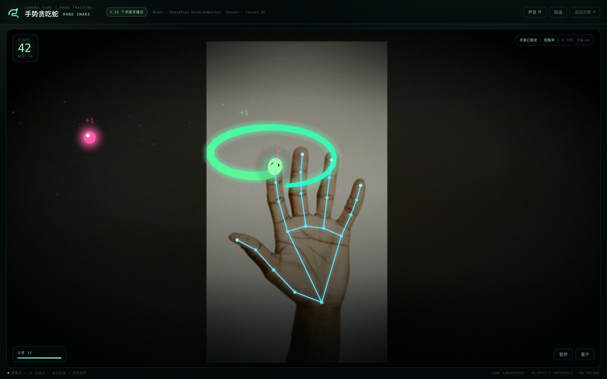

# 手势贪吃蛇 · HAND SNAKE

> 用摄像头玩的贪吃蛇：MediaPipe HandLandmarker 在浏览器里追踪 **21 个手部关键点**，
> **食指指尖就是蛇头**，伸手去吃画面里的光点，蛇会变长、变快；握拳暂停。
> 手部模型与推理全部在本机完成，画面不上传，没有后端。



| 能力 | 实现 |
| --- | --- |
| 手部追踪 | MediaPipe HandLandmarker（float16 模型，7.5 MB）+ WebAssembly / GPU delegate，在 Web Worker 内推理 |
| 控制 | 食指指尖（landmark 8）→ 蛇头目标点；镜头镜像与 cover 裁剪坐标都做了换算，骨架和画面里的手完全重合 |
| 手势 | 张开手掌控制；握拳约 0.5 秒暂停，重新张开约 0.5 秒继续 |
| 玩法 | 吃粉色光点 +1 分、长 3 节；每吃 5 个普通光点，下一个变成金色奖励光点（+5 分、长 5 节）；越吃越快 |
| 兜底 | 没有摄像头可切「鼠标模式」，同一套规则；开始界面、帮助弹窗、静音、重开、暂停齐全 |
| 视觉 | 霓虹蛇身 + 光晕 + 关节骨架 + 轨迹粒子 + 分数飘字；摄像头画面实时叠加 |
| 构建 | 纯静态、零 npm 依赖、无构建框架；模型随 app 入库，运行时复用合集已有 MediaPipe 资产 |

## 快速开始

```bash
cd apps/hand-snake

# 本地预览（先构建，再起零依赖静态服务器）
npm run dev            # → http://127.0.0.1:5188/

# 只构建
npm run build          # → dist/（约 33 MB，含手部模型与 WASM）
```

在合集根目录构建并预览：

```bash
cd ../..
node scripts/build-all.mjs --only hand-snake
npm run serve          # → http://127.0.0.1:5180/demos/hand-snake/
```

> 摄像头需要 **HTTPS 或 localhost**（浏览器安全策略）。本机 `127.0.0.1` 满足要求；
> GitHub Pages 默认 HTTPS，也满足要求。

## 怎么玩

1. 点「开启摄像头开始」→ 允许摄像头 → 等手部模型加载完（首次约 8 MB）→ 3 秒倒计时。
2. 把一只手掌完整放进画面，**伸出食指**。指尖在画面里移动，蛇头会跟着游过去。
3. 让蛇头碰到粉色光点：得分 +1，蛇长 +3 节。每吃 5 个普通光点，下一个是金色奖励光点。
4. **握拳**约半秒暂停；重新张开手掌约半秒继续。也可以按 `空格`/`P` 或点暂停按钮。
5. 没有摄像头？点「鼠标模式试玩」，移动鼠标控制蛇头。

键盘快捷键：`空格/P` 暂停继续 · `R` 重开 · `M` 静音 · `Esc` 关闭帮助。

## 实现说明

```
摄像头 <video>
   │  requestVideoFrameCallback（约 15 次/秒，限制在途请求）
   ▼
createImageBitmap  ──transfer──▶  Worker
                                    ├─ MediaPipe HandLandmarker（GPU / CPU delegate）
                                    └─ 21 个归一化关键点 + 左右手 + 检测耗时
   ◀────────────────────────────────┘
镜像 + cover 裁剪切换到舞台坐标
   ├─ 食指指尖 → 蛇头目标点（EMA 平滑）
   ├─ 张开 / 握拳 → 控制 / 暂停
   └─ 21 点骨架 → Canvas 2D 叠加
```

- **为什么用 Worker**：手部推理虽然是毫秒级，但同步 WASM/WebGL 计算仍会阻塞渲染；放到 Worker 后主线程只负责传帧、游戏循环和绘制，60 fps 不卡。
- **坐标对齐**：摄像头预览是镜像的（`scaleX(-1)`），且舞台通常不是 16:9，`object-fit: cover` 会裁切画面。`mapHandToStage()` 先按 cover 的缩放/偏移换算，再镜像 x 轴，保证骨架、蛇头、真实手三者对齐。
- **游戏循环**：蛇头以固定速度追指尖目标，身体段之间保持固定间距（拖绳模型），所以手停下来蛇也会自然收拢；吃食物时在尾部追加段数。
- **帧率**：手部检测约 12–15 FPS（GPU 单帧 24–30 ms），游戏渲染 60 FPS；指尖目标做平滑，低检测帧率下依然跟手。
- **没有死亡**：撞墙会从另一侧穿出，也没有自碰撞判定 —— 这是一个「伸手吃、越来越长」的放松向体感玩具，而不是硬核贪吃蛇。

## 静态部署与真实性边界

- 摄像头帧、手部关键点、游戏状态**全部在浏览器内**，没有后端、没有上传、没有外部 CDN。
- 手部模型（`hand_landmarker.task`）与 WASM 从本站加载，首次约 8 MB，之后走浏览器缓存。
- 没有摄像头 / 拒绝权限时会提示，并可用鼠标模式完整游玩；不会伪造手部数据。
- 摄像头权限需要 HTTPS 或 localhost；`file://` 直接打开会因浏览器安全限制无法使用摄像头。

## 资源来源与许可

- **MediaPipe HandLandmarker**：Apache License 2.0 — <https://ai.google.dev/edge/mediapipe/solutions/vision/hand_landmarker>
- **手部模型**：MediaPipe 官方模型页（float16 / latest），随本 app 的 `public/models/hand_landmarker.task` 入库。
- **MediaPipe Tasks Vision 运行时与 WASM**：复用 `apps/mecha-battle/public/mediapipe/`，浏览器端本地推理。
- **封面示意照片**：Pexels Photo #8058729（Pexels License，免费使用，无需署名）；
  仅用于封面/说明素材，实际运行时展示的是用户自己的摄像头画面。

## 验证记录（2026-11-06，Apple M1 Max / headless Chromium ANGLE Metal，fake camera）

| 场景 | 结果 |
| --- | --- |
| 摄像头 + 手部检测 | fake 摄像头播放手掌画面，`HandLandmarker` 稳定检出 1 只手，骨架与手掌关键点重合 |
| 手部检测性能 | 约 12–15 FPS；GPU 单帧 24–30 ms（60 fps 游戏渲染不受影响） |
| 控制 | 手部画面移动时蛇头目标随动（实测 2.5s 内目标位移 0.19 归一化坐标） |
| 吃与成长 | 食物放到蛇头附近后：分数 0→1、长度 6→9、HUD 同步更新 |
| 暂停 | 按钮暂停 → 继续 正常；握拳/张开手势逻辑已接入（阈值 0.5s） |
| 鼠标模式 | 无摄像头时正常游玩，同样可以吃食物成长 |
| 移动端 390×844 | 无横向溢出，开始界面与 HUD 正常 |
| 控制台 | 无 pageerror / console.error / 失败请求 |

## 目录结构

```text
apps/hand-snake/
├── index.html
├── src/
│   ├── app.js            # 摄像头、Worker 调度、手势、HUD、流程
│   ├── game.js           # 贪吃蛇状态机 + Canvas 渲染 + 手部骨架
│   ├── hand.worker.js    # HandLandmarker 推理 Worker
│   └── style.css
├── public/
│   ├── favicon.svg
│   ├── media/hand-poster.jpg        # 封面示意（Pexels）
│   └── models/hand_landmarker.task  # 手部 21 关键点模型（7.5 MB）
├── scripts/
│   ├── build.mjs         # 零依赖构建
│   └── dev.mjs           # 构建 + 静态服务器
└── screenshots/cover.jpg
```
