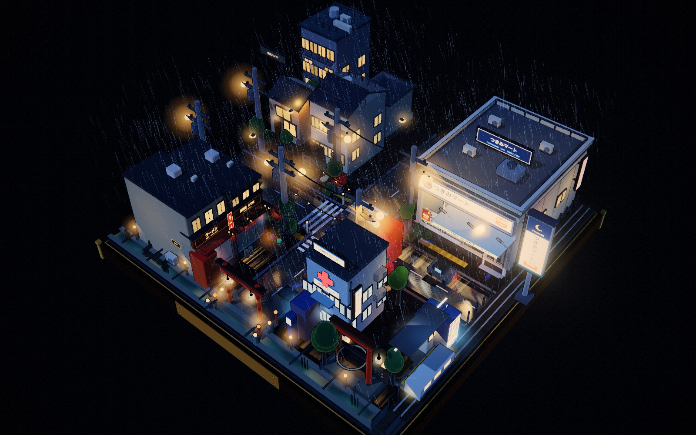

# 雨夜小镇 · RAINY TOWN

> 一座雨夜日式小镇的全景微缩模型：15×15 的胡桃木底座上，十字街、便利店、商店街、
> 住宅、学校、神社、小医院、车站与河流被压缩成一个可以被拿在手里看的「景观盒」。
> 三渲二卡通渲染、清晰描边、冷雨与暖光对比，可以自由拖拽 / 旋转 / 缩放，**没有任何 UI**。



## 当前版本做了什么

这是「小镇 v1」：先把整条街的**空间骨架、氛围和可探索性**搭起来，便利店延续原版完整内景。

**底座 / 街道**
- 15.2 × 15.2 的方形地块 + 胡桃木收藏底座、黄铜包边、铜铭牌「雨夜の小さな町」
- 十字路口、四向街道、斑马线、中心虚线、路缘石、排水沟、盲道、井盖、积水与真实湿路反射
- 南侧被切开的河道、两座桥（主桥 + 步行桥）、东侧被切到模型边缘的铁道与站台
- 持续降雨、屋檐滴水、地面涟漪、玻璃雨水、招牌微闪、自动门、雨雾光锥、关东煮/拉面/澡堂蒸汽

**东北 · 便利店（视觉焦点）**
- 完整保留原版的便利店外壳与内景：大面积玻璃、自动门、雨棚、灯箱、立柱招牌
- 透过玻璃能看到三排货架、饮料冷柜、便当区、关东煮、咖啡机、收银台、杂志架、海报与灯箱

**东南 / 西南 · 商店街**
- 居酒屋（红灯笼、暖帘、木格栅、灯笼串）与拉面店（暖帘、菜单灯箱、蒸汽、红灯笼），
  以微缩尺度立在主街西侧，面向街道
- 花摊、理发转灯、自动贩卖机、自行车、A 字菜单牌、路边小货车

**西北 · 住宅 + 学校**
- 两栋日式独栋住宅（坡屋顶 / 四坡屋顶、暖窗、庭院、信箱、围栏、空调）
- 三层小公寓（阳台、晾衣杆、信箱、屋顶水箱与天线）
- 月見町小学校（两层校舍、教室窗光、校门、操场与篮球架）
- 小公园（秋千、长椅、树）

**西南 / 东南 · 神社 + 医院**
-  elevated 石台上的小神社：鸟居、参道、石灯笼、拜殿、绘马架、注连绳、古树；
  桥头另有一座红色鸟居作为小镇入口
- 月見町クリニック：红色十字、招牌、暖光入口、侧窗、屋顶招牌

**东侧 · 车站**
- 月見駅：站台、站房、站名牌、时刻表、顶棚灯带、长椅、贩卖机、停靠的一节电车
- 铁道贯穿底座东侧边缘，带信号灯与围栏

**河流 / 街景**
- 河道、石砌河堤、桥头灯、芦苇、河岸栏杆与暖色小灯
- 电线杆与下垂电线、街灯、信号灯、街名牌、护柱、分类垃圾桶、邮筒、公共电话、猫

## 操作

- **拖拽**：环绕小镇旋转
- **滚轮 / 双指捏合**：缩放（从整座小镇到贴近便利店玻璃）
- 闲置 14 秒后极慢自动环绕，一动鼠标就停
- **无任何按钮、文字覆层或 loading UI**

## 开发

```bash
npm install
npm run dev       # http://127.0.0.1:5210
npm run build     # 产物 dist/，相对路径，可放任意子目录
```

截图自检：`node tools/shot.mjs --url "http://127.0.0.1:5211/?view=hero&still=1" --out screenshots/cover.png`
（视角：hero / front / shops / homes / shrine / rail / top / inside / back；`?t=秒` 跳到动画时刻）

## 目录

```
src/
├── main.js               # 渲染器 / 相机 / 灯光 / 后期 / 主循环
├── config.js             # 小镇布局、调色板、品牌、相机预设（唯一尺寸真源）
├── lib/
│   ├── toon.js           # 卡通材质、轮廓光、描边、辉光
│   ├── kit.js            # 几何缓存与摆件工具
│   ├── textures.js       # 程序化 Canvas 纹理库
│   └── post.js           # Bloom + 最终调色 / 颗粒 / 移轴
└── world/
    ├── base.js           # 胡桃木底座 / 铜牌 / 黄铜包边
    ├── ground.js         # 十字街 / 反射湿路 / 河 / 铁道 / 积水
    ├── store.js          # 便利店外壳 / 玻璃 / 自动门 / 招牌
    ├── interior.js       # 店内基础布局与陈列
    ├── interior-details.js # 店内细节层
    ├── shops.js          # 街版店铺构件（居酒屋、拉面、古书…）+ 道具
    └── town.js           # 小镇：住宅 / 学校 / 神社 / 医院 / 车站 / 河岸 / 街道家具
```

## 已知取舍（v1）

- 目前商店街只落地了**居酒屋、拉面**两家（书店 / 理发 / 花店 / 药店 / 咖啡馆 / 洗衣店 / 百元店仍待第二轮）。
- 住宅区为 **2 栋独栋 + 1 栋小公寓**（目标 5–8 栋），学校体育馆/操场看台、医院完整大厅内景尚未展开。
- 只有便利店保留**完整内景**；其余建筑采用「外观 + 亮窗 + 招牌 + 简化内景」的微缩模型做法。
- 神社/车站/医院等作为地标级体量，不追求逐房间内景。
- 雨、涟漪、玻璃水痕、自动门、招牌闪烁等氛围动效沿用原版；灯笼摆动、猫的走动、列车/显示屏变化
  列入下一轮。

## 技术

- 纯静态 Three.js（r170），零外部贴图：所有模型与招牌均由代码 + Canvas 程序化生成。
- 湿路 Reflector + 自定义湿沥青 shader；HDR → UnrealBloom → 自写最终 Pass（ACES 逼近 / 冷阴影暖高光 / 移轴 / 暗角 / 颗粒 / 色散）。
- 三渲二：MeshToonMaterial + 4 阶 gradient map + 菲涅尔轮廓光 + 背面外扩描边。
- 雨 / 涟漪 / 滴水 / 蒸汽都是 GPU 实例化或 shader 动画，update 不产生新对象。
