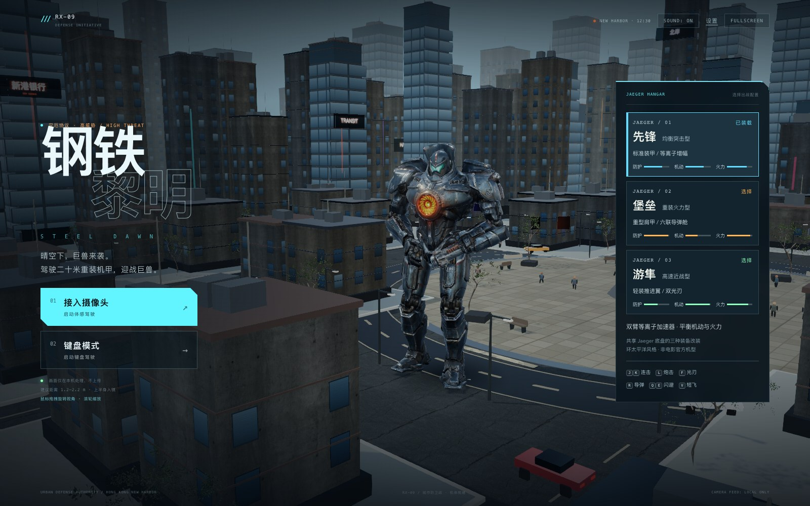
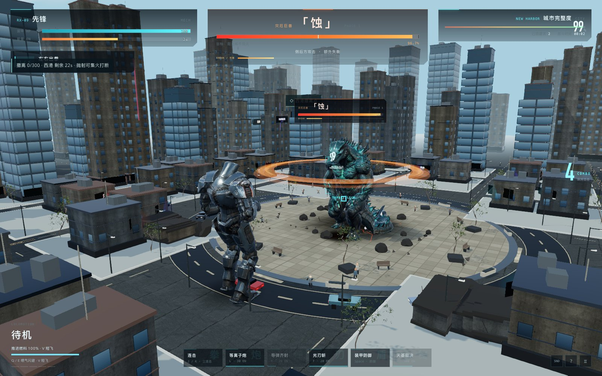

# 钢铁黎明 · 环太平洋机甲对战（STEEL DAWN）

浏览器里的 3D 机甲 Boss 战。驾驶二十米重装机甲 **RX-09**，在新港市迎战巨兽「蚀」。
Three.js 渲染 + 60 Hz 固定步长战斗模拟 + 骨骼动画 + 可破坏城市；支持**摄像头体感驾驶**
与**键盘完整操作**，纯前端、零后端、静态托管即可运行。





## 这是什么

这是 demo 合集里的 `mecha-battle` 作品，源码位于 `apps/mecha-battle/`，构建后部署在
**`/demos/mecha-battle/`** 子路径下。核心玩法：

- 二十米级 Jaeger 对战二十五米级 Kaiju，三套装备改装（先锋 / 堡垒 / 游雉）共用同一具
  Jaeger 底盘，定位、机动与火力各不相同。
- 三连击（左拳 / 右拳 / 重击）、等离子炮、导弹齐射、光刃斩、装甲防御、精准格挡、
  喷气短飞与天基裁决；持续输出可打满 BREAK 条让巨兽失衡。
- 巨兽会追击、出招、换阶段；地裂、突进、熔岩喷发可破防。装甲或城市完整度归零即失败，
  击倒巨兽即胜利，结算含战斗用时、连击、伤害、建筑损毁与城市完整度。
- 白天新港市大面积街区，外围高楼可受损倒塌，含三个建筑撤离任务与三档难度。
- 体感模式为**纯本地 MediaPipe 推理**（Web Worker + WASM），摄像头画面只在浏览器内存中
  处理，不上传、不落盘。

## 操作

### 键盘（完整可玩）

| 按键 | 功能 |
| --- | --- |
| `W A S D` | 移动 / 走位 |
| `Shift` | 奔跑 |
| `V`（按住） | 喷气短飞，松开降落 |
| `J` / `K` | 左拳 / 右拳（三连击，第三拳重击） |
| `L` | 等离子炮（30 能量） |
| `R` | 导弹齐射（20 能量） |
| `F` | 光刃斩（20 能量） |
| `空格` | 装甲防御 / 精准格挡 |
| `Q` / `E` | 左右闪避 |
| `U` | 天基裁决（100 能量） |
| `C` | 显示 / 隐藏摄像头小窗（体感模式） |
| `H` | 操作说明 |
| `Esc` | 暂停 |
| `X` / 鼠标双击 | 视角复位 |

### 鼠标（自由视角）

| 操作 | 功能 |
| --- | --- |
| 左键拖拽 | 绕机体旋转视角（主菜单与战斗中均可） |
| 右键拖拽 | 同上（已屏蔽浏览器右键菜单） |
| 滚轮 | 拉近 / 拉远镜头 |
| 双击 / `X` | 视角复位到标准战斗构图 |

战斗中停手约 3 秒，视角会自动缓慢回到标准战斗构图，避免转走镜头后看不清双方动作；
主菜单里转的角度会保留，方便先观察机体。

主菜单点击「键盘模式」即可直接出战；也可以先「接入摄像头」进入体感校准，再选择驾驶。

### 体感（上半身）

| 动作 | 功能 |
| --- | --- |
| 站定 / 左右倾身 | 移动、走位；快速侧倾触发闪避 |
| 左右手交替向镜头出拳 | 三连击 |
| 双掌同时前推并停留 | 等离子炮 |
| 双臂向两侧张开 | 导弹齐射 |
| 单臂高举过头 | 光刃斩 |
| 双臂交叉护胸 | 装甲防御 |
| 双手高举过头 | 天基裁决 |

### 体感权限与运行条件

- 摄像头只在 **HTTPS 或 localhost / 127.0.0.1** 下可用（浏览器安全上下文限制）。
- 首次进入体感校准会请求摄像头权限；授权后先做人物检测与玩家锁定，再识别肩 / 肘 / 手腕，
  站定约 1.2 秒完成校准后才会接入动作输入。追踪丢失会暂停体感输入，恢复后可继续。
- 不需要腿部入镜，半身即可游玩；建议距离摄像头 1.2–2.2 米、光线充足。
- 姿态模型与 WASM 全部随站点静态托管（本地约 48 MB），**不需要联网**；推理在本机完成，
  没有后台服务，摄像头数据不会离开浏览器。

## 静态化改动（相对源项目）

本目录由源项目 `~/Downloads/game` 的 **STEEL DAWN（legacy 入口）** 版本移植而来，
并按「纯静态站点 + 子路径部署」重新整理：

1. **入口替换**：源项目 `legacy.html`（`/src/main.js`，STEEL DAWN 版）改写为本目录
   `index.html`；标题/描述改为对外展示向。源项目根 `index.html` 指向的 EVA 版未采用。
2. **EVA 内容剔除**：`src/eva/`、`public/models/eva/`（约 77 MB 私有素材）、EVA 版音频
   （源项目从 EVA Battlefields APK 提取，原注释明确不可公开发布）、`tools/eva-import/`、
   EVA 专用测试 `tests/eva-source-assets.test.mjs` 全部移除；`src/audio.js` 中的 EVA 采样
   加载逻辑一并删除，音效全部改回 Web Audio 程序化合成。
3. **未引用重型素材删除**（均先 grep 确认无运行时引用）：`Xbot.glb`、`Godzilla.glb`、
   `RobotExpressive.glb`、`Demon.gltf`、旧基础模型 `Jaeger.glb` / `Kaiju.glb`、MediaPipe
   `pose_landmarker_lite.task`（仅 benchmark 用）、`vision_wasm_module_internal.*`
   （仅 ESM 引入方式使用，本作走经典 Worker）。
4. **子路径路径修复**：新增 [`src/assetPaths.js`](src/assetPaths.js)，用
   `import.meta.env.BASE_URL` 拼接运行时资源；模型、纹理、音频、MediaPipe worker / wasm /
   模型文件不再写死 `/models/...` 这类站点根绝对路径。`vite.config.js` 保持 `base: './'`，
   HTML 中的 JS/CSS/favicon 均为相对引用。构建产物 `dist/index.html` 内没有任何
   `src="/..."` / `href="/..."` 绝对引用。
5. **开发资产剥离**：源项目的 `native/`、`archive/`、`output/`、`assets/animation/` 原始
   Blender 工程、开发截图与浏览器 smoke 脚本不随本移植分发；`docs/` 保留与 STEEL DAWN
   相关的历史开发记录（版本演进与验收说明）。
6. **体积**：`dist/` 约 **69.8 MB**（源项目含 EVA 素材时 `public/` 就近 180 MB）。

### 构建体积构成（dist ≈ 69.8 MB）

| 部分 | 大小 | 说明 |
| --- | --- | --- |
| `mediapipe/` | 约 47.9 MB | WASM 26.7 MB（SIMD + 非 SIMD 回退）、姿态模型 9.1 MB、人物检测 13.1 MB、worker/bundle |
| `models/` | 约 11.2 MB | `JaegerMotion.glb` 5.2 MB、`KaijuMotion.glb` 4.9 MB、行道树 1.1 MB |
| `textures/` | 约 5.3 MB | Poly Haven CC0 场景贴图 + Kenney 粒子贴图 |
| `assets/` | 约 5.4 MB | three.js / Rapier / 游戏逻辑打包产物（JS 约 5.1 MB，CSS 54 KB） |
| 其余 | < 0.1 MB | `index.html`、`favicon.svg`、许可文本 |

## 开发与构建

需要 Node.js（Vite 7 建议 Node 20.19+，本机验证使用 Node 24）。

```bash
npm install        # 安装依赖
npm run dev        # 开发服务器 http://127.0.0.1:5190
npm run build      # 生产构建，输出 dist/
npm run preview    # 预览构建产物 http://127.0.0.1:5191
npm test           # 单元测试（node --test，65 项）
```

如需在合集层面按真实子路径验证：

```bash
# 在仓库根目录运行
node scripts/serve-app.mjs apps/mecha-battle/dist /demos/mecha-battle 5281
# → http://127.0.0.1:5281/demos/mecha-battle/
```

部署时把 `dist/` 整个目录放到 `/demos/mecha-battle/` 即可，所有资源均为相对路径。

## 验证记录

- `npm test`：**65 / 65 通过**（体感手势、玩家追踪、战斗时序、弹道、固定步长、物理碰撞等）。
- `npm run build`：成功；`dist/index.html` 无绝对路径引用。
- 子路径验证（`/demos/mecha-battle/` + `scripts/serve-app.mjs` 端口 5281）：
  - 菜单/机甲正常渲染（`screenshots/cover.jpg`，1600×1000）；
  - Playwright 点击「键盘模式」→ 跳过过场 → `game.state === 'playing'`，按 J/K/L/R/F/U/V 等
    键无异常，HUD 正常（`screenshots/battle.jpg`）；
  - 严格截图（`scripts/shot.mjs --strict`）无 `pageerror`、无 `console.error`；
  - MediaPipe：Web Worker 初始化成功（CPU · Worker），wasm / pose task / person detector
    均从子路径 200 加载。无头浏览器软件渲染下游戏内摄像头初始化可能超出 60 秒预算而报
    「Inference init timed out」，属于无头环境帧率限制；真实浏览器（GPU）不受影响。
- 已知的验证环境噪音：零依赖静态服务 + 无头软件渲染下，偶发一条 `tree.glb`
  `net::ERR_ABORTED`，但 HTTP 响应为 200、字节数正确且模型实际加载；`vite preview`
  下 3/3 次无此现象，不涉及 404 或资源缺失。

## 目录结构

```
apps/mecha-battle/
├── index.html            # STEEL DAWN 入口（原 legacy.html）
├── src/
│   ├── main.js           # 渲染管线 / 渲染循环 / 自适应画质
│   ├── game.js           # 战斗状态机、Boss AI、命中结算、镜头
│   ├── assetPaths.js     # BASE_URL 资源路径工具（子路径部署）
│   ├── audio.js          # Web Audio 程序化音频
│   ├── ui.js / style.css # HUD、菜单、结算与样式
│   ├── pose/             # 本地 MediaPipe 体感推理、玩家锁定、手势识别
│   ├── world/            # 城市、角色、机甲装备、特效、碰撞、VFX
│   ├── combat/           # 战斗时序、弹道、平衡、技能时间线
│   ├── runtime/          # 固定步长模拟、本地存档
│   └── input/keyboard.js # 键盘输入
├── public/               # 运行时静态资源（模型 / 贴图 / MediaPipe / 许可文本）
├── scripts/              # sync-vision-worker.mjs（构建前同步 MediaPipe worker bundle）
├── tests/                # 65 项 node --test 单元测试
├── docs/                 # STEEL DAWN 历史开发记录（版本演进 / 战斗与动作验收）
├── screenshots/          # cover.jpg / battle.jpg
├── CREDITS.md            # 素材来源与许可说明
└── dist/                 # npm run build 产物（静态托管用）
```

## 素材许可提醒（重要）

- **机甲 / 巨兽模型**来自公开项目
  [pacific-rim-larp](https://github.com/hihicode-weeee/pacific-rim-larp)，**其模型许可证未经核实**；
  上游仓库未单独声明授权。公开下载不等于可自由再分发。本作仅将其作为用户本地私人的
  非商业项目素材使用，**对外公开（尤其商用）前请自行确认素材权利，或替换为自有授权素材**。
  运行时派生模型为 `JaegerMotion.glb` / `KaijuMotion.glb`。
- **EVA Battlefields 私有素材已被完全剔除**，构建产物不包含任何 EVA 派生资源。
- 音频全部为 Web Audio 程序化合成，不含外部音频文件。
- MediaPipe（Apache-2.0）、three.js / three.quarks / Vite（MIT）、Poly Haven 贴图与 HDR、
  Kenney 粒子贴图（CC0）等许可明细见 [CREDITS.md](CREDITS.md)。

## 相关文档

历史开发记录保留在 `docs/`（内容来自源项目，部分脚本/截图未随本移植分发）：

- [网页运行时升级](docs/WEB-RUNTIME-V11.md)、[重量与攻击承诺](docs/iterations/HEAVY-COMBAT-V14.md)
- [五轮实施与验证记录](docs/iterations/FIVE-ROUNDS-V13.md)、[城市交互与街道物件](docs/iterations/LIVE-CITY-V19.md)
- [体感格斗与开源技术调研](docs/OPENSOURCE-MOTION-VFX-RESEARCH.md)、[体感与原生迁移路线](docs/MOTION-AND-NATIVE-ROADMAP.md)
- [角色动作验收](docs/CHARACTER-V10.md)、[战斗质量样板](docs/COMBAT-QUALITY-V12.md)
