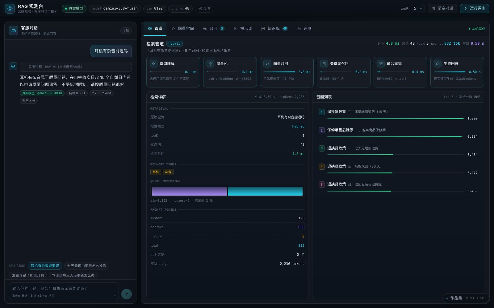

# RAG 观测台 · 客服对话可视化

> 把 RAG 的每一步摊开给你看：**查询理解 → 向量化 → 向量召回 → 关键词召回（BM25）→ RRF 融合 → Prompt 拼装 → 真实大模型流式生成**。
> 一个电商（虚构的「云岭商城」）在线客服机器人 Demo：8 篇客服知识库、48 个检索块、
> 浏览器内确定性哈希向量 + BM25 双路召回、6 个可视化页签。
>
> 知识库、切块、向量/BM25/RRF、PCA、Prompt 拼装、引用解析**全部在浏览器内真实运行**；
> 回答由**真实大模型**流式生成 —— 本地预览服务器只提供一层极薄的模型转发（注入 Key、绕开 CORS、透传 SSE），
> 不是 RAG 后端，检索与 Prompt 都不在服务端。

本目录来自 `~/Web/LearningDemo/rag-cs-demo` 的移植版本，保留原有服务器模式（`server.js`），
并提供**浏览器构建版**：`npm run build` 产出的 `dist/` 是纯静态产物，检索管线（切块 / 向量化 /
召回 / 融合 / Prompt 拼装 / 评测）全部在浏览器内运行，可嵌套部署到 `/demos/rag-lab/`；
真实生成由本地预览服务器的 `/api/llm/chat/completions` 同源转发完成。



---

## 两种运行模式

| | 服务器模式 | 浏览器构建版 |
| --- | --- | --- |
| 启动 | `npm start` → `http://127.0.0.1:8900` | `npm run build` → `dist/`，由本地预览服务器托管 |
| 检索管线 | Node 进程内（`rag/`） | **浏览器内**（`web/js/engine/`） |
| 接口 | 真实 `GET/POST /api/*` + SSE | `web/js/browser-api.js` 本地实现同名同结构接口 |
| 生成 | 真实大模型（读本目录 `.env` 的 Key） | 真实大模型：同源 `POST /api/llm/chat/completions`，经本地服务器极薄转发 |
| 未配置 Key | 明确返回「未连接」，不生成回答 | 顶栏显示「未连接」，发送禁用，不生成回答 |
| 依赖 | Node ≥ 22.6，零 npm 包 | 无（纯 HTML/CSS/ESM）；真实生成需要本地预览服务器转发 |

同一套 `web/` 前端在两个模式间按 `window.__RAG_BROWSER_MODE__` 分流：
构建脚本只往 `dist/index.html` 注入一行 `<script>window.__RAG_BROWSER_MODE__ = true;</script>`，
服务器模式永远不会出现该标记，`api.js` 照旧 `fetch('/api/...')`；
浏览器构建版则由 `browser-api.js` 在本地完成检索与 Prompt 拼装，再经 `/api/llm` 转发真实模型。

---

## 浏览器构建版原理

```
构建时（Node，零依赖）
  kb/*.md ──rag/loader.js 解析──► dist/kb-data.json（8 篇文档 + 小节正文）
  kb/eval.json ──────────────────► dist/eval.json
  web/* ─────────────────────────► dist/*（相对路径，可嵌套部署）
  rag/{util,chunker,embedder,store,prompt}.js ──同步──► web/js/engine/

运行时（浏览器）
  fetch('kb-data.json') ──► 浏览器内切块（48 块）──► 哈希向量(8192d) + BM25 索引 + PCA 投影
  提问 ──► browser-api.js 内跑检索 ──► 生成 Prompt（[n] 证据块）──►
          同源 POST /api/llm/chat/completions ──► 本地预览服务器（注入 Key、CORS 绕行、SSE 透传）
                                                  ──► 模型网关 ──► 真实模型逐 token 流式返回
          ──► 回调事件：meta → retrieval → prompt → reasoning → delta* → done
```

- **检索算法与服务端逐字一致**：`web/js/engine/` 下的 `chunker / embedder / store / prompt / util`
  是 `npm run build` 从 `rag/` 单向同步的副本（构建输出会显示 updated/unchanged），
  改算法只需改 `rag/`，重新构建即可，不会出现两份实现漂移。
- **模型转发层为什么存在**：模型网关（OpenAI 兼容接口）通常不允许浏览器跨域直连
  （`OPTIONS` 预检被拒 / 没有 `Access-Control-Allow-Origin`），而且 API Key 一旦放进前端产物
  就等于公开。所以本地预览服务器（`scripts/serve-site.mjs`）提供**极薄的转发**
  `POST /api/llm/chat/completions`：只注入 `Authorization`、绕开 CORS、原样透传 SSE。
  它**不是 RAG 后端** —— 知识库、切块、向量/BM25/RRF、Prompt 拼装、引用解析仍然全部在浏览器里。
- **输出字段严格对齐 `docs/API.md`**：`getHealth / getKb / postRetrieve / postEval / streamChat`
  与服务器返回结构相同，因此 `app.js / chat.js / pipeline.js / eval.js / kb.js` 无需区分模式。
- **没有假答案兜底**：未连接真实模型时页面明确显示「未连接」，聊天发送禁用，不会生成任何伪造回答。

### 浏览器构建版的模型配置

本地预览服务器按以下优先级读取真实模型配置：
**进程环境变量 → `apps/rag-lab/.env` → `apps/agent-lab/.env`**（可直接复用 mini-opencode 的同一份网关配置）。

| 变量 | 默认 | 说明 |
| --- | --- | --- |
| `DEEPSEEK_API_KEY` | 空 | 真实模型 Key；不填则页面显示「未连接」 |
| `OPENAI_BASE_URL` | `https://api.deepseek.com` | 任何 OpenAI 兼容网关 |
| `RAG_MODEL` | `deepseek-flash` | 模型名需与 baseUrl 同家服务商 |
| `RAG_LLM_TIMEOUT_MS` | `120000` | 转发超时（毫秒） |

也兼容带 `RAG_LLM_` 前缀的同名变量（`RAG_LLM_API_KEY` / `RAG_LLM_BASE_URL` / `RAG_LLM_MODEL`）。
Key 只存在于本地 Node 进程：既不会进入 `dist/` 构建产物，也不会发给浏览器。

---

## 快速开始

### 浏览器构建版（推荐，接真实模型）

```bash
# 1) 配置真实模型（可跳过：直接复用 apps/agent-lab/.env 的同一份网关配置）
cd apps/rag-lab
cp .env.example .env          # 填 DEEPSEEK_API_KEY / OPENAI_BASE_URL / RAG_MODEL

# 2) 构建纯静态产物
npm run build                 # → dist/（知识库 + 前端资源，不含任何 Key）

# 3) 回仓库根目录预览（npm run serve 自动启用 /api/llm 模型转发）
cd ../..
npm run serve                 # → http://127.0.0.1:5180/demos/rag-lab/
```

单独预览一个 demo（验证 `/demos/rag-lab/` 子路径嵌套部署）：

```bash
# 仓库根目录；--llm 启用真实模型转发（不加则页面显示「未连接」）
node scripts/serve-app.mjs apps/rag-lab/dist /demos/rag-lab 5283 --llm
# → http://127.0.0.1:5283/demos/rag-lab/
```

验收断开态（确认没有模型时不会伪造回答）：

```bash
# 仓库根目录：--static 只起静态服务（Agent / RAG 都不连）；--no-llm 只关 RAG 模型转发
npm run serve -- --static     # 或 npm run serve -- --no-llm
```

纯静态托管：任意静态服务器都能托管 `dist/`（不依赖 Node、不依赖路由 rewrite，路径全部是相对路径）。
此时知识库、检索、向量空间、召回、Prompt、评测照常可看，但没有真实模型生成，页面显示「未连接」。

### 服务器模式（原始完整功能，仅真实模型）

```bash
cd apps/rag-lab

cp .env.example .env   # 填 DEEPSEEK_API_KEY（任何 OpenAI 兼容接口都可）
npm start              # → http://127.0.0.1:8900
```

服务器模式同样只接真实模型：没有可用 Key 时，健康检查与聊天接口会明确返回「未连接」错误，
页面给出对应提示，**不会降级成假答案**。

`.env`（本目录或环境变量）主要配置见下表；`.env` 已被 gitignore，不会进入静态产物：

| 变量 | 默认 | 说明 |
| --- | --- | --- |
| `DEEPSEEK_API_KEY` | 空 | 真实模型 Key；不填则明确提示未连接 |
| `OPENAI_BASE_URL` | `https://api.deepseek.com` | 任何 OpenAI 兼容网关 |
| `RAG_MODEL` | `deepseek-flash` | 模型名需与 baseUrl 同家服务商 |
| `RAG_EMBED_DIM` | `8192` | 哈希向量维度（构建时同样生效） |
| `RAG_TOP_K` | `6` | 默认召回条数（页面可切 3/5/8） |
| `RAG_REASONING_EFFORT` | `low` | 思考强度；留空 = 不发送该参数 |
| `PORT` / `HOST` | `8900` / `127.0.0.1` | 服务器监听地址 |

---

## 命令一览

| 命令 | 作用 |
| --- | --- |
| `npm start` / `npm run dev` | 启动服务器模式（`server.js`，真实模型；未配置 Key 时明确提示未连接） |
| `npm run build` | 生成浏览器构建版 `dist/`（同步引擎副本、生成 kb-data.json / eval.json、注入浏览器模式标记；不含任何 Key） |
| `npm run verify:live` | 真实模型端到端验收（Playwright：连 `/api/llm` → 浏览器本地检索 → 真实模型流式回答 → 引用；需先 `npm run serve`） |
| `npm test` | Node 单测（切块 / 检索 / 契约 / markdown 渲染 / 配置） |
| `npm run eval` | 命令行检索命中率评测（`--json` 可接 CI） |
| 根目录 `npm run verify:rag` | 等价于 `node apps/rag-lab/scripts/verify-live.mjs --shot`，需先 `npm run serve` |

`verify:live` 用法（先在仓库根目录 `npm run serve`）：

```bash
# 终端 A（仓库根目录）：起站点 + Agent 后端 + /api/llm 模型转发
npm run serve

# 终端 B（仓库根目录）
npm run verify:rag            # = node apps/rag-lab/scripts/verify-live.mjs --shot
# 或直接调用，可自定义 URL / 验收断开态
node apps/rag-lab/scripts/verify-live.mjs --url http://127.0.0.1:5180/demos/rag-lab/
node apps/rag-lab/scripts/verify-live.mjs --expect disconnected \
  --url http://127.0.0.1:5283/demos/rag-lab/      # 对应不带 --llm 的单 demo 预览
```

---

## 页面导览（6 个页签）

| 页签 | 你看到什么 |
| --- | --- |
| **管道** | 5 个检索阶段 + 生成阶段的耗时与细节；召回 Top-K；命中词高亮；Prompt token 分配 |
| **向量空间** | 全部 48 个块 PCA 二维投影散点（按文档上色）；查询脉冲星标与 Top-K 连线；缩放 / 平移 / 悬停 / 点击定位 |
| **召回** | Top-K 卡片详版：来源、小节、正文、vector / keyword / fused 三路分数条、chunkId |
| **提示词** | 真正发给模型的 system + user 消息、上下文块 `[n]` 标记、system/context/history token 堆叠条、实际 usage |
| **知识库** | 8 篇文档 → 48 个块的浏览与关键词过滤，每块 token / 字符数；浏览器构建版会标注「来自构建时生成的 kb-data.json」 |
| **评测** | 15 条真实口语问法的检索命中率回归：hit@1 / hit@3 / hit@k / MRR / 平均耗时；按需触发 |

对话区支持多轮、流式打字、`[1]` 引用角标（hover 看来源、点击跳到召回卡片）、停止生成、
清空对话、topK 切换（3/5/8）、推荐问题。顶栏显示模型连接状态：连上真实模型时显示
「真实模型」与模型名，未连接时显示「未连接」并给出启动提示。

浏览器内实测（内置评测集，检索在浏览器里跑）：hit@1 **93.3%** / hit@3 **100%** / MRR **0.967**，
平均检索耗时约 **4ms**（48 块，8192 维，Chrome/Apple Silicon），与服务端结果一致。

---

## 目录结构

```
apps/rag-lab/
├── server.js                 # 服务器模式 HTTP 层（静态资源 + /api/* + SSE；仅真实模型）
├── config.js                 # .env / CLI 参数解析；无 Key 时明确未连接
├── rag/                      # 服务端 RAG 内核（算法唯一来源）
│   ├── loader.js             # 读 kb/*.md（仅 Node）
│   ├── chunker.js            # 标题感知切块 + 重叠
│   ├── embedder.js           # 本地确定性哈希向量（8192 维）
│   ├── store.js              # 余弦 + BM25 + RRF + PCA 投影
│   ├── prompt.js             # system 规则 + [n] 上下文 + 历史截断
│   ├── llm.js                # OpenAI 兼容流式客户端（仅服务器模式）
│   └── index.js              # createRag 组装
├── web/                      # 两种模式共用的前端（原生 ESM，零依赖）
│   ├── index.html            # 相对路径；构建时注入浏览器模式标记
│   ├── css/                  # base / chat / viz / inspector
│   └── js/
│       ├── api.js            # 模式分流：服务器 fetch / 浏览器构建版 browser-api + /api/llm
│       ├── browser-api.js    # 浏览器构建版本地接口（health/kb/retrieve/eval/chat + 模型流）
│       ├── engine/           # 浏览器版检索管线（index.js 为浏览器门面，其余由 rag/ 同步）
│       └── app/chat/pipeline/scatter/citations/prompt/kb/eval/state/util.js
├── kb/                       # 8 篇客服文档 + eval.json（15 条评测集）
├── scripts/
│   ├── build-static.mjs      # npm run build：生成 dist/
│   ├── verify-live.mjs       # npm run verify:live：真实模型端到端验收
│   └── eval.js               # 命令行检索评测
├── test/                     # node --test 单测
├── docs/                     # API 契约（docs/API.md）与知识库说明
├── screenshots/cover.jpg     # 1600x1000 封面（管道页 + 对话）
├── dist/                     # npm run build 产物（gitignore，静态托管用）
└── README.md
```

---

## 如何重新生成数据

**改知识库**：编辑 `kb/*.md`（`# 标题` + `## 小节`），然后：

```bash
npm run build   # 重新解析 kb/*.md → dist/kb-data.json
```

构建时会同步引擎模块、重新生成评测数据集副本，并做产物自检（缺文件 / 绝对路径 / `.env` 泄漏都会中止）。
浏览器构建版的切块与建索引发生在**页面首次加载**时，所以 kb-data.json 只需要放文档正文。

模型网关配置不属于构建产物：只在本地预览服务器启动时读取（见上文「浏览器构建版的模型配置」）。

---

## 边界与已知局限

- **真实生成需要本地模型转发**：只上传 `dist/` 到纯静态托管时，检索、向量空间、召回、Prompt、
  评测都能看，但顶栏显示「未连接」、发送禁用，**不会生成回答**；要展示真实生成，请在仓库根目录
  `npm run serve`，或单 demo 预览时加 `--llm`。
- **转发层不是 RAG 后端**：`/api/llm/*` 只做 Key 注入、CORS 绕行与 SSE 透传；检索与 Prompt
  仍然在浏览器里。需要完整 Node 服务时用服务器模式（`npm start`）。
- **哈希向量不是语义模型**：口语化、同义词（「换个颜色」vs「换货」）仍靠 BM25 兜底；
  向量只解决字面相近问题。rerank / query rewrite / 多跳检索不在本 Demo 范围。
- **检索只拿最后一条用户消息去查库**：带代词的追问（「那运费谁出？」）召回会偏——上下文虽然进了
  Prompt，但没有参与检索；生产环境需要 query rewrite / 多轮检索。
- **服务器模式与浏览器构建版的配置来源不同**：服务器模式读本目录 `.env` / 环境变量；
  浏览器构建版的转发配置由本地预览服务器统一读取（`apps/rag-lab/.env`，其次复用 `apps/agent-lab/.env`），
  两边都只接真实模型，未连接时明确报错，不生成回答。
- 评测集 15 条只够做方向性回归，不足以证明泛化能力；客服知识库与「云岭商城」均为虚构示例。
- 知识库数据构建时内嵌进 `dist/kb-data.json`，改知识库需要重新构建（静态站点没有热加载）。
- 浏览器构建版的 `dist/` 不包含 `server.js / rag/ / test / scripts` 等源码，只有前端资源与数据；
  体积以 `npm run build` 末尾输出为准。
- **API Key 只存在于本地 Node 进程**：不会进入 `dist/`、不会发给浏览器；对外演示 / 截图时也不要暴露 `.env`。

---

## 契约与测试

- 前后端 / 内部模块契约见 [`docs/API.md`](docs/API.md)，字段级严格对齐；
  浏览器构建版的 `browser-api.js` 只是把同一契约实现在浏览器里，唯一区别是生成走 `/api/llm` 同源转发
  （SSE 事件顺序与服务器模式一致）。
- `npm test`：Node 原生 test runner，覆盖切块、向量、检索质量（hit@3 ≥ 0.9、hit@1 ≥ 0.6、
  平均耗时 < 50ms）、Prompt 拼装、SSE 契约、Markdown 渲染与配置解析。
- `npm run verify:live`：端到端验收 —— 子路径资源 200、无 console error、顶栏「真实模型」+ 模型名、
  浏览器本地知识库就绪（48 块）、5 段检索、真实模型流式回答、真实 token 用量、`[n]` 引用角标，
  并检查页面不再出现假数据文案；`--expect disconnected` 用于验收断开态（「未连接」提示、
  发送禁用、知识库仍可本地使用、不伪造回答）。
