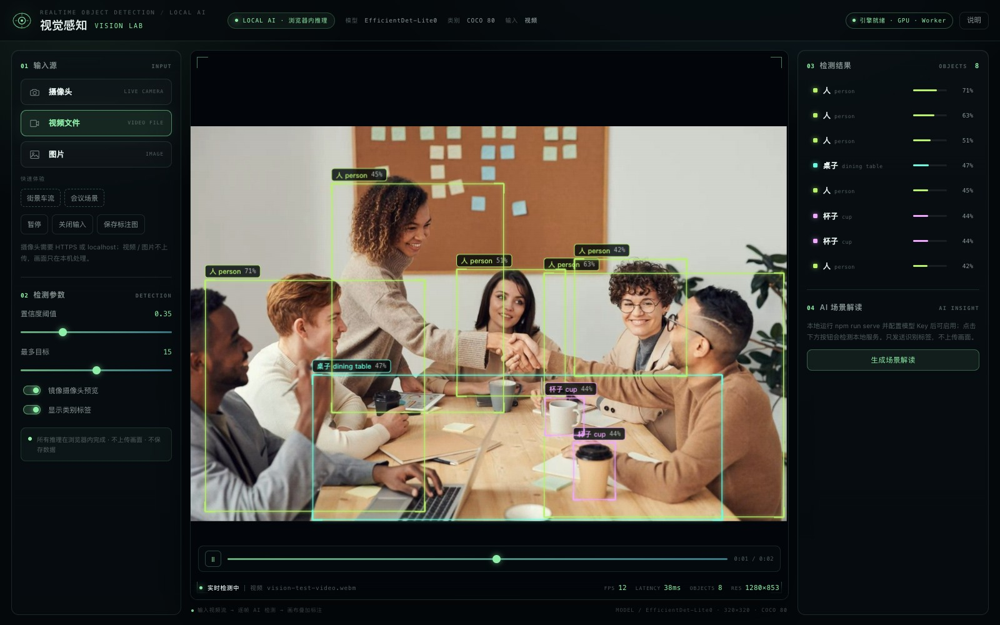

# 视觉感知 · VISION LAB

> 浏览器里的实时物体识别：**摄像头 / 视频文件 / 图片** 三路输入，MediaPipe EfficientDet-Lite0
> 在本地逐帧检测 COCO 80 类物体，画布实时叠加检测框；**零后端、零外部 CDN、画面不上传**。



| 能力 | 实现 |
| --- | --- |
| 输入源 | 摄像头实时流 / 本地视频文件（自动循环、可暂停拖动）/ 图片（单帧识别） |
| 模型 | MediaPipe Tasks Vision · EfficientDet-Lite0（COCO 80 类，320×320 输入） |
| 推理 | Web Worker 内 WASM 推理（优先 GPU delegate，失败回退 CPU），不阻塞视频与 UI |
| 叠加 | Canvas 2D 检测框 + 中文/英文类别 + 置信度；点击结果列表可高亮对应目标 |
| 参数 | 置信度阈值 0.15–0.9、最多目标 5–25、镜像预览、类别标签开关 |
| 附加 | 标注图下载、实时 FPS / 推理耗时 / 分辨率 HUD、示例图片、AI 场景解读（可选，本地服务） |
| 构建 | 纯静态产物，零 npm 依赖，无构建框架；`dist/` 可放在任意子目录 |

---

## 一、快速开始

```bash
cd apps/vision-lab

# 本地开发 / 预览：先构建，再起一个零依赖静态服务器
npm run dev            # → http://127.0.0.1:5187/

# 只构建
npm run build          # → dist/（约 39 MB，含模型与 WASM）
```

在合集根目录下构建并预览：

```bash
cd ../..
node scripts/build-all.mjs --only vision-lab
npm run serve          # → http://127.0.0.1:5180/demos/vision-lab/
```

> 摄像头需要 **HTTPS 或 localhost**（浏览器安全策略）。没有摄像头时，点「街景车流 / 会议场景」
> 两张示例图即可体验完整检测流程。

---

## 二、怎么玩

1. **选输入**：左侧「01 输入源」——摄像头 / 上传视频 / 上传图片；或点示例图。
2. **看框**：检测框颜色对应类别，右上角显示类别与置信度；右侧「检测结果」按置信度排序，
   点击某一条可以高亮画面中同类目标。
3. **调参数**：置信度阈值越高越严格，框越少；「最多目标」控制单帧输出上限。
4. **保存**：`保存标注图` 会把当前帧 + 检测框合成为 PNG 下载。
5. **AI 场景解读（可选）**：在项目根目录 `npm run serve` 且配置模型 Key 后，点击按钮会把
   **识别标签**（不含画面）发给本地模型网关，由模型用中文概括场景。静态托管时该功能显示未连接。

---

## 三、实现说明

### 3.1 检测管线

```
<video>/
   │  requestVideoFrameCallback（≈每秒 12–15 次，限制在途请求）
   ▼
createImageBitmap(video)  ──transfer──▶  Worker
                                          ├─ OffscreenCanvas.drawImage(bitmap)
                                          ├─ ObjectDetector.detectForVideo(canvas, ts)
                                          └─ 归一化检测框 → postMessage
   ◀──────────────────────────────────────┘
Canvas 2D 叠加检测框 + 右侧列表
```

- **为什么用 Worker**：目标检测是同步 WASM 计算（GPU delegate 单帧约 30–40ms，CPU 约 60–80ms），
  放主线程会阻塞视频播放和界面；放到 Worker 后主线程只负责传输帧与画框。
- **为什么限制在途请求**：始终只允许一帧在推理（`pending` 标志），避免慢设备上任务堆积导致延迟越来越大。
- **GPU / CPU**：Worker 里先尝试 `delegate: 'GPU'`，部分浏览器不给 Worker 提供 WebGL 时自动回退 CPU；
  顶栏「引擎就绪 · GPU/CPU · Worker」显示实际 delegate。
- **图像模式**：MediaPipe 的 `IMAGE` runningMode 是无状态图，每张图会重建计算图，单张约 200ms；
  实时视频/摄像头走 `VIDEO` 模式，无需重建，因此叠加更流畅。

### 3.2 构建方式（为什么没有 Vite）

这个 demo 故意做成**零依赖纯静态应用**：

- 运行时只有 `index.html + app.js + labels.js + style.css + mp/*`，不需要 npm 包；
- `scripts/build.mjs` 只做两件事：复制源码文件；从 `apps/mecha-battle/public/mediapipe/`
  复制 MediaPipe 运行时（`vision_bundle.js` / `wasm/`）与模型（`person_detector.tflite`）。
  这些资源在仓库里只存一份，避免重复提交 ~39MB 的二进制到 git。
- 因此 `npm install` 可跳过，GitHub Actions 构建也更快。

### 3.3 目录

```text
apps/vision-lab/
├── index.html                 # 页面结构（HUD / 面板 / 弹窗）
├── src/
│   ├── app.js                 # 主逻辑：数据源、检测循环、叠加、UI、AI 解读
│   ├── labels.js              # COCO 80 中英文标签 + 配色 + 位置描述
│   ├── detector.worker.js     # MediaPipe 推理 Worker（经典 Worker + importScripts）
│   └── style.css
├── public/
│   ├── favicon.svg
│   └── samples/               # 两张示例图（Pexels License）
├── scripts/
│   ├── build.mjs              # 零依赖构建
│   └── dev.mjs                # 构建 + 静态服务器
└── screenshots/cover.jpg
```

---

## 四、静态部署与真实性边界

- **物体检测完全在浏览器内完成**：模型、WASM、视频帧都不离开本机，不依赖任何后端；
  GitHub Pages / Nginx / OSS 等纯静态托管可以直接运行。
- **AI 场景解读**是可选增强：浏览器不允许直接跨域携带 API Key 调模型网关，因此它依赖
  合集根目录 `npm run serve` 提供的极薄 `/api/llm` 转发（见根 README「部署」）。
  纯静态环境下按钮会提示未连接，**不会伪造模型输出**。
- 摄像头功能需要 HTTPS；GitHub Pages 默认 HTTPS，满足要求。
- 模型只支持 **COCO 80 类**（人、车、常见动物/家具/食物等），不是通用开放词表检测；
  检测结果受光照、遮挡、距离影响，低置信度框不代表真实物体。

---

## 五、资源来源与许可

- **MediaPipe Tasks Vision**：Apache License 2.0 — <https://github.com/google-ai-edge/mediapipe>
- **EfficientDet-Lite0（COCO）**：来自 MediaPipe 官方物体检测模型页；运行时与模型文件复用
  `apps/mecha-battle/public/mediapipe/`，浏览器端为本地 WASM 推理。
- **示例图片**：
  - `samples/traffic.jpg` — Pexels Photo #210182
  - `samples/meeting.jpg` — Pexels Photo #3184291
  - 均按 **Pexels License** 使用（免费使用，无需署名；不从示例图主张额外权利）。
- 本 demo 的 UI 与代码为合集自有实现。

---

## 六、验证记录（2026-11-05，Apple M1 Max / headless Chromium ANGLE Metal）

| 场景 | 结果 |
| --- | --- |
| 图片（会议场景，COCO 80） | 识别到 9–11 个目标（人 / 杯子 / 桌子 / 键盘…），单张约 200ms（IMAGE 模式） |
| 视频文件（1280×853，本地 WebM） | 稳定 12–13 FPS，单帧推理 33–38ms，检测框随帧更新 |
| 摄像头（Chromium fake device） | 视频流正常接入，检测循环约 11 FPS，无异常 |
| 参数联动 | 阈值 0.35 → 0.7，检测数按预期减少；图片源自动重检 |
| 移动端 390×844 | 无横向溢出，控制面板纵向堆叠，检测正常 |
| 控制台 | 无 pageerror / console.error / 失败请求（AI 功能未触发网络请求） |
